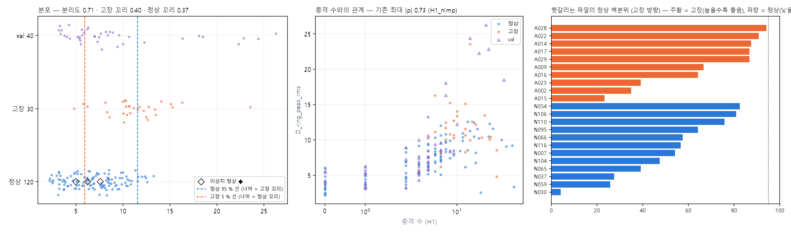

# D_ring_peak_rms — 대표 충격의 세기 ÷ 파일 RMS (채택 후보, D_K1과 같은 축)

**정의** (`src/dplus.py` `_ring_mean`, D+ 물리 블록)
- 1 kHz 고역 포락선에서 큰 봉우리 10개를 고르고, 200 Hz 고역 신호를 그 위치에 맞춰 부호를 정렬해 평균한다.
- **D_ring_peak_rms = 평균 파형의 첫 피크 ÷ 파일 표준편차**다. 충격이 없으면 0이다.

| 지표 | 값 |
|---|---|
| 분리도 (방향) | 0.71 (고장이 큼) |
| 고장 꼬리 / 정상 꼬리 | 0.40 / 0.37 |
| 헷갈리는 파일 안 분리도 | 0.40 |
| 지금 입력과 최대 \|ρ\| | 0.73 (H1), **D_K1과 0.79** |
| val 이동도 | 0.11 |
| ET OOF에 더하기 | PR-AUC 0.968 → 0.973, 헷갈림 0.52 → 0.58 |

**왜 쓸 만한가**
- "충격이 배경보다 얼마나 튀나"를 잰다. 지금 입력에는 충격의 **크기** 피처가 없다(휴대폰 2-32에서도 지적함). 첨도는 뾰족함이고, H1은 개수다.
- 헷갈리는 고장 A028 · A022 · A014 · A017 · A029를 85–95백분위로 올린다. A022를 올리는 것은 D_K1보다 낫다.

**주의**
- D_K1과 같은 축이다(ρ 0.79). 둘을 함께 넣으면 PR-AUC 0.975 · 헷갈림 0.62로, 하나만 넣었을 때보다 조금 낫다. 같은 축의 열이 늘면 그 축의 표가 커진다(4-13)는 점도 감안해야 한다.
- 헷갈리는 정상 N054 · N106 · N110도 75–82백분위로 올라간다.

**판정: 채택 후보 (D_K1의 대안 또는 짝).** 정식 실험에서 D_K1 단독과 둘 다 넣는 구성을 함께 비교한다.
