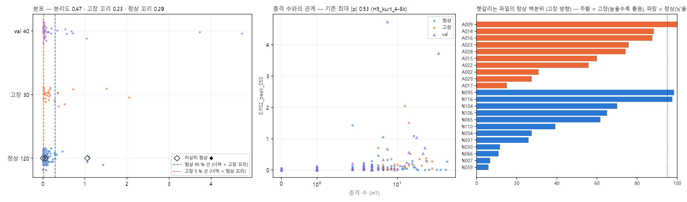

# E:P02_peak_050 — 5.0–6.25 kHz 대역 절대 피크 (기각)

**정의**: 5.0–6.25 kHz 4차 대역통과 신호의 max |x| (g)다.

| 지표 | 값 |
|---|---|
| 분리도 | 0.47 · 고장 꼬리 0.23 · 정상 꼬리 0.29 |
| 헷갈리는 파일 안 분리도 | 0.35 |
| 지금 입력과 최대 \|ρ\| | 0.53 (H5) |
| ET OOF에 더하기 | PR-AUC 0.968 → 0.968, 헷갈림 0.52 → 0.52 (**변화 없음**) |

**판정: 기각.** 관문 ①–④는 통과했지만 더해도 ET가 달라지지 않는다. 절대 크기라 게인에도 의존한다. 같은 대역의 정규화판(crest · 첨도)은 H5와 중복이다.
