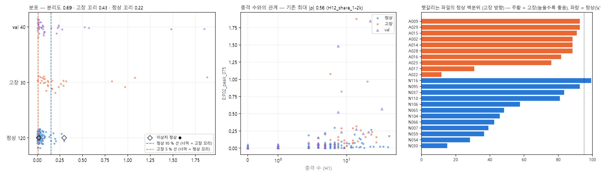

# E:P02_peak_075 — 7.5–8.75 kHz 대역 절대 피크 (보류: 게인 의존)

**정의** (`src/features.py` ext150 P02)
- 7.5–8.75 kHz 4차 대역통과 신호의 **max |x| (g, 절대 크기)**다.

| 지표 | 값 |
|---|---|
| 분리도 (방향) | 0.69 (고장이 큼) |
| 고장 꼬리 / 정상 꼬리 | 0.43 / 0.22 |
| 헷갈리는 파일 안 분리도 | 0.32 |
| 지금 입력과 최대 \|ρ\| | 0.56 (H12) |
| val 이동도 | 0.25 (후보 중 가장 큼) |
| ET OOF에 더하기 | PR-AUC 0.968 → 0.973, 헷갈림 0.52 → 0.58 |

**왜 보류인가**
- **절대 크기(g)라서 게인 · 차량 세팅에 따라 흔들린다.** 결정.md "게인: 절대값 추가 시 매번 하락(EXP-005)"에 걸리고, val 이동도도 후보 중 가장 크다.
- 같은 대역의 정규화판(P02_crest_075 · P02_kurtosis_075)은 H5와 \|ρ\| 0.88–0.89로 중복이다. 이 열이 주는 새 정보는 **절대 크기**뿐이다.
- 올려 주는 고장은 A009 · A029 · A015 · A002 · A014인데, A002 · A029는 8.3k 규칙이 이미 잡는다. 대신 N116(100백분위) · N095를 올린다.

**판정: 보류.** 쓰려면 게인을 지운 판(예: 이 대역 피크 ÷ 파일 1 kHz 위 RMS)을 새로 만들어 같은 관문을 다시 통과시켜야 한다.
