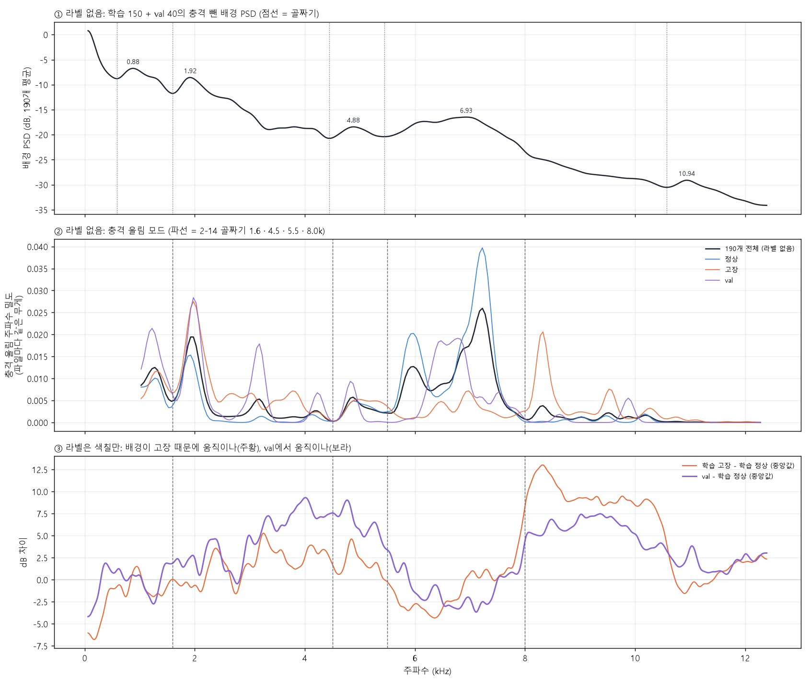
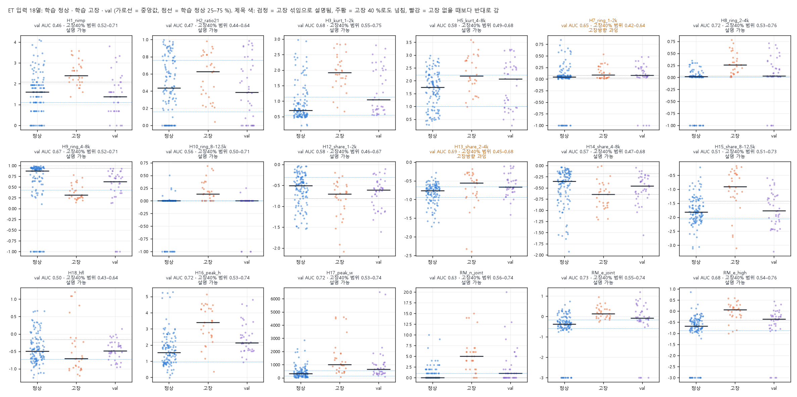
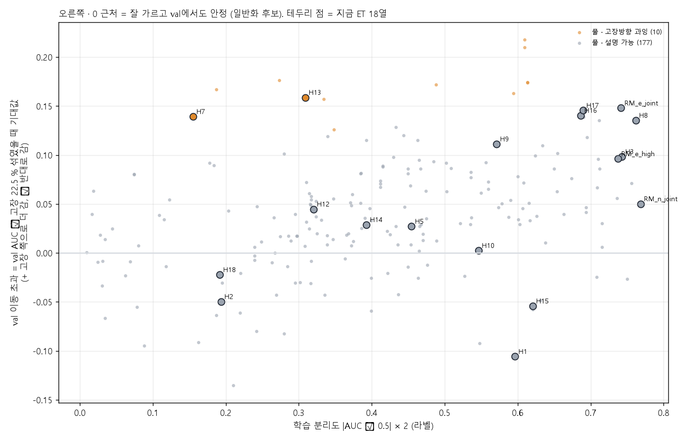

# 4-16 라벨 없는 지도 · val 이동 진단 (11-24)

상태: 1차, EDA만 함(모델 실험 없음). 코드 [run.py](run.py), 수치 [figs/결과.txt](figs/결과.txt), 열별 표 [figs/18열_이동.csv](figs/18열_이동.csv) · [figs/풀_이동.csv](figs/풀_이동.csv)

**목적**: 지금 모델의 정합성을 설명하고, val · test에서도 통하는 일반화된 피처를 찾는다. 여기서 "물리적으로 절대적인 피처"는 ① 학습 라벨로 정상과 고장을 가르고 ② val에서 측정 조건 때문에 움직이지 않는 피처를 뜻한다.
val은 **라벨 없이** 쓴다([판단차이 A13](../../1_기준·기록/판단차이.md), 사용자 11-24 결정).

**결론**

1. **대역 경계는 장비 구조로 볼 수 있다.** 190개 파일의 배경 PSD를 라벨 없이 모아 찾은 골짜기(1.60 · 4.44 · 5.44 kHz)가 충격 울림으로 따로 찾은 골짜기(2-14: 1.6 · 4.5 · 5.5)와 같다. 서로 다른 신호에서 같은 경계가 나왔으므로 라벨로 고른 경계가 아니다. 8.0 kHz 경계는 배경에서는 보이지 않는다.
2. **val은 측정 조건이 다르다.** val의 1.6–5.5 kHz 배경은 학습 정상보다 +4~7 dB 높다. 학습 고장의 배경은 +1.7~3.6 dB만 높으므로, val에 고장이 40 % 섞였다고 해도 이 차이는 설명되지 않는다. 또 val의 본체 모드 울림은 7.2 kHz가 아니라 6.5–7.0 kHz에 모여 있고, 1.2 · 3.2 kHz 봉우리가 새로 있다.
3. **지금 ET 18열은 대체로 안전하다.** 범위를 넘은 열은 H7(1–2k 울림 비율, 분리도 0.16)과 H13(2–4k 몫, 0.31) 두 개뿐이다. 둘 다 약한 열이고, 반대 방향으로 움직인 열은 없다. 강한 열(H8 · H16 · H17 · RM_e_joint)은 범위 안이지만 위쪽 끝에 있다(초과 +0.14 안팎).
4. **일반화되는 피처는 무차원 충격성 피처다.** 풀 187열 가운데 범위를 넘은 10열은 모두 절대 에너지(rms, 대역 크기)이거나 1.6–5.5 kHz의 몫 열이다. 반면 첨도 · 파고율 · 봉우리/σ · 충격 개수는 모두 안정적이다. 4-15의 1순위 **D_K1(두 번째 사건/σ)과 D_ring_peak_rms는 분리도 0.75 · 0.71이면서 val 이동이 가장 작다(초과 −0.03).**

## ① 라벨 없는 지도

- 위: 190개 파일의 충격 뺀 배경 PSD이다(충격 앞 5 ms ~ 뒤 30 ms를 덮는 조각을 뺀 Welch, 파일마다 같은 무게). 점선은 골짜기다.
- 가운데: 충격 울림 주파수의 밀도다. 검정은 라벨 없이 본 것이고, 색은 집단별로 나눈 것이다.
- 아래: 학습 정상의 중앙값에서 얼마나 벗어났나를 dB로 그렸다. 주황은 학습 고장, 보라는 val이다. 1.6–5.5 kHz에서 보라가 주황보다 높은데, 이것이 측정 조건 차이다.

| 대역 (배경 크기) | 학습 고장 − 정상 | val − 정상    | 판정               |
| ---------------- | ----------------- | -------------- | ------------------ |
| 0.2–1k          | −2.8 dB          | +1.7 dB        | 반대 방향 (조건)   |
| 연결부 1.6–4.5k | +1.7              | **+4.4** | 고장 40 %로도 넘침 |
| 전이 4.5–5.5k   | +3.6              | **+7.4** | 고장 40 %로도 넘침 |
| 본체 5.5–8k     | −3.1             | −3.6          | 설명 가능          |
| 고주파 8–12.5k  | +8.2              | +4.2           | 설명 가능          |

## ② 이동 진단 방법

- val AUC = P(val > 학습 정상)이다. 고장 쪽 값이 커지도록 방향을 뒤집었다.
- 같은 값을 "학습 정상에서 40개를 뽑되, 그중 p만큼을 학습 고장으로 바꿔 넣었을 때"(p = 0 · 0.225 · 0.4, 1000번)와 비교한다.
  - **고장 40 %로도 넘침**: p = 0.4일 때의 97.5 % 위로 나간 경우다. 조건 이동일 수도 있고 새 고장일 수도 있어서 애매하다.
  - **반대 방향(조건)**: p = 0일 때의 2.5 % 아래로 간 경우다. 고장으로는 생길 수 없으므로 조건 이동의 확실한 증거다.
- 적대 검증: ET로 학습 150 vs val 40을 갈라 본다.

| 18열                                        | 분리도     | 초과 (val − 고장 22.5 % 기대) | 판정             |
| ------------------------------------------- | ---------- | ------------------------------ | ---------------- |
| H7_ring_1-2k                                | 0.16       | +0.14                          | **넘침**   |
| H13_share_2-4k                              | 0.31       | +0.16                          | **넘침**   |
| H8 · H16 · H17 · RM_e_joint              | 0.69–0.76 | +0.13–0.15                    | 범위 안, 위쪽 끝 |
| H1 · H2 · H10 · H15 · H18 · RM_n_joint |            | −0.11–+0.05                  | 안정             |

- 적대 검증: 18열로 학습 vs val을 AUC 0.84로 가른다(학습 정상만 vs val이면 0.90). 열을 하나씩 빼도 AUC는 0.014 이하로만 줄어든다. 특정 열 하나 때문이 아니라 여러 열에 같은 원인(1.6–5.5 kHz 배경)이 퍼져 있다는 뜻이다.
- val 가운데 학습과 가장 달라 보이는 파일: 031 · 032 · 018 · 035 · 001.

## ③ 풀 전체: 분리도 vs 이동

- 오른쪽 아래 0 근처에 있는 열이 일반화 후보다(잘 가르면서 val에서도 안정적).
- 넘친 10열: P02_rms_037 · E01_env_rms_037 · P02_rms_087 · E01_env_rms_087 · B05_abs_mid · B04_ratio_03750 · F09_peak3_freq · D_ring_body · MS_연결부 · MS_전이. 모두 절대 크기이거나 몫이다.
- 안정적이면서 분리도 ≥ 0.7인 열: P02_kurtosis_012 · **D_K1** · SO_고주파÷본체 · P02_peak_025 · P02_crest_012 · **MK_연결부1.6-4.5k**(초과 0.006) · S01_cv_012 · **D_ring_peak_rms**.

## 해석과 다음

- **정합성 설명**: 경계는 라벨 없이 두 방법에서 같게 나온 모드 골짜기다. 모델의 주력 열은 무차원 충격성이고, val에서 조건 때문에 움직이는 것은 약한 열 두 개(H7 · H13)뿐이다. 이 세 가지를 발표 근거로 쓸 수 있다.
- **다음 할 일(3 · 4단계, 사용자 확인 후)**:
  1. 학습 라벨로 "고장만 우는 대역"을 고르되, 폴드마다 다시 골라도 같은 대역이 나오는지 확인한다.
  2. 18열을 D/L/P 등급과 이동 여부로 다시 분류한다. H7 · H13은 빼기 후보, H2는 분리도 0.19라 정리 대상이며 C4/C5와 비교한다.
  3. 1.6–5.5 kHz 에너지 열은 "같은 파일 · 같은 대역의 배경으로 나눈 충격 대 배경 비"로 바꾸는 것을 검토한다. 배경이 함께 올라가면 서로 상쇄되기 때문이다.
- **주의**:
  - "넘침"은 새 고장 유형일 수도 있다. 반대 방향만이 확실한 조건 증거다.
  - p = 0.225는 지금 모델의 val 판정(9/40)을 빌린 값이고, 판정에는 넉넉한 p = 0.4를 썼다.
  - 배경 조각이 4개 미만인 파일 4개는 가장 조용한 조각 4개로 대신 계산했다.
