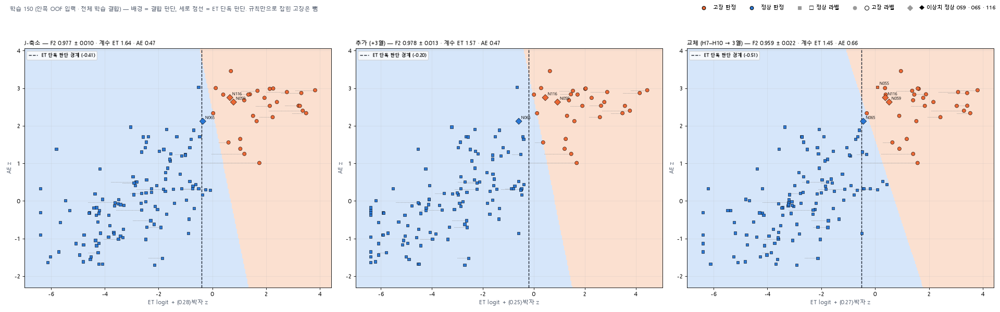
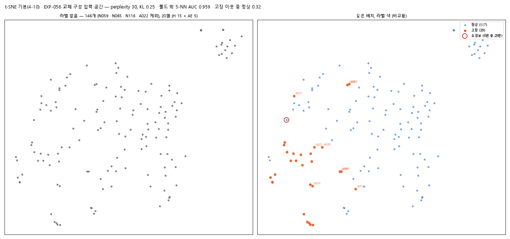
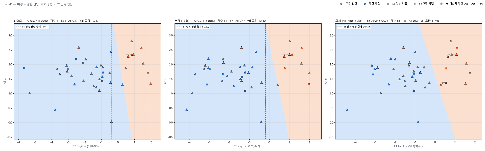

# EXP-056 울림 모드 피처 (2-14 후보) 추가 · 교체

노션 카드 (실험 DB에 그대로 옮긴다)

| 팀원 | 모델 | F2 점수 | 변경 사항 | 메모 |
|---|---|---|---|---|
| 이동훈 | J-축소 (ET 입력 = H 피처 ± 울림 모드 3열) + 박자 z + AE z → 로지스틱 OR E2 OR 8.3k | 0.959 ± 0.022 | 2-14 울림 모드 경계(1.6 · 2.2 · 4.5 · 5.5 · 8k, 라벨 없음)로 만든 3열을 ET에 추가 · H7–H10 교체. quick (H1, H2) | 울림 모드 3열은 오경보를 절반으로 줄이지만(0.042 → 0.021 · 0.025) 고장을 놓치기 시작해서(재현율 1.000 → 0.950) F2는 기준보다 낮다(0.968 → 0.944 · 0.941, 차이 > 기준 sd). |

## 주요 변경점 (기준 실험 대비)

- RM_n_joint 연결부 1.6–4.5k 충격 수
- RM_e_joint log √(E 2.2–4.5k ÷ E 5.5–8k), 큰 충격 20개 중앙값
- RM_e_high log √(E 8–12.5k ÷ E 5.5–8k)
- 추가 · 교체(H7–H10 뺌) 두 구성

- 가설: H1, H2 ([물리가설](../../../1_기준·기록/물리가설.md))
- 실행: 2026-11-23 · git `bd9a50a+수정중` · 코드 [run.py](run.py)
- 평가: 중첩 CV (바깥 5 × 안쪽 4) · 모드 seed 5 · ET 300. 자주 놓침 · 오경보 n회+ = seed 과반. quick 수치는 선별용, 기록 수치는 QE_FULL=1

## 결과

| 구성 | F2 | 재현율 | 오경보율 | 정밀도 | F2 (고장 10%·40%) | 자주 놓침 | 오경보 3회+ |
|---|---|---|---|---|---|---|---|
| 교체 (H7–H10 → 3열) | 0.959 ± 0.022 | 0.973 | 0.025 | 0.909 | 0.936 · 0.971 | — | 3 |

## 해석

정식 검증(full)에서 **추가(+3열)는 기준과 같은 점수에 오경보가 줄었다**(F2 0.978 ± 0.013 대 0.977 ± 0.010, 오경보율 0.030 → 0.022, 재현율 1.000 → 0.993). 교체(H7–H10 → 3열)는 0.959 ± 0.022로 낮다. quick(seed 2)에서는 추가도 0.944였다. seed 2개로는 판단이 뒤집힐 수 있다.

<!-- key-figs: 자동 (save_fig key=True) -->

*logistic_plane* — 기준 J-축소 · 추가 · 교체의 결합 경계 (학습 150)

*tsne_라벨* — 기본 t-SNE(4-10), 교체 구성 입력. 빨간 원 = 오경보

<!-- /key-figs -->

| 파일 (seed 5번 중 판정) | J-축소 | 추가 | 교체 |
|---|---|---|---|
| 고장 놓침 A028 · A022 · A009 | 0 · 0 · 0 | 1 · 0 · 0 | 1 · 2 · 1 |
| 오경보 N025 · N037 · N073 · N110 | 3 · 2 · 1 · 1 | 0 · 1 · 0 · 0 | 0 · 1 · 1 · 0 |
| 새 오경보 N054 · N030 · N002 · N027 | 0 | 1 · 1 · 0 · 0 | 4 · 0 · 1 · 1 |
| 이상치 N059 · N065 · N116 | 3 · 3 · 5 | 3 · 3 · 4 | 3 · 1 · 3 |
| val 고장 판정 | 10 | 10 (같음) | 11 (+V025) |
| 결합 계수 ET · 박자 · AE | 1.64 · 0.46 · 0.47 | 1.57 · 0.39 · 0.47 | 1.45 · 0.40 · 0.66 |

- **추가**: 본체 모드로 우는 오경보(N025 3 → 0)가 줄고 val 판정은 기준과 40개 모두 같다. 대신 A028을 5번 중 1번 놓친다. sd 안의 차이다.
- **교체**: 옛 울림 비율 H7–H10을 빼면 A022를 놓치기 시작하고(2/5) N054가 오경보가 된다(4/5). 새 3열이 옛 4열을 다 대신하지는 못한다.
- 단독 분리도: 연결부 충격 수 0.77 · 연결부 ÷ 본체 0.74 · 고주파 ÷ 본체 0.74 (H8 0.75).
- 오류분석_표.md는 한 번만 놓친 고장을 빠뜨린다(표 필터가 과반 기준). 위 표와 result.json이 정확하다.

## 그림

### val_판정
같은 경계 위의 val 40. 굵은 이름 = 기준과 판정이 다른 파일

## 중간 단계 결과 (비교 · 절제 · 이전 실험 값)

| 구성 | F2 | 재현율 | 오경보율 | 정밀도 | F2 (고장 10%·40%) | 자주 놓침 | 오경보 3회+ |
|---|---|---|---|---|---|---|---|
| J-축소 | 0.977 ± 0.010 | 1.000 | 0.030 | 0.895 | 0.949 · 0.991 | — | 4 |
| 추가 (+3열) | 0.978 ± 0.013 | 0.993 | 0.022 | 0.920 | 0.957 · 0.988 | — | 3 |