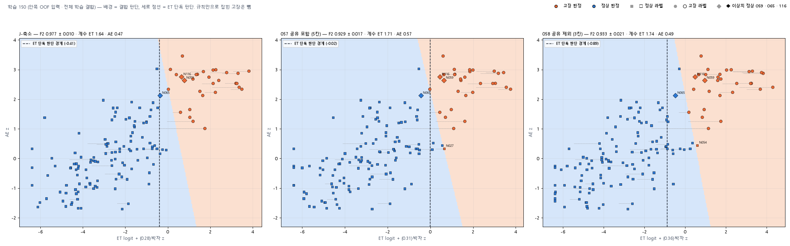
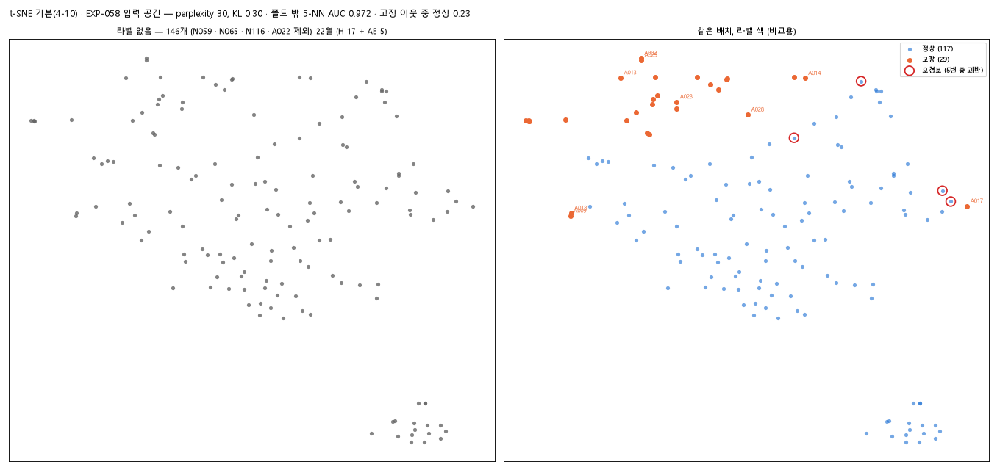
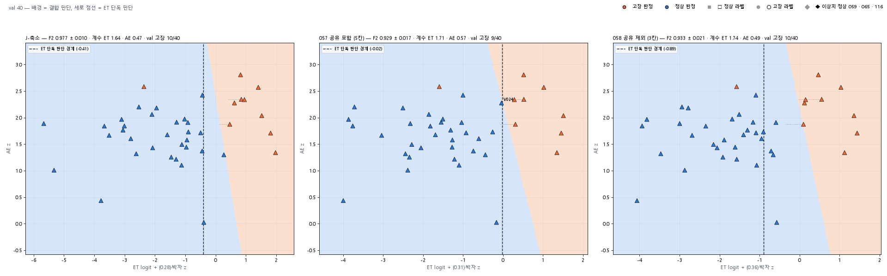

# EXP-058 모드 경계로 대역 교체 + 소린 비율 — 공유 제외

노션 카드 (실험 DB에 그대로 옮긴다)

| 팀원 | 모델 | F2 점수 | 변경 사항 | 메모 |
|---|---|---|---|---|
| 이동훈 | J-축소 (ET 입력 = 모드 경계 3칸(연결부 · 본체 · 고주파) 첨도 · 울림 비율 · 에너지 몫 + 소린 비율 2열) + 박자 z + AE z → 로지스틱 OR E2 OR 8.3k | 0.933 ± 0.021 | 옥타브 경계 → 울림 모드 경계 3칸(공유 · 전이 제외, 2-14 라벨 없음), 소린 비율 2열 추가. ET 15 → 16열. quick (H1, H2) | 모드 경계 3칸(공유 · 전이 제외, ET 16열)은 기준보다 F2가 낮고(0.968 → 0.932, 재현율 1.000 → 0.967, 오경보율 0.042 → 0.054), 공유를 포함한 [EXP-057](../EXP-057_1123_모드경계_공유포함/README.md)(0.938)보다도 조금 낮다. |

## 주요 변경점 (기준 실험 대비)

- 첨도 H3 · H5 → 모드 칸 3개 (연결부 · 본체 · 고주파)
- 울림 비율 H7–H10 → 모드 칸 3개 (축소 유지)
- 에너지 몫 H12–H15 → 모드 칸 3개
- 소린 비율 2열: 연결부 ÷ 본체 · 고주파 ÷ 본체
- EXP-057(5칸)과 다른 점 = 공유 · 전이 칸 제외

- 가설: H1, H2 ([물리가설](../../../1_기준·기록/물리가설.md))
- 실행: 2026-11-23 · git `bd9a50a+수정중` · 코드 [run.py](run.py)
- 평가: 중첩 CV (바깥 5 × 안쪽 4) · 모드 seed 5 · ET 300. 자주 놓침 · 오경보 n회+ = seed 과반. quick 수치는 선별용, 기록 수치는 QE_FULL=1

## 결과

| 구성 | F2 | 재현율 | 오경보율 | 정밀도 | F2 (고장 10%·40%) | 자주 놓침 | 오경보 3회+ |
|---|---|---|---|---|---|---|---|
| 058 공유 제외 (3칸) | 0.933 ± 0.021 | 0.973 | 0.060 | 0.803 | 0.883 · 0.961 | 022 | 7 |

## 해석

정식 검증(full)에서 모드 경계 3칸(공유 · 전이 제외, ET 16열)은 기준보다 크게 낮다(F2 0.933 ± 0.021 대 0.977 ± 0.010, 재현율 0.973, 오경보율 0.030 → 0.060). 공유를 포함한 [EXP-057](../EXP-057_1123_모드경계_공유포함/README.md)(0.929 ± 0.017)과는 sd 안이다.

<!-- key-figs: 자동 (save_fig key=True) -->

*logistic_plane* — 기준 J-축소와 새 구성의 결합 경계 (학습 150)

*tsne_라벨* — 기본 t-SNE(4-10), 새 구성 입력. 빨간 원 = 오경보

<!-- /key-figs -->

| 파일 (seed 5번 중 판정) | J-축소 | 057 (5칸, 22열) | 058 (3칸, 16열) |
|---|---|---|---|
| 고장 놓침 A022 · A028 · A014 | 0 · 0 · 0 | **3** · 1 · 1 | **3** · 1 · 0 |
| 오경보 N025 · N037 | 3 · 2 | 0 · 1 | 0 · 0 |
| 새 오경보 N027 · N073 · N054 · N002 | 0 · 1 · 0 · 0 | 5 · 5 · 4 · 4 | 5 · 3 · 5 · 3 |
| 이상치 N059 · N065 · N116 | 3 · 3 · 5 | 3 · 4 · 5 | 5 · 3 · 4 |
| val 고장 판정 | 10 | 9 (V024 → 정상) | 10 (같음) |
| 결합 계수 ET · 박자 · AE | 1.64 · 0.46 · 0.47 | 1.71 · 0.54 · 0.57 | 1.74 · 0.64 · 0.49 |

- **두 구성 모두 같은 양상이다**: 본체 모드 오경보(N025)는 사라지지만 N027 · N073 · N054 · N002가 거의 매번 오경보가 되고, A022를 5번 중 3번 놓친다(자주 놓침).
- **공유 칸을 빼도(058) 나아지지 않는다**: 0.929 → 0.933으로 sd 안이다. 공유 칸 첨도(1.0–1.6k)는 단독 분리도 0.70으로 쓸모 있는 열이다.
- **옥타브 피처 전체를 바꾸는 것은 손해다**: 에너지 몫의 연결부 칸(1.6–4.5k)은 분리도 0.27로 약하다. 넓은 칸에 정상의 1.9k 모드 에너지가 섞이기 때문이다. 울림 모드 경계는 울림 비율에는 맞지만 첨도 · 에너지 몫에는 맞지 않는다.

대역(2-14, 라벨 없음): 공유 1.0–1.6k · 연결부 1.6–4.5k · 전이 4.5–5.5k · 본체 5.5–8k · 고주파 8–12.5k. 계산식은 H3–H6 · H7–H10(축소 유지, 울림 주파수 50 Hz 사전) · H12–H15와 같고 칸만 바꿨다. 소린 비율 = 큰 충격 20개 직후 12 ms log10 중앙값 √(E 분자 ÷ E 본체). 코드 `src.features2.mode_band_table`, 캐시 `4_outputs/cache/feat_modeband_*.csv`.

## 그림

### val_판정
같은 경계 위의 val 40. 굵은 이름 = 기준과 판정이 다른 파일

## 중간 단계 결과 (비교 · 절제 · 이전 실험 값)

| 구성 | F2 | 재현율 | 오경보율 | 정밀도 | F2 (고장 10%·40%) | 자주 놓침 | 오경보 3회+ |
|---|---|---|---|---|---|---|---|
| J-축소 | 0.977 ± 0.010 | 1.000 | 0.030 | 0.895 | 0.949 · 0.991 | — | 4 |
| 057 공유 포함 (5칸) | 0.929 ± 0.017 | 0.967 | 0.058 | 0.808 | 0.880 · 0.956 | 022 | 7 |