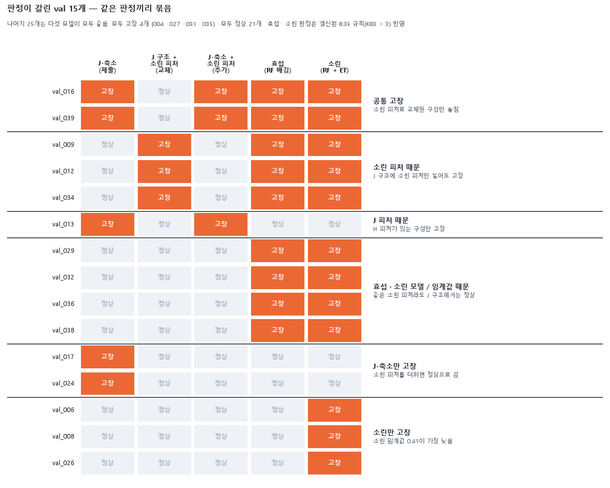
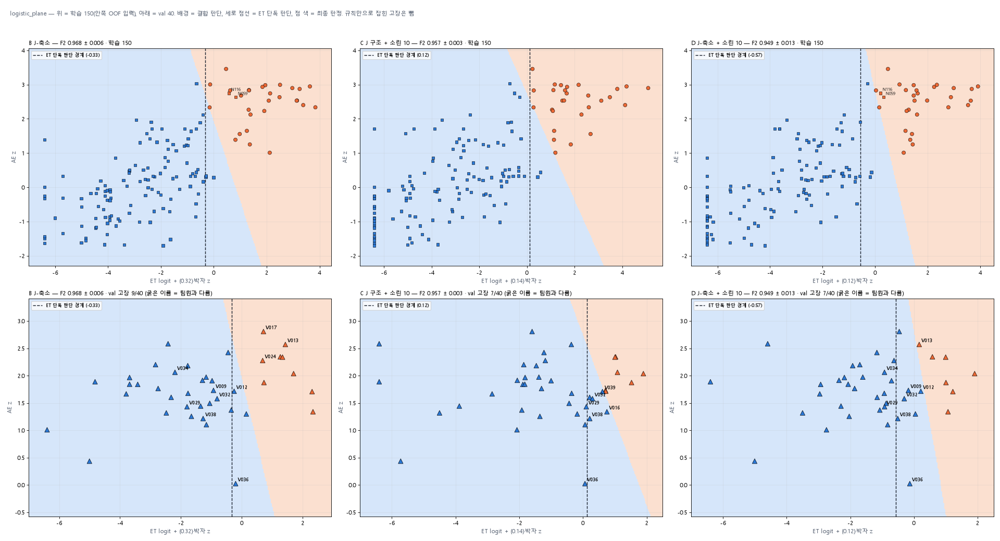
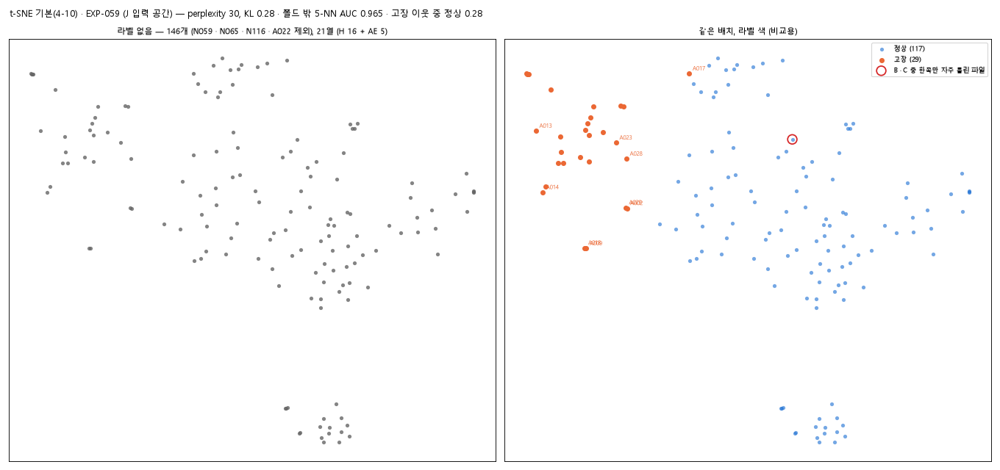

# EXP-059 팀원 피처로 부품 교체 (val 갈림 원인)

노션 카드 (실험 DB에 그대로 옮긴다)

| 팀원 | 모델 | F2 점수 | 변경 사항 | 메모 |
|---|---|---|---|---|
| 이동훈 | B J-축소 · C J 구조 + 소린 10 · D J-축소 + 소린 10 | 0.968 ± 0.006 | J 구조는 두고 ET 입력을 소린 피처로 교체(C) · 추가(D)해 팀원과의 val 갈림이 피처에서 오는지 분리. 같은 분할 (H1, H2) |  |

## 주요 변경점 (기준 실험 대비)

- C = J 구조 + ET 입력 소린 10개(+ H1 · H18, E2용), 봉우리 없음
- D = J-축소 + 소린 10개
- 팀원 모델은 다시 돌리지 않음(팀원 val · 보고 오류를 기준으로 씀)
- 이상치 학습 제외 없음(제출 J-축소와 같은 조건)

- 가설: H1, H2 ([물리가설](../../1_기준·기록/물리가설.md))
- 실행: 2026-11-23 · git `bd9a50a+수정중` · 코드 [run.py](run.py)
- 평가: 중첩 CV (바깥 5 × 안쪽 4) · 모드 seed 2 · ET 100. 자주 놓침 · 오경보 n회+ = seed 과반. quick 수치는 선별용, 기록 수치는 QE_FULL=1

## 결과

| 구성 | F2 | 재현율 | 오경보율 | 정밀도 | F2 (고장 10%·40%) | 자주 놓침 | 오경보 3회+ |
|---|---|---|---|---|---|---|---|
| B J-축소 | 0.968 ± 0.006 | 1.000 | 0.042 | 0.858 | 0.930 · 0.988 | — | 3 |

## 해석

J 구조에 팀원 피처를 넣은 C는 val 고장 7개로, 효섭(13)보다 오히려 적다. 갈린 10개 중 009 · 012 · 034만 피처를 바꾸면 고장으로 넘어가고(피처 원인), 029 · 032 · 036 · 038은 팀원 피처를 써도 J 구조에서는 정상이다(팀원 모델 · 임계값 원인). J만 고장인 013 · 017 · 024는 팀원 피처로 바꾸면 정상이 된다(J의 H 피처가 만든 판정). quick(seed 2), C · D는 폴드 밖 피처 선택이라 약간 낙관적.

| 갈린 val | J(B) | 효섭 | C (J 구조 + 소린 10) | D (J + 소린 10) | 원인 |
|---|---|---|---|---|---|
| 009 · 012 · 034 | 정상 | 고장 | **고장** | 정상 | 팀원 피처 |
| 029 · 032 · 036 · 038 | 정상 | 고장 | 정상 | 정상 | 팀원 모델 · 임계값 (RF 배깅 · 낮은 임계값) |
| 013 | 고장 | 정상 | 정상 | **고장** | J 피처 |
| 017 · 024 | 고장 | 정상 | 정상 | 정상 | J 피처 (팀원 피처를 더하면 정상으로 감) |
| 016 · 039 | 고장 | 고장 | 정상 | 고장 | (공통 고장인데 C만 놓침) |

- 학습(같은 분할, quick): B 0.968 ± 0.006 (재현율 1.000 · 오경보율 0.042) · C 0.957 ± 0.003 (0.967 · 0.021, A022 2/2 놓침) · D 0.949 ± 0.013
- val 일치(40개 중): C–효섭 34 · C–B 32 · D–B 38 · B–효섭 30
- 팀원 판정은 갱신된 8.3k 규칙(K83 > 3)을 반영(사용자 11-23): val_001 정상 → 효섭 13 · 소린 16

<!-- key-figs: 자동 (save_fig key=True) -->

*val_판정지도* — 판정이 갈린 val만, 같은 판정끼리 묶음. 오른쪽 = 묶음의 뜻

*logistic_plane* — B · C · D의 결합 경계 (학습 · val)

*tsne_라벨* — 기본 t-SNE(4-10). 빨간 원 = J-축소(B)와 소린 피처 교체(C) 중 한쪽만 자주 틀린 학습 파일

<!-- /key-figs -->

## 그림

## 중간 단계 결과 (비교 · 절제 · 이전 실험 값)

| 구성 | F2 | 재현율 | 오경보율 | 정밀도 | F2 (고장 10%·40%) | 자주 놓침 | 오경보 3회+ |
|---|---|---|---|---|---|---|---|
| C J 구조 + 소린 10 | 0.957 ± 0.003 | 0.967 | 0.021 | 0.921 | 0.938 · 0.967 | 022 | 1 |
| D J-축소 + 소린 10 | 0.949 ± 0.013 | 0.983 | 0.050 | 0.831 | 0.905 · 0.972 | — | 4 |