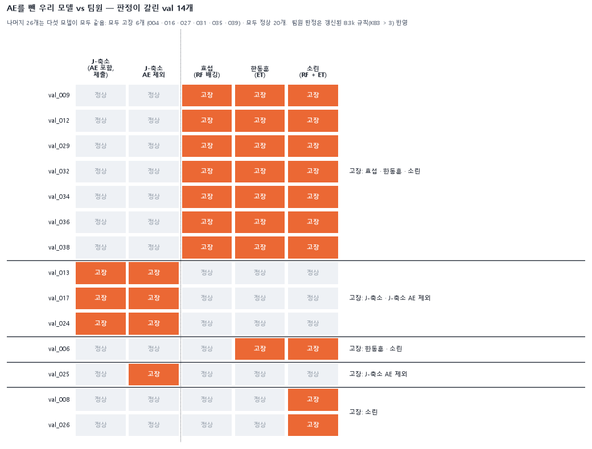
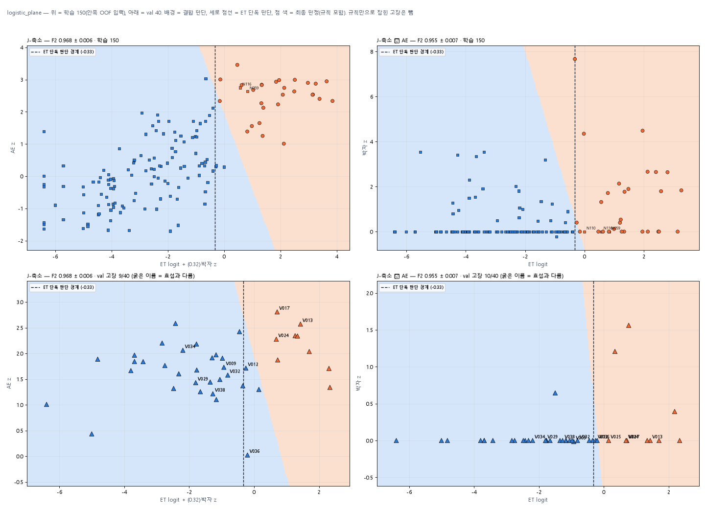
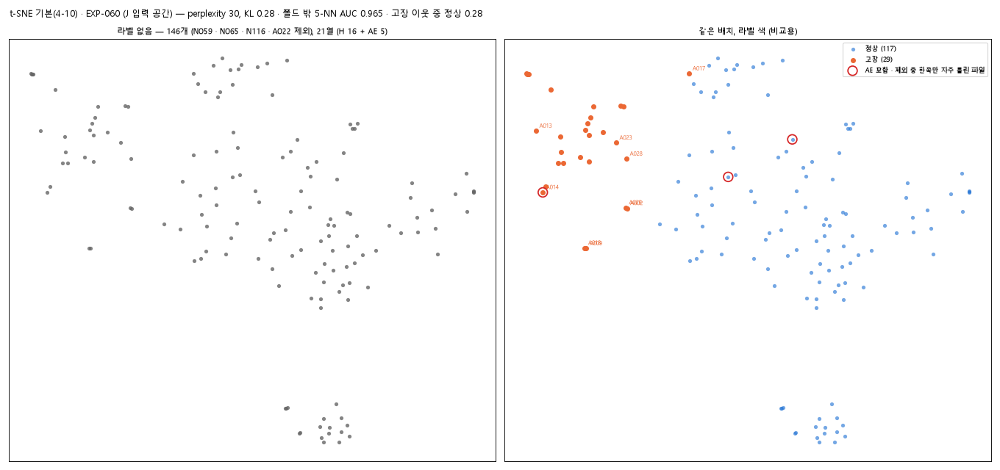

# EXP-060 AE 빼고 팀원과 val 비교

노션 카드 (실험 DB에 그대로 옮긴다)

| 팀원 | 모델 | F2 점수 | 변경 사항 | 메모 |
|---|---|---|---|---|
| 이동훈 | J-축소 · J-축소 − AE (ET + 박자 → 로지스틱 OR E2 OR 8.3k) | 0.955 ± 0.007 | J-축소의 결합 입력에서 AE z만 뺌. 같은 분할, val을 팀원(효섭 · 한동훈 · 소린, K83 반영) 판정과 비교 (H1, H2) | AE를 빼고 다시 학습해도 val 판정은 40개 중 39개가 같다(025만 고장으로 바뀜, 9 → 10). 팀원과 갈리는 10개(효섭 · 한동훈 · 소린만 고장 7 · J만 고장 3)는 AE 유무와 무관하게 그대로 갈린다. 다시 학습하면 ET 계수가 1.48 → 1.82로 커지고 문턱이 0.958 → 0.521로 내려가 AE 몫을 ET가 대신한다(계수 고정 근사로 본 "024 · 027이 넘어간다"는 틀림). 학습 F2는 0.968 → 0.955(quick, A014 1/2 놓침, 오경보 N110 2/2 새로 생김 · N025 · N106 사라짐). |

## 주요 변경점 (기준 실험 대비)

- 결합 입력 [ET, 박자, AE] → [ET, 박자] (AE 제외)
- E2 · 8.3k(K83) 규칙 · 울림 비율 축소 그대로
- 이상치 학습 제외 없음(제출 J-축소와 같은 조건)

- 가설: H1, H2 ([물리가설](../../1_기준·기록/물리가설.md))
- 실행: 2026-11-23 · git `bd9a50a+수정중` · 코드 [run.py](run.py)
- 평가: 중첩 CV (바깥 5 × 안쪽 4) · 모드 seed 2 · ET 100. 자주 놓침 · 오경보 n회+ = seed 과반. quick 수치는 선별용, 기록 수치는 QE_FULL=1

## 결과

| 구성 | F2 | 재현율 | 오경보율 | 정밀도 | F2 (고장 10%·40%) | 자주 놓침 | 오경보 3회+ |
|---|---|---|---|---|---|---|---|
| J-축소 − AE | 0.955 ± 0.007 | 0.983 | 0.042 | 0.856 | 0.918 · 0.974 | — | 4 |

## 해석

AE를 빼고 다시 학습해도 val 판정은 40개 중 39개가 같다(025만 고장으로 바뀜, 9 → 10). 팀원과 갈리는 10개(효섭 · 한동훈 · 소린만 고장 7 · J만 고장 3)는 AE 유무와 무관하게 그대로 갈린다. 다시 학습하면 ET 계수가 1.48 → 1.82로 커지고 문턱이 0.958 → 0.521로 내려가 AE 몫을 ET가 대신한다(계수 고정 근사로 본 "024 · 027이 넘어간다"는 틀림). 학습 F2는 0.968 → 0.955(quick, A014 1/2 놓침, 오경보 N110 2/2 새로 생김 · N025 · N106 사라짐).

<!-- key-figs: 자동 (save_fig key=True) -->

*val_판정지도* — AE 포함 · 제외 우리 모델과 팀원 세 명의 val 판정 (갈린 파일만, 같은 판정끼리)

*logistic_plane* — AE 포함 · 제외 결합 경계 (학습 · val)

*tsne_라벨* — 기본 t-SNE(4-10). 빨간 원 = AE를 빼면 판정이 달라지는(한쪽만 자주 틀린) 학습 파일

<!-- /key-figs -->

| 갈린 val | J-축소 (AE 포함) | J-축소 − AE | 효섭 | 한동훈 | 소린 |
|---|---|---|---|---|---|
| 009 · 012 · 029 · 032 · 034 · 036 · 038 | 정상 | 정상 | 고장 | 고장 | 고장 |
| 013 · 017 · 024 | 고장 | 고장 | 정상 | 정상 | 정상 |
| 006 | 정상 | 정상 | 정상 | 고장 | 고장 |
| 008 · 026 | 정상 | 정상 | 정상 | 정상 | 고장 |
| 025 | 정상 | **고장** | 정상 | 정상 | 정상 |

- val AE z(학습 정상 기준) 중앙값 1.75, 40개 중 38개 > 1: val 전체가 AE에서 고장 쪽으로 이동해 있지만, 판정에는 거의 영향이 없다
- 팀원 판정은 갱신된 8.3k 규칙(K83 > 3) 반영. 효섭 13 · 한동훈 14 · 소린 16

## 그림

## 중간 단계 결과 (비교 · 절제 · 이전 실험 값)

| 구성 | F2 | 재현율 | 오경보율 | 정밀도 | F2 (고장 10%·40%) | 자주 놓침 | 오경보 3회+ |
|---|---|---|---|---|---|---|---|
| J-축소 | 0.968 ± 0.006 | 1.000 | 0.042 | 0.858 | 0.930 · 0.988 | — | 3 |