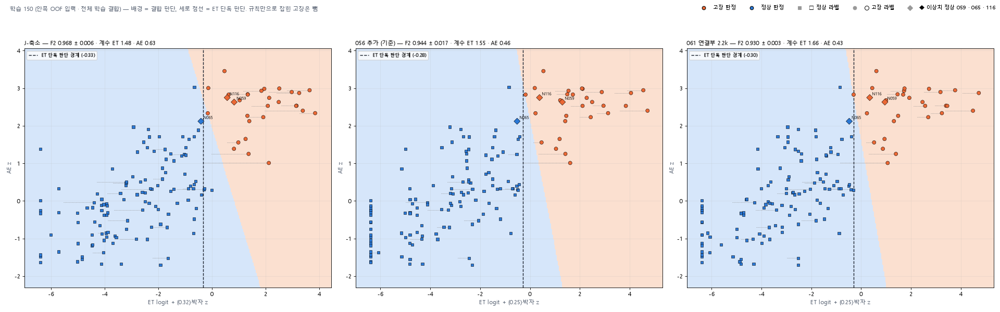
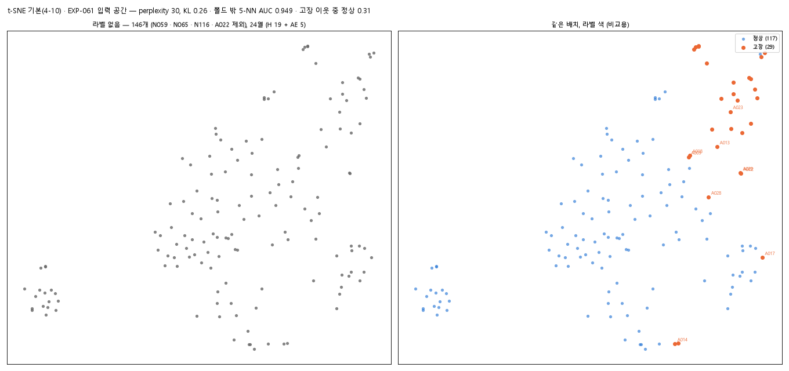
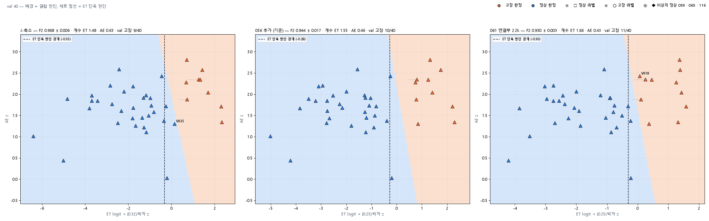

# EXP-061 연결부 충격 수 아래 경계 1.6k → 2.2k

노션 카드 (실험 DB에 그대로 옮긴다)

| 팀원 | 모델 | F2 점수 | 변경 사항 | 메모 |
|---|---|---|---|---|
| 이동훈 | J-축소 + 울림 모드 3열 (EXP-056 추가) + 박자 z + AE z → 로지스틱 OR E2 OR 8.3k | 0.930 ± 0.003 | RM_n_joint(1.6–4.5k 충격 수) → RM_n_joint22(2.2–4.5k). 1.9k 공유 모드(2-14)를 빼 RM_e_joint와 같은 경계. quick (H1, H2) | **quick 결과: 061은 기준(056 추가)보다 낮고(0.930 vs 0.944), V025도 정상으로 가지 않는다.** A009를 2/2 놓친다. 연결부 충격 수를 2.2k부터 세면 1.6–2.2k의 고장 신호(train 분리도 0.77 → 0.62)도 함께 빠진다. V025는 6-11의 반사실(모델 고정, −1.31)과 달리 다시 학습한 모델에서 +0.47로 여전히 고장이다. 같은 quick에서 056 추가의 V025 여유는 +0.90(full ET 300에서는 −0.02)이다. V025는 ET 나무 수 · seed에 따라 판정이 뒤집히는 경계 파일이다. 8.3k 규칙은 세 구성 모두 K83 포함. |

## 주요 변경점 (기준 실험 대비)

- RM_n_joint 1.6–4.5k → RM_n_joint22 2.2–4.5k (1.9k 공유 모드 제외)
- 나머지(H 15열 · RM_e_joint · RM_e_high · 결합 · 규칙)는 EXP-056 추가와 같음

- 가설: H1, H2 ([물리가설](../../1_기준·기록/물리가설.md))
- 실행: 2026-11-23 · git `bd9a50a+수정중` · 코드 [run.py](run.py)
- 평가: 중첩 CV (바깥 5 × 안쪽 4) · 모드 seed 2 · ET 100. 자주 놓침 · 오경보 n회+ = seed 과반. quick 수치는 선별용, 기록 수치는 QE_FULL=1

## 결과

| 구성 | F2 | 재현율 | 오경보율 | 정밀도 | F2 (고장 10%·40%) | 자주 놓침 | 오경보 3회+ |
|---|---|---|---|---|---|---|---|
| 061 연결부 2.2k | 0.930 ± 0.003 | 0.933 | 0.021 | 0.918 | 0.911 · 0.940 | 009 | 2 |
| 061 연결부 2.2k | 0.930 ± 0.003 | 0.933 | 0.021 | 0.918 | 0.911 · 0.940 | 009 | 2 |

## 해석

**quick 결과: 061은 기준(056 추가)보다 낮고(0.930 vs 0.944), V025도 정상으로 가지 않는다.** A009를 2/2 놓친다. 연결부 충격 수를 2.2k부터 세면 1.6–2.2k의 고장 신호(train 분리도 0.77 → 0.62)도 함께 빠진다. V025는 6-11의 반사실(모델 고정, −1.31)과 달리 다시 학습한 모델에서 +0.47로 여전히 고장이다. 같은 quick에서 056 추가의 V025 여유는 +0.90(full ET 300에서는 −0.02)이다. V025는 ET 나무 수 · seed에 따라 판정이 뒤집히는 경계 파일이다. 8.3k 규칙은 세 구성 모두 K83 포함.

<!-- key-figs: 자동 (save_fig key=True) -->

*logistic_plane* — J-축소 · 056 추가(기준) · 061의 결합 경계 (학습 150)

*tsne_라벨* — 기본 t-SNE(4-10), 061 입력. 빨간 원 = 오경보

<!-- /key-figs -->

| 구성 (quick) | F2 | 재현율 · 오경보율 | 놓침 | val 고장 | V025 여유 |
|---|---|---|---|---|---|
| J-축소 | 0.968 ± 0.006 | 1.000 · 0.042 | — | 9 | −0.20 |
| 056 추가 (기준) | 0.944 ± 0.017 | 0.950 · 0.021 | A028 1/2 | 10 | +0.90 |
| 061 연결부 2.2k | 0.930 ± 0.003 | 0.933 · 0.021 | A009 2/2 · A028 1/2 | 11 (+V018) | +0.47 |

## 그림

### val_판정
같은 경계 위의 val 40. 굵은 이름 = 기준과 판정이 다른 파일

## 중간 단계 결과 (비교 · 절제 · 이전 실험 값)

| 구성 | F2 | 재현율 | 오경보율 | 정밀도 | F2 (고장 10%·40%) | 자주 놓침 | 오경보 3회+ |
|---|---|---|---|---|---|---|---|
| J-축소 | 0.968 ± 0.006 | 1.000 | 0.042 | 0.858 | 0.930 · 0.988 | — | 3 |
| 056 추가 (기준) | 0.944 ± 0.017 | 0.950 | 0.021 | 0.919 | 0.925 · 0.954 | 028 | 2 |