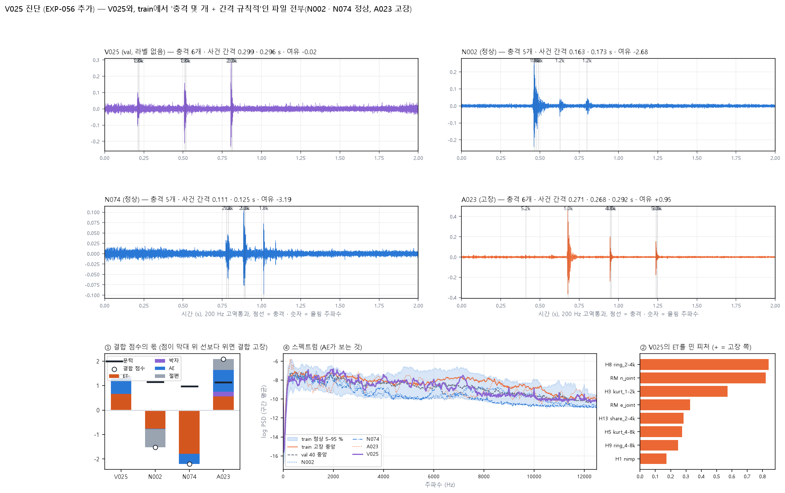

# 6-11 V025 재진단 — 채택 구성 EXP-056 추가 (11-23)

**결론: V025가 경계(여유 −0.02)에 있는 이유는 6-6과 같은 "2 kHz 근처 울림"이다. 다만 이번에는 옥타브 경계(2k)와 새 RM 열의 아래 경계(1.6k)가 같은 울림을 두 번 센다.** V025의 충격 6개는 모두 1.8 · 2.0 kHz로 운다.
- **H8 (2–4k 울림 비율)**: 2000 Hz 격자를 2–4k로 센다. 정상 백분위 100이고 ET에 +0.84를 더한다(6-6과 같음).
- **RM_n_joint (1.6–4.5k 충격 수)**: 1.8k · 2.0k 울림을 모두 연결부로 센다. 6개로 정상 백분위 97이고 ET에 +0.82를 더한다(**새로 생긴 몫**).
- 1.6–2.2k는 2-14에서 정상 · 고장이 **둘 다 우는 1.9k 모드**다(파일 안 비율 정상 12 % · 고장 22 %). 그래서 소린 에너지 비 RM_e_joint는 2.2k부터 센다. 충격 수 RM_n_joint만 1.6k부터 센다.
- 그 위에 val 공통의 AE 상승(+0.61, 6-6과 같음)이 얹힌다.

| 반사실 (모델은 그대로, V025 값만 바꿈) | 여유 | ET 몫 |
|---|---|---|
| 지금 (EXP-056 추가) | **−0.02** | +0.67 |
| RM_n_joint를 2.2k부터 셈 (0개) | −1.31 | −0.62 |
| + 2.0 kHz를 1–2k로 셈 (H7 = 1, H8 = 0) | −3.08 | −2.39 |
| 참고: J-축소 (6-6) | −0.09 | +0.45 |

**그러나 1.6–2.2k를 빼면 고장 신호도 함께 약해진다.** train 분리도(파일당 충격 수)는 1.6–4.5k 0.768에서 2.2–4.5k 0.615로 떨어진다. 2000 Hz 울림은 고장 충격에 4배 흔하다(12 % vs 3 %). 그래서 V025를 정상 쪽으로 보내는 수정은 2 kHz로 우는 고장도 함께 내린다. 6-6의 결론과 같다.

**그 밖의 점 (6-6과 거의 같음)**
- **결합 분해**: ET +0.67 · 박자 0 · AE +0.61 · 절편 +0.09 − 문턱 1.39 = −0.02. 계수는 ET 1.57 · 박자 0.38 · AE 0.47이다.
- **모델마다 판정이 갈린다.** 바깥 5폴드 + 전체 모델 6개의 여유는 −0.27 · −0.66 · +0.90 · +1.69 · +1.76 · −0.02다. 6개 중 3개가 고장이다(J-축소에서는 4/6).
- **가까운 train 5개**(N106 · N006 · N070 · N066 · N082)는 모두 정상이다. 시간 모양(0.30 s 간격 쌍 충격)은 고장 A023을 닮았고, 울림은 정상 N002 · N074를 닮았다.
- **N002는 J-축소보다 고장 쪽으로 왔다**(−3.99 → −2.68). 1.8k · 1.2k로 우는 정상이라 RM_n_joint가 같이 민다. 4-13에서 N002 점수가 오른 것(0.25 → 0.35)과 같은 이유다.

**판단에 쓸 정리**
| V025 정상 쪽 | V025 고장 쪽 |
|---|---|
| 울림(1.8–2.0k)이 정상 N002 · N074와 같다. 2-14의 1.9k 공유 모드 | 2000 Hz 울림은 train 고장에 4배 흔하다 |
| 2 kHz 경계 처리만 바꿔도 −1.3 ~ −3.1 | 0.30 s 간격 쌍 충격(A023과 닮음) |
| 가까운 train 5개 모두 정상, 세기 0.21 g로 작음 | AE 오차 학습 정상 88–99 % (val 공통) |

**코드 · 수치**: `run.py`(6-6 복사 + ET 입력에 RM 3열 + ⑧ 아래 경계 점검, `QE_FULL=1`, 약 1분) · [표_V025.md](표_V025.md)
