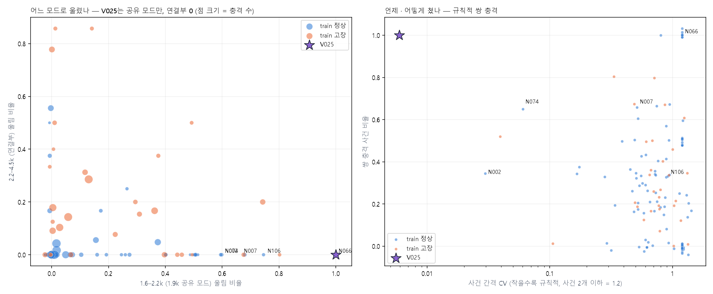

# 6-12 V025는 고장인가 정상인가 (11-23, 모델 없음)

**결론: 정상 쪽 근거가 더 많다. 다만 "규칙적인 쌍 충격"이라는 시간 모양은 train에 비교할 파일이 2개뿐이라 판단할 수 없다.** val에는 라벨이 없으므로 확정은 아니다. 학습 150개 중 V025와 닮은 파일의 라벨로 본 것이다.

| V025의 특징 | 같은 특징을 가진 train | 고장 비율 (기저 20 %) | 방향 |
|---|---|---|---|
| 울림 대부분이 1.6–2.2k (1.9k 공유 모드) | 20개 | 25 % | 중립 |
| 2.2–4.5k 연결부 울림 없음 | 103개 | 10 % | 정상 쪽 |
| 충격이 작음 (≤ 0.3 g) | 94개 | 10 % | 정상 쪽 |
| 공유 모드 + 작음 + 충격 3–8개 | 11개 | **9 %** (A017만 고장) | 정상 쪽 |
| 쌍 충격 사건 비율 ≥ 0.5 | 36개 | 25 % | 중립 |
| 사건 간격이 규칙적 (CV < 0.1) | 3개 (A023 · N002 · N074) | 33 % | 판단 불가 |
| 쌍 충격 + 규칙 간격 | 2개 (A023 · N074) | 50 % | 판단 불가 |

- **물리 특징 7개를 합친 거리로 가까운 train 파일**: N066 · N007 · N074 · N002 · N106이다. **가까운 5개가 모두 정상**이고, 10개로 넓히면 고장 2개(A025 · A030)로 기저 비율과 같다.
- **모델 공간에서 가까운 train 5개**(기본 t-SNE 공간, 6-11)도 모두 정상이다.
- **고장 쪽 근거는 두 가지다.** 하나는 간격 CV 0.006으로 train 어느 파일보다 규칙적이라는 점이다. 다른 하나는 2000 Hz 울림이 train 고장 충격에 4배 흔하다는 점이다(6-6). 그러나 1.6–2.2k 울림이 대부분인 파일로 보면 고장 비율은 25 %로 기저와 비슷하다.

- **왼쪽 (어느 모드로 울렸나)**: V025는 공유 모드로만 울렸고 연결부 울림이 0이다. 같은 자리(오른쪽 아래)에는 정상 N066 · N074 · N002 · N007 · N106이 모여 있다. 고장은 대부분 위쪽(연결부로 울림)에 있다.
- **오른쪽 (언제 · 어떻게 쳤나)**: V025는 왼쪽 위 끝에 혼자 있다. 쌍 충격만 있고 간격이 가장 규칙적이다. train에 이런 파일은 없다.

**피처 경계를 바꿀 때의 주의**
- V025를 정상으로 보내려고 경계를 바꾸면 val에 맞추는 것이 된다. 결정.md의 "val만 보고 모델 · 피처를 바꾸지 않는다"에 걸린다.
- 경계를 바꾸려면 **train에서 독립된 근거**가 필요하다.
  - 이미 있는 근거: 2-14에서 라벨 없이 1.6–2.2k가 '정상 · 고장 공유 모드'로 나왔다. 같은 이유로 RM_e_joint는 2.2k부터 센다. 그래서 RM_n_joint만 1.6k부터 세는 것은 앞뒤가 맞지 않는다.
  - 판단 기준: 수정의 채택 여부는 **train 중첩 CV(full)**로 정하고, V025는 결과로 확인만 한다.

**코드 · 수치**: `run.py`(2-14 충격 캐시, 수 초) · `figs/결과.txt`
