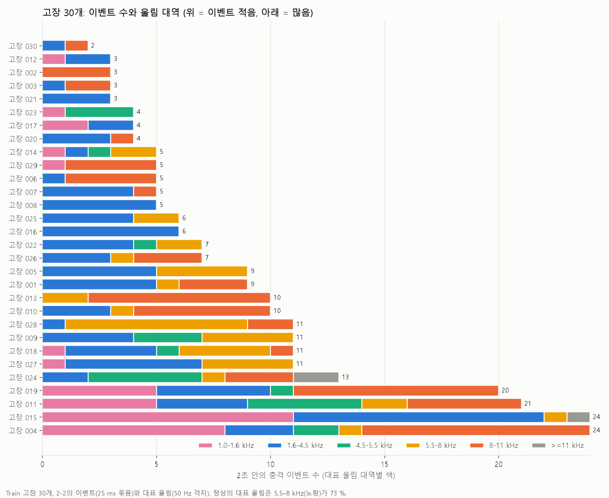

# 2-3 고장 30개 파일 커버리지 (11-24)

2-2에서 찾은 두 단서(이벤트 수, 대표 울림 대역)가 고장 30개를 파일 단위로 얼마나 덮는지, 어떤 고장이 사각지대로 남는지 본다. 고주파 트랙만, 라벨을 본 탐색이다.
코드 [run.py](run.py) · 수치 [figs/커버리지_수치.txt](figs/커버리지_수치.txt) · 파일별 표 [figs/files_cover.csv](figs/files_cover.csv). 입력은 2-2의 `events.csv`(이벤트 = 25 ms 묶음, 대표 울림 = 50 Hz 격자).

## 정의
- **이벤트 수** `n_ev`: 2초 안의 충격 이벤트 수.
- **울림 대역별 수**: 이벤트의 대표 울림 주파수가 1.0–1.6 · 1.6–4.5 · 4.5–5.5 · 5.5–8 · 8–11 · 11 kHz 이상 중 어디인가(11 kHz 이상은 상한 결정에 따라 참고).
- **`off`**: 정상이 주로 울리는 5.5–8 kHz 밖의 두 대역, 즉 1.6–4.5 kHz + 8–11 kHz에서 울린 이벤트 수.

## 결과 1 · 파일 단위 사각지대는 두 개뿐
- 고장 30개 가운데 `off ≥ 1`을 놓친 파일은 **abn_023 하나**다. 이벤트 4개가 1.0–1.6 kHz 1개와 4.5–5.5 kHz 3개로 울렸다(1.6–4.5와 5.5–8 사이의 "비어 있는" 대역). 충격은 강하다(바탕의 79.5배). 대역 PSD는 중간 수준이다(3–5 kHz 정상 백분위 77, 8–10.5 kHz 72).
- `n_ev ≥ 3`을 놓친 파일은 **abn_030 하나**다. 이벤트 2개(0.657 s 2.0 kHz와 1.296 s 8.35 kHz)로 둘 다 off 대역이고 충격이 강하다(73.5배, 26.7배). 대역 PSD가 정상 98–99 백분위라 PSD로는 잡힌다.
- "대표 울림이 정상 대역(5.5–8 kHz)에 머무는 고장 파일들"은 **여럿이 아니다**. 이벤트의 절반 이상이 5.5–8 kHz인 고장은 abn_028(11개 중 8개) 하나뿐이고, 그 파일도 8–11 kHz 2개, 1.6–4.5 kHz 1개가 있다. 사각지대는 "정상 대역에서만 울리는 고장"이 아니라 "정상과 고장 어느 쪽 대역에도 안 드는 4.5–5.5 kHz형"(023)이다.

## 결과 2 · 단순 규칙의 덮는 범위 (같은 150개, 사후 관찰이므로 낙관적)
| 규칙 | 고장 | 정상 | 같은 150개에서의 F2(참고) |
|---|---|---|---|
| `n_ev ≥ 3` | 29/30 | 65/120 (54 %) | 0.68 |
| `off ≥ 1` | 29/30 | 34/120 (28 %) | 0.79 |
| `off ≥ 2` | 28/30 | 18/120 (15 %) | 0.84 |
| `n_ev ≥ 3` & `off ≥ 1` | 28/30 | 23/120 (19 %) | 0.82 |
| `n_ev ≥ 3` & `off ≥ 2` | 27/30 | 16/120 (13 %) | 0.83 |
| `n_ev ≥ 3` 또는 `off ≥ 1` | 30/30 | 76/120 (63 %) | — |

- 이 표는 규칙의 문턱을 고른 것이 아니다. 먼저 적어 둔 몇 가지를 본 것이다. 그래도 150개를 보고 만든 규칙이라 F2는 중첩 CV가 아닌 **같은 데이터의 값**이다. 일반화 점수로 읽으면 안 된다. 고장 비율 20 % 기준이다.
- **이벤트 수만으로는 정상을 못 거른다.** 고장 97 %가 3개 이상이지만 정상도 54 %가 3개 이상이다.
- **울림 대역이 정상과의 구분을 더한다.** `off ≥ 2`는 고장 28/30을 유지하면서 정상 오경보를 54 % → 15 %로 줄인다.

## 결과 3 · 오경보가 되는 정상 (off ≥ 2, 18개)
- 가장 큰 파일은 nor_104(이벤트 16, 1.6–4.5 kHz 9개) · nor_030(18, 9개) · nor_054(6, 6개)다. 모두 1.6–4.5 kHz(연결부 모드)에서 울린 이벤트가 많은 정상이다.
- 정상의 24 %가 1.6–4.5 kHz로 울린 이벤트를 하나 이상 갖는다. 이 대역의 울림만으로는 정상과 고장이 갈리지 않고, 이벤트 수 · 세기 · 대역 에너지를 같이 봐야 한다.
- 이 정상들의 대역 PSD 백분위는 낮은 편(nor_030의 3–5 kHz 5 %, nor_054의 8–10.5 kHz 1 %)이어서 대역 에너지 정보가 이 오경보를 걸러낼 가능성이 있다. 확인은 아직 안 했다.

## 해석과 다음
- 2-2의 두 단서는 고장 30개를 거의 모두 덮는다(28–29/30). 한계는 사각지대(023, 030)보다 **정상 쪽 오경보**(규칙에 따라 15–54 %)다.
- 023의 4.5–5.5 kHz 울림은 지난번 PSD 후보 대역(3–5 kHz, 8–10.5 kHz)에서 5–5.5 kHz가 약했던 것과 같은 자리다. 대역을 확정하기 전에 이 구간을 어떻게 다룰지 정해야 한다.
- 다음 후보: ① 오경보 정상 18개와 고장 30개를 가르는 이벤트 단위 특성(세기, 울림 fit, 대역 에너지), ② 이벤트 안의 보조 모드까지 세기. 어느 쪽이든 폴드 안에서 다시 확인한다.
