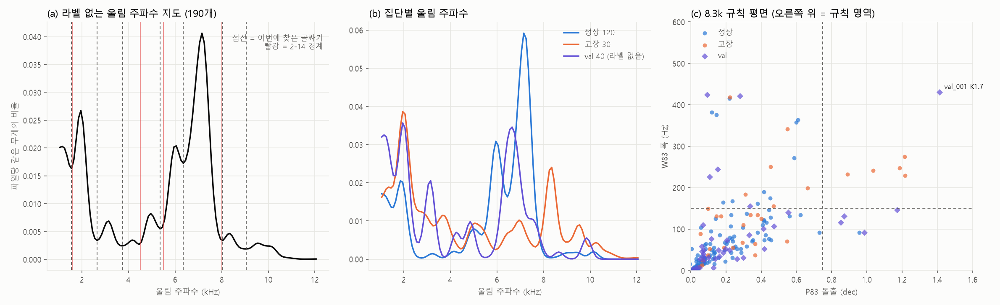

# 2-4 이전 발견 가져오기: 울림 모드 경계(2-14) · 8.3k 규칙(2-2) (11-24)

기존 `3_단계/2_EDA/2-14_1123_울림모드경계`와 `3_단계/2_EDA/2-2_8.3k규칙`의 발견을 new_단계로 가져와, 지금 데이터(Train 150 + val 40 라벨 없이)에서 같은 결과가 다시 나오는지 확인했다. 코드는 `src`의 것을 그대로 썼고 규칙 문턱은 바꾸지 않았다. 이전 결과는 배경지식이고, 아래 "재현"만 new_단계의 근거로 센다.
코드 [run.py](run.py) · 수치 [figs/재확인_수치.txt](figs/재확인_수치.txt) · 8.3k 파일별 표 [figs/rule83_files.csv](figs/rule83_files.csv)

## 이전 발견 요약 (가져온 것)

**2-14 울림 모드 경계**
- 경계는 옥타브가 아니라 울림 모드 사이의 골짜기에 둔다: 1.6 · 4.5 · 5.5 · 8.0 kHz(6.3 kHz 골짜기는 합침).
- 2 kHz 아래는 정상과 고장이 같이 운다. 고장만 우는 구간은 2.2–4.5 kHz부터다.
- 대역 의미: 연결부 모드 1.6–4.5 kHz = 고장, 본체 모드 5.5–8 kHz = 정상, 고주파 8–12.5 kHz = 고장 + 이상치 정상. 1.0–1.6 · 4.5–5.5 kHz는 공유 대역이라 피처에서 뺀다.
- 피처 후보: 연결부 충격 수(분리도 0.77), 에너지 비 2.2–4.5k ÷ 5.5–8k(0.74), 8–12.5k ÷ 5.5–8k(0.70).

**2-2 8.3k 규칙** (`src/final.py`)
- 스펙트럼 규칙: 8.20–8.45 kHz 봉우리 돌출 P83 ≥ 0.75 dec AND 반높이 폭 W83 ≥ 150 Hz AND 포락 첨도 K83 > 3.
- 공진 규칙: 8.0–8.7 kHz로 울린 충격 중 ζ ≤ 0.02이고 맞춤 fit ≥ 0.7인 것이 하나라도 있으면 고장. 두 규칙은 OR.
- 근거 가설 H2′: 8.3 kHz 모드가 고장에서 더 크게 들뜬다(공진 "이동"이 아니라). K83은 val_001을 막으려고 11-23에 추가했다.

## 재현 결과

### A. 울림 모드 지도 (라벨 없음, 190개, 모든 검출, 파일당 같은 무게)
| 항목 | 2-14 | 이번 재현 | 판정 |
|---|---|---|---|
| 봉우리 (kHz) | 1.9 · 3.2 · 4.9 · 6.0 · 7.2 · 8.3 · 9.5 | 1.95 · 3.15 · 4.95 · 6.05 · 7.15 · 8.35 · 9.55 | **재현** |
| 골짜기 1.6 | 1.6 | 1.55 | 재현 |
| 골짜기 5.5 | 5.5 | 5.35 | 거의 재현 |
| 골짜기 6.3 | 6.3(합침) | 6.35 | 재현 |
| 골짜기 8.0 | 8.0 | 8.05 | 재현 |
| **골짜기 4.5** | 4.5 | **없음. 가장 깊은 골짜기는 3.75 kHz** | **재현 안 됨** |
| 그 밖 | | 2.65 kHz(1.95와 3.15 사이), 9.05 kHz (모두 얕음) | 추가 |

- 모드 봉우리 일곱 개는 거의 그대로 다시 나온다. 모드 지도는 믿을 만하다.
- **4.5 kHz 경계는 지켜지지 않는다.** 이번 지도에서는 3.15 kHz 봉우리와 4.95 kHz 봉우리 사이의 골짜기가 3.75 kHz이고 돌출이 가장 크다(가장 깊은 골짜기). 3.75–4.5 kHz는 울림이 거의 없는 구간이라 이벤트 수에는 영향이 작지만, 대역 에너지 피처의 경계로 쓰면 달라진다. 경계는 평활 폭(이번 200 Hz 한 가지)에 민감할 수 있다.
- **연결부 1.6–4.5 kHz 안에 모드가 둘** 있다(1.95 kHz, 3.15 kHz). 2-14도 같은 봉우리를 적었다. 이 둘을 한 대역으로 묶는 것이 맞는지는 아직 정하지 않았다.
- **abn_023(2-3의 사각지대)의 울림은 4.95 kHz 봉우리**다. 정상과 고장이 같이 우는 "전이" 대역(2-14가 피처에서 뺀 곳)이라 규칙에서 빠졌다.

파일당 충격 수 AUC (고장 > 정상, train 150):

| 대역 | AUC | 정상 중앙 · 고장 중앙 · val 중앙 |
|---|---|---|
| 1.0–1.6 kHz | 0.64 | 0 · 0 · 0 |
| **1.6–4.5 kHz** | **0.88** | 0 · 5 · 1 |
| 4.5–5.5 kHz | 0.62 | 0 · 0 · 0 |
| 5.5–8 kHz | 0.39 (정상이 더 많음) | 2 · 1 · 0 |
| 8–11 kHz | 0.78 | 0 · 1 · 0 |

- 2-14가 적은 "새 1.6–4.5k 충격 수 분리도 0.77"은 AUC 0.885와 같다. **재현**.
- val은 중앙값이 1.6–4.5 kHz 1개로 정상(0)과 고장(5) 사이다. 그림(b)에서 val의 본체 모드 봉우리는 약 6.6 kHz로 학습 정상(약 7.2 kHz)보다 낮고, 1.2 kHz · 3.2 kHz에도 봉우리가 있다(그림에서 읽은 대략 값). 2-14가 적은 val의 이동과 같은 방향이다. 고장이 섞여서 생기는 이동은 아니다(고장은 6–7 kHz 밀도가 낮다).

### B. 8.3k 규칙 (`src.final` 정의 그대로)
| | 정상 120 | 고장 30 | val 40 |
|---|---|---|---|
| 스펙트럼 규칙 (K 없이) | 0 | 5 | **1 (val_001)** |
| 스펙트럼 규칙 (K 포함) | 0 | 5 (002 · 006 · 010 · 029 · 030) | 0 |
| 공진 규칙 | 0 | 5 (002 · 003 · 006 · 010 · 029) | 0 |
| 둘 중 하나 | 0 | **6** (002 · 003 · 006 · 010 · 029 · 030) | 0 |

- 이전 기록(고장 6개, 정상 0, val은 K로 001이 빠짐)과 **정확히 같다**.
- 규칙 경계 근처(문턱의 0.8–1.0배): val_037(P 1.17, W 146 Hz = 폭 4 Hz 모자람), **val_020(P 0.87, W 131 Hz, 폭 19 Hz 모자람)**, 정상 nor_092(P 0.61, W 363), nor_070(P 0.62, W 134), 고장 abn_007(P 0.66, W 198). 2-16은 val_037만 적었고 **val_020도 같은 폭 경계 근처**다.
- val_001은 K83 1.7로 꺼진다(지속음이라 충격성이 없음).

### C. 새 분석(2-3)과 이어 보기
- 규칙이 잡는 고장 6개는 모두 **8–11 kHz로 울린 이벤트**를 갖는다(002 3/3, 003 2/3, 006 4/5, 010 6/10, 029 4/5, 030 1/2). 8.3k 규칙이 보는 8.3 kHz 모드를 "이벤트의 울림 주파수"로 보면 규칙 문턱 없이도 같은 파일에 닿는다.
- **8–11 kHz 울림 이벤트가 1개 이상인 파일: 고장 17/30, 정상 5/120**(019 · 043 · 059 · 065 · 116). 2개 이상이면 고장 13, 정상 2(019 · 059). 8.3k 규칙(고장 6, 정상 0)보다 고장을 11개 더 덮고 정상 오경보가 5개 생긴다. 이 숫자도 라벨을 본 탐색이다.
- 1.6–4.5 kHz 울림 이벤트가 1개 이상인 파일: 고장 26/30, 정상 29/120. 이 대역만으로는 정상 24 %가 걸린다(2-3의 결과와 같음).
- 어느 쪽 대역에도 울림이 없는 고장은 abn_023 하나다.

## 지위와 주의
- **8.3k 규칙의 문턱(0.75 · 150 Hz · 3)은 사후 값이다.** 6개 고장 파일을 본 뒤 정했고 K83은 val_001을 보고 더했다. new_단계에서 쓰려면 폴드 안 재선택이나 "사후 값이라 점수가 낙관적"이라는 표시가 필요하다.
- **2-14의 경계도 일부는 라벨을 보고 정했다.** 6.3 kHz를 합친 것과 공유 대역을 뺀 것이 그렇다(2-14 본문). 이번 재현에서는 4.5 kHz 경계가 지켜지지 않았다.
- 이번 A의 울림 지도는 2-14와 같은 검출기 · 같은 데이터라 **독립 확인이 아니라 재현**이다.
- 가져온 것은 "후보"다. 어떤 것을 new_단계의 피처 · 규칙으로 올릴지는 아직 정하지 않았다.

## 다음 선택 후보
1. 경계 정하기: 연결부 1.6–4.5 kHz를 1.95 · 3.15 kHz 모드 두 개로 나눌지, 3.75 kHz 골짜기를 경계로 쓸지.
2. 8–11 kHz 울림 이벤트 수를 8.3k 규칙 대신 쓸지, 같이 둘지 (오경보 5개의 정체: 059 · 065 · 116은 이상치 정상).
3. 8.3k 규칙을 "높은 특이도 규칙"(정상 0)으로 OR에 남기고 폴드 안 재확인 계획 세우기.

## 이전 발견은 일반화가 약해서 다른 방법으로 잡는다 (11-25 정리)

이전 프로젝트에서 얻은 두 발견은 그대로 쓰지 않고, 일반화가 약하다고 보는 근거를 아래에 적고 **다른 방법으로 잡는 쪽**으로 방향을 정했다. 여기서 "일반화가 약하다"는 교차검증 점수로 잰 것이 아니라 아래 **근거 목록**을 본 판단이다. 대체 방법은 Gemini 2차 안([Gemini_2차답변_피처명세안.md](../../Gemini_2차답변_피처명세안.md))이며 **아직 검증하지 않았다**.

| 이전 발견 | 일반화가 약하다고 보는 근거 | 대신 잡는 방법 (Gemini 안, 미검증) |
|---|---|---|
| **8.3k 규칙**: P83 ≥ 0.75 AND W83 ≥ 150 Hz AND K83 > 3, OR 공진 규칙(ζ ≤ 0.02, fit ≥ 0.7). 고장 6/30, 정상 0 | ① 문턱 5개(0.75 · 150 Hz · 3 · 0.02 · 0.7)가 모두 사후 값이다. 고장 6개를 본 뒤 정했다. ② K83 조건은 val_001이 켜지는 것을 보고 더했다(val을 보고 고침). ③ 폭 문턱 근처에 val 파일이 둘 있다(val_037 폭 4 Hz 모자람, val_020 19 Hz 모자람). 문턱이 조금만 움직여도 판정이 바뀐다. ④ 학습 고장 6개에만 맞춘 규칙이라 다른 유형의 8 kHz대 고장은 못 본다 | 8–11 kHz로 울린 **이벤트 수**와 대역 신호의 **연속 값**(포락 첨도 등)으로 대체. 같은 6개 고장 외에 고장 17/30을 덮는다(정상 5/120 걸림). 단 이 숫자는 라벨을 본 탐색이고, **규칙이 가졌던 정상 오경보 0이라는 장점을 잃는다** |
| **2-14 울림 모드 경계**: 1.6 · 4.5 · 5.5 · 8.0 kHz, 에너지 비 2.2–4.5k ÷ 5.5–8k | ① 4.5 kHz 경계는 이번 재현에서 지켜지지 않았다(가장 깊은 골짜기는 3.75 kHz). ② 6.3 kHz를 합친 것과 공유 대역을 뺀 것은 라벨 그림을 보고 판단했다. ③ 연결부 대역에 모드가 둘(1.95 · 3.15 kHz). ④ 이전 val 점검(배경지식)에서 1.6–5.5 kHz 에너지 · 몫 열이 val에서 이동했다 | 경계는 **라벨 없이 190개에서 재현된 골짜기(1.6 · 5.5 · 8.0 kHz)** 만 쓰고, 중심은 대역 에너지 비가 아니라 **이벤트 단위의 울림 주파수와 개수**. 에너지는 보조 |
| **ζ(감쇠비) 구분**, 9.5 kHz는 정상 고유 울림, 9.4 → 9.5 kHz 이동 | ζ는 4개 값뿐이고 두 측정법 순위 상관이 0.475. 9.5 kHz는 고장 쪽 이벤트가 더 흔했고(정상 2/566, 고장 13/261) 이동은 이번 맞춤으로는 확인되지 않았다 | 쓰지 않는다(보류) |

**남는 약점(대체 방법도 같은 한계가 있다)**: 대체 방법의 경계 · 검출기 상수도 사후 값이고, 같은 150개에서 나온 숫자다. 다음 단계에서 폴드 안 재선택과 val 분포 이동 점검으로 확인해야 한다. 대체 방법이 8.3k 규칙보다 일반화가 낫다는 근거는 아직 없다.
