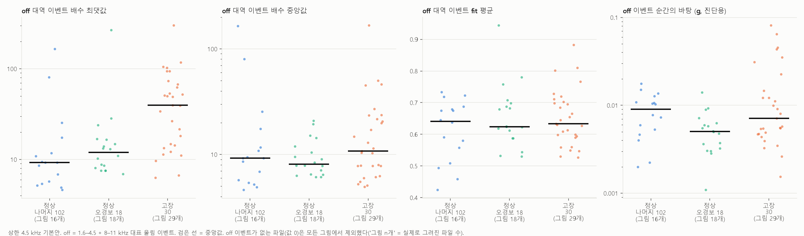

# 2-5 계산 ① 하단 대역 상한 · 계산 ② 오경보 정상의 이벤트 지표 (11-25)

Gemini 수정안([Gemini_2차답변_피처명세안.md](../../Gemini_2차답변_피처명세안.md) 7절)이 요청한 계산 ①②만 돌렸다. 입력은 2-2의 `events.csv`(이벤트 = 25 ms 묶음, 대표 울림 = 50 Hz 격자)이고 새 학습 · 모델은 없다. **라벨을 본 탐색이고 폴드 안 재확인이 아니다.**
코드 [run.py](run.py) · 수치 [figs/계산12_수치.txt](figs/계산12_수치.txt) · 파일별 값 [figs/file_metrics.csv](figs/file_metrics.csv)

## 계산 ① 하단 비정상 대역 상한: 4.5 vs 5.5 kHz

`off` = 1.6~상한 kHz + 8~11 kHz로 운 이벤트 수.

| 상한 | 규칙 | 고장 | 정상 오경보 | 같은 150개 F2(참고) |
|---|---|---|---|---|
| 4.5 kHz | off ≥ 1 | 29/30 | 34/120 (28.3 %) | 0.792 |
| 5.5 kHz | off ≥ 1 | **30/30** | 38/120 (31.7 %) | 0.798 |
| 4.5 kHz | off ≥ 2 | 28/30 | 18/120 (15.0 %) | 0.843 |
| 5.5 kHz | off ≥ 2 | **30/30** | 25/120 (20.8 %) | 0.857 |

넓혔을 때 새로 켜지는 파일:
- off ≥ 1: 고장 abn_023 / 정상 nor_004 · 015 · 027 · 057 (4개)
- off ≥ 2: 고장 abn_014 · abn_023 / 정상 nor_004 · 015 · 027 · 044 · 046 · 057 · 088 (7개)
- 4.5–5.5 kHz 대표 울림 이벤트: 정상 40/566(7.1 %), 고장 22/261(8.4 %). 파일 수로는 정상 9개(7.5 %), 고장 9개(30 %)다.

**읽기**
- 고장 2개를 더 잡는 대신 정상 오경보가 7개 늘어난다. 미탐 1건 = 오경보 4건(F2)이라 2건 ≈ 8건이고, 오경보 7건과 거의 같다. 같은 150개 F2는 0.843 → 0.857로 +0.014 오른다. 한 파일 단위의 차이라서 잡음 안이다.
- Gemini의 예상("오경보가 늘어 F2가 떨어질 가능성이 높다")은 **확인되지 않았다.** F2는 거의 같고 조금 오른다. 반대로 "넓히는 게 낫다"고 할 근거도 아니다. 오경보 증가폭이 크다(18 → 25).
- 결정 신호가 약하다. 이 비교는 라벨을 보고 경계를 고르는 것이라, 선택하면 폴드 안에서 다시 확인해야 한다.

## 계산 ② 오경보 정상 18개 vs 고장 30개

기본안(상한 4.5 kHz)에서 off ≥ 2에 걸린 정상 18개: 002 · 003 · 007 · 019 · 026 · 030 · 037 · 054 · 059 · 072 · 074 · 080 · 082 · 098 · 103 · 104 · 106 · 110.
지표는 off 이벤트 기준이고 off 이벤트가 없는 파일은 0이다. AUC는 "고장 > 비교 집단"이고 대괄호는 파일 재추출 2000번의 95 % 구간이다.

| 지표 | 고장 30 | 오경보 정상 18 | 정상 나머지 102 | AUC vs 오경보 18 | AUC vs 정상 120 전체 |
|---|---|---|---|---|---|
| off 이벤트 수 | 5 [3, 6] | 2 [2, 3] | 0 [0, 0] | 0.74 [0.58, 0.88] | 0.94 [0.89, 0.98] |
| **off 최대 배수** (포락선 ÷ 바탕) | 39.6 [13.6, 66.3] | 12.0 [8.2, 16.1] | 0 | **0.75 [0.59, 0.88]** | 0.92 [0.86, 0.97] |
| off 중앙 배수 | 10.6 [6.7, 21.4] | 8.1 [6.6, 11.6] | 0 | 0.58 [0.42, 0.73] | 0.87 [0.80, 0.92] |
| off fit 평균 | 0.63 [0.59, 0.70] | 0.62 [0.59, 0.70] | 0 | 0.50 [0.33, 0.66] | 0.85 [0.79, 0.91] |
| 전체 이벤트 수 | 6.5 [4.3, 11] | 5 [3, 7.5] | 2 [1, 5] | 0.61 [0.43, 0.78] | 0.77 [0.69, 0.84] |
| 이벤트 간격 중앙값(s) | 0.12 | 0.11 | 0.14 | 0.49 [0.32, 0.66] | 0.43 [0.32, 0.54] |
| 이벤트 최소 간격(s) | 0.04 | 0.05 | 0.07 | 0.44 [0.28, 0.61] | 0.37 [0.27, 0.49] |
| 간격 변동계수 | 0.71 | 0.54 | 0.65 | 0.61 [0.42, 0.79] | 0.56 [0.43, 0.68] |

**읽기**
- **오경보 18개와 고장을 어느 정도 가르는 지표는 "off 이벤트 수"(0.74)와 "off 최대 배수"(0.75)뿐이다.** 구간 아래쪽이 0.58–0.59라 우연으로 보기는 어렵지만 분리가 크지는 않다.
- **off 중앙 배수 · off fit 평균 · 이벤트 간격 통계는 이 18개를 못 가른다**(AUC 0.44–0.61, 구간이 0.5를 포함). 수정안 7개 피처 중 `off_med_rel_amp`와 `off_mean_fit`는 이 비교에서는 정보가 없다.
- **"정상 전체 120과 비교한" 높은 AUC(0.85–0.94)는 대부분 "off 이벤트가 있나 없나"에서 나온다.** 정상의 72 %가 off 이벤트가 0개라 값 0으로 채워지기 때문이다. 크기 지표 자체의 힘이 아니다. 그래서 18개와의 비교가 더 의미 있다.
- 고장 중 off 최대 배수가 낮은 파일: abn_023(off 이벤트 없음 = 0), abn_028 6.3, abn_016 6.7, abn_009 9.6, abn_018 11.1. 이 파일들은 배수만으로는 오경보 정상과 구별되지 않는다. (2-3에서 적은 abn_002 11.3 · abn_024 20.8은 전체 이벤트의 최대 배수였고, off 이벤트만 보면 순서가 다르다.)

### 가설 점검: "조용한 바탕 때문에 오경보가 났다" (진단용 값, 피처로 쓰지 않음)
| 집단 | 모든 이벤트 순간의 바탕 중앙값(g) | off 이벤트 순간의 바탕 중앙값(g) |
|---|---|---|
| 고장 30 | 0.0068 | 0.0071 |
| 정상 오경보 18 | **0.0044** | **0.0050** |
| 정상 나머지 102 | 0.0071 | 0.0091 |

- 오경보 18개의 바탕은 다른 정상 · 고장보다 낮다(0.0044 vs 0.0068–0.0071). off 이벤트 순간의 바탕이 고장보다 낮을 확률은 0.69(구간 0.52–0.83)다. **가설을 어느 정도 지지한다.** 완전히 맞는 것은 아니다.
- **반례 nor_054**: 바탕이 0.0011 g(가장 조용함)이고 off 최대 배수가 **267.8**로 고장 전체와 견줄 만큼 크다(그림 첫 패널의 오경보 18의 맨 위 점). 조용한 파일에서는 작은 충격도 바탕 대비 배수가 아주 커져서 **배수만으로는 구별되지 않는다.** 상대 배수(크기 무관)의 약점이다.

## 정리
1. 5.5 kHz 확장: 고장 +2 / 정상 오경보 +7로 F2 변화가 +0.014(잡음 안). 한쪽이 낫다고 가를 수 없다.
2. 오경보 18개를 가르는 데 쓸 만한 크기 무관 지표는 off 최대 배수 하나(AUC 0.75)이고 효과가 중간 정도다. 중앙 배수 · fit · 간격 통계는 쓸모가 없었다.
3. "조용한 바탕" 설명은 부분적으로 맞고 nor_054가 반례다.
4. 위 숫자는 모두 같은 150개에서 라벨을 본 것이다. 3순위(val 분포 이동)와 폴드 안 재확인은 아직 하지 않았다.
