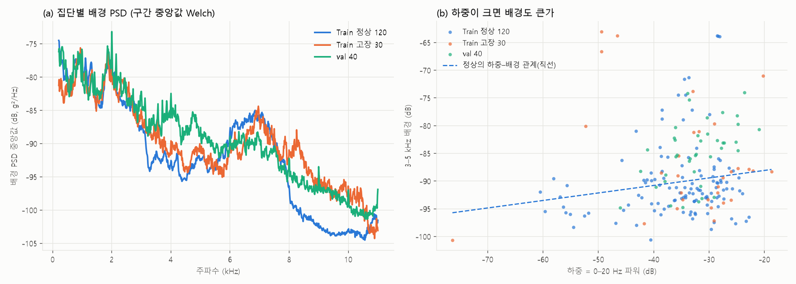

# 2-8 val 배경 이동의 원인: 하중 때문인가 (11-25)

이전 기록(3_단계/2_EDA/2-8_val배경이동)은 "val의 3–5 kHz 배경 +10.9 dB, 고장 비율로 설명 안 됨, 측정 조건 차이 쪽"까지였다. 여기서는 **"하중(노면 입력)이 커져서 올라갔나"**를 데이터로 직접 시험했다. val은 라벨 없이 보고, 모델 · 문턱은 바꾸지 않는다.
코드 [run.py](run.py) · [comb.py](comb.py) · 수치 [figs/수치.txt](figs/수치.txt) · [figs/빗살_수치.txt](figs/빗살_수치.txt) · 파일별 [figs/files.csv](figs/files.csv)

## 방법
- 하중 = 0–20 Hz 저역 신호의 RMS(출렁임). 20–200 Hz RMS도 함께 본다.
- 배경 PSD = 1초 구간 Welch의 **구간 중앙값**(충격이 낀 구간의 영향을 줄임), 평균 제거 후.
- 시험 세 가지: ① val의 하중이 실제로 큰가 ② Train 정상 안에서 하중이 크면 배경도 큰가(기울기로 val 이동량 예측) ③ 하중이 비슷한 파일끼리만 비교.

## 결과
**① val의 하중은 거의 같다**
| | 정상 | 고장 | val | val − 정상 |
|---|---|---|---|---|
| 0–20 Hz RMS (g) | 0.0211 | 0.0282 | 0.0245 | +1.3 dB (p 0.08) |
| 20–200 Hz RMS (g) | 0.0100 | 0.0081 | 0.0085 | −1.5 dB (p 0.37) |

**② 하중으로 예측되는 이동은 거의 0이다**
| 대역 | Train 정상 안 ρ(하중, 배경) | 하중 차이로 예측한 이동 | 실제 이동 | 하중 보정 후 남는 이동 |
|---|---|---|---|---|
| 1.0–2.5 kHz | +0.39 | +0.5 dB | +0.5 dB | +0.2 dB |
| **3.0–5.0 kHz** | **+0.11** | **+0.2 dB** | **+7.3 dB** | **+5.0 dB** |
| 5.5–8.0 kHz | +0.25 | +0.2 dB | −4.2 dB | −4.4 dB |
| 8.0–10.0 kHz | +0.09 | +0.1 dB | +5.4 dB | +2.1 dB |

**③ 하중이 같은 파일끼리 비교해도 남는다**: val 하중 IQR 범위 안의 정상 57개 vs val 20개에서 3–5 kHz 배경 차이 **+6.2 dB**.

**④ 이동 모양은 "전체가 커짐"이 아니라 "대역별로 다르게 바뀜"이다** (val − 정상)
| 0.2–1.6 kHz | 1.6–3 kHz | 3–5 kHz | 5–5.5 kHz | 5.5–6.5 kHz | **6.5–7.5 kHz** | 8–10 kHz | 10–11 kHz |
|---|---|---|---|---|---|---|---|
| −0.7 ~ +0.6 | +1.1 ~ +1.8 | **+5.5 ~ +6.6** | +3.6 | −0.8 | **−3.8** | +4.7 ~ +5.7 | +2.8 |

- 참고로 Train 고장 − 정상은 3–5 kHz +1.9 ~ +2.8, 8–10 kHz +6.6 ~ +7.9다. val의 8–10 kHz 이동은 고장 혼합과 구별되지 않지만, 3–5 kHz 이동은 고장보다 훨씬 크다.

**⑤ 모드 위치**: 본체 모드(5.5–8 kHz 최대 봉우리)의 위치는 같다(정상 6573 Hz, val 6635 Hz, p 0.79). 2.5–4 kHz 봉우리는 val이 위로(2692 → 2966 Hz, p 0.02), 1.0–1.6 kHz 봉우리는 아래로(1245 → 1086 Hz, p 0.01) 옮겨 갔다. 파일 수가 40개라 약한 증거다.

**⑥ 점검했지만 아니었던 것**: val 중앙 PSD의 2.7–4.2 kHz에 약 145 Hz 간격 봉우리가 보였지만, 파일별로 보면 빗살 패턴이 있는 val은 0/40이다(정상 6/120, 고장 0/30). 40개 파일의 중앙값 곡선이 들쭉날쭉해서 생긴 착시로 본다.

## 해석 (도메인 근거)
1. **하중(입력 크기) 가설은 기각한다.** 선형계에서 입력이 커지면 응답은 모든 대역에서 거의 같은 비율로 커진다(전달함수 H는 그대로). 그런데 val은 하중이 같고, 하중을 맞춰도 3–5 kHz가 +6 dB 남고, 6.5–7.5 kHz는 오히려 −3.8 dB 내려갔다. 이 "대역별 재분배"는 입력 크기로 설명되지 않는다.
2. **남는 후보는 "전달 경로 · 구조가 다르다" 또는 "입력의 주파수 모양이 다르다"이다.**
   - (a) **측정 세션 · 장착 차이**: 데이터 소개 PDF에 "센서 부착 위치는 실험 조건에 따라 결정"이라고 되어 있다. 센서 위치나 차량(암 개체)이 다르면 전달함수가 바뀌어 대역별로 다르게 오르내린다. 이 패턴과 가장 잘 맞는다.
   - (b) **고무 부싱의 조건 의존성**: 고무의 동강성 · 손실계수는 온도 · 주파수 · 진폭에 따라 변한다(도메인 논문 A · D). 온도가 다르면 부싱이 연해지거나 굳어 경계 조건이 바뀌고, 모드별로 다르게 움직인다. 1.0–1.6 kHz 봉우리가 내려가고 2.5–4 kHz 봉우리가 올라간 것은 한 방향의 강성 변화로는 깔끔하게 설명되지 않는다.
   - (c) **노면 · 속도 차이**: 노면 조직이나 속도가 바뀌면 0–20 Hz 크기는 같아도 kHz 대역 입력 모양이 달라질 수 있다(도메인 D4: 노면 입력이 진단 특징을 오염). 메타정보가 없어 확인할 수 없다.
   - (d) **학습에 없던 고장 유형**: 막을 수 없다. 다만 Train 고장은 3–5 kHz를 +2 dB 정도만 올린다.
3. **모델에 주는 뜻**: 3–5 kHz와 6.5–7.5 kHz의 절대 에너지 · 몫 피처는 val에서 흔들린다. 바탕 대비 배수 같은 상대 지표도 배경이 3–5 kHz에서 올라가면 그 대역의 충격이 덜 검출될 수 있다(2-6에서 val 이벤트 수가 적게 잡힌 것과 방향이 맞다, 미확인).

## 한계
- 하중을 0–20 Hz RMS로만 정의했다. 하중의 방향 · 정적 예압은 볼 수 없다(센서 1축).
- 라벨 없는 val 40개라 표본이 작고, 고장 비율도 모른다.
- (a)–(c)는 메타정보(센서 위치 · 차량 · 노면 · 온도)가 없어 데이터만으로는 가를 수 없다. 조교 질문 후보다.
