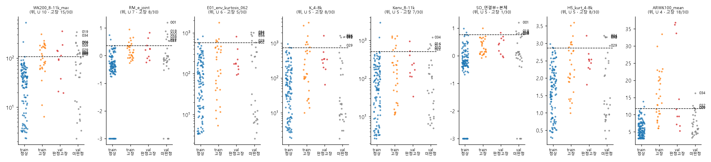

# V-11 val 고장을 끌어내는 피처 탐색: 첨도 · 윈도우 · 스펙트로그램 (11-27)

## 목적 · 질문
train을 더 잘 맞추는 피처가 아니라, **val에서 아직 정상으로 판정한 30개 중 고장을 끌어내는 피처**를 찾는다. train에서 "정상에도 1–2개 있다"는 이유로 버렸던 징후가 val에서 무리 지어 나타나는가?

## 방법
- 피처 457개 = 새로 계산 약 250개 + 기존 캐시 약 210개(ext150 · H · f3 · MB · RM · 4-19 · 4-21 · w_segk). 정의는 val을 보기 전에 고정했다
  - **첨도**: 옥타브 1–2 · 2–4 · 4–8 · 8–11 kHz와 1–11 kHz의 신호 첨도 `K_`, 포락선 첨도 `Kenv_`
  - **윈도우**: 20 · 50 · 100 · 200 ms 창(절반 겹침)마다 첨도 `WK`(max · p90 · mean)와 RMS `WR`(max/중앙 · 첨도 · 중앙 4배 넘는 창 수). AR(40) 백색화 판 `ARWK`
  - **스펙트로그램**: STFT 256 · 512 · 1024점. spectral kurtosis `SK`, 대역 프레임 에너지의 첨도 `TK` · max/중앙 `TC`, 가장 큰 3프레임의 대역 몫 `TS`, flux · 엔트로피 · 중심 · 활성 프레임 비율
- **선 = train 정상 120개 중 2개만 넘는 값**(정상에도 1–2개 있는 징후), 위 · 아래 두 방향. 그 선을 넘는 val 미판정 파일 수를 센다. U가 모두 정상이라면 기대값은 0.5개다
- **후보** = 미판정 30개 중 3개 이상이 넘고 이항 p < 0.01. 다만 val 미판정 중앙값이 train 정상 기준 |z| ≥ 1이거나 12개 넘게 넘으면 **"이동"**(측정 조건 차이)으로 따로 뺀다
- val 라벨과 다른 조 결과는 쓰지 않는다. 실행 `자료/run.py` → `자료/result.txt` · `자료/피처표.csv`(914행 전체) · `자료/파일별_후보수.csv`

## 결과

**그림 읽는 법**: 칸마다 피처 하나, 점 하나가 파일 하나다. 파랑 = train 정상, 주황 = train 고장, 빨강 = val 판정 고장(10), 회색 = val 미판정(30). 점선 = train 정상 2개만 넘는 선, 오른쪽 숫자 = 그 선을 넘는 val 미판정 파일이다.

| # | 결과 |
|---|---|
| 1 | **4–8 kHz 첨도(H5 · `K_4-8k` · `Kenv_4-8k`)가 val 미판정 5개를 끌어올린다: 012 · 029 · 032 · 034 · 036.** 넷은 정상 100 백분위, 029는 99다. 선을 넘는 train 정상은 054 · 073 두 개, train 고장은 8개(001 005 009 012 014 018 027 030)다. 미판정 30개가 모두 정상이라면 기대값은 0.5개인데 5개가 나왔다(p 3.5e-4). val 중앙값은 이동하지 않았다(z −0.5 – −0.65) |
| 2 | **윈도우 첨도는 같은 5개를 더 많은 train 고장과 함께 잡는다.** `WK200_1-11k_max`(200 ms 창 첨도의 최대)는 미판정 012 · 029 · 032 · 034 · 036, train 고장 14/30, 선을 넘는 정상은 050 · 088이다. 200 ms 창을 4–8 · 8–11 kHz로 바꾸면 006 · 008 · 009 · 002 · 019가 더 들어오지만 train 고장도 15–19/30으로 넓어진다 |
| 3 | 파일별로 보면 후보 30개 중 **034 23 · 029 20 · 032 18 · 012 15 · 036 13 · 009 12 · 006 11**개 피처가 이 파일을 선 위로 올린다. 대부분 첨도와 윈도우 첨도다. 나머지 23개 파일은 0–6개다 |
| 4 | **스펙트로그램 계열은 하나도 후보가 되지 않았다.** `SK` · `TK` · `TC` · flux · 엔트로피 · 중심은 val 미판정 초과가 우연 수준이다. 가장 큰 프레임의 대역 몫 `TS`는 12개 모두 val 전체 이동이다(val 배경 3–5 kHz 상승과 같은 원인). 윈도우 RMS `WR`도 후보 0개 |
| 5 | 3–5 kHz 비율 계열(`RM_e_joint` · `SO_연결부÷본체`)은 001 · 018 · 019 · 020 · 038 · 037을 올린다. 이동 z가 0.8–0.94로 문턱 직전이고 대역이 val 배경 이동 대역과 겹친다 → **이동으로 본다** |
| 6 | 2–4 kHz 20–50 ms 창 첨도 "아래"(012 015 018 028 030 032)는 train 고장 0개라 고장 근거가 아니다 |

## 해석
- val에서 놓친 고장으로 의심하던 **고립 강타형(V-2의 012 · 032 · 034 · 036)이 "4–8 kHz 첨도"에서 하나로 모인다. 029도 같은 무리다.** V-2에서 "최대 충격 크기"는 train 정상 80–98 백분위에 그쳐 가르지 못했다. 첨도는 크기와 "드물게 하나만 튐"을 함께 재기 때문에 100 백분위로 올라간다
- train에서 이 징후는 정상 2개(054 · 073)에도 있었다. 고장 8개는 대부분 다른 열로 이미 잡혀서 ET는 이 꼬리를 쓰지 않았다(H5는 ET 입력에 있다). **"정상에도 있다"는 이유로 무시된 꼬리가 val에서는 5개 파일로 나타난다**
- F2로 보면(고장 17개 고정): 5개를 더 고장으로 내면 그중 고장이 1개만 있어도 val F2가 오른다. 5개가 모두 고장이면 F2 = 5·13 / (68 + 15) = **0.78**(지금 0.513). train에서 치르는 비용은 정상 054 · 073 오경보 2개다
- 스펙트로그램(시간–주파수 통계)은 새 정보를 주지 못했다. 쓸 만한 것은 **시간 창 첨도**, 곧 "짧은 구간에 갑자기 튀는 사건" 쪽이다

## 주의
- 피처 914개(457 × 두 방향)를 본 결과다. val U를 무작위 train 정상 30개로 바꿔 같은 절차를 돌리면 "후보" 피처 수가 0–52개(중앙 7)로 나온다. 피처끼리 상관이 커서 우연한 무리가 생긴다 → **후보 피처 수(30)는 증거가 아니다.** 증거가 되는 것은 서로 다른 계열(첨도 · 윈도우 첨도 · ext · H5)이 **같은 5개 파일**을 가리키고, 그 파일이 V-2 파형 확인 · 8조(034 · 036) · 효섭 RF(012 · 032 · 034 · 036)와 겹친다는 점이다. 다른 조 결과는 확인용으로만 썼다
- val 미판정 파일을 보고 피처를 고른 것이다. 선(train 정상 3번째 값)은 train만으로 정했지만, 이 피처를 쓰기로 한 결정은 val 분포를 본 뒤 내렸다 → test에서 따로 확인해야 한다
- H5 · `K_4-8k`는 파일 전체 첨도라 충격 수에 민감하다(충격이 많은 고장은 오히려 낮아짐). 그래서 train 고장 8/30만 넘는다. 이 피처는 "고립 강타" 한 유형만 맡는다

## 다음 (사용자 판단)
- (a) OR 규칙 "H5(4–8 kHz 첨도) > train 정상 3번째 값" 또는 `WK200_1-11k_max`로 같은 규칙 → train 중첩 CV(오경보 증가)와 val 판정 변화를 본다
- (b) ET 열로 넣는 것은 EXP-068(w_segk)처럼 효과가 묻힐 가능성이 크다. 이 징후는 꼬리(규칙)로 쓰는 쪽이 맞다

## 개념
- **첨도(kurtosis)**: 분포 꼬리가 얼마나 두꺼운가. 가우스 잡음은 3이고, 2초 중 한 순간만 크게 튀면 수백–수천이 된다
- **윈도우 첨도**: 신호를 짧은 창(예: 200 ms)으로 잘라 창마다 첨도를 잰다. 창 안에서 갑자기 튀는 사건이 있으면 큰 값이 나온다. 파일 전체 첨도와 달리 다른 구간의 충격 수에 덜 묽어진다
- **spectral kurtosis(SK)**: 주파수 칸마다 시간에 따른 세기의 첨도. 어느 주파수에서 충격성이 큰지 본다
