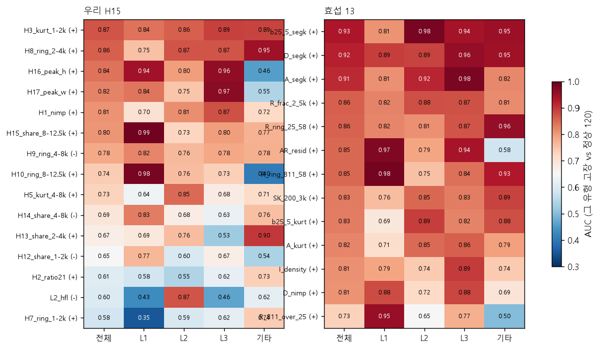
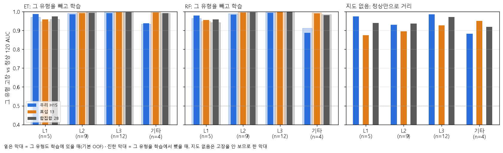
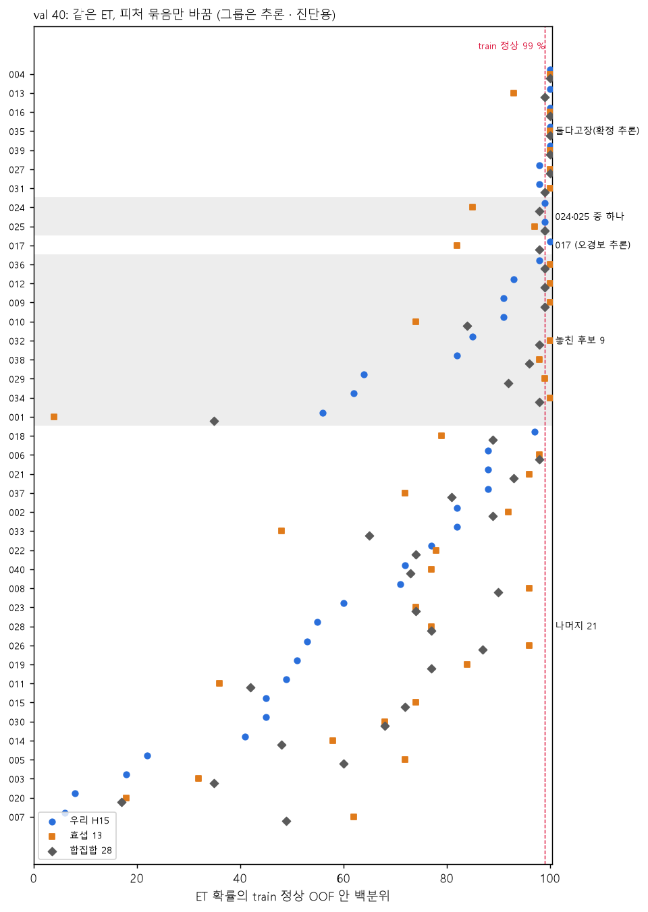

# V-11 피처 묶음 교체 비교: 우리 H15 vs 효섭 13 (11-27)

상태: EDA 끝 · 실험 전 (사용자 판단 대기)

## 한 줄 결론
**모델을 같게 두면 효섭 13개가 우리 H15보다 train에서도 낫다**(ET PR-AUC 0.974 vs 0.949). **유형마다 고르게 가르는 것도 효섭 쪽이다.** 우리 피처는 "어느 대역으로 울렸나"를 재는 유형 전용 피처이고, 효섭 상위 피처(구간 첨도 계열)는 "신호가 시간에 따라 얼마나 뾰족한가"를 재는 공통 피처다. 우리 CV 점수가 높았던 것은 ET 피처가 아니라 그 바깥 구조(박자 · AE · 규칙) 덕분이다. → "ET 피처를 근본적으로 바꾼다"는 방향은 근거가 있다.

## 목적 · 질문
V-3 · EXP-068에서 구간 첨도 1열을 ET에 더해도 val 고립 강타를 못 잡았다. 그러면 열 하나가 아니라 **피처 묶음 자체**가 문제인가?
1. 모델을 고정하고 피처 묶음만 바꾸면 train · val 결과가 어떻게 달라지나
2. train에 없던 고장 유형에 어느 묶음이 더 잘 일반화되나

## 방법
- 묶음: **우리 H15**(제출 모델 EXP-062 구성 3의 ET 입력 그대로, 울림 축소 포함) · **효섭 13**(1119 최종 모델이 돌려 쓰는 13개, 3-2와 같은 계산) · **합집합 28**
- 모델: ET(제출 모델과 같은 설정, 300그루) · RF(효섭 설정, 300그루, 배깅 · 피처 선택 없음) · **지도 없음**(train 정상만으로 강건 z → Ledoit-Wolf 마할라노비스 거리)
- A. train 그룹 5-fold OOF(097 · 101 · 120 한 그룹) × seed 3: AUC · PR-AUC
- B. **유형 빼기**: 2-1 고장 유형(L1 5 · L2 9 · L3 12 · 기타 4 = L4 1 + 미분류 3)을 하나씩 학습에서 통째로 빼고, 그 유형 고장이 정상 120보다 높게 나오는지(AUC) 본다. train 안에서 "처음 보는 유형"을 흉내 낸 시험이다
- C. 단일 피처 × 유형 AUC
- D. val: train 150 전체로 학습 → val 40 점수(train 정상 OOF 안 백분위로 맞춤). 그룹은 아래처럼 **추론한 것**이고 진단에만 쓴다
  - 둘다고장 7(우리 ∩ 8조) · 024 · 025 중 하나는 고장 · **017 = 오경보 추론**(val F2 0.513 = TP 8 · 오경보 2에서 계산, 효섭 결과와 무관) · **놓친 후보 9** = 001 009 010 012 029 032 034 036 038(효섭만 + 8조만, 개수가 미탐 9와 같음)
- 실행: `자료/run.py` → `자료/표.md` · `자료/result.json` · `자료/figs/` (약 4분)

## 결과

### A. 같은 모델이면 효섭 묶음이 train에서도 낫다
| 묶음 | ET AUC · PR-AUC | RF AUC · PR-AUC | 지도 없음 AUC · PR-AUC |
|---|---|---|---|
| 우리 H15 | 0.982 · 0.949 | 0.978 · 0.946 | **0.953 · 0.823** |
| 효섭 13 | **0.989 · 0.974** | **0.989 · 0.974** | 0.912 · 0.699 |
| 합집합 28 | 0.991 · 0.975 | 0.987 · 0.971 | 0.949 · 0.769 |

(seed 3개 sd 0.002–0.013. 지도 없음만 우리 묶음이 낫다)

### C. 우리 피처는 유형 전용, 효섭 피처는 공통

**그림 읽는 법**: 칸 = 피처 하나가 그 유형 고장과 정상 120을 얼마나 가르나(AUC, 빨강 = 잘 가름, 파랑 = 못 가름). 첫 열은 고장 30 전체다. 괄호 = 방향(+ 고장이 큼).

- **효섭 상위 3개(b25_5_segk · D_segk · A_segk, 구간 첨도 계열)는 네 유형 모두 0.81–0.98**이다. D_segk는 가장 낮은 유형도 0.89다
- **우리 피처는 유형마다 들쭉날쭉하다.** H10(8–12.5 kHz 울림) · H15(8–12.5 kHz 몫)는 L1에서 0.98–0.99지만 기타에서 0.40–0.77이다. L2_hfl은 L2에서만 0.87이다. H16 · H17(봉우리)은 L3에서 0.96–0.97, 기타에서 0.46–0.55다
- 우리 쪽에서 네 유형을 고르게 가르는 것은 **H3(1–2 kHz 첨도, 0.84–0.89)** 하나뿐이다. 이것도 첨도, 즉 "뾰족함" 피처다

### B. 유형 빼기: train 안에서는 "새 유형"을 만들 수 없다

**그림 읽는 법**: 옅은 막대 = 그 유형도 학습에 있을 때, 진한 막대 = 그 유형을 빼고 학습했을 때. 지도 없음은 고장을 보지 않으므로 막대가 하나다.

- 어느 묶음이든 유형을 빼도 AUC가 거의 그대로다(손실 −0.017 – +0.024). **train 고장 유형들은 피처 공간에서 서로 다르지 않다.** V-1의 "train 고장은 모두 두 징후가 강한 고장"과 같은 말이다. 그래서 이 시험으로는 val의 고립 강타 같은 새 유형 일반화를 재지 못한다
- 차이가 나는 곳은 **기타(017 · 021 · 023 미분류 + 015 저주파)**다: 우리 ET 0.93 · RF 0.89, 효섭 0.99 · 0.99. 조용한 고장을 효섭 묶음이 더 잘 가른다

### D. val: 같은 ET에서 효섭 묶음이 놓친 후보를 끌어올리고, 나머지는 올리지 않는다

**그림 읽는 법**: 파일 하나가 한 줄이다. 가로 = 같은 ET의 확률이 train 정상 OOF 점수 중 몇 백분위인가. 빨간 점선 = train 정상 99 %. 색 = 피처 묶음. 회색 띠 = 그룹(추론).

| 묶음 (ET) | 후보 9 순위 중앙(40개 중) | 후보 9가 정상 99 % 위 | 나머지 21이 정상 99 % 위 | 017(오경보 추론) 백분위 | 013(고장 확정) |
|---|---|---|---|---|---|
| 우리 H15 | 19 | **0 / 9** | 0 / 21 | **100** | 100 |
| 효섭 13 | 11 | **6 / 9** (009 012 029 032 034 038) | 0 / 21 | **77** | 93 |
| 합집합 28 | 14 | 3 / 9 | 0 / 21 | 98 | 98 |

- **우리 H15는 놓친 후보 9개 중 하나도 train 정상 99 %를 넘기지 못한다.** 같은 ET에 효섭 묶음을 넣으면 6개가 넘고, 나머지 21개는 하나도 넘지 않는다
- ⚠ **순환 주의**: 후보 9 중 8개는 효섭 모델이 고른 파일이라, 효섭 묶음이 높게 매기는 것은 당연한 면이 있다. 효섭 결과와 **무관한** 근거는 017이다. 017은 우리 점수와 다른 조 정보로 오경보라고 추론했는데, 우리 묶음은 100 백분위(가장 고장 같음), 효섭 묶음은 77이다
- 대신 효섭 묶음은 013(고장 확정)을 93으로 낮추고, 나머지 21 중 006 · 008 · 026을 96–98까지 올린다(val 배경 이동, 3-2의 R_frac_2_5k)
- **합집합은 중간이다.** 열을 더하면 ET가 기존 열과 몫을 나누므로 효섭 묶음의 이점이 묽어진다(EXP-068과 같은 현상)
- **지도 없음(정상만으로 거리)은 val에서 쓸 수 없다**: 후보 9 vs 나머지 21 AUC 0.52. val 전체가 train 정상에서 멀어져 있어(측정 조건 이동) 거리가 고장을 가리지 못한다

## 해석과 결정
- 우리 ET 피처가 val 고장을 못 잡는 이유는 **피처가 "고장의 일반 성질"이 아니라 "train 고장의 겉모습"을 재기 때문이다.** 울림 비율 · 에너지 몫 · 봉우리는 "충격이 몇 개 검출됐고, 그것이 어느 대역으로 울렸나"를 잰다. train 고장(반복 충격 + 2–4 kHz 울림)에는 맞지만, 충격이 1–2개뿐이거나(고립 강타) 다른 대역으로 우는 고장에서는 값이 정상 범위에 머문다
- 효섭 상위 피처인 구간 첨도는 충격 검출 없이 **"신호가 시간에 따라 얼마나 뾰족한가"**를 잰다. 그래서 유형과 무관하게 고르게 갈린다(C). 우리 묶음에서 같은 성질을 가진 것은 H3 하나다
- EXP-068이 실패한 이유도 같다. 열 하나를 **더하면** ET가 기존 유형 전용 열과 몫을 나누고, 결합기 문턱은 train의 강한 고장에 맞춰진다. 고치려면 **ET 입력을 공통 피처 중심으로 바꾸는 것(교체)**을 시험해야 한다
- 정상만으로 이상 점수를 내는 방식(지도 없음)은 val 측정 조건 이동에 무너진다 → 근본 변경은 학습 방식이 아니라 **피처** 쪽이다
- 주의: EXP-059 C(J 구조 + 소린 10개로 교체)는 val 고장이 7개로 오히려 줄었다(016 · 039 놓침). 피처만 바꾸고 결합 구조(로지스틱 + train F2 최대 문턱)를 그대로 두면 이득이 사라질 수 있다. 교체 실험에서는 결합 구조의 영향도 함께 봐야 한다

## 다음 (실험은 요청 시)
- **EXP-070 (제안)**: J 구조(박자 · AE · E2 · 8.3k 규칙)는 두고 ET 입력만 교체해 같은 중첩 CV로 비교한다
  - 0 기준 H15 · 1 효섭 13 · 2 공통 피처 묶음(구간 첨도 3 + H3 + H1 + 울림 비율 중 유형 공통인 H8, 우리 전처리 판 `src/featV`)
  - 볼 것: train F2 · 오경보, 기타 유형(017 · 021 · 023 · 015) 놓침, val 판정 변화(후보 9 · 017 · 013 · 006 · 008 · 026)

## 개념
- **유형 빼기(leave-one-type-out)**: 한 유형의 고장을 학습에서 통째로 빼고 그 유형을 맞히는지 본다. 처음 보는 고장에 대한 일반화를 train 안에서 재는 방법이다
- **Ledoit-Wolf 마할라노비스 거리**: 정상 분포의 공분산을 안정적으로 추정해서, 상관된 피처를 고려해 정상 중심에서 얼마나 먼지 잰다
- **PR-AUC**: 고장이 적을 때 AUC보다 정밀도 손실을 잘 드러내는 지표. 1에 가까울수록 고장을 위쪽에 깨끗하게 모은다
