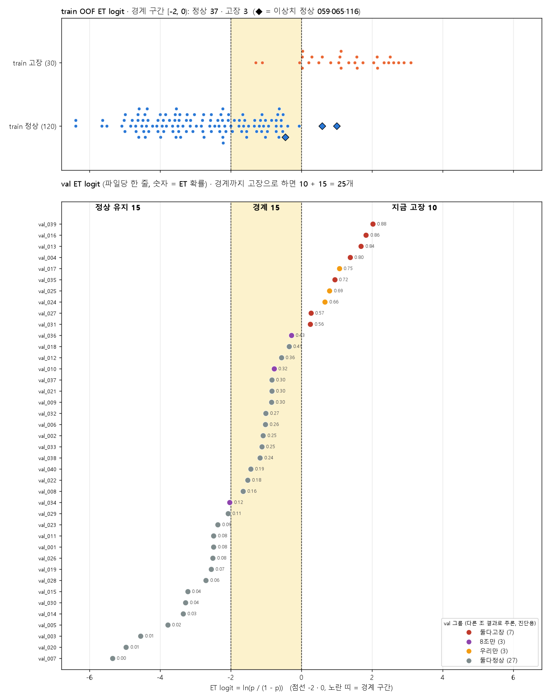
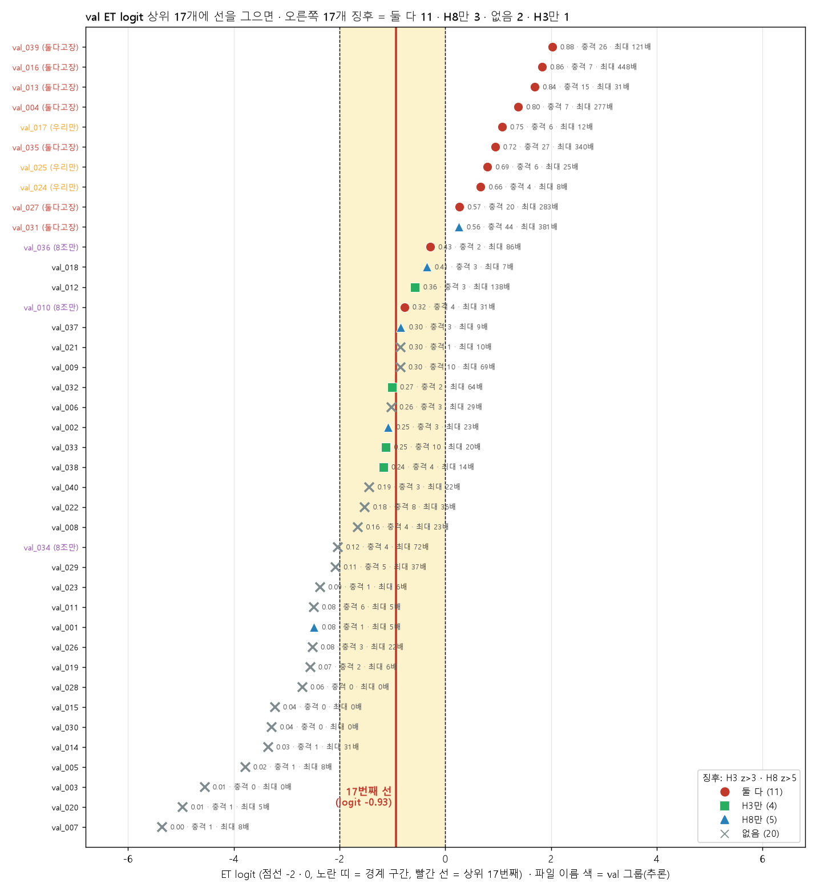

# V-1 val 미탐 원인 진단 (11-27)

## 목적 · 질문
val F2 **0.513**(고장 17/40, 우리 고장 판정 10 → TP 8 · 오경보 2 · **미탐 9**). train 중첩 CV 0.971인데 왜 val에서 고장의 절반을 놓쳤나.
사용자 가설: "train이 너무 쉽게 나뉘어서 ET가 피처 몇 개만 썼다."

## 방법
- 제출 모델(EXP-062 구성 3)을 그대로 읽어 train 150 · val 40의 ET 입력 15열을 만든다(학습 없음)
- A 단일 피처 AUC · ET 중요도, B 얕은 나무(깊이 1 · 2) OOF, C 상위 k개만 쓴 ET, D val 그룹별 피처 위치(train 정상 기준 강건 z), E ET logit 구간별 파일 수, F 두 징후 동시 출현
- val 그룹은 8조 결과와 겹쳐 추론(둘다고장 7 · 8조만 3 · 우리만 3 · 둘다정상 27). **진단에만 쓰고 모델 · 문턱 튜닝에 쓰지 않는다**
- 실행: `자료/run.py` → `자료/result.txt`. 경계 그림은 `자료/plot_경계.py` → `자료/figs/01_ET경계.png` · `02_ET_17선_징후.png`(스크립트는 번호 없는 이름으로 저장 → 다시 그리면 이름에 번호를 붙인다. V-1 캐시만 읽음, 학습 없음)

## 결과

**그림 읽는 법**: 가로 = 제출 모델의 ET logit(ln(p / (1 − p))), 노란 띠 = 경계 구간 −2 ≤ logit < 0. 위 = train 150의 OOF logit(점이 겹치지 않게 위아래로 비켜 놓음, ◆ = 이상치 정상 059 · 065 · 116). 아래 = val 40을 파일당 한 줄로 놓고, 숫자는 ET 확률, 색은 val 그룹(추론, 진단용)이다.

- train 경계 구간에는 정상 37 · 고장 3이 있다 → 모델은 이 구간을 정상으로 배웠다
- val은 정상 유지 15 · **경계 15** · 지금 고장 10이다. 경계까지 고장으로 하면 **25개**다. 경계 15개 중 8조만 잡은 파일은 036 · 010이고, 나머지 13개는 둘다정상 그룹이다
- 8조만 잡은 034(확률 0.12)는 −2 선 바로 바깥이다(029 0.11도 붙어 있음)
- ⚠ 이 경계는 원인 진단용이다. val 그룹을 보고 문턱을 −2로 내리면 val 과적합이 되고, train에서는 정상 37개(31%)가 오경보가 된다

### 상위 17번째에 선을 그으면 (11-27 추가)

**그림 읽는 법**: val을 ET logit 순으로 놓고, 실제 고장 수 17에 맞춰 위에서 17번째와 18번째 사이에 빨간 선을 그었다(logit −0.93). 모양 = 징후(● 둘 다 · ■ H3만 · ▲ H8만 · × 없음), 오른쪽 숫자 = ET 확률 · 충격 수 · 최대 배수. 표는 `자료/17선_표.txt`

- 선 오른쪽 17개 = **둘 다 11 · H8만 3(031 · 018 · 037) · H3만 1(012) · 없음 2(021 · 009)**
- 지금 고장 10개 다음으로 들어오는 7개(11–17위) = 036 · 010(둘 다, 8조만) · 018 · 037(H8만, V-2에서 약한 충격 → 정상 쪽) · 012(H3만, 고립 강타) · 021 · 009(징후 없음)
- **"징후 하나만"인 파일로 채워지지 않는다.** 하나만인 val 9개 중 선 안에 드는 것은 4개(031 · 018 · 012 · 037)뿐이다. 고립 강타 032(H3만, 64배)와 034(징후 없음, 72배, 8조만)는 선 밖이다
- 15–17위(037 · 021 · 009)는 logit 차이 0.01 안이다 → 선의 위치는 사실상 동률에서 갈린다. ET 순위만으로는 경계 안의 순서를 믿기 어렵다

| # | 결과 | 근거 (`자료/result.txt`) |
|---|---|---|
| 1 | **피처 쏠림은 크지 않다.** ET 중요도 상위 3개 합 0.37 · 5개 합 0.56, 단일 피처 AUC 최고 0.87, 깊이 1–2 나무 F2 0.69–0.71 | A · B · C |
| 2 | **train 고장은 두 징후가 함께 있는 강한 고장.** H3(1–2 kHz 첨도) z > 3 · H8(2–4 kHz 울림 비율) z > 5 둘 다: 고장 67%, 정상 4%. 하나만: 고장 13%, 정상 22% → 모델은 "하나만 = 정상"으로 배웠다 | F |
| 3 | **애매한 구간이 train에서 비어 있다.** ET OOF logit −2–0: train 정상 37 · 고장 3(92% 정상), val 15개 | E |
| 4 | 우리가 고장으로 낸 10개 = 두 징후 모두 강함(H8 z +9 – +38). 8조만 잡은 010 · 036도 두 징후가 있지만 약하다(H8 z +8 · +11, 충격 4 · 2개, H16 봉우리 음수) → ET 확률 0.32 · 0.43 | D · G |
| 5 | val에서 징후가 하나만 있는 파일 9개: 001 002 012 018 031 032 033 037 038 (031만 고장 판정) | F |
| 6 | AE z는 val 40개 전부 +0.1 – +2.6(분포 이동). 전체를 같이 올려서 미탐의 주원인은 아님 | G |

## 해석과 결정
- 가설은 **반쯤 맞다**. "피처 몇 개"가 아니라 **"강한 고장만 배운 것"**이 문제다. 약한 고장이 train에 거의 없어 애매한 구간을 정상으로 배웠고, 문턱도 그 빈 구간에서 정해졌다
- 고장 비율 차이(train 20% → val 42.5%)가 겹쳐, 같은 애매한 파일도 val에서는 고장일 가능성이 약 3배
- ⚠ V-2에서 고침: 놓친 후보 상당수(034 · 036 · 012 · 032)는 "약한 고장"이 아니라 **충격은 강하지만 1–2개뿐인, train에 없던 유형**이었다
- 다음: V-2에서 010 · 036 · 034와 징후가 하나만 있는 8개의 파형을 직접 본다(약한 고장인가, 정상의 잡음인가)

## 개념
- **F2**: 재현율을 정밀도보다 4배 무겁게 보는 점수. 고장 17개로 정해지면 F2 = 5·TP / (68 + 고장 판정 수)
- **OOF logit**: 그 파일을 학습에 쓰지 않은 모델이 낸 점수(로그 오즈). 학습 점수보다 정직하다
- **강건 z**: (값 − train 정상 중앙값) / (1.4826 × MAD). 이상치에 덜 흔들리는 표준화
