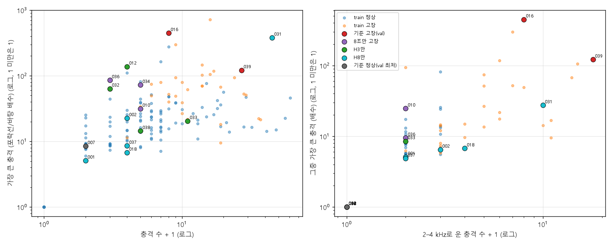
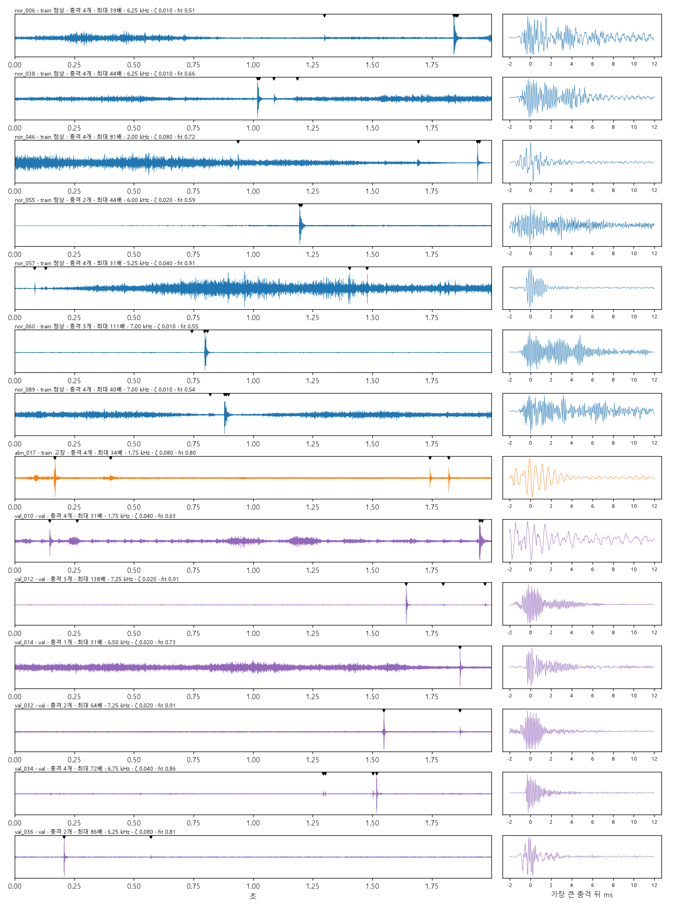

# V-2 놓친 고장 후보 파형 확인 (11-27)

## 목적 · 질문
V-1에서 나온 놓친 고장 후보(8조만 010 · 034 · 036, 징후가 하나만 있는 8개)의 충격은 진짜 고장 충격(약한 판)인가, 정상의 잡음인가?

## 방법
- 제출 모델과 같은 충격 검출기(1–11 kHz 대역통과, `src.impacts.all_impacts(fmax=11000)`)로 train 150 · val 40 전체의 충격을 뽑는다
- 그림 3장: 파형 + 충격 표시 · 가장 큰 충격 확대(울림 주파수 · ζ · fit) · 충격 세기 분포(train 위에 val 후보)
- 기준: val 확실한 고장 039 · 016, val 점수 최저 007, train 정상 중 징후가 하나만 있는 파일 027(H3) · 006(H8)
- 실행: `자료/run.py` → `자료/figs/` · `자료/파일표.md` · `자료/result.json`. 캐시는 `4_outputs/cache/val_eda_*.joblib`

## 결과

**그림 읽는 법**: 점 하나가 파일 하나다. 왼쪽 그림은 가로 = 충격 수, 세로 = 가장 큰 충격의 크기(포락선이 바탕의 몇 배인가)다. 오른쪽 그림은 2–4 kHz로 운 충격만 센다. 파랑 = train 정상, 주황 = train 고장, 큰 점 = val 후보.

| # | 결과 | 근거 |
|---|---|---|
| 1 | **val 확실한 고장(039 · 016 · 031)은 "큰 충격의 반복"이다.** 약 25 ms 간격으로 충격이 7–44개 이어지고, 2 kHz · ζ 0.08로 운다. train 고장과 같은 모습이다 | `파형_충격.png` · `충격_확대.png` |
| 2 | **034 · 036 · 012 · 032는 다른 모습, 즉 "고립된 강한 충격 1–2개"다.** 크기 64–138배로 train 정상 최대 충격의 96–98 백분위(train 고장 중앙 58배와 비슷하거나 더 큼)인데 반복되지 않는다. 034 · 012 · 032는 6.75–7.25 kHz · ζ 0.02 · fit 0.86–0.91로 맑게 운다 | `파일표.md` · `충격_확대.png` |
| 3 | **충격 ≤ 4개이면서 최대 > 60배인 파일: train 정상 2/120(1.7%) · train 고장 0/30 · val 4/40(012 · 032 · 034 · 036).** 7 kHz 근처에서 맑게(ζ ≤ 0.02, fit ≥ 0.85) 50배 넘게 운 충격은 train에 0개, val에 2개(012 · 032)다 | 추가 확인(아래 주의) |
| 4 | **"H8만" 후보(001 · 018 · 037)는 약하다.** 충격 1–3개, 5–9배(train 정상 최대 충격의 14–22 백분위)이고 바탕 잡음이 크다. 충격 하나가 2–4 kHz로 울면 비율 H8이 크게 튀어 징후처럼 보인 것이다 → 정상일 가능성이 크다 | `파일표.md` · `파형_충격.png` |
| 5 | 010 · 033 · 038 · 002는 중간이다(14–32배). 010은 1.75 kHz로 울지만 바탕에 잡음 덩어리가 많다 | `파형_충격.png` |

### 추가 (11-27): train의 고립 강타 — 왜 "하나만 크게 울려도 정상"이 됐나

**그림 읽는 법**: 충격 4개 이하이면서 가장 큰 충격이 30배를 넘는 파일 전부다. 왼쪽 = 2초 파형(▼ = 충격), 오른쪽 = 가장 큰 충격 뒤 12 ms. 파랑 = train 정상, 주황 = train 고장, 보라 = val.

| # | 결과 |
|---|---|
| 6 | 60배 초과 정상 2개 = **nor_046(81배, 2.00 kHz · ζ 0.08)** · **nor_060(111배, 7.00 kHz · ζ 0.01)**. 기준을 30배로 낮추면 train은 **정상 7 : 고장 1**(abn_017, 34배)이다 → 모델은 "고립 강타 = 정상"으로 배웠다 |
| 7 | **울림 모양이 다르다.** train 정상의 6–7 kHz 강타(006 · 038 · 055 · 060 · 089)는 ζ 0.01로 **12 ms 넘게 길게 울리고 맥놀이(진폭이 출렁임)**가 있다. fit 0.51–0.66으로 낮은 것은 가까운 두 모드가 겹치기 때문이다. val 012 · 032 · 034는 ζ 0.02–0.04로 **3 ms 안에 깨끗하게 잦아들고** fit 0.86–0.91이다 |
| 7′ | ⚠ **촘촘한 사전으로 다시 계산하면 ζ 차이는 대부분 사라진다(11-27).** 주파수 ±400 Hz(10 Hz 간격) × ζ 60개(로그 0.003–0.3)로 다시 맞추면 val 012 · 032 · 034는 ζ 0.018 · 0.021 · 0.031이고, train 정상 6–7 kHz 강타는 0.004–0.021이다(006 0.017 · 055 0.021과 겹침). 포락선 기울기로 구한 ζ도 비슷하다(val 0.008–0.016, 정상 0.004–0.030). **남는 차이는 단일 모드의 깨끗함이다**: fit val 0.89–0.96 vs 정상 0.53–0.67, 2번째 모드를 더했을 때 fit 증가 val +0.01–0.03 vs 정상 +0.07–0.13. 정밀 추정(VP · Matrix Pencil)과 train 전체 분포는 [옛 V-3](../아카이브/V-3_울림모양_정밀추정/README.md) |
| 8 | 2 kHz · ζ 0.08로 짧게 우는 강타(고장 울림과 같은 모양)는 nor_046 · abn_017 · val_036 · val_010이다. 정상과 고장에 모두 있어서 모양만으로는 갈리지 않는다 |

## 해석
- val에는 train 고장과 같은 **"반복 충격형"** 고장 말고도, train 고장에 한 번도 없던 **"고립 강타형"**(강한 충격 1–2개, 7 kHz 근처로 맑게 울림)이 섞여 있다. 8조가 잡은 034 · 036이 이 모습이고, 012 · 032도 같은 모습이다
- 우리 ET 피처는 충격 수 · 울림 비율 · 첨도로 고장을 본다. 충격이 1–2개이면 "드문 충격 = 정상"으로 보고, **충격 하나의 크기는 피처로 쓰지 않는다**. 그래서 이 유형을 놓쳤다
- 이 모습이 train 정상의 1.7%에서만 나오므로, val 정상 약 23개 중 우연히 나올 기대 개수는 약 0.4개다. val에서 4개가 나온 것은 **대부분 고장일 가능성이 크다**는 근거다(추론이며 라벨로 확인한 것은 아니다)
- V-1의 "약한 고장"이라는 표현은 고친다. 놓친 것은 **약한 고장이 아니라 train에 없던 유형**(충격은 강하지만 드문 것)이다

## 주의
- 결과 3의 기준(충격 ≤ 4 · 60배 · 7 kHz · ζ ≤ 0.02)은 **val을 본 뒤 정했다.** 그래서 이 기준을 그대로 규칙으로 만들면 val에 과적합된다. 모델에 반영하려면 물리 가설(예: 고립 강타 = 간헐 접촉 · 초기 손상)로 먼저 세우고, train에서 라벨 없이 정한 기준(예: train 정상 99% 분위)으로 정의해야 한다
- 확인 코드는 scratchpad에서 돌렸다. 승격할 때는 `run.py`에 옮긴다

## 개념
- **포락선/바탕 배수**: 충격 순간의 진폭 포락선이 주변 100 ms 바탕의 몇 배인가. 검출 문턱은 4.5배
- **ζ(감쇠비)**: 울림이 얼마나 빨리 잦아드는가. 0.02는 오래 맑게 울리고(가벼운 감쇠), 0.08은 금방 죽는다
- **fit**: 충격 뒤 8 ms가 한 주파수의 감쇠 사인파와 얼마나 닮았나(1에 가까울수록 깨끗한 울림)
