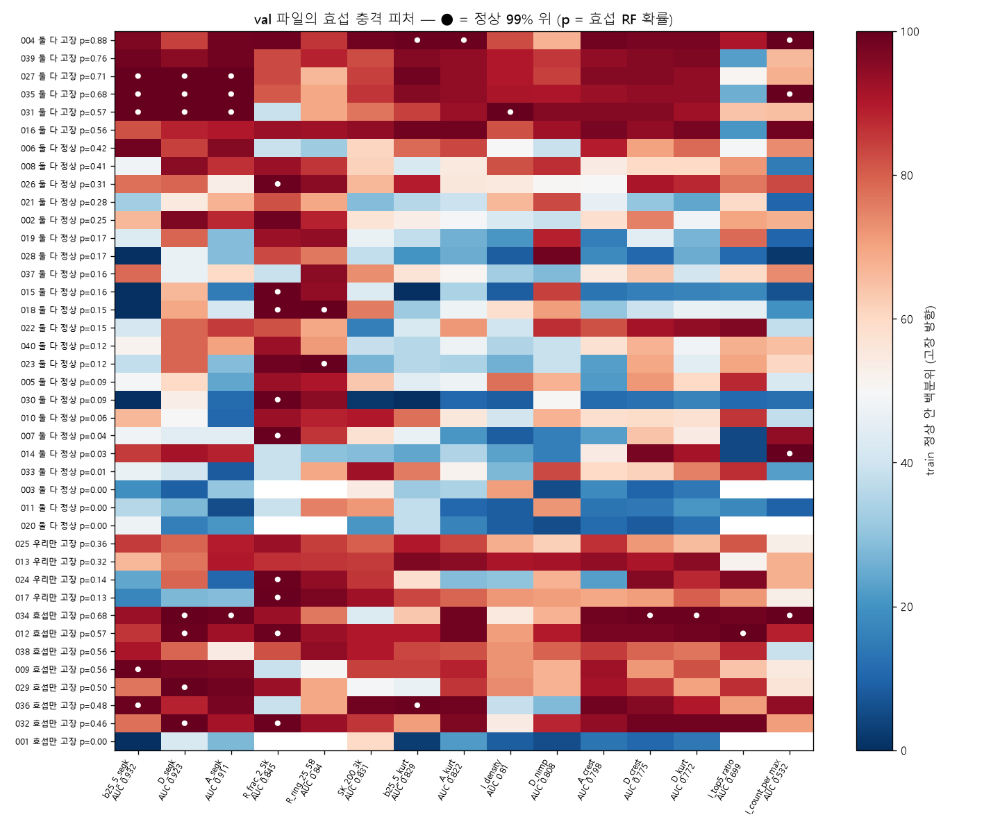
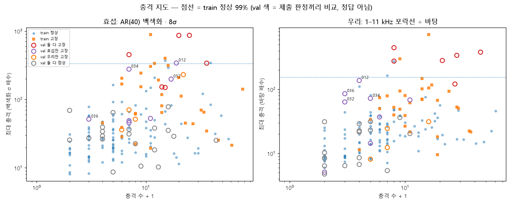
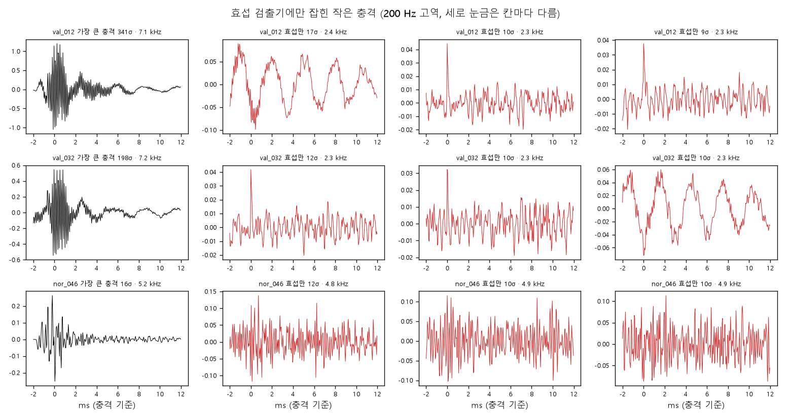

# 3-1 충격 검출기 비교: 효섭 방식으로 충격 추정 (11-27) (옛 V-6)

상태: 진행 중 · EDA만(모델 실험 없음). 코드 [자료/run.py](자료/run.py) · 수치 [자료/result.json](자료/result.json) · 파일표 [val](자료/파일표_val.csv) · [train](자료/파일표_train.csv)
관련: [3-2 효섭 피처 진단](../3-2_효섭피처진단/README.md)(옛 V-5, 선택한 파일 위주) → 3-1은 **train 150 · val 40 전체**로 같은 질문을 센다

## 목적 · 질문
효섭 RF는 val에서 우리가 놓친 고립 강타형(012 · 032 · 034 · 036)을 고장으로 냈다. "효섭 피처는 고장을 잘 잡는다"는데,
1. 효섭의 **충격 추정**(AR(40) 백색화 → 바탕의 8배 봉우리)은 우리 검출기와 같은 충격을 잡나?
2. 그 차이 때문에 고립 강타를 잡은 것인가, 아니면 다른 피처 때문인가?
3. train 정상만으로 정한 기준(정상 99%)으로 고립 강타를 정의할 수 있나?

## 방법
- 효섭 검출: `src/rf_hyoseop.py`(원본 복사, 고치지 않음)의 계산을 그대로 써서 충격 위치 · 배수(σ = 백색화 신호 MAD/0.6745) · 울림 주파수(큰 충격 20개, 12 ms FFT 최댓값)를 꺼냈다. **다시 센 충격 수 = 효섭 D_nimp, train 150/150 · val 40/40 일치**
- 우리 검출: 제출 모델과 같은 1–11 kHz 포락선 ÷ 100 ms 바탕 ≥ 4.5 (V-2 캐시)
- 두 검출기 일치 = 한쪽 충격 중 다른 쪽 충격과 ±3 ms 안에 있는 비율
- 효섭 피처 15개(충격 · 첨도 관련): train AUC, train 정상 99% 위에 든 train 고장 · val 수. 피처 값은 EXP-048 캐시
- val 그룹은 **효섭 제출과 우리 제출(EXP-062)을 비교한 것**이다(둘 다 고장 6 · 효섭만 8 · 우리만 4 · 둘 다 정상 22). 정답이 아니므로 진단에만 쓴다

## 결과

**그림 읽는 법**: 행 = val 파일(그룹 → 효섭 RF 확률 순), 열 = 효섭 피처(왼쪽일수록 train AUC 높음). 색 = train 정상 안 백분위(고장 방향, 빨강일수록 고장 쪽), ● = 정상 99% 위. "효섭만 고장" 8개는 왼쪽 세 열 **구간 첨도(segk)**와 첨도 · 파고율 열이 함께 빨갛고, "둘 다 정상"은 segk 열이 대부분 파랑 · 흰색이다.

| # | 결과 | 근거 |
|---|---|---|
| 1 | **두 검출기는 다른 충격을 잡는다.** 서로 ±3 ms 안에 겹치는 비율이 train 정상 75 % / 67 %, train 고장 65 % / 61 %(효섭 → 우리 / 우리 → 효섭, 중앙값). 012 · 032는 효섭 18 · 16개, 우리 3 · 2개다 | `1_충격지도.png` · `2_파형_두검출기.png` · result.json `검출기_겹침` |
| 2 | **효섭에만 잡힌 012 · 032의 작은 충격은 기계 충격이 아니다.** 확대하면 **울림 없는 1표본짜리 뾰족점**(0.03–0.04 g)이거나, 느린 파형 위의 잡음이다. 따라서 "2.3 kHz 울림"이라는 값은 의미가 없다. train 정상 nor_046의 효섭만 충격도 바탕 잡음과 구별되지 않는다 | `4_효섭만_충격확대.png` |
| 3 | **효섭만 잡은 충격의 "2–5 kHz 울림" 비율이 val 전체에서 높다**: train 정상 0.15 · train 고장 0.25 · val 둘 다 정상 0.36 · val 효섭만 고장 0.67. 피처 R_frac_2_5k는 val 12개를 정상 99% 위로 보낸다(train 고장은 2/30뿐). val 이동(2-9의 3–5 kHz 배경 상승과 같은 방향)으로 보이며 믿기 어렵다 | result.json `효섭만_충격_울림` · `피처표` |
| 4 | **최대 충격 크기만으로는 고립 강타를 가르지 못한다.** 고립 강타 4개의 최대 배수는 train 정상의 80–98 백분위다(두 검출기 모두). "충격 ≤ 4개 & 최대 > 정상 99%"로 정의하면 train 정상 0 · train 고장 0 · **val 0개** | result.json `고립강타` · `고립강타_정의_*` |
| 5 | **효섭이 고립 강타를 잡은 힘은 구간 첨도(segk)다.** D_segk(백색화 신호)는 정상 99% 위에 **train 정상 2/120 · train 고장 19/30 · val 7개**(012 · 032 · 034 + 027 · 029 · 031 · 035)가 든다. A_segk · b25_5_segk까지 셋 중 하나로 묶으면 정상 6/120 · 고장 22/30 · val 9개(+ 009 · 036). 고립 강타 4개가 모두 들고, 우리 제출이 잡은 027 · 031 · 035도 든다 | result.json `segk_정상99` |
| 6 | **segk는 우리 피처와 덜 겹친다.** 가장 비슷한 H 열은 H1(충격 수)이고 ρ 0.73–0.75로 4-5 관문(\|ρ\| < 0.8) 안이다. 반대로 D_kurt ~ H5 0.87, A_kurt ~ H3 0.83은 우리 첨도와 거의 같은 정보다 | result.json `segk_우리H_상관` |
| 7 | **우리만 잡은 013 · 017 · 024 · 025는 segk가 낮다**(효섭 확률 0.13–0.36). 두 모델이 서로 다른 고장을 잡는다 | 그림 아래쪽 4행 |

**그림 읽는 법**: 점 하나 = 파일 하나. 가로 = 충격 수 + 1, 세로 = 가장 큰 충격의 배수(왼쪽 = 효섭 백색화 σ, 오른쪽 = 우리 포락선 ÷ 바탕), 점선 = train 정상 99%. 고립 강타(012 · 032 · 034 · 036)는 두 지도 모두 점선 아래, train 정상 무리의 위쪽 끝에 있다. 효섭 지도에서 012 · 032가 오른쪽(충격 16–18개)으로 간 것은 결과 2의 뾰족점 때문이다.

**그림 읽는 법**: 왼쪽 첫 칸(검정) = 파일에서 가장 큰 충격, 나머지(빨강) = 효섭 검출기에만 잡힌 충격 중 큰 3개(200 Hz 고역, 충격 −2 – +12 ms). 진짜 충격(첫 칸)은 수 ms 동안 울리지만, 효섭만 잡은 것은 한 점만 튀고 울림이 없다.

## 해석
- **"효섭 피처가 고장을 잘 잡는" 이유는 충격 추정(검출기)이 아니라 구간 첨도다.** 효섭 검출기가 더 잡은 충격은 대부분 울림 없는 뾰족점 · 잡음이고, 그 울림 주파수 피처(R_frac_2_5k)는 val에서 이동한다. 그래서 효섭 방식 그대로 충격을 추정해 우리 피처로 쓰는 것은 권하지 않는다
- 구간 첨도 = 2초를 0.1초 × 20구간으로 나눠 구간마다 첨도를 재고 평균한 값이다. 충격이 든 구간은 첨도가 크게 튀므로, **강한 충격 한두 개만 있어도** 값이 오른다. 우리 피처(충격 수 · 울림 비율 · 대역 첨도)는 이 경우 "드문 충격 = 정상"으로 본다(V-2). segk가 이 빈틈을 메우는 후보다
- 백색화(D_segk)가 셋 중 가장 강한 것은, AR(40)이 **길게 우는 공진(예측 가능한 성분)을 빼고 갑작스러운 시작만 남기기** 때문일 수 있다. train 정상의 고립 강타 nor_060(우리 111배, 길게 우는 7 kHz)은 백색화하면 36.8σ로 작아지고 D_segk z −0.3이다(V-5). **가설이며 아직 확인하지 않았다**
- 결과 5의 정상 99% 문턱은 train 정상만으로 정했다(라벨 · val 안 봄). 다만 val 그룹은 정답이 아니어서, "val 9개가 고장"이라고 말할 수는 없다

## 주의
- 결과 2의 뾰족점은 그림 3파일(012 · 032 · nor_046)만 확대해서 본 것이다. train 전체에 이런 뾰족점이 얼마나 있는지는 세지 않았다
- segk의 val 이동(배경이 높은 val에서 첨도가 낮아지거나 높아지는지)은 아직 4-5 방식(p0 · p0.4 기준)으로 확인하지 않았다

## 다음 (제안)
1. **피처 후보 EDA**: 구간 첨도를 우리 전처리(1–11 kHz, 평균 제거) 위에 다시 정의한다. 백색화 유무와 구간 길이 0.1 s를 비교하고, 4-5 틀(AUC · 꼬리 · val 이동 · 하중 ρ · 중복)로 점검한다. 물리가설은 "드문 강타도 고장 증거(간헐 접촉 · 초기 손상)"로 새로 둔다
2. 뾰족점 확인: train · val 전체에서 울림 없는 1표본 스파이크 수를 센다(센서 · 전기 잡음인지). 나오면 전처리에서 거를지 판단한다

## 개념
- **AR(40) 백색화**: 앞 40점으로 다음 점을 예측하는 선형 모델을 맞추고, 예측이 빗나간 몫(잔차)만 남긴다. 공진 · 회전처럼 규칙적인 진동은 예측되어 사라지고, 갑작스러운 충격의 시작이 남는다. 대신 1표본 스파이크도 그대로(오히려 도드라지게) 남는다
- **구간 첨도(segk)**: 첨도(kurtosis) = 분포 꼬리의 무게(정규분포 3, 뾰족한 충격이 있으면 커짐). 파일 전체 첨도는 긴 파일에서 충격 하나가 희석되지만, 0.1초 구간마다 재서 평균하면 충격이 든 구간이 값을 끌어올린다
