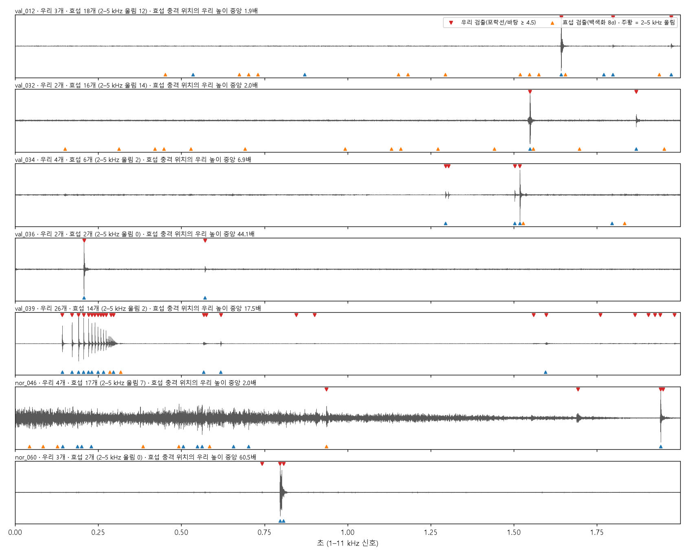

# 3-2 효섭 피처 진단: 효섭 피처로 본 고립 강타 (11-27) (옛 V-5)

## 목적 · 질문
효섭 모델(RF 배깅, 11-19 최종)은 우리가 놓친 val 012 · 032 · 034 · 036을 고장으로 봤다(확률 0.46–0.68). 사용자 가설: **"우리 모델과 충격을 잡는 방식이 달라서"**.
어떤 피처 때문인가? 그 피처가 train의 고립 강타 정상(nor_046 · nor_060)도 올리나? 두 검출기는 무엇이 다른가?

## 방법
- 효섭 코드(`1_참고자료/팀원 공유 정보/신효섭/1119_최종/7_코드/최종모델.py`)를 고치지 않고 불러 train 150 · val 40의 피처 32개를 계산한다. val 확률 재현 상관 **0.997**
- ③ 최종 13개 피처의 train AUC · train 정상 기준 강건 z ④ 두 검출기의 충격 수 ⑤ 파형 위에 두 검출 결과 ⑥ 효섭만 잡은 "작은 사건"이 train 정상 · 고장에서 얼마나 흔한가
- 실행: `자료/run.py` → `자료/결과.md` · `자료/작은사건.txt` · `자료/figs/`

## 결과

**그림 읽는 법**: 1–11 kHz 신호. 위 ▼ = 우리 검출(포락선/100 ms 바탕 ≥ 4.5배), 아래 ▲ = 효섭 검출(AR(40) 백색화 신호 > 8σ, 10 ms 간격), 주황 ▲ = 효섭 기준으로 2–5 kHz로 울린 사건.

| # | 결과 | 근거 |
|---|---|---|
| 1 | **가설이 맞다 — 012 · 032는 검출기 차이다.** 우리 3 · 2개, 효섭 **18 · 16개**. 효섭만 잡은 사건은 우리 기준으로 1.2–2.0배(문턱 4.5배 아래)다 | ⑤ 표 |
| 2 | 그 작은 사건들은 **한 표본짜리 뾰족한 스파이크이고 뒤에 울림이 없다**(바탕 잡음의 약 3배). 효섭 피처가 매긴 "2–5 kHz 울림"(012 12개 · 032 14개)은 사건 뒤의 **바탕 잡음 스펙트럼**일 가능성이 크다(val 바탕은 3–5 kHz가 높다, 2-9) | `figs/val012_작은충격.png` |
| 3 | **울림 없는 작은 사건은 고장 쪽에 더 많다**: 파일당 중앙값 정상 1 · 고장 4. 10개 이상인 파일은 정상 7/120(6%) · 고장 7/30(23%) · val 7/40(012 · 032 · 016 · 008 · 015 · 019 · 028). train AUC 0.675 → 잡음만은 아니지만 약한 증거 | `작은사건.txt` |
| 4 | **034 · 036은 검출기가 같다**(우리 4 · 2, 효섭 6 · 2). 효섭이 고장으로 본 이유는 **구간 첨도**: A_segk z +3.9 · +3.2, D_segk +2.9 · +1.4, SK_200_3k(036) +22.6 | ③ 표 |
| 5 | **train 고립 강타 정상은 구간 첨도가 낮다**: A_segk nor_046 −0.4 · nor_060 +0.8 · 006 +0.8 · 055 +0.9 · 089 +0.7(예외 038 +3.2). 효섭 모델 OOF 확률도 0.01–0.13(055만 0.43) | ③ · ④ 표 |
| 6 | **A_segk(0.1초 구간 첨도 평균)는 train AUC 0.911**로 효섭 피처 중 가장 꾸준히 뽑힌다(1000번 중 100%). val 후보 4개 모두 +2.1 – +3.9, 잡은 val 고장 039 · 016 · 004도 +2.0 – +3.3 | ③ 표 |
| 7 | 대신 효섭 모델은 우리가 잡은 013 · 017 · 024 · 025를 놓친다(확률 0.11–0.31) | 결과.md |

## 해석
- "고립 강타형"은 일부가 **검출기 착시**였다. 012 · 032는 강타 1개 + 우리가 보지 못한 작은 스파이크 14–15개 파일이다. 이 스파이크가 고장 징후인지는 약한 증거(train 고장 23% vs 정상 6%)만 있다
- 효섭 모델이 고립 강타를 잡은 진짜 힘은 **구간 첨도(A_segk · D_segk)**다. 2초 전체가 아니라 0.1초 구간마다 첨도를 재서 평균하므로, **조용한 바탕에서 뾰족한 사건이 여러 구간에 흩어져 있을 때** 커진다. train 고립 강타 정상(바탕이 시끄럽거나 사건이 한 구간에 몰림)은 낮다
- 이 피처는 **train으로 학습 · 검증할 수 있다**(AUC 0.91). V-2에서 고민한 "val을 보고 만든 규칙"이 아니다
- 다음 후보: 우리 ET 입력에 **A_segk(+ D_segk)**를 더하는 실험. 중첩 CV로 train 점수와 val 판정이 어떻게 바뀌는지 본다(실험은 요청 시)

## V 피처 후보 정리 (11-27, `자료/V피처후보.md` · `V피처후보_값.csv`)
우리 모델(H 15열 + 박자 + AE)은 그대로 두고, H와 구분해 **V**로 더할 후보 12개를 같은 기준으로 비교했다. ΔAUC · ΔPR-AUC = 제출 모델의 ET OOF logit만 넣은 로지스틱(AUC 0.9815 · PR-AUC 0.9517) 대비 후보 하나를 더했을 때(5-fold × 20). 실험(중첩 CV)이 아닌 대략의 지표다. z = train 정상 기준.

| 후보 | train AUC | ΔAUC · ΔPR-AUC | 012 · 032 · 034 · 036 | N046 · N060 | 판단 |
|---|---|---|---|---|---|
| **D_segk** (백색화 구간 첨도) | 0.923 | **+0.005 · +0.014** | +1.9 · +2.3 · +2.9 · +1.4 | −0.9 · −0.3 | **1순위** |
| **A_segk** (10 Hz 고역 구간 첨도) | 0.911 | +0.002 · +0.004 | +2.1 · +2.1 · +3.9 · +3.2 | −0.4 · +0.8 | **2순위** (D_segk와 ρ 0.79) |
| **spike_noring** (울림 없는 작은 사건 수) | 0.675 | 0 · +0.001 | +2.0 · +2.0 · +0.4 · −0.7 | **+2.0** · −0.7 | 3순위: 012 · 032를 올리지만 N046도 똑같이 올림 |
| b25_5_segk | 0.932 | −0.002 · +0.002 | +1.0 · +0.6 · +1.5 · +2.4 | −0.5 · +0.2 | 제외: 이득 없음, 2.5–5 kHz는 val 배경 이동 대역 |
| SK_200_3k | 0.831 | −0.002 · −0.006 | +9.5 · +7.5 · −0.2 · +22.6 | +0.3 · +4.0 | 제외: H3_kurt_1-2k와 ρ 0.94 |
| R_frac_2_5k | 0.858 | 0 · 0 | +4.6 · +5.7 · +2.2 · 0 | +2.7 · 0 | 제외: **val 중앙 z +2.2**(배경 이동에 흔들림) |
| AR_resid · hx_max · b25_5_kurt | 0.83–0.86 | 음수 | — | N060 +1.4 – +2.2 | 제외: 고립 강타 정상을 올림 |
| D_nimp · spike_small · I_density | 0.67–0.81 | 음수 | — | — | 제외: H1_nimp와 겹침(ρ 0.51–0.80), 이득 없음 |

- **"울림 없는 작은 사건만으로 012 · 032를 잡으면 구간 첨도는 필요 없나?"** → 아니다. ① spike_noring은 034 · 036을 못 올린다(+0.4 · −0.7). ② 012 · 032와 똑같이 **N046(시끄러운 정상)도 +2.0**으로 올린다. ③ 구간 첨도와 상관이 0.38–0.39로 서로 다른 정보다. 구간 첨도는 네 파일을 모두 올리면서 N046 · N060은 올리지 않는다
- 주의: 효섭 피처는 10 Hz 고역 전 대역이다. 우리 전처리(11 kHz 상한)로 다시 정의할지는 실험 전에 정한다

### 우리 전처리(1–11 kHz)로 다시 정의 (11-27 사용자 결정: 전처리는 우리 것 그대로, `src/featV.py`, `자료/V피처_우리전처리.md`)
| 후보 | train AUC | ΔAUC · ΔPR-AUC | 012 · 032 · 034 · 036 | N046 · N060 | val 중앙 z |
|---|---|---|---|---|---|
| **segk** (구간 첨도, 백색화 없음) | 0.927 | +0.003 · +0.012 | +0.7 · +1.2 · +2.1 · +1.5 | −0.8 · −0.3 | +0.5 |
| **segk_w** (구간 첨도, AR 백색화) | 0.928 | +0.004 · +0.011 | +1.6 · +2.0 · +3.1 · +1.4 | −0.9 · −0.2 | +1.0 |
| spike_noring (백색화 없이 검출) | 0.756 | −0.001 · −0.005 | **0 · 0** · +0.7 · 0 | +2.3 · 0 | +0.9 |
| spike_noring_w (백색화 후 검출) | 0.748 | 0 · −0.003 | +0.9 · **0** · +0.4 · −0.7 | +2.1 · −0.7 | +0.4 |

- **울림 없는 작은 사건(V3)은 우리 전처리에서 012 · 032를 못 올린다(z 0 – 0.9).** 1–11 kHz로 거르면 그 스파이크가 문턱 아래로 내려간다 → 한 표본짜리 스파이크의 에너지가 대부분 11 kHz 위(또는 1 kHz 아래)에 있다는 뜻이다. 기계 충격(울림)보다 전기적 잡음에 가깝다(추정). → **V3는 뺀다**
- **백색화는 train 성능을 바꾸지 않는다**(AUC 0.927 vs 0.928, Δ도 같음, 둘의 상관 0.92). 차이는 val 후보에서만 난다: 백색화하면 012 · 032 · 034가 +0.7 – +1.0 더 올라가고 N046 · N060은 그대로 낮다. 대신 **val 전체 중앙 z도 +0.5 → +1.0**으로 올라 val 배경 이동에 더 흔들린다
- segk_w는 효섭 D_segk와 같다(ρ 0.98). segk는 효섭 A_segk와 ρ 0.83
- **정리: V 후보 = 구간 첨도 하나.** 백색화 여부는 train으로는 못 가르고, 고르는 근거가 val 후보뿐이면 val 과적합이 된다 → 실험에서 두 판(segk · segk_w)을 같은 중첩 CV로 비교해 정한다

## 개념
- **AR 백색화**: 앞 40점으로 예측되는 성분(공진 · 규칙 진동)을 빼고 남은 잔차. 예측 못 하는 짧은 사건이 두드러진다. 한 표본짜리 스파이크도 크게 보인다
- **구간 첨도(seg kurtosis)**: 0.1초 × 20구간마다 첨도(가우스 잡음 = 3)를 재서 평균. 뾰족한 사건이 여러 구간에 있으면 커진다
- **스펙트럼 첨도 SK_200_3k**: STFT에서 200 Hz–3 kHz 주파수 칸마다 에너지가 순간적으로 튀는 정도
