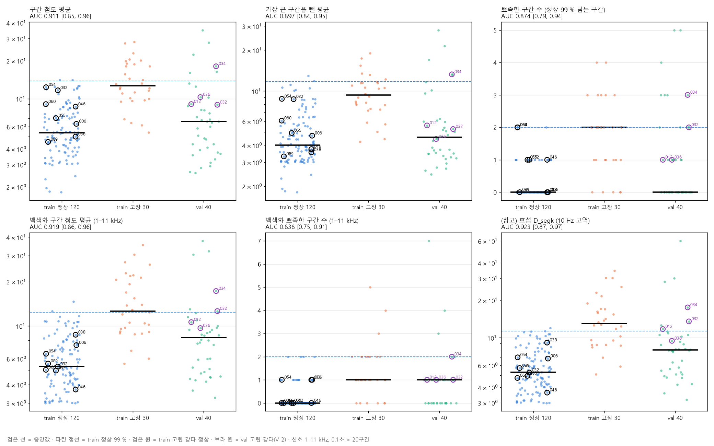
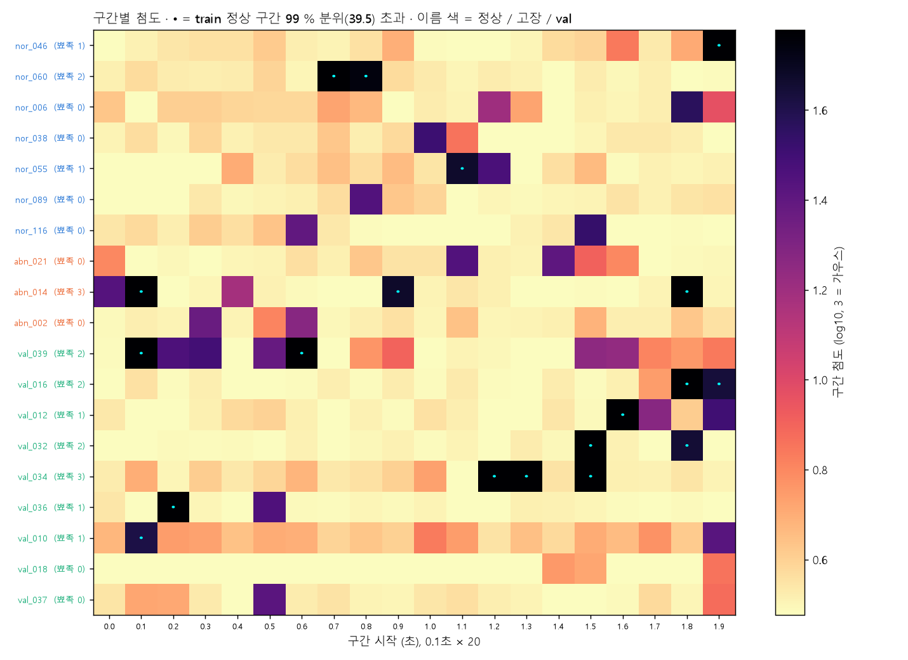

# 3-3 구간 첨도 피처 EDA (11-27) (옛 V-7)

## 목적 · 질문
V-5 · V-6은 효섭 모델이 고립 강타(val 012 · 032 · 034 · 036)를 잡은 힘이 **구간 첨도**(0.1초 구간마다 첨도를 재서 평균)라고 봤다. 이것을 우리 전처리로 만들면
1. train에서 고장을 가르는가
2. 우리 ET 15열(특히 H1 충격 수 · H3 1–2 kHz 첨도)과 다른 정보인가
3. train 고립 강타 정상(046 · 060 · 006 · 038 · 055 · 089 · 054 · 032)을 같이 올리지 않는가
4. val 이동이 고장 비율로 설명되는 범위 안인가

가설 **H1″**(물리가설 H1 연장): 유격 타격은 2초 안에서 여러 0.1초 구간에 흩어진다. 외부 강타(정상)는 한 구간에 몰리고 길게 운다.

## 방법
- 신호: 평균 제거 → **1–11 kHz 대역통과**(우리 검출기 입력과 같음), 0.1초(2500점) × 20구간, 첨도(가우스 = 3)
- 열(실행 전 고정): `segk_mean` 평균 · `segk_med` 중앙값 · `segk_trim` 가장 큰 구간을 뺀 평균 · `n_seg_hi` train 정상 구간 99 % 분위(39.5)를 넘는 구간 수 · (참고) `A_segk` 효섭과 같은 10 Hz 고역 신호
- **백색화 열**(V-6 결과를 받아 추가, 정의는 효섭 그대로): AR(40) 백색화(앞 20000점으로 계수, 양끝 500점 자름) 후 19구간. `w_segk_mean` · `w_n_seg_hi`(문턱 46.2) · (참고) `D_segk`(10 Hz 고역)
- 관문은 4-19와 같다: AUC [95 %] · 정상 99 %를 넘는 고장 · 고장 10 % 선을 넘는 정상 · val 이동 AUC(고장 0 · 20 · 40 % 섞은 기준 범위) · ρ(하중) · ET 15열과의 최대 |ρ|(관문 < 0.8)
- val 그룹(다른 조 결과로 추론)은 그림 표시에만 썼다. 열 정의 · 문턱에는 쓰지 않았다
- 실행: `자료/run.py` → `자료/result.txt` · `자료/result.json` · `자료/파일표.csv` · `자료/figs/`

## 결과

**그림 읽는 법**: 칸마다 열 하나다. 점 하나가 파일 하나이고 파랑 = train 정상, 주황 = train 고장, 초록 = val이다. 검은 선 = 중앙값, 파란 점선 = train 정상 99 %. 검은 원 = train 고립 강타 정상, 보라 원 = val 고립 강타(V-2). 위 줄 = 원신호(1–11 kHz), 아래 줄 = 백색화 신호.

| 열 | AUC [95 %] | 정상 99 % 넘는 고장 | 고장 10 % 선 넘는 정상 | val 이동 AUC (40 % 기준 범위) | 최대 겹침 (관문 < 0.8) | 판정 |
|---|---|---|---|---|---|---|
| segk_mean | 0.911 [0.85, 0.96] | 13 | 40/120 | 0.57 (0.60–0.73) | H1_nimp **0.85** | 겹침 탈락 |
| segk_trim | 0.897 [0.84, 0.95] | 6 | 31/120 | 0.55 | H1_nimp **0.88** | 겹침 탈락 |
| segk_med | 0.707 | 1 | 79/120 | 0.58 | 0.70 | 약함 |
| n_seg_hi | 0.874 [0.79, 0.94] | 7 | 21/120 | 0.67 | H3 0.54 | 통과 · 고립 강타 정상을 못 내림 |
| **w_segk_mean** | **0.919 [0.86, 0.96]** | **15** | **21/120** | 0.70 (0.60–0.73) | H1_nimp 0.76 | **통과 · 1순위** |
| w_n_seg_hi | 0.838 | 3 | 19/120 | 0.72 (0.59–0.68) | H8 0.52 | 약함 · val 이동 큼 |
| (참고) D_segk | 0.923 [0.87, 0.97] | 19 | 24/120 | 0.72 (0.61–0.73) | H1_nimp 0.75 | w_segk_mean과 ρ 0.99 (같은 열) |

**파일별 (train 정상 안 백분위)**

| 파일 | segk_mean | n_seg_hi | **w_segk_mean** |
|---|---|---|---|
| train 고립 강타 정상 046 · 060 · 055 · 032 · 054 | 82 · 83 · 68 · 91 · 95 | 82 · 98 · 82 · 82 · 98 | **16 · 42 · 41 · 49 · 65** |
| train 고립 강타 정상 006 · 038 | 61 · 44 | 0 · 0 | 73 · 83 |
| 이상치 정상 059 · 065 · 116 | 45 · 31 · 59 | 0 | 62 · 40 · 66 |
| val 고립 강타 012 · 032 · 034 · 036 | 84 · 83 · 100 · 89 | 82 · 98 · 100 · 82 | **92 · 99 · 100 · 88** |
| val 확실한 고장 039 · 016 · 004 | 100 · 89 · 98 | 98 · 98 · 100 | 88 · 79 · 87 |
| train 고장 021 · 028 · 014 · 017 | 61 · 100 · 98 · 93 | 0 · 98 · 100 · 98 | 87 · 100 · 100 · 87 |
| val 경계 009 (둘다정상 그룹) | 97 | 100 | 98 |

- val 중 w_segk_mean > 정상 99 %: 027 · 029 · 031 · 032 · 034 · 035. D_segk는 여기에 012가 더해진다
- H3를 같이 쓸 때 남는 정보(H3 순위로 설명되지 않는 잔차의 AUC): w_segk_mean 0.786 · n_seg_hi 0.787 · segk_mean 0.759

**그림 읽는 법**: 한 줄이 파일 하나, 한 칸이 0.1초 구간이다(원신호 1–11 kHz). 색이 진할수록 그 구간이 뾰족하다. • = train 정상 구간 99 % 분위를 넘는 구간. train 강타 정상 060 · 054는 뾰족한 구간이 2개로, val 032와 같다 → 원신호의 구간 수로는 둘을 가르지 못한다.

## 해석과 결정
- **원신호 구간 첨도(segk_mean · segk_trim)는 사실상 "충격 수"다**(H1_nimp와 ρ 0.85–0.88). 그리고 train 강타 정상 054 · 032를 91–95 백분위로 올린다. V-5의 "train 고립 강타 정상은 구간 첨도가 낮다"는 046 · 006 · 038 · 089에만 맞고, 054 · 032 · 060에는 맞지 않는다
- **백색화하면 갈린다.** AR(40)은 길게 우는 공진(앞 표본으로 예측되는 성분)을 빼고 **갑작스러운 시작**만 남긴다. train 강타 정상은 7 kHz 근처에서 길게 울리므로 백색화 후 16–65 백분위로 내려가고, val 고립 강타 012 · 032 · 034 · 036은 88–100 백분위에 남는다. 원신호에서는 둘이 같은 높이(82–95)였다
- 그래서 **H1″는 "뾰족한 사건이 흩어진다"가 아니라 "예측되지 않는 갑작스러운 시작이 많다"로 고쳐야 맞다.** 정상 강타는 크지만 한 번 길게 우는 공진이고, 고장 타격은 짧고 갑작스럽다
- **w_segk_mean이 1순위 후보다.** AUC 0.919, 정상 99 %를 넘는 고장 15/30, H1과 ρ 0.76(관문 통과), 하중과 무관(ρ +0.10). 우리 1–11 kHz 전처리 판과 효섭 10 Hz 고역 판(D_segk)은 ρ 0.99로 같은 열이므로 우리 전처리 판을 쓴다
- ⚠ **val 이동 AUC 0.70은 40 % 기준 범위(0.60–0.73)의 위쪽이다.** val 고장 비율(42.5 %)로 설명되지만 여유가 작다. val 바탕(3–5 kHz가 높음, 2-9)이 백색화에 섞였을 가능성은 남는다
- ⚠ val_009(둘다정상 그룹으로 추론)도 98 백분위로 올라간다. 숨은 고장인지 오경보인지는 모른다
- `n_seg_hi` · `w_n_seg_hi`는 0–3의 계단값이라 정보가 거칠고, 고립 강타 정상을 내리지 못하거나 val 이동이 크다 → 쓰지 않는다
- 다음(요청 시): ET 입력에 w_segk_mean 1열을 더한 실험(EXP-068). 중첩 CV(quick)로 F2와 오경보, 그리고 val 판정에서 012 · 032 · 034 · 036 · 009가 어떻게 움직이는지 본다

## 개념
- **구간 첨도**: 0.1초 구간마다 첨도(가우스 잡음 = 3, 뾰족할수록 큼)를 재서 평균한 값. 파일 전체 첨도는 가장 큰 충격 하나가 좌우하지만, 구간 첨도는 뾰족한 구간이 몇 군데인지에 더 민감하다
- **AR 백색화**: 앞 40개 표본으로 다음 값을 예측하는 선형 모델을 신호에 맞추고, 예측이 빗나간 부분(잔차)만 남긴다. 공진처럼 규칙적으로 이어지는 진동은 지워지고, 충격의 첫 순간처럼 예측할 수 없는 사건만 남는다
- **val 이동 AUC**: val 40개가 train 정상보다 얼마나 위에 있는가. 고장을 0 · 20 · 40 % 섞은 가짜 val의 범위와 비교해, 고장 비율로 설명되는지 본다
