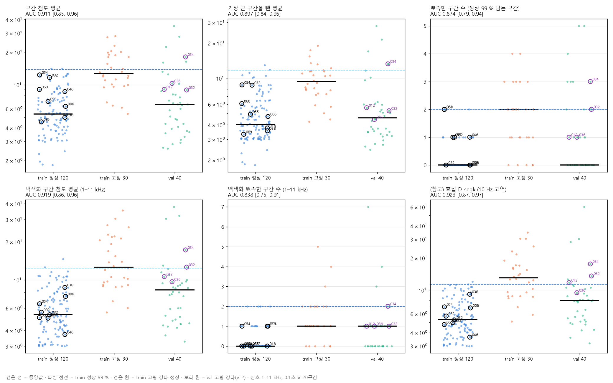

# V-3 고립 강타를 잡는 피처: 구간 첨도 (11-27)

상태: EDA 끝 · 실험 전. [V-2](../V-2_약한고장_파형확인/README.md)에서 찾은 놓친 유형 **"고립 강타형"**(val 012 · 032 · 034 · 036: 강한 충격 1–2개, 반복 없음)을 잡을 피처를 찾는 묶음이다. 효섭 RF는 네 파일을 모두 고장으로 냈고, 우리 모델은 모두 놓쳤다.

## 한 줄 결론
**고립 강타를 가르는 것은 "AR(40) 백색화 신호의 구간 첨도"(`w_segk_mean`) 하나다.** 효섭 검출기가 충격을 더 잡은 것은 대부분 잡음이었고, 백색화하지 않은 구간 첨도는 우리 충격 수(H1)와 같은 정보다.

## 세 조각 — 성격이 다르다
| 조각 | 성격 | 물은 것 | 답 |
|---|---|---|---|
| [3-1 충격 검출기 비교](3-1_충격검출기비교/README.md) (옛 V-6) | **측정**: 검출기 | 효섭의 충격 추정(AR(40) 백색화 → 8σ)은 우리 검출기(1–11 kHz 포락선 ÷ 바탕 ≥ 4.5)와 같은 충격을 잡나? train 150 · val 40 전체 | 아니다(겹침 61–75 %). 효섭만 잡은 충격은 **울림 없는 1표본 뾰족점** → 효섭 검출기는 가져오지 않는다 |
| [3-2 효섭 피처 진단](3-2_효섭피처진단/README.md) (옛 V-5) | **원인 진단**: 효섭 모델 | 효섭 모델은 어떤 피처로 고립 강타를 잡았나? 효섭 피처 12개를 후보로 비교 | **구간 첨도(D_segk · A_segk)**. 나머지(R_frac_2_5k · SK_200_3k · 충격 수 등)는 val 이동 · 우리 피처와 중복 · 강타 정상을 같이 올림으로 제외 |
| [3-3 구간 첨도 피처](3-3_구간첨도피처/README.md) (옛 V-7) | **피처 EDA**: 우리 판 | 구간 첨도를 우리 전처리(1–11 kHz)로 만들면 관문(4-19 · 4-5 틀)을 통과하나? | 백색화한 판 **w_segk_mean만 통과**. 원신호 판은 H1과 ρ 0.85–0.88로 중복 탈락 |

## 핵심 수치 (기준 정의 = 3-3)
`w_segk_mean` = 평균 제거 → 1–11 kHz 대역통과 → AR(40) 백색화 → 0.1초 × 19구간 첨도 평균 (효섭 D_segk와 ρ 0.99)

| 항목 | 값 |
|---|---|
| train AUC | **0.919** [0.86, 0.96] |
| train 정상 99 % 위 | 고장 15/30 (정상은 정의상 약 1 %) |
| 우리 ET 15열과 최대 겹침 | H1_nimp ρ 0.76 (관문 < 0.8 통과) · 하중 ρ +0.10 |
| train 고립 강타 정상 046 · 060 · 055 · 032 · 054 | 16 · 42 · 41 · 49 · 65 백분위 (원신호 판에서는 68–95) |
| val 고립 강타 012 · 032 · 034 · 036 | **92 · 99 · 100 · 88 백분위** |
| val 이동 AUC | 0.70 — 고장 40 % 기준 범위(0.60–0.73)의 위쪽 끝 ⚠ |

**그림 읽는 법**: 칸마다 열 하나, 점 = 파일. 파랑 train 정상 · 주황 train 고장 · 초록 val, 파란 점선 = train 정상 99 %. 검은 원 = train 고립 강타 정상, 보라 원 = val 고립 강타. 위 줄(원신호)에서는 검은 원과 보라 원이 같은 높이이고, 아래 줄(백색화)에서는 검은 원만 내려간다.

## 왜 백색화가 가르나 (물리가설 H1″, 3-3에서 고침)
- 정상의 고립 강타는 **크지만 7 kHz 근처에서 길게 우는 공진**이다. AR(40)은 앞 표본으로 예측되는 공진을 지우므로 백색화 후 작아진다
- val 고립 강타와 고장 타격은 **짧고 갑작스러운 시작**이 남는다
- 그래서 가설은 "뾰족한 사건이 흩어진다"가 아니라 **"예측되지 않는 갑작스러운 시작이 많다"**다 ([물리가설.md](../../3_단계/1_기준·기록/물리가설.md) H1″)

## 버린 것과 이유 (다시 보지 않게)
| 버린 것 | 이유 | 조각 |
|---|---|---|
| 효섭 검출기 · 충격 수(D_nimp) | 더 잡은 충격은 울림 없는 1표본 뾰족점. 1–11 kHz로 거르면 012 · 032에서 0개 → 전기적 잡음 추정 | 3-1 · 3-2 |
| 울림 없는 작은 사건 수(spike_noring) | 우리 전처리에서 012 · 032를 못 올림, N046(정상)을 올림 | 3-2 |
| R_frac_2_5k (2–5 kHz로 우는 충격 비율) | val 12개가 정상 99 % 위(train 고장은 2/30) → val 3–5 kHz 배경 이동 | 3-1 · 3-2 |
| 최대 충격 크기 | 고립 강타는 train 정상의 80–98 백분위. "충격 ≤ 4 & 최대 > 정상 99 %" = val 0개 | 3-1 |
| 원신호 구간 첨도(segk_mean · segk_trim) | H1과 ρ 0.85–0.88(중복), 강타 정상 054 · 032를 91–95 백분위로 올림 | 3-3 |
| 구간 수 열(n_seg_hi · w_n_seg_hi) | 0–3 계단값, 강타 정상을 못 내리거나 val 이동 큼 | 3-3 |
| SK_200_3k · A_kurt · D_kurt | H3 · H5와 ρ 0.83–0.94 | 3-1 · 3-2 |

## 조각 사이에서 고쳐진 내용
- 3-2의 "train 고립 강타 정상은 구간 첨도가 낮다"는 **백색화 판에만 맞다.** 3-2는 정상 강타 2개(046 · 060)만 봤고, 3-3에서 8개를 다 보니 원신호 판은 054 · 032가 높다
  - 두 조각의 원신호 판을 직접 맞춰 봄(11-27, train 정상 안 백분위). 3-2 판(양끝 20 ms 자름)과 3-3 판(안 자름)은 ρ 0.94이고, 백색화 판끼리는 ρ 0.99로 같은 열이다

    | 파일 | 원신호 3-2 판 | 원신호 3-3 판 | 백색화 w_segk_mean |
    |---|---|---|---|
    | 정상 강타 046 · 060 | 18 · 38 | 82 · 83 | 16 · 42 |
    | 정상 강타 054 · 032 | **91 · 92** | **95 · 91** | 65 · 49 |
    | val 고립 강타 012 · 032 · 034 · 036 | 76 · 88 · 100 · 92 | 84 · 83 · 100 · 89 | 92 · 99 · 100 · 88 |

  - **어느 원신호 판이든 054 · 032가 val 고립 강타와 같은 높이**라 가르지 못한다. 046 · 060이 두 판에서 크게 다른 것은 양끝 자르기 차이(파일 끝 근처 강타이거나 필터 끝단 영향, 확인 안 함)이며, 백색화 판은 양끝을 자르므로 영향 없다
  - 그래서 "구간 첨도가 유의미하다"(3-2)는 유지되고, 그 역할을 하는 형태가 **백색화 판**이다
- 3-2의 "segk와 segk_w를 실험에서 비교해 정한다"는 3-3에서 정리됐다. 원신호 판(segk)은 중복 관문에서 떨어지므로 **후보는 w_segk_mean 하나**다

## 주의
- val 이동 AUC 0.70은 여유가 작다. val 바탕(3–5 kHz 상승, 2-9)이 백색화에 섞였을 가능성이 남는다
- val_009(두 제출 모두 정상)도 98 백분위로 오른다. 숨은 고장인지 오경보인지 모른다
- val 그룹(효섭 · 우리 · 8조 판정 비교)은 정답이 아니다. 진단에만 썼고, 열 정의 · 문턱은 train 정상만으로 정했다
- 반대로 우리만 잡은 val 013 · 017 · 024 · 025는 구간 첨도가 낮다 → 구간 첨도는 기존 피처를 **대체**가 아니라 **보탠다**

## 다음 (실험은 요청 시)
- ET 입력에 `w_segk_mean` 1열을 더하는 실험(EXP-068 예정): 같은 중첩 CV(quick → full)로 F2 · 오경보, val 판정에서 012 · 032 · 034 · 036 · 009의 변화
