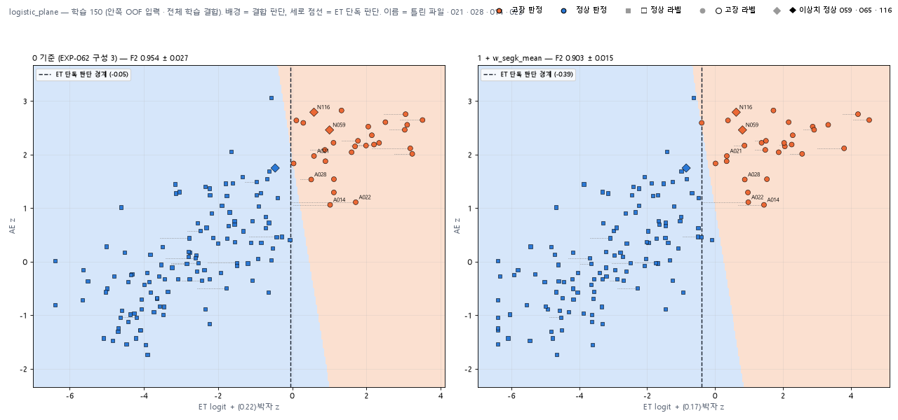
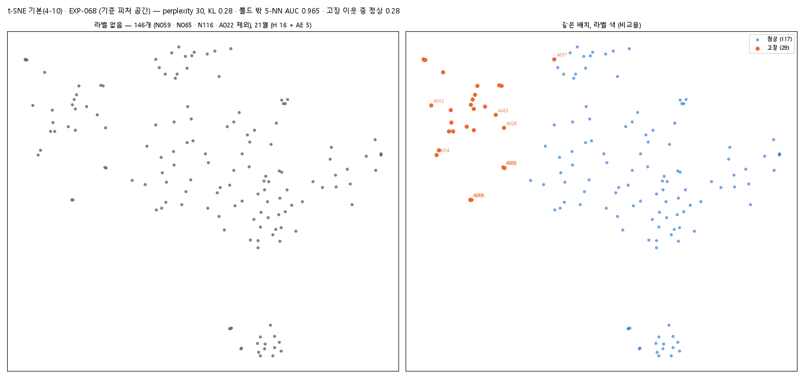
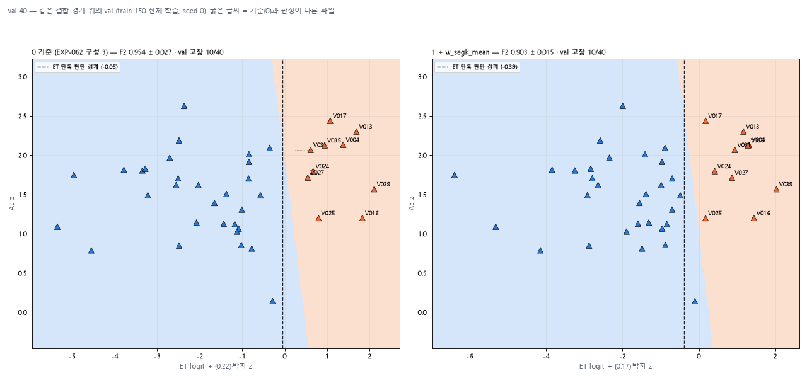

# EXP-068 백색화 구간 첨도 (+ w_segk_mean, 고립 강타형)

노션 카드 (실험 DB에 그대로 옮긴다)

| 팀원 | 모델 | F2 점수 | 변경 사항 | 메모 |
|---|---|---|---|---|
| 이동훈 | J-축소 + K83 (src/final.py JShrink) · 11 kHz 상한 (EXP-062 구성 3) | 0.903 ± 0.015 (기준 0.954 ± 0.027, quick) | 기준 = EXP-062 구성 3. ET 열 추가: + w_segk_mean (1–11 kHz → AR(40) 백색화 → 0.1초 구간 첨도 평균, 5_VAL_단계 V-3 · 3-3 관문 통과). 이상치 학습 포함, 그룹 CV (H1″) | **기각 후보**: ET 열로 넣으면 F2 −0.051(sd 넘게 하락), 022 놓침 · 오경보 증가. val 고립 강타는 여유만 +0.6–2.3 오르고 판정 변화 0 |

## 주요 변경점 (기준 실험 대비)

- 기준 = EXP-062 구성 3 (옛 검출기 250 Hz 사전 · 옛 RES), 같은 분할
- 1: ET 열 + w_segk_mean (src/featV.w_segk_mean, JShrink cols). 3-3: AUC 0.919 · H1 ρ 0.76 · 하중 ρ +0.10 · val 이동 0.70(40 % 범위 안)
- 울림 축소 · E2 · 8.3k 규칙은 그대로

- 가설: H1″ ([물리가설](../../../3_단계/1_기준·기록/물리가설.md))
- 실행: 2026-11-27 · git `651c14b+수정중` · 코드 [run.py](자료/run.py)
- 평가: 중첩 CV (바깥 5 × 안쪽 4) · 모드 seed 2 · ET 100. 자주 놓침 · 오경보 n회+ = seed 과반. quick 수치는 선별용, 기록 수치는 QE_FULL=1

## 결과

| 구성 | F2 | 재현율 | 오경보율 | 정밀도 | F2 (고장 10%·40%) | 자주 놓침 | 오경보 3회+ |
|---|---|---|---|---|---|---|---|
| 0 기준 (EXP-062 구성 3) | 0.954 ± 0.027 | 0.967 | 0.025 | 0.906 | 0.931 · 0.966 | — | 2 |
| 1 + w_segk_mean | 0.903 ± 0.015 | 0.933 | 0.058 | 0.803 | 0.855 · 0.929 | 022 | 3 |

## 해석

**ET 열로 넣으면 나빠진다.** F2 0.954 → 0.903(−0.051, 기준 sd 0.027을 넘음, seed별 −0.009 · −0.092). 재현율 0.967 → 0.933(abn_022 2/2 → 0/2 놓침), 오경보율 0.025 → 0.058(065 0 → 2, 037 · 066 · 073 · 095 · 106 · 110 0 → 1). 새 열은 ET 중요도 1위(0.143)가 되어 기존 열(H9 · H16 · H1)의 몫을 가져갔다. **val은 판정이 하나도 바뀌지 않았다**(10/40 그대로): 고립 강타 012 · 032 · 034 · 036과 009는 여유가 +0.6 – +2.3 올랐지만 모두 문턱 아래(−0.56 – −1.41)다. quick(seed 2) 값이다.

<!-- key-figs: 자동 (save_fig key=True) -->

*logistic_plane* — 기준(0) vs + w_segk_mean(1)의 결합 경계

*tsne_라벨* — 기본 t-SNE(4-10, 기준 피처). 빨간 원 = 구성 1 오경보

<!-- /key-figs -->

**그림 읽는 법 (logistic_plane)**: 가로 = ET logit + 박자 z, 세로 = AE z, 배경 = 결합(로지스틱) 판단(파랑 정상 · 주황 고장), 세로 점선 = ET 단독 판단 경계. 오른쪽(구성 1)은 정상 무리의 오른쪽 끝이 경계 쪽으로 퍼지고(ET 단독 경계 −0.05 → −0.39), A022 · A014가 경계에 붙는다.

**왜 나빠졌나 (해석)**
- train에는 고립 강타형 고장이 없다(5_VAL_단계 V-2). 그래서 ET는 w_segk_mean을 "고립 강타" 축이 아니라 **"충격이 많고 뾰족하다"는 일반 고장 축**으로 배운다. 이 정보는 H1 · H3 · H8에 이미 있고(ρ 0.49–0.76), 새 열이 나무의 분기를 가져가며 기존 열의 결정이 흔들렸다
- 022는 충격이 적은 주기 잠금형(박자로 잡던 고장)이다. 박자 계수가 0.394 → 0.287로 줄고 결합 문턱이 1.032 → 0.921로 내려가면서 경계가 바뀌었다
- val 고립 강타는 새 열만 높고 다른 열(H1 충격 수 · H3 · H8)은 정상 쪽이다. train 고장은 새 열이 높으면 다른 열도 함께 높으므로, ET는 "새 열 하나만 높은 파일"을 고장으로 배울 예가 없다 → 결합 점수가 문턱까지 오르지 않는다(추론). **ET에 열을 더하는 방식으로는 train에 없는 유형을 배울 수 없다**는 V-1 · V-2의 진단과 같다

**결정 (제안, 사용자 판단)**
- ET 열 추가는 채택하지 않는다(sd 넘게 하락, val 이득 0)
- 남은 길: w_segk_mean을 ET 밖에서 **train 정상 99 % 위 꼬리 규칙**(E2와 같은 방식, 문턱 = 학습 정상 분포)으로 쓰는 것. 3-1 기준(효섭 D_segk)으로는 train 정상 2/120 · 고장 19/30 · val 7개(012 · 032 · 034 포함)였다. 우리 판 w_segk_mean은 train 고장 15/30 · val 027 · 029 · 031 · 032 · 034 · 035(3-3). 실험 전에 규칙 정의를 먼저 고정해야 한다

## 그림

### val_판정
기준 vs 구성 1의 val 판정

