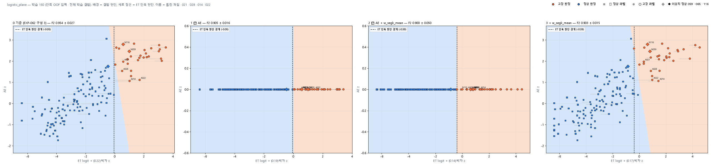
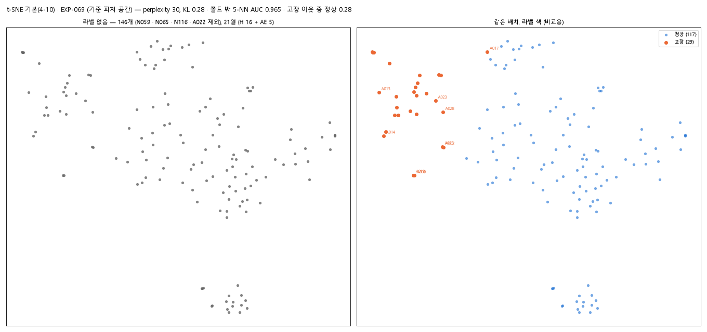
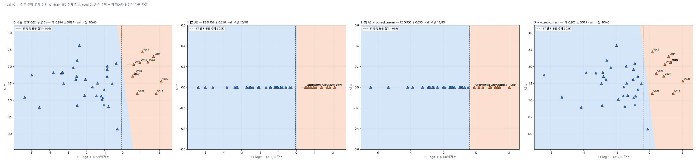

# EXP-069 AE 제외 (기준 · + w_segk_mean을 AE 있음 · 없음으로)

노션 카드 (실험 DB에 그대로 옮긴다)

| 팀원 | 모델 | F2 점수 | 변경 사항 | 메모 |
|---|---|---|---|---|
| 이동훈 | J-축소 + K83 (src/final.py JShrink) · 11 kHz 상한 (EXP-062 구성 3) | 0.954 ± 0.027 | 기준 = EXP-062 구성 3. AE 제외(JShrink use_ae=False) · + w_segk_mean 조합 4구성, 같은 분할, quick (H1″) | AE를 빼면 0.905(−0.049). 세 변형 모두 0.90 안팎이고, 하락은 거의 seed 1에서만(seed 0 차이 −0.009 – +0.022) → quick 2 seed로는 판단 보류, full 필요. val: − AE + w_segk_mean만 036이 고장(2/5 seed), 012 · 032 여유 −0.17 · −0.57 |

## 주요 변경점 (기준 실험 대비)

- 기준 = EXP-062 구성 3 (옛 검출기 250 Hz 사전 · 옛 RES), 같은 분할
- 1: AE 제외 (JShrink use_ae=False, 결합 = ET logit · 박자 z)
- 2: AE 제외 + ET 열 w_segk_mean · 3: AE 있음 + w_segk_mean (= EXP-068 구성 1)
- 울림 축소 · E2 · 8.3k 규칙은 그대로

- 가설: H1″ ([물리가설](../../../3_단계/1_기준·기록/물리가설.md))
- 실행: 2026-11-27 · git `651c14b+수정중` · 코드 [run.py](자료/run.py)
- 평가: 중첩 CV (바깥 5 × 안쪽 4) · 모드 seed 2 · ET 100. 자주 놓침 · 오경보 n회+ = seed 과반. quick 수치는 선별용, 기록 수치는 QE_FULL=1

## 결과

| 구성 | F2 | 재현율 | 오경보율 | 정밀도 | F2 (고장 10%·40%) | 자주 놓침 | 오경보 3회+ |
|---|---|---|---|---|---|---|---|
| 0 기준 (EXP-062 구성 3) | 0.954 ± 0.027 | 0.967 | 0.025 | 0.906 | 0.931 · 0.966 | — | 2 |
| 1 − AE | 0.905 ± 0.016 | 0.917 | 0.037 | 0.859 | 0.872 · 0.922 | 009 028 | 3 |
| 2 − AE + w_segk_mean | 0.900 ± 0.050 | 0.933 | 0.062 | 0.789 | 0.849 · 0.928 | — | 4 |
| 3 + w_segk_mean | 0.903 ± 0.015 | 0.933 | 0.058 | 0.803 | 0.855 · 0.929 | 022 | 3 |

## 해석

**AE를 빼면 train 점수가 내려간다(quick).** F2 0.954 → 0.905(−0.049), 재현율 0.967 → 0.917(009 · 028 자주 놓침), 오경보율 0.025 → 0.037(065 0 → 2). − AE + w_segk_mean 0.900 ± 0.050, + w_segk_mean(AE 있음) 0.903 ± 0.015로 **세 변형이 모두 0.90 안팎**이다. 다만 하락은 거의 seed 1에서 났다(seed별 차이: − AE −0.006 · −0.092, − AE + w_segk **+0.022** · −0.131, + w_segk −0.009 · −0.092). seed 0에서는 기준과 sd 안이므로 **quick 2 seed로는 결론을 내리지 않는다 → full(seed 5) 필요.** val: AE만 빼면 판정 변화 0(10/40). **− AE + w_segk_mean에서만 036이 고장으로 바뀌고(2/5 seed, 여유 +0.54), 012 · 032 · 034 · 009의 여유가 −0.17 · −0.57 · −1.10 · −0.57로 문턱에 가장 가까워진다**(11/40).

<!-- key-figs: 자동 (save_fig key=True) -->

*logistic_plane* — 기준(0) · − AE(1) · − AE + w_segk_mean(2) · + w_segk_mean(3)의 결합 경계 (AE 없음은 세로축 0)

*tsne_라벨* — 기본 t-SNE(4-10, 기준 피처). 빨간 원 = 구성 1 오경보

<!-- /key-figs -->

**그림 읽는 법 (logistic_plane)**: 네 칸 = 구성 0–3. AE가 없는 1 · 2는 세로축(AE z)이 0이라 점이 한 줄로 눕는다 → 판단은 가로축(ET logit + 박자 z) 하나로만 이루어진다.

**해석**
- AE를 빼면 결합 계수는 ET 1.76 → 1.97, 박자 0.39 → 0.37, 문턱 1.03 → 0.92. AE가 맡던 몫을 ET 혼자 진다. AE가 정상 쪽으로 눌러 주던 065가 오경보로, AE가 올려 주던 009 · 028이 놓침으로 바뀐다
- AE가 없을 때 w_segk_mean을 더하면 결합 문턱이 0.43까지 내려가고 박자 계수가 0.26으로 줄어 경계가 크게 움직인다(seed 차이 +0.022 · −0.131로 가장 불안정)
- val에서 AE는 40개를 통째로 높게 본다(V-1). AE를 빼는 것만으로는 val 판정이 바뀌지 않았고, w_segk_mean과 함께 뺄 때만 고립 강타가 문턱 쪽으로 움직였다. 이것은 val을 보고 고를 근거가 아니다(진단)

**다음 (제안)**: 같은 네 구성을 QE_FULL=1(seed 5)로 다시 재서, seed 1에서만 난 하락인지 확인한다

## 그림

### val_판정
네 구성의 val 판정

