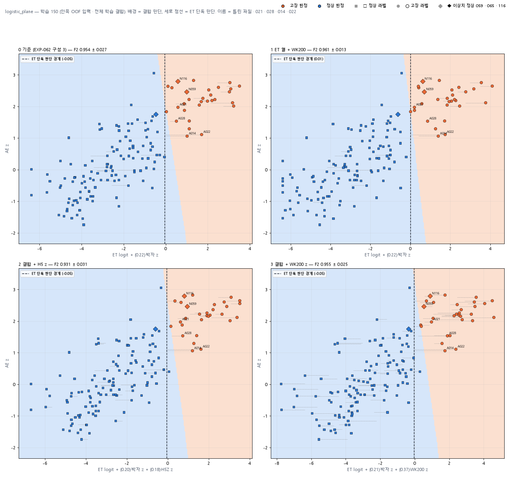
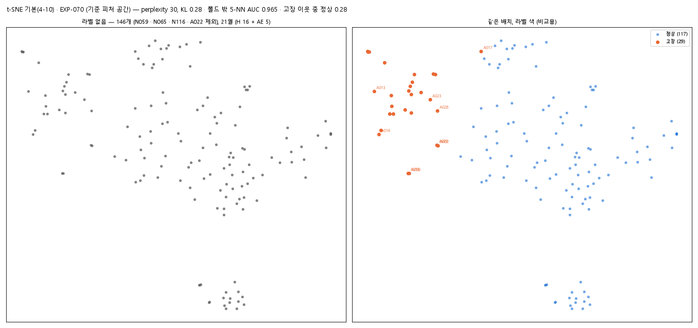
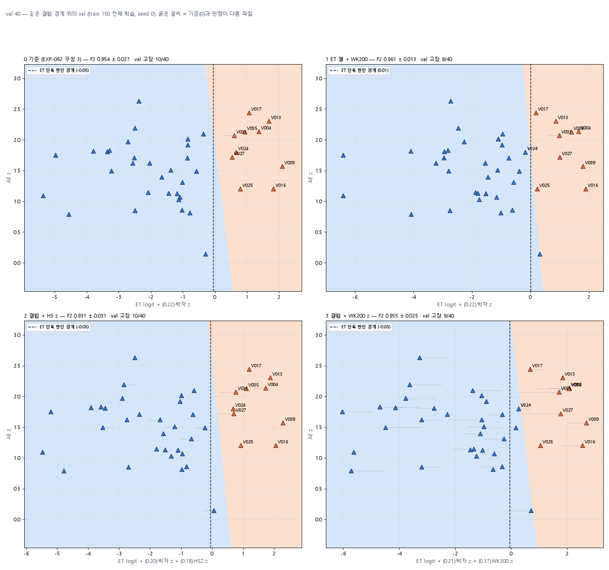

# EXP-070 첨도 피처 (ET 열 vs 결합 입력, 고립 강타형)

노션 카드 (실험 DB에 그대로 옮긴다)

| 팀원 | 모델 | F2 점수 | 변경 사항 | 메모 |
|---|---|---|---|---|
| 이동훈 | J-축소 + K83 (src/final.py JShrink) · 11 kHz 상한 (EXP-062 구성 3) | 0.954 ± 0.027 | 기준 = EXP-062 구성 3. 1: ET 열 + 200 ms 창 첨도 최대(WK200) · 2: 결합 입력 + H5(4–8 kHz 첨도) 강건 z · 3: 결합 입력 + WK200 강건 z (5_VAL_단계 V-11). 이상치 학습 포함, 그룹 CV (H1″) |  |

## 주요 변경점 (기준 실험 대비)

- 기준 = EXP-062 구성 3 (옛 검출기 250 Hz 사전 · 옛 RES), 같은 분할
- 1: ET 열 + wk200_max = log10(200 ms 창 첨도 최대, 1–11 kHz) (JShrink cols)
- 2: 결합(로지스틱) 입력 + H5_kurt_4-8k 강건 z (JShrink zcomb, 학습 정상 기준) — ET 입력은 그대로
- 3: 결합 입력 + wk200_max 강건 z
- 울림 축소 · E2 · 8.3k 규칙은 그대로

- 가설: H1″ ([물리가설](../../../3_단계/1_기준·기록/물리가설.md))
- 실행: 2026-11-27 · git `9ffd899+수정중` · 코드 [run.py](자료/run.py)
- 평가: 중첩 CV (바깥 5 × 안쪽 4) · 모드 seed 2 · ET 100. 자주 놓침 · 오경보 n회+ = seed 과반. quick 수치는 선별용, 기록 수치는 QE_FULL=1

## 결과

| 구성 | F2 | 재현율 | 오경보율 | 정밀도 | F2 (고장 10%·40%) | 자주 놓침 | 오경보 3회+ |
|---|---|---|---|---|---|---|---|
| 0 기준 (EXP-062 구성 3) | 0.954 ± 0.027 | 0.967 | 0.025 | 0.906 | 0.931 · 0.966 | — | 2 |
| 1 ET 열 + WK200 | 0.961 ± 0.013 | 0.983 | 0.033 | 0.881 | 0.931 · 0.977 | — | 2 |
| 2 결합 + H5 z | 0.931 ± 0.031 | 0.950 | 0.038 | 0.867 | 0.898 · 0.949 | — | 2 |
| 3 결합 + WK200 z | 0.955 ± 0.025 | 0.983 | 0.042 | 0.857 | 0.918 · 0.974 | — | 2 |

## 해석

**피처로 넣어도 val 고립 강타 5개는 하나도 고장으로 넘어가지 않는다.** train 점수는 지키지만(1: 0.961 · 3: 0.955, 기준 0.954, 모두 sd 안) val 판정은 오히려 10 → 9개다(024가 정상으로). 결합 입력 WK200 z의 계수는 +0.586으로 양수로 학습됐고(ET 다음으로 큼), val 012 · 029 · 032 · 034 · 036의 여유는 +0.4 – +1.4 올랐다. 그래도 문턱 아래에 남는다(036 −0.11 · 012 −0.43 · 032 −1.18 · 034 −2.31 · 029 −2.95). 036만 seed 5번 중 4번 고장(구성 3). quick 값이다.

- 막는 것은 **ET logit**이다. 이 파일들은 충격 수 · 울림 비율이 정상이라 ET가 강하게 정상으로 본다(034 여유 기준 −3.73). 첨도 z 항이 이것을 넘으려면 계수가 지금의 약 2–3배여야 한다
- 계수가 작은 이유: train에서 첨도가 높은 고장(14/30)은 ET로 이미 잡힌다. 로지스틱은 "ET가 놓친 고장을 첨도가 잡는" 예시를 train에서 보지 못해 첨도에 큰 무게를 줄 근거가 없다. **train에 고립 강타형 고장이 없다는 V-2 결론이 그대로 학습 한계로 나타난 것**이다
- train 비용: 구성 3에서 재현율 0.967 → 0.983(abn_021 1/2 → 2/2), 오경보율 0.025 → 0.042(054 · 073 · 037 · 066 · 106 각 1/2)

<!-- key-figs: 자동 (save_fig key=True) -->

*logistic_plane* — 기준(0) · ET 열 + WK200(1) · 결합 + H5 z(2) · 결합 + WK200 z(3)의 결합 경계. 가로축에 박자 · 첨도 z 항을 접어 넣음

*tsne_라벨* — 기본 t-SNE(4-10, 기준 피처). 빨간 원 = 구성 3 오경보

<!-- /key-figs -->

## 그림

### val_판정
구성별 val 판정

