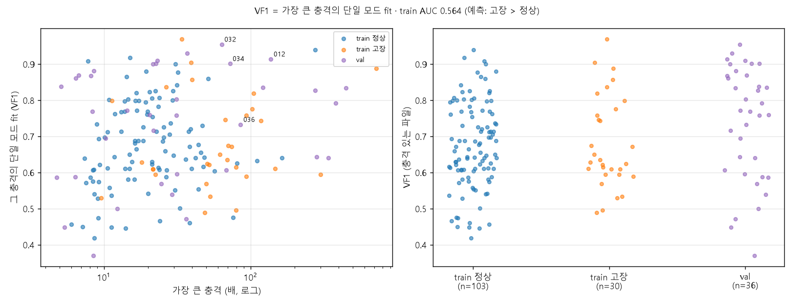

# V-10 가장 큰 충격이 한 모드로 깨끗하게 우는가 (11-27) — 결론: 쓰지 않음

## 목적 · 질문
V-2 그림 4(고립 강타 비교)에서 train 정상의 큰 6–7 kHz 강타는 여러 모드가 섞여 길게 울고(맥놀이, fit 0.46–0.68), val 고립 강타 012 · 032 · 034는 한 모드로 깨끗했다(fit 0.86–0.96). 옛 V-3에서 ζ 차이는 착시였고 fit 차이만 남았다. 이 차이가 **고장과 정상의 차이**인가?

## 방법 (계산 전에 고정)
- 피처 하나: **VF1 = 파일에서 가장 큰 충격의 단일 모드 fit**(VP, 봉우리 + 0.2 ms부터 8 ms, V-8 캐시). 충격 없는 파일 = 0. 문턱 · 띠 없음
- **미리 적은 예측: 고장 > 정상. 반대거나 없으면 쓰지 않는다**
- 실행: `자료/run.py` → `자료/결과.md` · `자료/figs/VF1.png`

## 결과

**그림 읽는 법**: 왼쪽 = 파일마다 가장 큰 충격의 크기(가로, 로그) × 그 충격의 단일 모드 fit(세로). 파랑 = train 정상, 주황 = train 고장, 보라 = val(번호 = 고립 강타 후보). 오른쪽 = 그룹별 VF1 분포(충격 있는 파일만). 정상과 고장은 겹치고, val이 전체적으로 위에 있다.

| 관문 | 값 | 판정 |
|---|---|---|
| train AUC | **0.564** (부트스트랩 5–95 % 0.47–0.66, 0.5 포함) · 충격 있는 파일만 0.493 | ✗ 구분 없음 |
| 정상 · 고장 중앙 | 0.640 · 0.632 | 같음 |
| ET에 더했을 때 | ΔAUC +0.0002 · ΔPR-AUC −0.0006 | ✗ 이득 없음 |
| H 피처와 중복 | 최대 ρ 0.43 (H9) | ○ |
| **val 이동** | val 중앙 0.759 (train 정상 기준 **z +0.81**) | ✗ val 전체가 깨끗함 |

- 최대 충격 크기 구간별로 나눠도 정상 · 고장 fit이 같다(10–30배 0.71 vs 0.62, 30–100배 0.64 vs 0.63)
- val 후보 012 · 032 · 034는 z +1.8 – +2.1로 높지만, val 고장 039 · 016 · 004도 +1.3, train 고장 중앙은 정상과 같다

## 해석과 결정
- **쓰지 않는다.** train에서 고장의 큰 충격이 정상보다 깨끗하지 않다(AUC ≈ 0.5). val 후보가 깨끗한 것은 **val 충격 전체가 깨끗하기 때문**(val 중앙 z +0.81)이다
- 즉 V-2 그림 4의 울림 모양 차이(정상 = 섞인 모드 · 맥놀이, val = 한 모드)는 **고장 · 정상 차이가 아니라 train · val 차이**다. V-8의 val 본체 모드 이동(주파수 ↓ · 감쇠 ↑)과 같은 맥락 — val 장비 · 측정 조건에서는 본체 모드가 한 모드로 깨끗하게 운다
- V-2 그림 4는 여전히 유효한 그림이다: ① 구간 첨도(`w_segk_mean`, EXP-068 V1)의 출발점 ② val 측정 조건 차이의 시각적 근거. 다만 "깨끗한 울림 = 고장"으로 읽으면 안 된다
