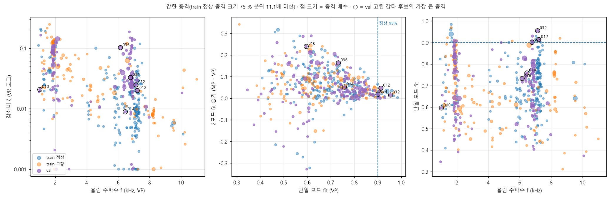

# V-3 울림 모양 정밀 추정 (11-27)

## 목적 · 질문
V-2에서 기존 사전(250 Hz × ζ 4칸)으로 본 "val 고립 강타는 빨리 죽고 깨끗하다"가 사전 칸 오차 없이 재도 맞는가? 강한 충격의 울림(주파수 f · 감쇠비 ζ · 단일 모드 fit · 맥놀이)이 train 정상과 val 후보(012 · 032 · 034 · 036 · 010 · 014)를 가르는가?

## 방법
1. **합성 검증**: 정답을 아는 감쇠 사인파(칸 사이 주파수 1830 · 3110 · 7125 · 9060 Hz, ζ 0.005–0.08, 잡음 진폭비 30 · 10, 위상 8번)와 맥놀이(두 모드 Δf 250 · 500 · 1000 Hz)로 추정기 3개를 비교한다
   - 기존 사전: 1–12 kHz 250 Hz × ζ {0.01, 0.02, 0.04, 0.08}
   - **VP(변수 투영) 연속 최적화**: 기존 결과 → 주변 ±300 Hz × ζ 40칸 → (f, ln ζ) `least_squares`. 진폭 · 위상은 매번 최소제곱
   - **Matrix Pencil**: 표본에서 모드 극점을 직접 계산(그리드 없음). 2모드로 맥놀이 분리
2. **실제 충격**: train 150 · val 40에서 train 정상 충격 크기 75% 분위(**11.1배**) 이상인 강한 충격 483개. 창 = 봉우리 + 0.2 ms부터 8 ms
3. **기준은 train 정상만으로**: 강한 충격의 fit 95% 분위 = **0.90**
- 실행: `자료/run.py` (약 1분) → `자료/figs/` · `자료/result.json` · `자료/강한충격표.csv` · `자료/고립강타_정밀.md`

## 결과

**그림 읽는 법**: 점 하나가 강한 충격 하나다. 점 크기 = 충격 배수, ○ = val 후보 파일의 가장 큰 충격. 왼쪽 = 주파수 × ζ, 가운데 = 단일 모드 fit × 2모드로 맞췄을 때 fit 증가(맥놀이 · 섞인 모드일수록 위), 오른쪽 = 주파수 × fit. 점선 = train 정상 fit 95% 분위.

| # | 결과 | 근거 |
|---|---|---|
| 1 | **기존 사전의 ζ는 믿을 수 없다.** 합성에서 ζ 상대오차 중앙값이 기존 사전 50–100%(ζ 0.005가 0.01 · 0.02로, 칸 사이 값은 이웃 칸으로)인데, VP · MP는 잡음비 30에서 1.5%, 10에서 5%다 | `합성검증.png` · result.json |
| 2 | **맥놀이를 한 모드로 맞추면 ζ가 커 보이고 fit이 떨어진다.** Δf 250 Hz 맥놀이(둘 다 ζ 0.010): VP 단일 모드 ζ 0.017 · fit 0.83. MP 2모드는 두 주파수(7001 · 7253 Hz) · ζ(0.0099 · 0.0091) · 진폭비(0.78)를 그대로 되찾고 fit 0.994 | result.json `맥놀이합성` |
| 3 | **정밀하게 재도 ζ는 갈리지 않는다.** 6–7 kHz 강타의 ζ는 train 정상 0.003–0.03, val 012 · 032 · 034가 0.020 · 0.025 · 0.033으로 정상 범위 안이다 | 왼쪽 그림 · `고립강타_정밀.md` |
| 4 | **단일 모드 fit > 0.90(정상 95% 분위)인 5.5–8.5 kHz 강한 충격: train 정상 5/164(3%, 4개 파일) · train 고장 1/33 · val 6/69(9%, 6개 파일: 002 · 008 · 012 · 029 · 032 · 034).** val에 약 3배 많지만 train 정상에도 있다 | result.json `그룹요약` |
| 5 | **크기를 함께 보면 다르다.** train 정상의 깨끗한 고주파 충격은 모두 작다(13–18배). 큰 고주파 강타(nor_060 111배 · 038 44배 · 006 39배 · 089 40배)는 모드가 섞여 있다(fit 0.46–0.68). val의 깨끗한 고주파 충격은 크다(012 138배 · 034 72배 · 032 64배 · 029 37배 · 002 · 008 23배) | 오른쪽 그림 · 아래 표 |
| 6 | **val 6개의 울림이 서로 매우 닮았다.** 034 · 029 · 002 · 008은 6.79–6.83 kHz · ζ 0.033–0.035 · fit 0.90–0.93이고, 012 · 032는 7.14–7.21 kHz · ζ 0.020–0.025다. 확인: 6.7–6.9 kHz · ζ 0.028–0.040인 강한 충격은 **train 0/345, val 12개(6개 파일: 002 · 008 · 009 · 029 · 034 · 035)**다. fit과 상관없이 센 값이다(범위는 val을 보고 정했다) | `강한충격표.csv` |
| 7 | 036(6.15 kHz · ζ 0.10 · fit 0.73)과 010(1.0 kHz · fit 0.60, 2모드 증가 +0.24)은 깨끗한 단일 모드가 아니다 | 가운데 그림 |

### ζ 신뢰성 검증 (11-27 추가, `자료/검증_감쇠비.md`)
논리: 지수 감쇠 하나라면 (a) 창 시작을 늦춰도 (b) 창 길이를 바꿔도 ζ가 같고 (c) 독립된 두 방법(VP · MP)이 같은 값을 내며 (d) 같은 파일 · 같은 모드의 반복 충격이 비슷한 값을 내야 한다. 또 (e) 실제 처리 경로(1–11 kHz 대역통과 · 검출 봉우리 시작 · 실제 바탕 잡음)를 넣은 합성에서 참값을 되찾아야 한다.

| 검증 | 결과 |
|---|---|
| (e) 현실 합성, 한 모드 | ζ ≤ 0.033: 오차 ≤ 4%. **ζ 0.08 · 6.8–7.2 kHz는 −10 – −14%(MP는 −50%)**: τ ≈ 0.3 ms라 검출 지연 + 0.2 ms 뒤에는 울림이 거의 남지 않는다 |
| (e) 현실 합성, 2번째 모드(+400 Hz, 진폭 30%) | VP가 ζ를 **13–20% 작게** 잡는다 |
| (a)(b)(c) 실제 483개, fit ≥ 0.9 (25개) | 창 4 ms vs 8 ms 3% · VP vs MP 6% · **시작 +0.6 ms 17% · +1.2 ms 27%** |
| 같은 검증, fit 0.75–0.9 / 0.6–0.75 / < 0.6 | VP vs MP 15% / 41% / 85%, 시작 +1.2 ms 34% / 57% / 92% |
| (d) 반복 충격 ζ 변동계수 | 고장 2 kHz: val_016 0.05 · abn_008 0.08 · val_039 0.32. val_034(6.8 kHz) 0.12. **정상 7 kHz: 0.20–0.85** |
| 고립 강타 파일 | **val_034 안정**(0.029–0.037). abn_017 0.043–0.065. **val_012 · 032는 시작을 늦출수록 작아진다**(012: 0.020 → 0.023 → 0.0055, 032: 0.025 → 0.038 → 0.0094) → 앞은 빨리, 뒤는 천천히 죽는 두 단계 감쇠. val_036은 방법마다 0.012–0.24로 흩어져 의미 없음 |

**판정**: ζ는 **조건부로만** 믿을 수 있다. 한 모드가 뚜렷하고(fit ≥ 0.9) 시작점을 옮겨도 안정한 충격(val_034 · val_016 · abn_017 등)은 ±10–15%. fit < 0.75인 충격(정상의 큰 강타 대부분)에서는 "ζ 하나"가 정의되지 않는다(±30–90%). 7 kHz에서 ζ ≥ 0.08처럼 1 ms 안에 죽는 울림은 지금 창 시작(봉우리 + 0.2 ms)으로는 잴 수 없다.

## 해석
- V-2 결과 7("val 고립 강타는 2–4배 빨리 죽는다")은 **틀렸다.** 사전 칸 때문에 생긴 착시다. 감쇠비는 train 정상과 같은 범위에 있다
- 남는 차이는 **"크고 깨끗한 한 모드 울림"**이다. train 정상은 크게 맞으면 여러 모드가 함께 울리고(맥놀이 · 섞임), 깨끗한 한 모드 울림은 작은 충격에서만 나온다. val에는 크면서 한 모드로 깨끗하게 우는 충격이 6개 파일에 있다
- 이 6개가 같은 울림(약 6.8 kHz · ζ 0.033)을 공유한다는 것은 해석이 둘로 갈린다
  - (가) **고장 신호**: 특정 부위의 간헐 접촉이 한 모드만 깨끗하게 때린다
  - (나) **val 측정 조건 차이**: 2-9에서 본 val 배경 이동(3–5 kHz +6–11 dB)처럼, 센서 위치 · 장착이 달라서 val에서만 이 모드가 깨끗하게 보인다
  - 8조는 034만 고장으로 보고 029 · 002 · 008은 정상으로 봤다. 그래서 이 울림 자체가 곧 고장이라는 근거는 약하다. 지금 정보로는 둘을 가를 수 없다
- **결론**: 정밀 추정 도구(VP · MP)는 검증됐다. 하지만 울림 모양만으로 val 고립 강타를 고장으로 판단하기에는 근거가 부족하다. 고립 강타의 고장 근거는 여전히 **"크기"(V-2: 충격 ≤ 4개 · 60배 초과가 train 정상 1.7%)** 쪽이 더 강하다

## 주의
- 강한 충격 기준(75% 분위) · fit 기준(95% 분위)은 train 정상만으로 정했다. 비교 대상 파일 이름(012 · 032 …)은 V-2에서 왔다
- 포락선 기울기로 구한 ζ(`z_env`)는 012 · 032에서 VP의 절반쯤이다(0.010 vs 0.020). 앞부분은 빨리, 뒷부분은 천천히 죽는(지수 하나가 아닌) 감쇠일 수 있다. 확인하지 않았다

## 개념
- **VP(변수 투영)**: 진폭 · 위상은 주어진 f · ζ에서 최소제곱으로 바로 풀리므로, 최적화는 f · ζ 두 개만 한다. 사전 칸이 없다
- **Matrix Pencil**: 감쇠 사인파의 합은 표본 사이에 "한 칸 밀면 일정한 복소수 배"라는 관계가 있다. 이 관계를 행렬 고윳값으로 풀어 모드의 주파수 · 감쇠를 직접 얻는다. 모드 수만 정하면 된다
- **2모드 fit 증가**: 두 번째 모드를 더했을 때 맞춤이 얼마나 좋아지는가. 맥놀이 · 섞인 모드면 크다
