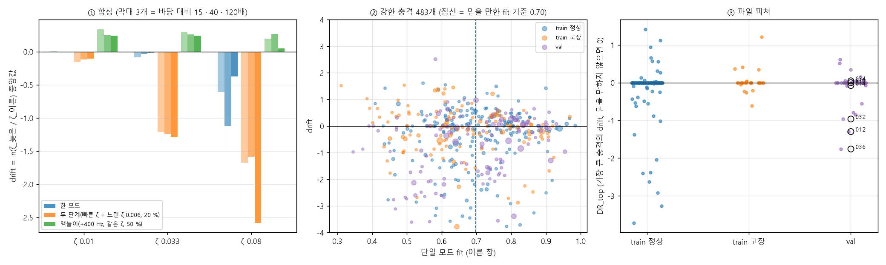

# V-4 시작점별 ζ 변화(감쇠 드리프트)를 피처로 쓸 수 있나 (11-27)

## 목적 · 질문
V-3에서 val_012 · 032는 창 시작을 늦출수록 ζ가 작아졌다(앞은 빨리, 뒤는 천천히 죽는 두 단계 감쇠). 이 "드리프트"를 피처로 쓰면 고장을 가를 수 있나?
가설: **H5(감쇠 C 변화)의 변형**. 접촉 · 마찰 같은 비선형 감쇠나 감쇠가 다른 두 모드가 있으면 drift = ln(ζ_늦은 / ζ_이른) < 0이다. 지수 감쇠 하나면 0이다.

## 방법
- drift: 충격 봉우리 + 0.2 ms 창과 + 1.2 ms 창(각 8 ms)의 VP ζ 비 (`src/ringfit.py` `zeta_drift`, V-3 추정기를 옮긴 것)
- ① 합성: 실제 바탕 + 울림(한 모드 · 두 단계 · 맥놀이) → 1–11 kHz 대역통과 → 포락선 봉우리 → drift
- ② 강한 충격 483개(train 정상 충격 75% 분위 11.1배 이상)
- ③ 파일 피처 3개: DR_top(가장 큰 충격) · DR_med · DR_min(fit ≥ 0.70 = train 정상 중앙값인 충격들). 없으면 0(중립)
- ④ train 단변량 AUC · 기존 피처와 상관 · ET OOF logit에 더한 로지스틱(5-fold × 20회). 중첩 CV 실험은 하지 않았다
- 실행: `자료/run.py` → `자료/결과.md` · `자료/figs/드리프트.png` · `자료/충격_drift.csv`

## 결과

**그림 읽는 법**: 왼쪽 = 합성(막대 = 바탕 대비 15 · 40 · 120배 충격의 drift 중앙값), 가운데 = 실제 강한 충격의 fit × drift, 오른쪽 = 파일 피처 DR_top (○ = val 후보).

| # | 결과 |
|---|---|
| 1 | **합성에서 drift는 의도대로 반응한다**: 한 모드 ζ ≤ 0.033은 0(−0.08 – 0), 두 단계 감쇠는 −1.2 – −2.6, 맥놀이는 +0.2 – +0.3 |
| 2 | **하지만 빨리 죽는 한 모드(ζ 0.08)도 −0.4 – −1.1**이 나온다. 늦은 창(+1.2 ms)에서는 울림이 이미 바탕 잡음에 묻혀 잡음을 "천천히 죽는 울림"으로 맞추기 때문이다 → 음의 drift가 두 단계 감쇠인지 잡음 바닥인지 구분이 안 된다 |
| 3 | **train에서 구분력이 없다**: 단변량 AUC DR_top 0.44 · DR_med 0.53 · DR_min 0.57(0.5 = 우연) |
| 4 | **ET에 더해도 이득 없다**: ET OOF만 AUC 0.9815 · PR-AUC 0.952 → + DR_* 0.980–0.981 · 0.947–0.950. 기존 피처와 상관은 낮다(ρ ≤ 0.24, 새 정보지만 쓸모없는 정보) |
| 5 | **음의 drift는 train 정상에도 흔하다**: DR_top −1 이하인 정상 파일 약 12개(최저 −3.7). val 012(−1.30) · 032(−0.97) · 036(−1.76)은 그 범위 안 |

## 해석과 결정
- **피처로 쓰지 않는다.** train에서 정상과 고장을 가르지 못하고(AUC ≈ 0.5), 합성에서도 잡음 바닥 때문에 거짓 음의 drift가 생긴다
- val 012 · 032의 두 단계 감쇠는 **train 정상에도 있는 모습**이다 → 이 두 파일을 고장으로 볼 근거를 더해 주지 않는다
- H5는 "약한 지지" 그대로(물리가설.md 11-27 추가)
- 고립 강타의 고장 근거는 여전히 **크기**(V-2) 쪽이다. 울림 모양(ζ · drift · fit) 쪽은 V-3 · V-4로 정리하고 닫는다

## 개념
- **drift**: 창 시작을 늦춘 ζ ÷ 이른 ζ의 로그. 0 = 지수 감쇠 하나, 음수 = 뒤가 천천히 죽음(두 단계 · 비선형 감쇠, 또는 잡음 바닥), 양수 = 맥놀이(진폭이 다시 커져 감쇠가 느려 보이다가 …)
- **잡음 바닥 편향**: 울림이 바탕 잡음 아래로 내려간 뒤의 구간을 맞추면, 잡음은 줄지 않으므로 "아주 천천히 죽는 울림"처럼 보인다
