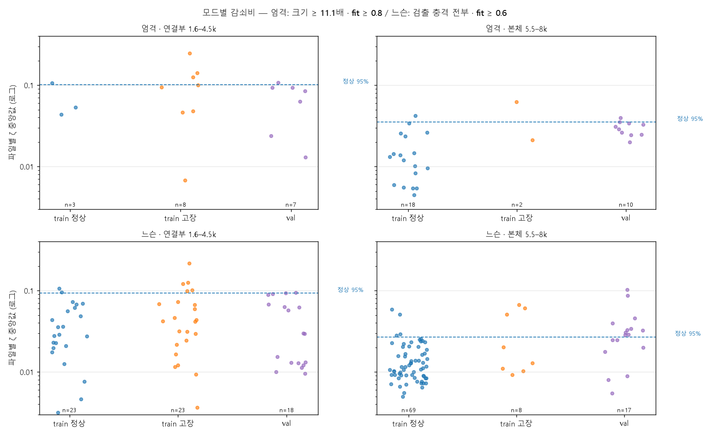

# V-8 모드별 감쇠비 (11-27)

## 목적 · 질문
연결부가 헐거워지면 감쇠가 커진다(사용자 가설, H5). 감쇠비는 모드마다 다르므로 **모드별로 따로 보고 OR로 판단**하면 정상과 고장이 갈리는가? 초기 고장은 정상과 같은 모드(본체)로 울되 감쇠만 커질 수 있다.

## 방법
- 검출된 모든 충격 1509개(train 정상 849 · 고장 409 · val 251, 제출 모델 검출기 · 1–11 kHz)의 f · ζ · fit을 VP 연속 최적화로 추정(`src/ringfit.py`, V-3에서 검증)
- 충격 고르는 기준 두 가지를 비교
  - **엄격**: 크기 ≥ train 정상 충격 75% 분위(11.1배) · fit ≥ 0.8 → 103개
  - **느슨**: 검출된 충격 전부 · fit ≥ 0.6 → 901개
- 모드: 연결부 1.6–4.5 kHz · 본체 5.5–8 kHz(주요), 전이 · 고주파는 참고. 파일 · 모드마다 ζ 중앙값
- 정상 기준 = train 정상 파일들의 ζ 95% 분위(정상 라벨만 씀) → 넘으면 이상, 주요 두 모드 OR
- 실행: `자료/run.py` → `자료/결과.md` · `자료/파일별_ζ_엄격.csv` · `파일별_ζ_느슨.csv` · `자료/figs/`. 충격별 값 캐시 `4_outputs/cache/val_eda_ringall.csv`

## 결과

**그림 읽는 법**: 점 하나 = 파일 하나(그 모드로 운 믿을 만한 충격들의 ζ 중앙값). 위 = 엄격, 아래 = 느슨. 왼쪽 = 연결부, 오른쪽 = 본체. 점선 = train 정상 95% 분위. n = 그 모드에 값이 있는 파일 수.

| # | 결과 |
|---|---|
| 1 | **연결부 모드는 가르지 못한다.** 엄격 AUC 0.63(정상 3개뿐) · 느슨 0.59. 정상 ζ 중앙 0.029 · 고장 0.042로 겹친다 |
| 2 | **본체 모드는 train에서 고장이 더 크다**: 정상 ζ 중앙 0.011–0.013, 고장 0.017–0.042, AUC 엄격 0.86 · 느슨 0.72. 가설 방향과 맞다. 다만 **본체 모드로 우는 고장이 2–8개 파일뿐**이라 근거가 약하다 |
| 3 | **val 전체가 본체 모드에서 감쇠가 크다**: val ζ 중앙 0.029–0.030 = train 정상의 약 2.5배, train 정상 95% 분위(0.027–0.035) 근처. 고장 비율(42.5%)로는 설명하기 어려운 **전체 이동**이다 |
| 4 | 모드 OR 판단: 엄격 = train 정상 오경보 2/120 · 고장 검출 4/30 · val 이상 3/40. 느슨 = 5/120 · 8/30 · 10/40 |
| 5 | **ζ 추정은 충격 크기에 끌려가지 않는다**: train 정상, 같은 모드 안에서 ζ와 크기의 상관 본체 0.00 · 연결부 0.19 → 결과 3의 val 이동은 잡음 크기 차이가 아니다 |
| 6 | 느슨 기준 val 이상 10개: 002 004 008 009 027 029 031 034 036 040. V-3의 "약 6.8 kHz · ζ 0.033" 파일(002 · 008 · 009 · 029 · 034)이 대부분 들어 있다 |
| 7 | 엄격 vs 느슨: 경향은 같다. 느슨은 파일이 3–4배 많아지고(본체 정상 18 → 69) 흩어짐이 커진다 |

### 추가 (11-27): 느슨 · 본체에서 기준선을 넘은 train 4개 · 6.8 kHz
- **train 정상 4개(016 · 080 · 040 · 110)는 추정 흔들림이다**: 작고 fit 낮은 충격 1개(016 8.5배 fit 0.61 · 080 7.3배 fit 0.63)가 파일 값을 정했거나, 같은 파일 충격끼리 ζ가 8배 엇갈린다(110: 0.050 vs 0.006). train 정상 본체 충격 430개의 ζ는 크기 · fit 구간과 상관없이 중앙 약 0.011 · 상위 10 % 0.030–0.038 → 충격 1–2개의 중앙값은 흔들린다
- **train 고장 3개(028 · 018 · 005)는 큰 충격에서 ζ가 크다**: 018 722배 ζ 0.063 fit 0.89 · 028 70배 ζ 0.118. 그 충격의 실제 주파수는 6.56 · 6.59 · 6.80 kHz(앞서 쓴 "6.78–6.82 kHz"는 파일 중앙값)
- **val은 본체 모드 주파수 자체가 낮다**(라벨 안 씀, fit ≥ 0.6, 100 Hz 칸): train 충격은 7.0–7.2 kHz에 몰리고(43 %), val은 **6.8 kHz(37 %) · 6.3 kHz(19 %)**에 몰린다. 파일별 중앙: train 정상 7063 Hz(66개) · train 고장 6808 Hz(6개) · val 6824 Hz(17개, 6.9 kHz 아래 14개)
- val에서 주파수가 낮은 14개 중 8개(002 008 009 011 014 029 033 040)는 두 조 모두 정상으로 본 묶음이다. 이 묶음에 숨은 고장은 6–7개뿐이라 전부 고장일 수는 없다 → **val 시스템 자체가 다르다(측정 조건 이동)** 쪽에 무게
- **물리 해석**: 모드 주파수 ↓(강성 ↓) + 감쇠비 ↑(마찰 ↑) = 연결부가 헐거워진 모습. train 고장(본체로 운 6개)도 이 방향이다. 하지만 val은 정상까지 이 방향으로 이동해 있어 둘이 섞인다
- **6.8 kHz를 띠로 정해 쓰지 않는다**: ① 고장 3개를 보고 고른 띠(과적합) ② 라벨 없는 모드 지도(2-14)에는 6.8 kHz 봉우리가 없다(5975 · 7225 Hz) ③ val의 본체 모드가 바로 그 자리라 val 정상까지 잡는다

### 메모 — test 때 할 일 (11-27 사용자: test는 나중에)
- test 40개의 **본체 모드 주파수 분포**를 라벨 없이 본다(이 README 추가 절과 같은 방법, fit ≥ 0.6, 100 Hz 칸). train처럼 7.1 kHz 근처면 val만의 조건 차이, val처럼 6.8 kHz면 train 기준 피처(AE 포함) 전체가 test에서 흔들릴 위험 → 모델 전략 재검토

## 해석 (논의 중)
- 본체 모드 감쇠는 **가설 방향(고장일수록 크다)과 맞는 신호**가 있다. 하지만 train에서 본체 모드로 우는 고장이 적어 검증이 약하다
- **val은 본체 모드 감쇠가 전체적으로 크다.** 2-9의 val 배경 이동(3–5 kHz +6 dB · 6.5–7.5 kHz −3.8 dB)과 같은 맥락일 수 있다(장착 · 측정 조건 · 온도 차이 → 감쇠 변화). 이 경우 train 정상 기준 문턱은 val 정상까지 이상으로 잡는다
- 다음 논의: val 이동이 측정 조건 때문인지 고장 때문인지 어떻게 가를지

## 개념
- **감쇠비 ζ**: 한 번 흔들릴 때 에너지가 빠지는 비율. 연결부 마찰 · 접촉이 늘면 커진다. 모드마다 값이 다르다
- **fit**: 충격 뒤 8 ms가 한 모드의 감쇠 사인파와 얼마나 닮았나. 높을수록 ζ를 믿을 수 있다
