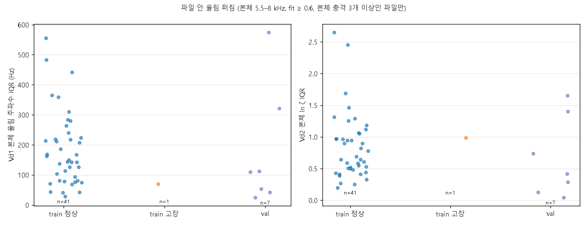

# V-9 파일 안 울림 퍼짐 (11-27) — 결론: 쓰지 않음

## 목적 · 질문
헐거운 연결부는 충격마다 접촉 상태가 달라 같은 모드라도 주파수 · 감쇠가 흔들릴 것이다(H5 변형). 측정 조건 차이(val, V-8)는 모든 충격을 같이 옮기므로 파일 안 퍼짐에는 안 나타난다 → 이동에 강한 피처가 될까?

## 방법 (계산 전에 고정, 과적합 방지로 최소화 — 사용자 11-27 "너무 복잡하면 과적합")
- 피처 2개: **Vd1** = 본체 띠(5.5–8 kHz, 라벨 없는 모드 지도) 충격들의 울림 주파수 IQR, **Vd2** = 같은 충격들의 ln ζ IQR
- 충격 = V-8 느슨 기준(fit ≥ 0.6). 본체 충격 3개 미만이면 0. 묶기 · 가중치 · 새 문턱 없음
- **미리 적은 예측: 고장 > 정상. 반대면 쓰지 않는다**
- 실행: `자료/run.py` → `자료/결과.md` · `자료/파일별_Vd.csv` · `자료/figs/파일안_퍼짐.png`

## 결과

**그림 읽는 법**: 점 하나 = 본체 충격이 3개 이상인 파일 하나. 왼쪽 = 울림 주파수 IQR, 오른쪽 = ln ζ IQR. train 고장은 1개뿐이라(n=1) 비교가 성립하지 않는다.

| | 값이 있는 파일(본체 충격 ≥ 3) | AUC(전체) | ET에 더했을 때 ΔAUC · ΔPR-AUC |
|---|---|---|---|
| 커버리지 | train 정상 41/120 · **train 고장 1/30** · val 7/40 | — | — |
| Vd1 주파수 퍼짐 | | **0.34 (예측 반대)** | −0.011 · −0.013 |
| Vd2 감쇠 퍼짐 | | **0.35 (예측 반대)** | +0.001 · +0.001 |

- **고장은 본체 모드로 3번 이상 울지 않는다(1/30).** 고장 충격은 연결부(1.6–4.5 kHz) 쪽으로 운다(V-8 · 2-14). 그래서 "값이 있음" 자체가 정상의 표시가 되고, AUC가 거꾸로 나온다(Vd1 · Vd2와 본체 충격 수의 상관 0.82)
- 반대로 연결부 모드에서 재면 정상이 그 모드로 거의 울지 않아 기준이 없다(V-8: 연결부로 운 정상 6–23개)

## 해석과 결정
- **쓰지 않는다**(미리 정한 예측과 반대). 생각이 틀렸다기보다 **이 데이터에서는 잴 수 없는 구조**다: 정상과 고장이 같은 모드로 여러 번 우는 파일이 거의 없다
- 감쇠비 계열(V-3 · V-4 · V-8 · V-9)의 정리: ζ는 정밀하게 잴 수 있지만(VP), 정상과 고장이 서로 다른 모드로 울어서 **같은 모드 안 비교가 성립하는 표본이 train에 거의 없다**. 남는 지식은 V-8의 **val 본체 모드 이동(주파수 ↓ · 감쇠 ↑)** = 측정 조건 차이와 test 때 확인할 메모

## 개념
- **IQR**: 75% 분위 − 25% 분위. 가운데 절반이 얼마나 퍼져 있나(이상치에 덜 흔들림)
