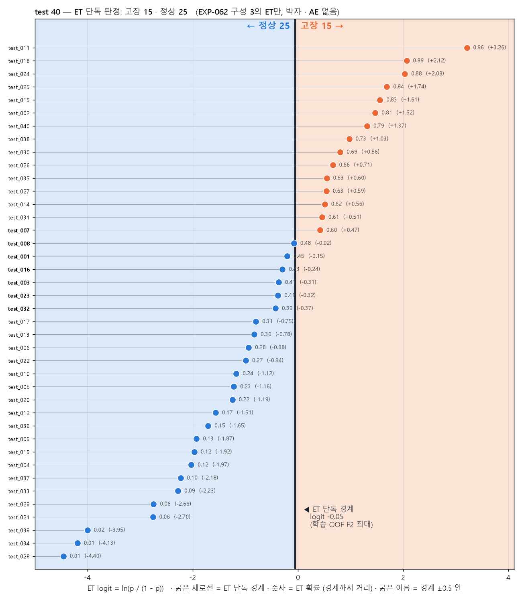
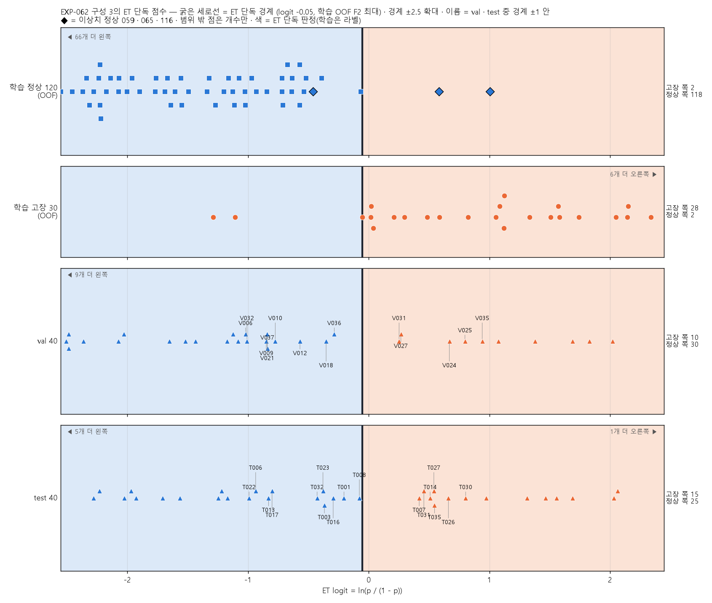

# T-1 — EXP-062 구성 3으로 돌린 test 예측: ET 단독 점수로 보기 (11-27)

## 질문
최종 모델(EXP-062 구성 3, J-축소 + K83 + 11 kHz 상한)은 test 40개를 어떻게 판정하는가. 그중 **ET 하나만**(박자 · AE 없이) 보면 경계 근처에 어떤 파일이 있는가.

## 한 일
- 학습 150개로 이미 저장된 모델(`3_단계/7_최종·제출/제출_EXP-062/모델/final_model_062.joblib`)을 읽어 **예측만** 했다. 다시 학습하지 않았고 문턱도 그대로다.
- 제출 양식 예측: `2_예측.py 2_data/TeamProject_test/test submission_test_9조.csv 2_data/TeamProject_test/submission_test.csv` (원본 출력은 `제출_EXP-062/출력/`, 여기 `자료/`에는 사본)
- ET 단독 그림 · 표: [자료/run.py](자료/run.py). ET logit = ln(p / (1 − p)), 학습은 안쪽 OOF logit, val · test는 학습 전체 ET로 채점. **ET 단독 경계 = 학습 OOF ET logit에서 F2 최대 문턱 −0.054**

## 결과
- ET 단독 고장 **15/40** · 최종(결합 OR 규칙) 고장 **15/40**. 두 판정이 다른 파일은 **없다**(규칙 0개, 결합도 ET와 같은 쪽)
- 고장: 002 007 011 014 015 018 024 025 026 027 030 031 035 038 040
- 경계 ±0.5 안: **007(+0.47) · 008(−0.02) · 001(−0.15)** · 016(−0.24) · 003(−0.31) · 023(−0.32) · 032(−0.37). 008은 경계에 붙어 있다
- 고장 비율: train 20%(30/150), val 판정 25%(실제 17/40 = 42.5%), test 판정 38%

**그림 읽는 법**: test 40개를 ET logit 순으로 한 줄씩 놓았다. 굵은 세로선 = ET 단독 경계(−0.05), 왼쪽 파랑 = 정상, 오른쪽 주황 = 고장. 숫자 = ET 확률(경계까지 거리), 굵은 이름 = 경계 ±0.5 안.

**그림 읽는 법**: 같은 ET 단독 축에 학습(OOF, 라벨 색) · val · test를 나눠 놓고 경계 ±2.5만 확대했다. 범위 밖 점은 모서리에 개수만 적었다. ◆ = 이상치 정상 059 · 065 · 116. 이름은 val · test 중 경계 ±1 안.
- 학습: 경계 오른쪽 정상 2(이상치 059 · 116), 왼쪽 고장 2 → 학습에서 ET 하나로 거의 갈린다
- val · test 모두 경계 바로 왼쪽(−1 – 0)에 파일이 몰려 있다. 학습 정상은 이 구간이 비교적 성기다 → V-1에서 본 "애매한 구간"이 test에도 있다

## 표
- [ET단독_요약.txt](자료/ET단독_요약.txt) · [ET단독_판정표.csv](자료/ET단독_판정표.csv) — 파일별 ET 확률 · logit · 경계까지 거리 · ET 단독 / 최종 판정
- [요약](자료/요약_submission_test_9조.txt) · [근거표](자료/근거표_submission_test_9조.csv) · [제출 양식 사본](자료/submission_test_9조.csv) — 최종 모델(결합 OR 규칙) 출력 사본
- 결합 평면 그림(ET + 박자 × AE)은 [제출_EXP-062/결과](../../3_단계/7_최종·제출/제출_EXP-062/결과/)에 있다

## 해석과 결정
- test에서는 최종 판정이 ET 단독 판정과 똑같다. 박자 · AE · 규칙이 판정을 바꾼 파일이 없다
- 제출 확정은 아니다(사용자 승인 대기). 사본이므로 이 CSV를 수정하지 않는다
- 경계 근처 파일(008 · 001 · 016 · 003 …)의 징후 · 17번째 선은 [T-2](../T-2_ET경계_17선/README.md)
