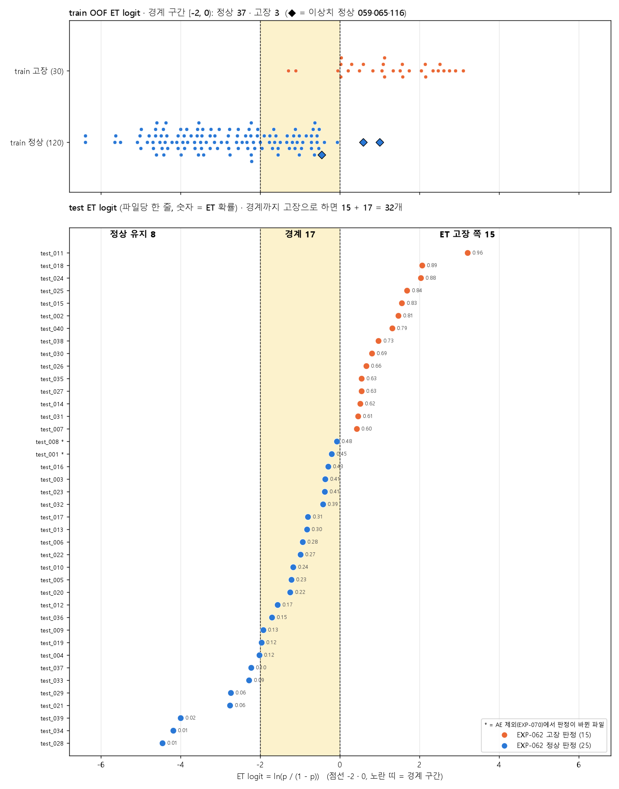
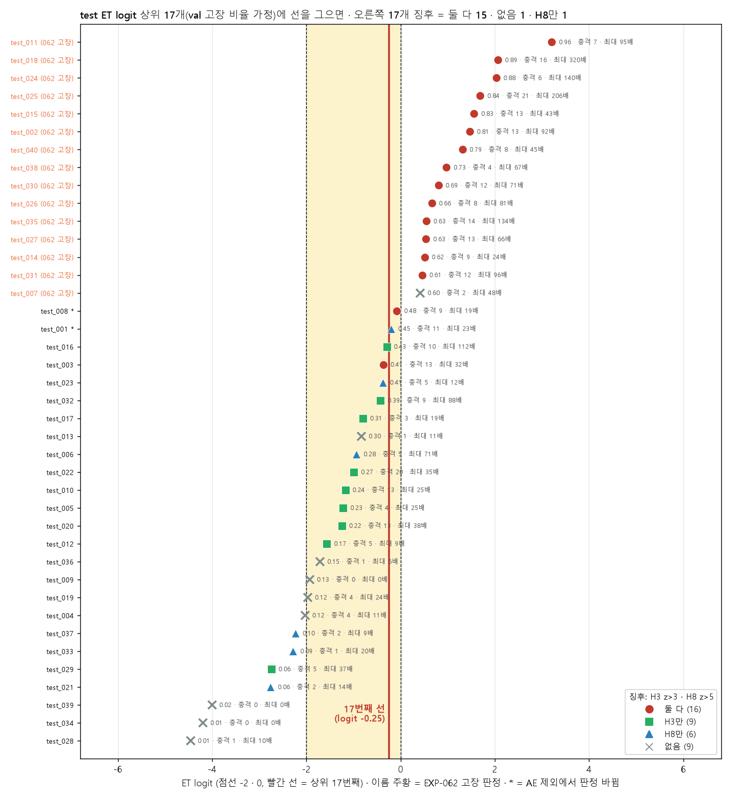

# T-2 — test ET logit 경계 · 상위 17번째 선 (V-1 방식을 test에, 11-27)

## 질문
[V-1](../../5_VAL_단계/V-1_미탐원인진단/README.md)에서 val을 ET logit 순으로 놓고 17번째(실제 고장 수)에 선을 그었다. 같은 방식으로 test를 보면 경계 구간 · 선 안쪽에 어떤 파일이 들어오는가.

## 방법
- 제출 모델(EXP-062 구성 3)을 그대로 읽는다(학습 없음). 코드 [자료/run.py](자료/run.py) (V-1 `plot_경계.py`와 같은 그림)
- **test 라벨은 없다.** 17 = val 고장 비율(17/40)을 test에 그대로 가정한 값이다. 선 위치만 정하는 진단용이며 모델 · 문턱에 쓰지 않는다
- 징후: train 정상 중앙 · MAD 기준 z, H3(1–2 kHz 첨도) z > 3 · H8(2–4 kHz 울림 비율) z > 5. 충격: `src.impacts.all_impacts(fmax=11000)`(V-2와 같음)
- 색 = EXP-062 최종 판정(val의 다른 조 그룹 대신), 이름 옆 * = AE 제외(EXP-070)에서 판정이 바뀐 파일

## 결과

**그림 읽는 법**: 가로 = ET logit, 노란 띠 = 경계 구간 −2 ≤ logit < 0. 위 = train 150 OOF logit(◆ = 이상치 정상), 아래 = test 40을 파일당 한 줄, 숫자 = ET 확률.

- test: 정상 유지(< −2) 8 · **경계 17** · ET 고장 쪽(≥ 0) 15. 경계까지 고장으로 하면 32개
- val(정상 유지 15 · 경계 15 · 고장 10)보다 test가 전체로 오른쪽에 있다

**그림 읽는 법**: test를 ET logit 순으로 놓고 위에서 17번째와 18번째 사이에 빨간 선(logit −0.25). 모양 = 징후(● 둘 다 · ■ H3만 · ▲ H8만 · × 없음), 오른쪽 숫자 = ET 확률 · 충격 수 · 최대 배수, 주황 이름 = EXP-062 고장 판정. 표는 [자료/17선_표.txt](자료/17선_표.txt) · [17선_표.csv](자료/17선_표.csv)

- 선 오른쪽 17개 = **둘 다 15 · H8만 1(001) · 없음 1(007)**
- EXP-062 고장 15개 다음으로 들어오는 2개 = **008(둘 다, logit −0.08) · 001(H8만, −0.21)** → AE 제외(EXP-070)에서 추가된 두 파일과 같다
- 18위 016(H3만, 최대 112배) · 19위 003(둘 다)도 −0.29 · −0.37로 붙어 있다. 16–19위가 logit 0.3 안이라 선 위치는 거의 동률에서 갈린다
- **007은 징후가 없는데(H3 z 0.4 · H8 z 0.4, 충격 2개 · 최대 48배) ET 고장 판정**이다. 확률 0.60(여유 +0.47) → 확인할 파일
- test 전체 징후: 둘 다 16 · H3만 9 · H8만 6 · 없음 9. 징후 하나만 15개 중 선 안은 001 하나

## 해석
- val에서 선 안을 채운 것은 "징후 하나만"이나 "징후 없음"이었지만, test에서는 선 안이 거의 **"둘 다"**다. test의 상위 17개는 train 고장과 닮은 쪽이다
- 고립 강타형(충격 적고 최대 배수 큼, V-2): 016(112배, 충격 10) · 032(88배, 9)는 선 밖, 006(71배, 5)도 밖. 충격 수가 많아 V-2의 고립 강타 정의(충격 ≤ 4 · 최대 > 30배)에 해당하는 test 파일은 038(4개 · 67배) · 007(2개 · 48배) 둘뿐이고, 둘 다 이미 고장 판정이다
- ⚠ 17은 가정이다. 선 위치로 문턱을 정하지 않는다
