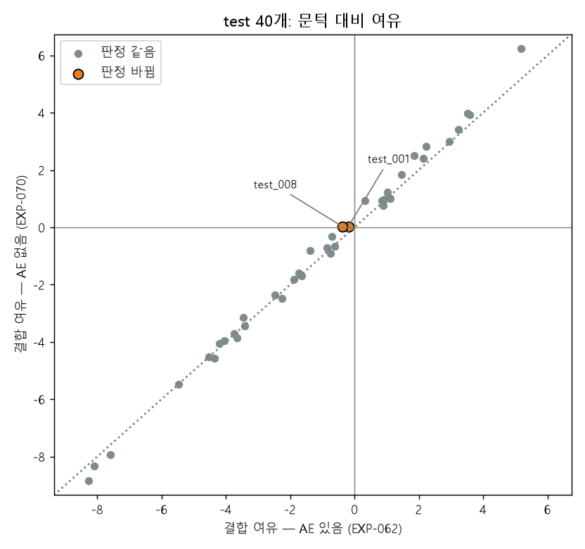

# EXP-070 AE 제외 모델로 test 판정 (EXP-062 구성 3에서 AE만 뺌)

노션 카드

| 팀원 | 모델 | F2 점수 | 변경 사항 | 메모 |
|---|---|---|---|---|
| 이동훈 | J-축소 + K83 · 11 kHz 상한 · AE 제외 (FinalJ use_ae=False) | 측정 안 함 (test 라벨 없음). 참고: 중첩 CV quick 0.905(EXP-069, 기준 0.954) | EXP-062 구성 3에서 AE 학습 · 결합 입력만 제거 (H1″) | test 고장 판정 15 → **17**: test_001 · test_008이 추가, 둘 다 여유 +0.03. val 판정 변화 0(10/40) |

## 주요 변경점 (EXP-062 구성 3 대비)
- AE 제외 → 결합 = ET logit · 박자 z (계수 1.969 · 0.370 · AE 0, 절편 0.852, 문턱 0.924. AE 있을 때 1.764 · 0.394 · 0.414, 문턱 1.032)
- E2 · 8.3k 규칙 · 11 kHz 상한 · 학습 150개 · 학습은 한 번만(문턱을 test로 고치지 않음)

## 결과
| | AE 있음 (EXP-062) | AE 없음 (EXP-070) |
|---|---|---|
| test 고장 판정 | 15/40 | **17/40** |
| val 고장 판정 | 10/40 | 10/40 (같음) |
| test 규칙 켜짐 (8.3k · 공진 · E2) | 0 | 0 |
| test 여유 0.5 미만 | 008 001 014 | 003(−0.33) 008(+0.03) 001(+0.03) |

- 추가된 고장: **test_001 · test_008** (AE 있음 여유 −0.19 · −0.38 → AE 없음 +0.03 · +0.03). 빠진 고장 없음
- 두 파일 모두 AE z가 높은 쪽(+1.10 · +0.76)인데 AE를 빼면 정상 쪽으로 눌러 주던 힘이 없어져 문턱을 겨우 넘는다

*test 40개의 문턱 대비 여유. 점선 = 같음. 주황 = 판정이 바뀐 파일*

## 해석
- AE를 빼도 큰 판정은 거의 그대로다(15개는 전부 유지). 바뀌는 것은 문턱 바로 위 · 아래의 001 · 008뿐이고, 여유가 0.03이라 **어느 쪽이든 동전 던지기** 수준이다. 이 둘이 고장인지는 라벨 없이 알 수 없다
- train 점수는 AE를 빼면 내려가고(quick 0.954 → 0.905, 009 · 028 놓침) 그 하락이 seed 1에 몰려 아직 결론이 아니다(EXP-069, full 대기). 즉 "AE 제외가 낫다"는 근거는 아직 없다. test에서 AE를 뺄 이유는 train 점수가 아니라 AE가 val · test 전체를 높게 본다는 진단(V-1)이다
- 제출 파일은 확정하지 않았다. 사본: [submission_test_noAE.csv](자료/submission_test_noAE.csv) · [근거표](자료/근거표_test_noAE.csv) · [여유 비교표](자료/test_여유비교.csv) · [result.json](자료/result.json)

**다음 (제안)**: EXP-069를 QE_FULL=1로 돌려 AE 제외의 train 하락이 seed 1 한정인지 확인 → 그 결과로 AE 제외 여부를 사용자가 정한다.
