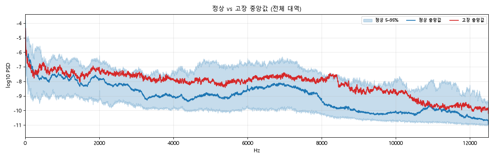
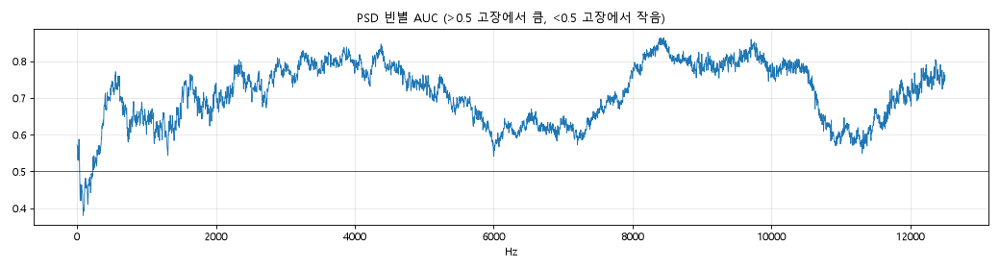
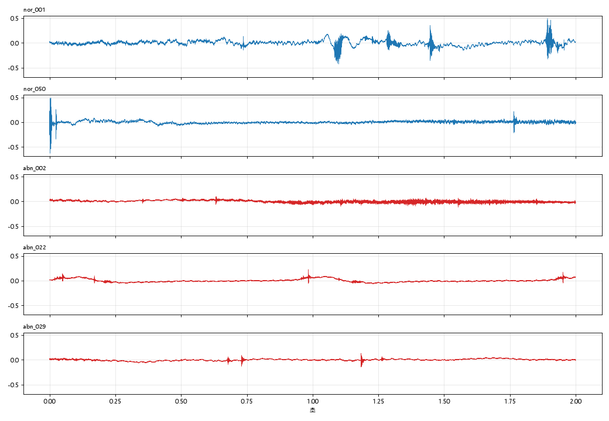
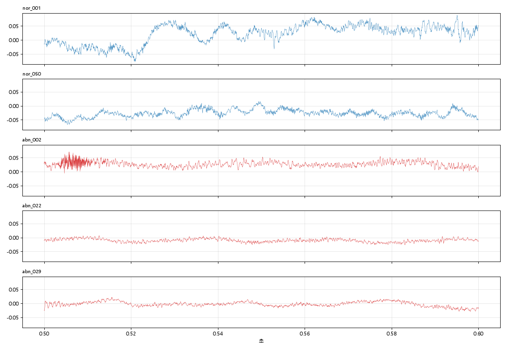
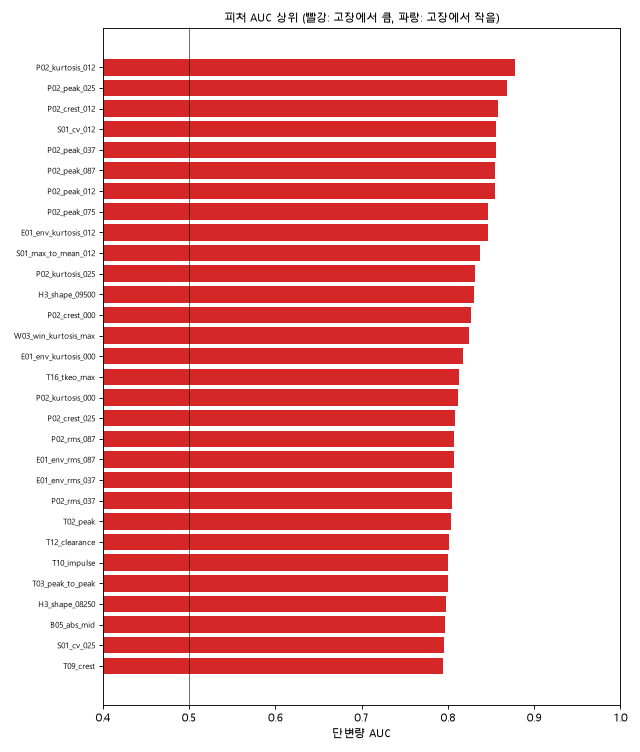
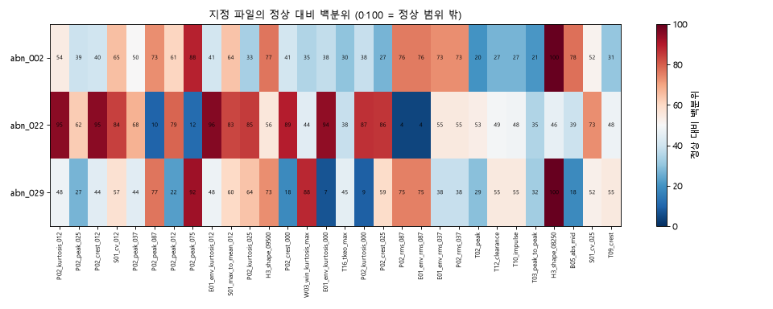

# EDA 데이터 이해 그림

- 가설: H1, H2, H3, H4 ([물리가설](../notes/물리가설.md))
- 실행: 2026-11-13 · git `62a4f46+수정중` · 코드 [run.py](run.py)

## 그림

### psd_focus
파란 띠 = 정상 120개 중 5–95%. 빨강 = 고장 중앙값. 지정 파일이 띠 밖으로 나가는 주파수가 그 파일을 잡을 단서


### psd_median
고장이 평균적으로 어느 대역에서 정상과 다른가. 1–3 kHz(H1 충격 모드), 8.3 kHz(H2 공진)



### psd_auc
주파수 빈별 AUC. 최고 8447 Hz (0.864), 최저 89 Hz (0.380). 라벨을 본 그림이므로 대역 선택에 직접 쓰지 않는다



### wave_focus
2초 전체 파형. 고장은 빨강. 짧은 스파이크(H1)와 느린 흔들림(H4)을 본다



### wave_zoom
0.5–0.6초 확대. 충격 1개의 모양과 링다운(H5)



### feature_auc
피처 단변량 AUC 상위 30 (전체 목록은 feature_auc.csv)



### focus_percentile
AUC 상위 30 피처에서 지정 파일의 정상 대비 백분위. 전부 중간(흰색)이면 현재 피처로는 못 잡는 파일



## 피처 묶음별 AUC (max·median·개수)

```
         max  median  count
group                      
P02    0.878   0.733     40
S01    0.856   0.641     30
E01    0.847   0.697     20
H3     0.831   0.625     50
W03    0.825   0.825      1
T16    0.813   0.813      1
T02    0.804   0.804      1
T12    0.801   0.801      1
T10    0.801   0.801      1
T03    0.800   0.800      1
B05    0.797   0.725      3
T09    0.794   0.794      1
T19    0.789   0.789      1
B04    0.778   0.642     20
T07    0.768   0.768      1
W02    0.754   0.754      1
H1     0.753   0.753      1
T18    0.751   0.751      1
T11    0.744   0.744      1
T17    0.733   0.733      1
F01    0.727   0.727      1
B02    0.722   0.722      1
F04    0.712   0.712      1
T01    0.706   0.706      1
T13    0.706   0.706      1
F02    0.699   0.699      1
B01    0.693   0.693      1
T14    0.682   0.682      1
H2     0.676   0.622     10
T04    0.674   0.674      1
F09    0.670   0.668      2
W01    0.662   0.662      1
H4     0.660   0.575      6
F03    0.657   0.657      1
T15    0.655   0.655      1
B03    0.634   0.634      1
W04    0.633   0.633      1
F05    0.620   0.620      1
F07    0.593   0.593      1
F08    0.589   0.589      1
F10    0.561   0.559      2
T20    0.516   0.516      1
T08    0.508   0.508      1
T06    0.504   0.504      1
```

## 메모
(결론·해석을 여기에 손으로 쓴다. 다시 실행해도 유지됨)
