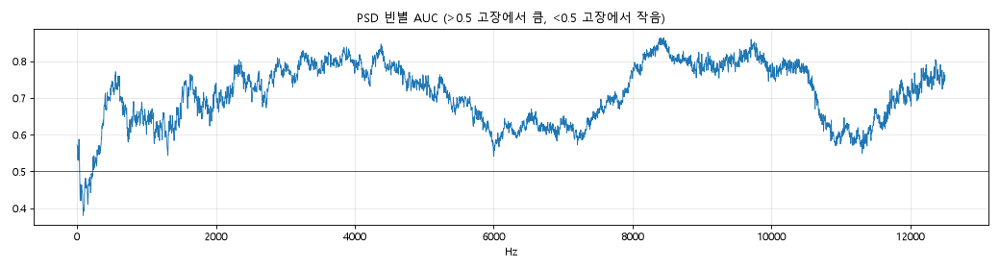
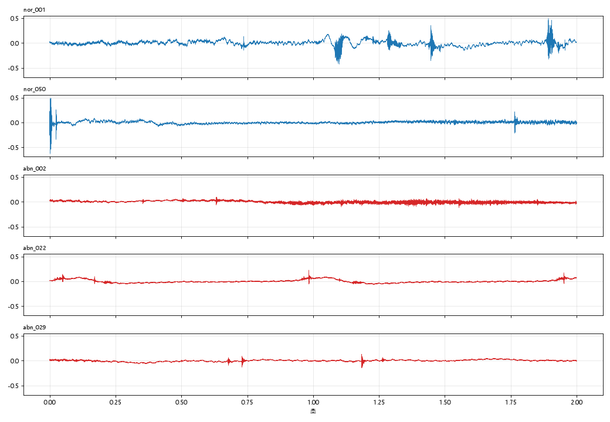
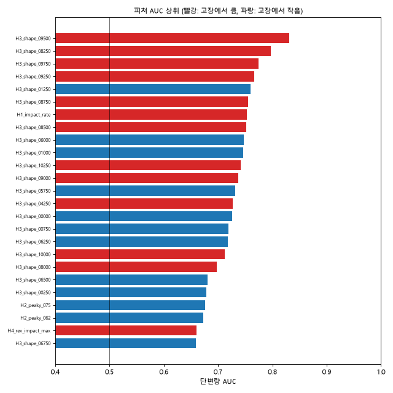
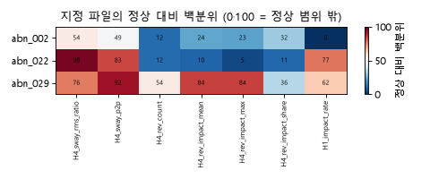

# EXP-006 물리 가설 피처와 피처셋별 모델 결합

- 가설: H2, H3, H4 ([물리가설](../../notes/물리가설.md))
- 실행: 2026-11-13 · git `62a4f46+수정중` · 코드 [run.py](run.py)
- 평가: 중첩 CV (바깥 5 × 안쪽 4, seed 5개). 자주 놓침 = seed 5번 중 3번 이상

## 결과

| 구성 | F2 | 재현율 | 정밀도 | 자주 놓침 | 오경보 3회+ |
|---|---|---|---|---|---|
| 기준 ext150 | 0.827 ± 0.031 | 0.867 | 0.700 | 002 022 029 | 10 |
| ext150 + H2 공진날카로움 | 0.827 ± 0.021 | 0.873 | 0.684 | 002 015 022 029 | 11 |
| ext150 + H4 반전충격(+H1 충격수) | 0.788 ± 0.030 | 0.820 | 0.685 | 002 015 017 021 022 029 | 10 |
| ext150 + H2 + H3 + H4 (한 모델) | 0.807 ± 0.033 | 0.840 | 0.698 | 002 015 022 029 | 9 |
| 물리만 H2+H3+H4 | 0.784 ± 0.047 | 0.853 | 0.594 | 014 015 022 | 15 |
| 결합: ET(ext150) + ET(H3 모양) | 0.789 ± 0.024 | 0.860 | 0.607 | 002 014 015 022 | 16 |
| 결합: ET(ext150) + ET(H2+H3) | 0.773 ± 0.021 | 0.853 | 0.565 | 002 014 015 022 | 19 |
| 결합: ET(ext150+H4) + ET(H2+H3) | 0.786 ± 0.021 | 0.853 | 0.608 | 002 014 015 022 | 14 |

## 그림

### psd_focus
abn_002·022·029의 PSD가 정상 범위 밖으로 나가는 곳. 8.2–8.4 kHz 협대역 피크(H2), 저주파(H4)를 본다


### psd_auc
주파수 빈별 AUC. 0.5에서 멀수록 그 주파수의 파워가 정상·고장을 가른다



### wave_focus
정상 2개와 놓친 고장 파형. 022는 저주파 흔들림 반전점의 충격(H4)을 본다



### phys_auc
물리 피처(H1–H4) 단변량 AUC 상위



### h4_percentile
H4 반전 충격 피처에서 놓친 고장이 정상 분포의 어디에 있나 (0·100이면 정상 밖)



## 물리 피처 AUC 상위 15 (abn 열 = 정상 대비 백분위)

```
          feat   auc dir  abn_002  abn_022  abn_029
H3_shape_09500 0.831   +   76.667   55.833   73.333
H3_shape_08250 0.797   +  100.000   45.833  100.000
H3_shape_09750 0.774   +   55.833   46.667   57.500
H3_shape_09250 0.767   +   74.167   61.667   88.333
H3_shape_01250 0.760   -   82.500   40.833   21.667
H3_shape_08750 0.755   +   91.667   45.000   97.500
H1_impact_rate 0.753   +    0.000   76.667   62.500
H3_shape_08500 0.752   +   95.000   35.833   98.333
H3_shape_06000 0.748   -    3.333    6.667   10.000
H3_shape_01000 0.746   -   72.500   73.333   30.000
H3_shape_10250 0.741   +   38.333   38.333   93.333
H3_shape_09000 0.738   +   75.833   52.500   85.833
H3_shape_05750 0.731   -   14.167   40.833   17.500
H3_shape_04250 0.726   +   55.833   94.167   33.333
H3_shape_00000 0.726   -   15.833   75.833   30.000
```

## 메모
(결론·해석을 여기에 손으로 쓴다. 다시 실행해도 유지됨)
