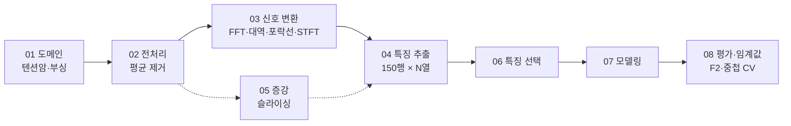

# 도메인·파이프라인 지도

노션 「도메인 지식 & 파이프라인」 한 페이지를 파이프라인 단계별 노트로 나눈 것이다.
필요한 단계 노트만 열어 읽는다. 구현 상태(피처 id, core/확장)는 [[features]], 규칙은 [[pipeline]], 미결정은 [[decisions]]가 원본이다.

## 이 폴더의 규칙
- 개념 노트에는 **개념만** 쓴다: 정의, 식, 물리적 의미, 원문 주장과 정정, 주의점
- 이 데이터에서 나온 결과는 쓰지 않는다. 결과는 `30_실험/EXP-nnn`, 결정은 [[decisions]], 코드 변경은 git 커밋에 남긴다
- 실험에서 생긴 도메인 질문은 [[60_회의·질문/도메인_질문]]

## 파이프라인과 노트

| 단계 | 노트 | 한 줄 요약 | 노션 원문 위치 |
|---|---|---|---|
| 도메인 | [[01_도메인_텐션암]] | 부싱 결함 → 강성 K·감쇠 C 변화 → 공진 이동·충격·고조파 | 1장, 2.3 |
| 전처리 | [[02_전처리]] | 평균 제거는 필수, MA는 고주파 충격을 죽여서 미적용 | 4장 표, 4.1–4.2, 4.8 |
| 신호 변환 | [[03_신호변환]] | FFT·대역 분할·Bandpass·포락선·STFT·웨이블릿 | 2.2, 4.3–4.6 |
| 특징 추출 | [[04_특징추출]] | 시간·주파수·윈도우 피처의 물리적 의미 | 2.1–2.2, 2.6, 5장 후보 목록 |
| 증강 | [[05_증강]] | 슬라이싱·노이즈·스케일·SMOTE와 누수 주의 | 4.7 |
| 특징 선택 | [[06_특징선택]] | 상관·VIF·폴드 안 선택, 모델별 필요성 | 5장 특징 선택 |
| 모델링 | [[07_모델링]] | 시계열 분류 4방법, 후보 모델, 실전 포인트 | 2.4–2.5, 3장, 5장 모델링 |
| 평가·임계값 | [[08_평가_임계값]] | F2, 파일 단위 중첩 CV, 임계값 분리 | 5장 공통 규칙·학습 순서 |
| 논문 | [[20_논문/00_논문DB]] | 참고 논문 17편 목록과 단계별 매핑 | 6장, 참고 논문 DB |

## 읽는 순서 (도메인 이해용)
1. [[01_도메인_텐션암]]: 무엇이 고장나고 신호에 어떻게 나타나는가
2. [[04_특징추출]]: 그 변화를 숫자로 잡는 방법
3. [[03_신호변환]]: 숫자를 뽑기 전 신호를 어떤 공간으로 바꾸는가
4. 나머지는 실험할 때 해당 단계만

## 내용의 신뢰도 표기
노션 원문은 Gemini 리서치·웹 자료를 정리한 것이라 출처 수준이 섞여 있다. 각 노트에서 아래처럼 구분한다.

| 표기 | 뜻 |
|---|---|
| (원문) | 노션 원문 주장. 근거 확인 전 |
| (추정) | 원문에서도 추정으로 표시된 값 (예: Gemini 주파수 대역) |
| (정리자) | 노션 정리 중 덧붙인 의견·정정 |

