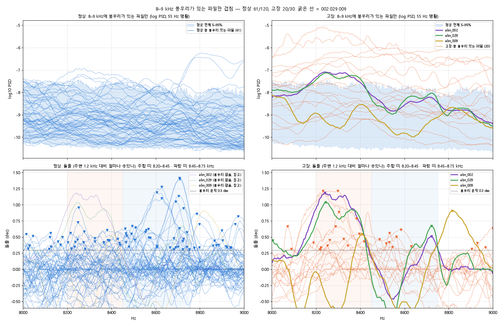
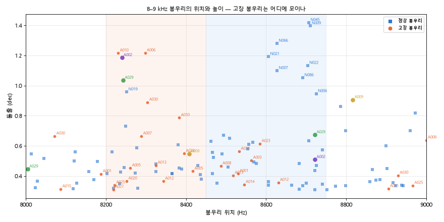

# 2-11 README2 — 8–9 kHz 봉우리만 본다: 8.25 kHz가 왜 제대로 쓰이지 않나

상태: 2차 (2026-11-14, EXP-020 결과와 사후 피처 판단 추가). 코드 [run2.py](run2.py), 수치 [figs/r2_numbers.txt](figs/r2_numbers.txt)
출발점: [EXP-014 README](../../5_모델비교/유의미/EXP-014_1114_ET·AE결합/README.md)의 회색지대(002·029) · 앞 문서: [2-11 경계 파일 특징](2-11_1114_경계파일특징_8.25khz.md) · 관련: [2-9 공진 이동](../2-9_1114_공진이동/2-9_1114_공진이동.md) · [2-10 AE 오차·8k 대역](../2-10_1114_AE오차·8k대역/2-10_1114_AE오차·8k대역.md) · 모델 적용: [EXP-020](../../5_모델비교/유의미/EXP-020_1114_8k봉우리축/README.md)

## 아이디어 (사용자 11-14)
- abn_002 같은 파일은 **이제 막 나기 시작한 조용한 고장**이다. 이를 잡으려면 **8.25 kHz**를 활용하는 것이 중요하다
- 지금 모델도 이 대역을 쓰기는 하지만(ET `B04_ratio_08125`, AE 복원 오차) 정작 제대로 활용되지 않는 것 같다
- 그래서 이번에는 **8–9 kHz만** 보고, 이 대역 안에 **봉우리가 있는 파일만** 골라 겹쳐 본다

## 방법
- 봉우리 정의(2-9와 같음, 라벨 안 씀): log PSD(평균 제거, Welch 8192)를 55 Hz로 평활 → 주변 1.2 kHz 이동 중앙값을 뺀 **돌출(dec)** → 돌출 ≥ 0.3 dec(약 2배)인 국소 최대, 150 Hz 간격
- 강조 파일: abn_002, abn_029(지금까지 논의한 8.25 kHz 고장), abn_009(사용자 언급)
- 위쪽 그림 = log PSD 그대로(크기 비교), 아래쪽 = 돌출(파일마다 주변 대비 얼마나 솟았나, 게인과 무관)

## 결과

**① 봉우리가 "있는가"만으로는 구분이 안 된다**: 8–9 kHz에 봉우리가 있는 파일은 정상 61/120(51%), 고장 20/30(67%)이다.

**② 봉우리의 "위치와 높이"로는 갈린다** (돌출 0.75 dec, 약 5.6배 이상의 큰 봉우리만)

| 위치 | 정상 | 고장 |
|---|---|---|
| **8.20–8.45 kHz** | nor_019 (0.96) — **1개** | **002 (1.18) · 006 (1.22) · 010 (1.22) · 029 (1.03) · 030 (0.89) · 010 둘째 (0.79) — 5개 파일** |
| **8.45–8.75 kHz** | **045 (1.42) · 009 (1.40) · 066 (1.28) · 021 (1.19) · 022 (1.13) · 007 (1.10) · 086 (1.05) · 006 (0.95) — 8개** | **0개** (가장 큰 것 029의 0.67) |

- **큰 봉우리가 8.2–8.45 kHz에 있으면 고장, 8.45–8.75 kHz에 있으면 정상**이라는 패턴이 거의 깨끗하다(6개 중 5개 / 8개 중 8개)
- 002·029는 둘 다 8.24 kHz에 큰 봉우리(1.18·1.03)가 있고, 8.72 kHz에는 작은 봉우리(0.51·0.67)가 함께 있다(2-9의 "두 봉우리 공존")
- 작은 봉우리(0.3–0.6)는 두 대역 모두 정상·고장이 섞여 있다

**③ abn_009는 8.25 kHz형이 아니다**: 봉우리가 8.41 kHz(0.55)와 8.82 kHz(0.91)에 있고, log PSD 크기도 002·029보다 한 자릿수 가까이 낮다. 지금까지 모델이 놓친 파일도 아니다(EXP-014~018에서 잘 잡힘). 이 문서에서 "8.25 kHz 조용한 고장"은 **002·029**이다

## 해석 — 왜 지금 모델이 8.25 kHz를 제대로 못 쓰나
1. **ET의 `B04_ratio_08125`는 8.125–8.75 kHz를 한 칸으로 묶는다.** 이 칸 안에 고장형 봉우리(8.2–8.45)와 정상형 봉우리(8.45–8.75)가 **함께 들어간다.** 정상 8개(045·009·066 …)의 큰 8.6–8.7 kHz 봉우리가 같은 칸 값을 올려서 002·029와 구분되지 않는다(2-10: 002·029 위에 nor_019·092가 바로 붙어 있음)
2. **AE는 1025칸 오차의 평균**이라, 8.25 kHz(전체의 약 1.7%)의 오차가 희석된다(2-10: 002·029 초과 오차의 16%)
3. **EXP-017의 200 Hz 격자 폴드 안 선택**은 칸 하나의 크기만 봐서 8.2 kHz와 9.6 kHz 칸 사이를 오갔다. 봉우리의 **위치**를 쓰지 않았다
4. 즉 지금 모델은 "8 kHz대가 높다"는 정보는 받지만, **"어느 쪽 봉우리가 솟았나"(8.3 vs 8.6 kHz)는 받지 못한다.** 2-9의 H2′(고장에서 8.3 kHz 모드가 크게 들뜸)와 같은 방향이다

## 모델에 넣어 본 결과 ([EXP-020](../../5_모델비교/유의미/EXP-020_1114_8k봉우리축/README.md))
EXP-014 결합(AE, ET → 로지스틱)에 8 kHz 축을 한 열 더했다. quick_cv는 5-fold × seed 3이다. 위험 = 고장일 때 자기보다 점수가 높은 정상의 비율(0이면 모든 정상보다 위)

| 추가한 피처 | 정의 | quick_cv PR-AUC (기준 0.929) | 002 · 029 위험 (기준 0.13 · 0.03) | 8.6 kHz 봉우리 정상 045 · 066 위험 (기준 0.80 · 0.66) |
|---|---|---|---|---|
| 정상 덮개 초과 | 학습 정상의 주파수별 돌출 90%선을 넘는 봉우리 최댓값 (라벨 없음) | 0.923 (중첩 F2 0.830) | 0.16 · 0.05 (해결 못 함) | 0.79 · 0.69 |
| **두 모드 상대 크기 (사후)** | **8.20–8.45 kHz 최대 돌출 − 8.45–8.75 kHz 최대 돌출** | **0.950 (+0.021)** | **0.00 · 0.00 (해결)** | **0.34 · 0.29 (내려감)** |

- **효과가 있는 것은 "같은 파일 안에서 8.3 kHz 모드가 8.6 kHz 모드보다 솟았나"(두 모드 비교)**다. 위 ②의 패턴을 그대로 옮긴 피처이고, 002·029를 고장 쪽으로 올리면서 8.6 kHz 봉우리 정상은 내린다
- "정상에 드문 위치의 봉우리"(덮개 초과)는 실패했다. 8.6–8.7 kHz 큰 봉우리 정상은 정상의 약 7%라 90% 덮개에 덮이지 않고, 오히려 002·029보다 높게 나왔다. 두 모드를 비교한다는 핵심이 빠진 정의였다
- 부작용: 두 모드 비교는 nor_019(8.25 kHz 봉우리가 있는 정상)를 위험 0.69 → 0.91로, 027·073도 조금 올린다

## 사후 피처를 쓰는 것에 대한 판단 (사용자 11-14)
- **방향: 두 모드 상대 크기를 사후로 정한 경계 그대로 쓴다.** 이유는 "이제 막 나기 시작한 조용한 고장"처럼 독특한 고장 방식은 피처로 반영해야 하기 때문이다. 이 피처는 점수만 보고 고른 것이 아니라 물리 가설 H2′(고장에서 8.3 kHz 모드가 크게 들뜸, 2-9)에 근거한 도메인 피처다
- 원칙 3("라벨을 본 뒤 대역을 손으로 고르지 않는다")의 **예외**로 둔다. 별도 실험(경계 흔들기, 중첩 CV)은 하지 않기로 했다
- 대신 다음을 함께 기록하고 발표에서도 그대로 말한다
  1. **점수는 낙관적이다.** 경계 8.20 / 8.45 / 8.75 kHz를 같은 150개의 라벨을 보고 정했다. +0.021에는 이 선택 이득이 들어 있다
  2. **근거가 작다.** 8.2–8.45 kHz 큰 봉우리는 고장 5개(002·006·010·029·030), 정상 1개(019)다. val·test 고장에 이 봉우리가 없으면 이득도 없다
  3. **공진 위치는 측정 조건(센서 위치·온도)에 따라 움직일 수 있다.** 경계가 두 봉우리 무리 사이에 딱 맞게 그어져 있어 위치가 조금만 밀려도 효과가 줄 수 있다
  4. **val 40개(11/19 공개)는 확인용으로만 쓴다.** val을 보고 경계를 다시 고치지 않는다
- 이 피처는 "조용한 8.25 kHz형"(002·029)을 위한 보조 축이다. 다른 고장 유형(충격형, 017·022)에는 효과가 없다

## 한계
- 봉우리 문턱 0.3 dec, 평활 55 Hz, 바탕 1.2 kHz 한 설정만 봤다
- "큰 봉우리" 기준 0.75 dec는 표를 읽기 쉽게 하려고 그림을 본 뒤 정한 값이다
- 설비·센서 위치·온도가 다른 측정이 섞여 있으면 공진 위치는 고장 없이도 움직일 수 있다(2-9 한계와 같음)
