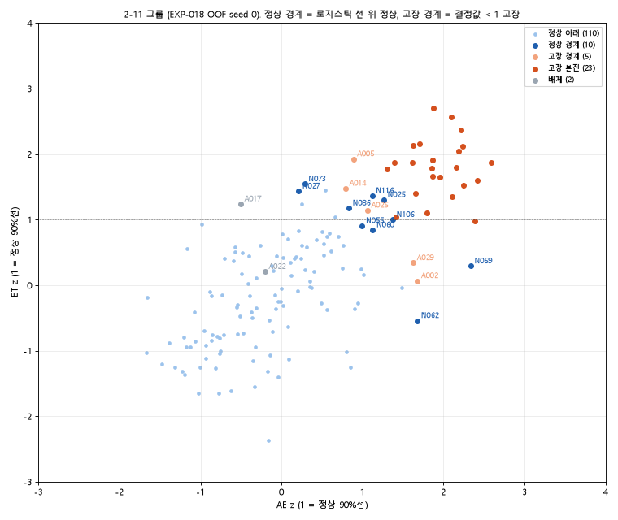
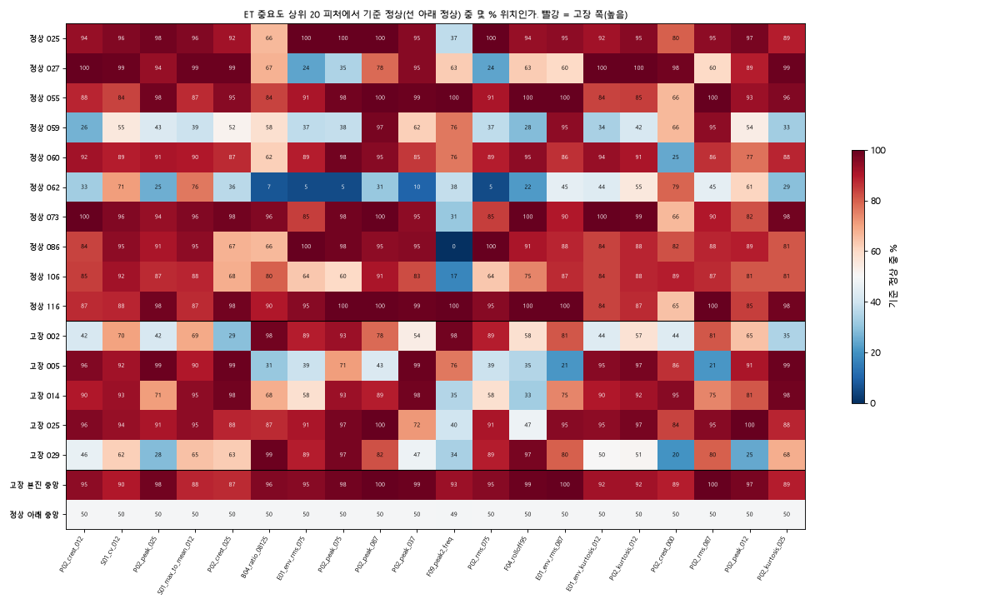
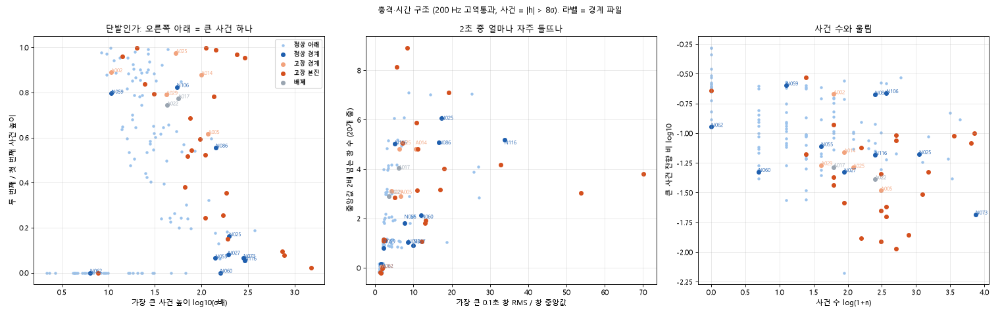
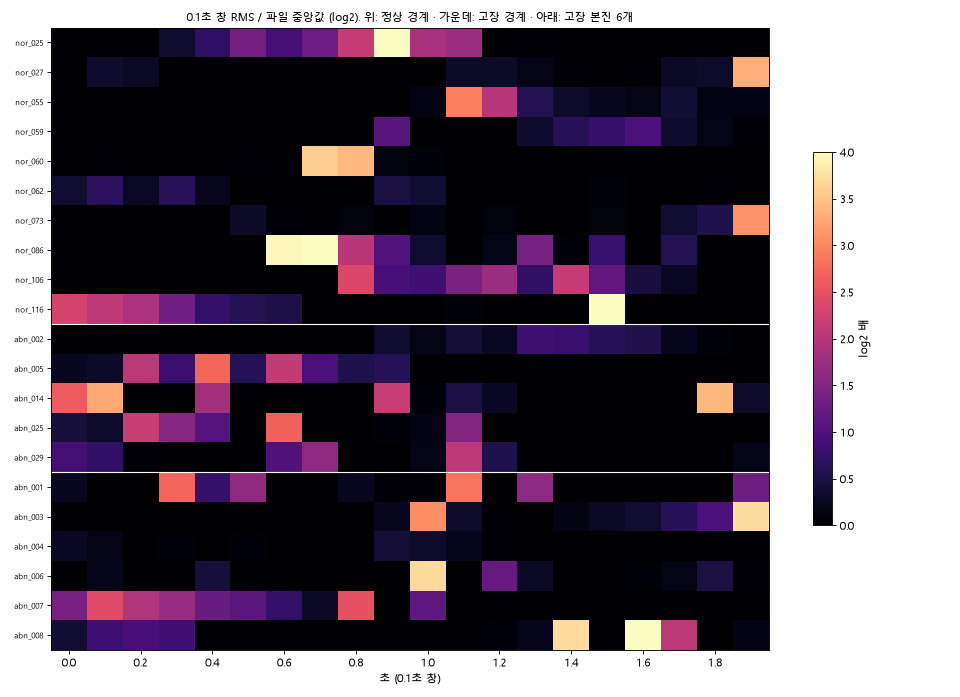
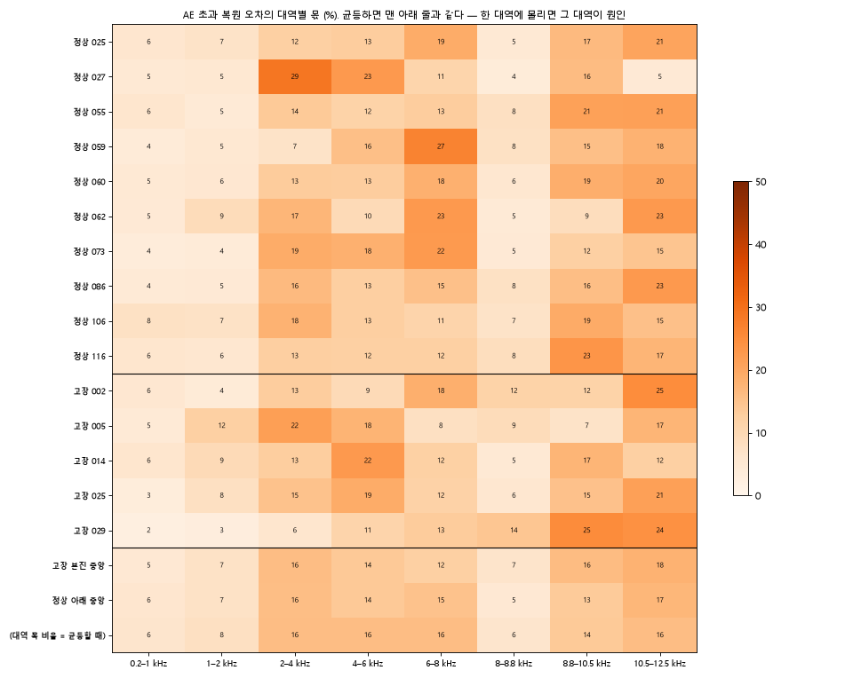
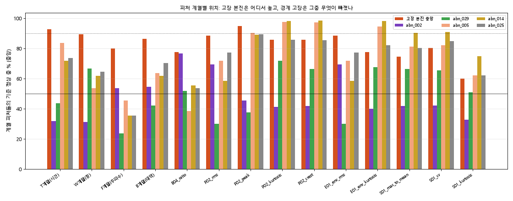
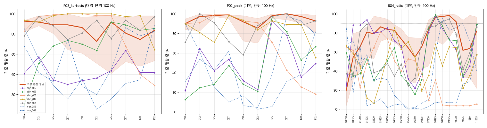
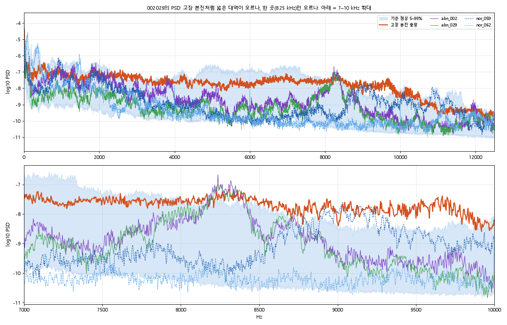

# 2-11 경계 파일의 특징 — 로지스틱 선 위의 정상, 선 근처의 고장은 무엇이 다른가

상태: 1차 (2026-11-14). 코드 [run.py](run.py), 수치 [figs/numbers.txt](figs/numbers.txt)
출발점: [EXP-018 boundary_lr](../../5_모델비교/기각/EXP-018_역할별최적화/README.md) (AE 기본 + ET 기본 → 로지스틱, = EXP-014 최종 후보)

## 질문 (사용자 11-14)
1. 로지스틱 선 **위에 있는 정상**은 무엇 때문에 고장처럼 보이나 → 선 아래로 내릴 특징은?
2. **abn_002·029**는 고장 본진과 무엇을 공유하고 무엇이 빠졌나 → 고장 군집에 가깝게 할 특징은?
3. abn_017·022는 일단 빼고, 나머지 경계 파일의 특징을 구분한다

## 방법
- 그룹(실행 전 고정): EXP-018과 같은 OOF(5-fold, seed 0)의 로지스틱 결정값 d
  - 정상 경계 = 정상 & d > 0 (선 위) → **025 027 055 059 060 062 073 086 106 116** (10개)
  - 고장 경계 = 고장 & d < 1 (017·022 제외) → **002 005 014 025 029** (5개)
  - 고장 본진 = 나머지 고장 23개, 정상 아래 = 나머지 정상 110개(기준 정상), 배제 = 017·022
  - seed 0 분할 하나로 나눈 것이라, 다른 seed에서 오경보였던 008·039·054·065·095는 여기서 "정상 아래"에 들어갔다
- 축: ① ET 중요도 상위 20 피처 ② AE 초과 복원 오차의 대역별 몫 ③ 충격 구조(사건 높이, 두 번째/첫 번째 사건 높이, 사건 수, 잔향) ④ 0.1초 창 RMS ⑤ 피처 계열·대역별 프로파일, PSD
- 라벨은 그룹 나누기와 설명에만 썼다. 아래 "후보 축"은 라벨 없는 정의로 다시 만들어 CV로 확인해야 한다(원칙 3)

## 결과 1 — 선 위 정상은 두 유형으로 나뉜다

### 유형 N-A "큰 사건 한 번" (025 027 055 060 073 116, 일부 086)

| | 큰 사건 높이 (σ배) | 두 번째 / 첫 번째 사건 높이 | ET 상위 20 중 정상 90% 넘는 피처 | 0.1초 창 2위/1위 |
|---|---|---|---|---|
| 025 · 027 · 055 · 060 · 073 · 116 | 140–290 | **0.00–0.16** | 8–16개 | 0.13–0.88 (025·027·073·116은 0.13–0.26) |
| 고장 본진 중앙 | 110 | **0.54** | 12개 | 0.77 |
| 고장 경계 005 · 014 · 025 | 50–120 | **0.62–0.97** | 10–13개 | 0.66–0.92 |
| 기준 정상 중앙 | 22 | 0.52 | — | 0.85 |

- **ET가 이들을 고장으로 보는 이유는 대역 필터 Peak·파고율(P02_peak·crest, S01_max_to_mean)이다.** ET 중요도 상위가 거의 이 계열이다. 큰 사건 하나가 이 값들을 끌어올린다
- **고장은 비슷한 높이의 충격이 반복되고(두 번째/첫 번째 0.54–0.97), 이 정상들은 큰 사건 하나만 있다(0.00–0.16).** 1-3의 물리 해석과 맞는다. 고장은 하중 주기마다 반복해서 때리고, 정상은 노면 같은 외부 충격을 한 번 받는다
- 다만 깨끗하게 갈리지는 않는다. 고장 본진에도 큰 사건 하나가 지배하는 파일이 있다(그림 4 왼쪽 아래의 주황 점 5개, 두 번째/첫 번째 0.02–0.35). 이들은 AE(광대역 상승)로 잡히고 있다
- 시간 구조(그림 5): 025·086·106·116은 큰 사건 뒤 **0.3–0.6초 동안 이어서 들뜬다**(연속된 창). 반면 고장 005·014·025·001·007은 2초 안에 **흩어진 짧은 들뜸이 여러 번** 나온다. 파일 몇 개를 눈으로 본 관찰이라 수치 확인이 필요하다

### 유형 N-B "조용한데 스펙트럼 모양이 다름" (059 062, 일부 106)

| | 큰 사건 높이 | ET 피처 | AE z | 초과 오차가 몰린 대역 |
|---|---|---|---|---|
| nor_059 | 11σ | 3개 | +2.34 | **6–8 kHz** (27%, 대역 폭 대비 ×1.7) |
| nor_062 | 6σ (사건 0개) | 0개 | +1.68 | **6–8 kHz** (23%, ×1.4) |
| nor_106 | 55σ | 2개 | +1.37 | 8.8–10.5 kHz (×1.4) |
| abn_002 | 11σ | 3개 | +1.68 | **8–8.8 kHz** (×1.8) |
| abn_029 | 42σ | 3개 | +1.63 | **8–8.8 kHz** (×2.3) |

- 충격이 거의 없어서 ET는 정상으로 본다. AE만 높게 본다
- 002·029와 **같은 AE 점수지만 오차가 나는 대역이 다르다**: 059·062는 6–8 kHz, 002·029는 8–8.8 kHz (2-10과 같은 결론을 그룹 전체에서 확인)

## 결과 2 — 002·029는 "조용한 고장 + 8.25 kHz 공진 하나"

| 피처 계열 (기준 정상 중 %, 중앙) | 고장 본진 | 002 | 029 | 005 | 014 | 025 |
|---|---|---|---|---|---|---|
| 시간(T) | 93 | **32** | **44** | 84 | 72 | 74 |
| P02 Peak (대역 필터 최대) | 95 | **45** | **38** | 90 | 89 | 90 |
| P02 첨도 | 86 | **41** | 72 | 98 | 98 | 86 |
| 대역 비율 B04 | 78 | 77 | 52 | 39 | 55 | 54 |

- **고장 본진이 가진 것 중 002·029에 빠진 것은 충격 관련 전부다**(시간·Peak·첨도가 정상 중앙 근처). 큰 사건 11·42σ, 0.1초 창 최대 ×1.8·×4.2로 거의 들뜨지 않는다
- **공유하는 것은 8 kHz대 하나**
  - PSD(그림 8): 고장 본진은 2–12 kHz 전체가 정상 띠 위로 약 한 자릿수 높다
  - 002·029는 대부분 대역에서 정상 띠 안이다. **8.0–8.45 kHz에서만 고장 본진과 같은 높이까지 올라간다**
  - B04 비율 프로파일(그림 7 오른쪽): 고장 본진은 8.1–10 kHz 칸들이 모두 정상 중 97–98%다. 002·029는 8.125 kHz 칸에서만 97–98%이고 8.75 kHz부터 내려간다
- 즉 002·029는 고장 본진의 "8–10 kHz 상승"의 **좁은 일부만** 가진 조용한 파일이다. 충격 축으로는 고장 군집에 가까워질 수 없고, 8 kHz대에서만 가까워질 수 있다

## 결과 3 — 고장 경계 005·014·025는 "충격은 있는데 AE가 약하다"
- 005·014·025는 충격 피처가 고장 본진만큼 높다(P02 첨도 86–98%, ET z 1.1–1.9). 하지만 AE z가 0.8–1.06으로 본진(약 2)보다 낮아 선 근처에 있다
- 반복 충격(두 번째/첫 번째 0.62–0.97, 2배 넘는 창 3–5개)이라 **N-A 정상과 정반대 위치**다(그림 4 왼쪽: 위쪽 vs 오른쪽 아래)

## 해석과 후보 축 (라벨 없는 정의로 CV 확인 필요)
| 목표 | 대상 | 관찰 | 후보 축 (사전 정의 가능한 형태) | 관련 가설 |
|---|---|---|---|---|
| 정상을 선 아래로 | N-A 025 027 055 060 073 116 | 큰 사건 하나가 ET의 Peak·파고율을 끌어올림 | **가장 큰 사건(±10 ms)을 가린 신호로 P02 Peak·파고율을 다시 계산** → 단발 사건의 영향 제거. 반복 충격 고장은 값이 유지됨 | H1 (반복 타격) |
| 고장을 선 위로 | 005 014 025 | 반복 충격인데 AE가 약함 | 같은 축: 가린 뒤에도 Peak가 높게 남는 것이 "반복"의 증거 → 이 고장들은 오히려 올라감 | H1 |
| 정상을 선 아래로 | N-A 일부 025 086 106 116 | 큰 사건 뒤 0.3–0.6초 연속 들뜸 vs 고장의 흩어진 반복 | 들뜬 0.1초 창의 **최장 연속 길이** 또는 사건 시각의 흩어짐 | H1·H5 |
| 정상을 선 아래로 | N-B 059 062 | AE 오차가 6–8 kHz에 몰림 | AE 단독 축으로는 002·029와 구분 불가. 대역별 오차를 쓰려면 대역이 **사전 고정 격자**여야 함(예: 2 kHz 격자 6칸) | H2·H3 |
| 고장을 군집 쪽으로 | 002 029 | 조용함 + 8.0–8.45 kHz만 고장 본진 수준 | 사전 고정 **2 kHz 격자 대역 비율**(8–10 kHz 칸이 자연스럽게 포함됨). EXP-017의 200 Hz 격자 폴드 안 선택은 불안정했으므로 칸을 고르지 않고 6칸 모두 입력 | H2′ |

### 우선순위 제안
1. **"가장 큰 사건을 가린 Peak·파고율"**: 한 축으로 N-A 정상 6개는 내리고 고장 경계 005·014·025는 올리는 방향이라 기대가 가장 크다. 정의가 라벨과 무관하다(사건 = |h| > 8σ, 가림 폭 ±10 ms 고정)
2. 2 kHz 고정 격자 대역 비율 6칸: 002·029 대상. 다만 EXP-017에서 대역 축을 추가할 때 오경보 꼬리(019·092)가 함께 올라왔던 위험이 있다
3. 연속 들뜸 길이: 그림 몇 장에서 본 관찰이라, 먼저 150개 전체 분포로 확인한다

## 한계
- 그룹은 seed 0 분할 하나의 결정값으로 나눴다. 경계 근처 파일은 분할에 따라 그룹이 바뀐다(예: 008·039·054·065·095)
- ET 중요도는 전체 150개로 학습한 모델의 값이라 설명용이다
- 파일 수가 작다(정상 경계 10, 고장 경계 5). 유형 이름(N-A, N-B)은 이 보고서의 설명용이고, 라벨로 쓰지 않는다(11-14 합의: 유형 라벨링 안 함)
