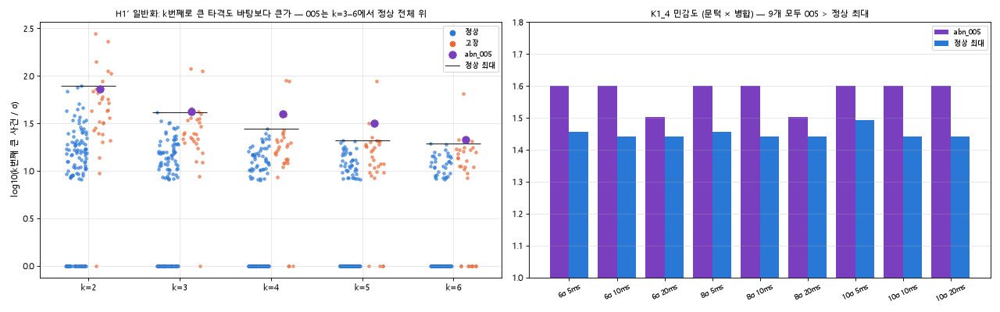
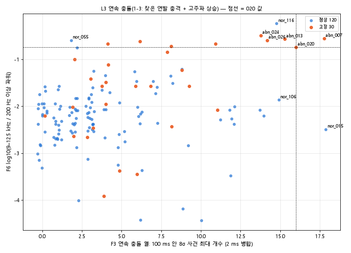
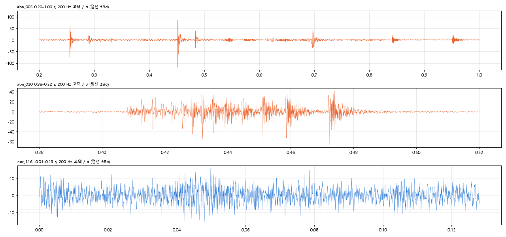

# 2-14 불안정 고장 005·020 — 가정한 고장 유형으로 찾는 확실한 특징

상태: 1차 (2026-11-14). 코드 [run.py](run.py), 수치 [figs/numbers.txt](figs/numbers.txt), 파일별 값 [figs/features.csv](figs/features.csv)
출발점: EXP-025 분리 판정에서 회색 고장으로 남은 005·020 (005는 seed 4에서 1번 놓침, 020은 회색). 실험(EXP) 아님

## 결론
| 파일 | 가정한 유형 | 확실한 특징 | 정상과의 관계 |
|---|---|---|---|
| **abn_005** | **H1′ 간극 타격의 고른 반복** (1-3에서는 L2 예시) | **K1_4 = log10(네 번째로 큰 타격 / 바탕 σ)** = 1.60 (타격이 바탕의 40배) | 정상 최대 1.44(nor_001)보다 위. **문턱 6–10σ × 병합 5–20 ms, 9개 설정 모두 005보다 높은 정상 0개** (차 +0.06 ~ +0.16 dec). k = 3–6 모두 정상 위 |
| **abn_020** | **L3 연속 충돌(knocking)** | **연속 충돌 열(100 ms 안 8σ 사건 16개) + 고주파 비율(9–12.5 kHz) 동시 상승** | 12개 설정 중 8개에서 둘 다 020 이상인 정상 0개, 4개에서 **nor_116 하나**가 남음. 확실하다고 하기에는 부족함 |

- **005는 "확실한 특징"이 있다.** EXP-025 규칙이 쓰던 R(2위/1위)은 005의 1위 타격(118σ)이 유난히 커서 0.62로 눌렸다. 같은 H1′을 **바탕 대비 k번째 타격 크기**로 재면 005가 정상 전체 위로 올라간다
- **020은 유형(L3)은 분명한데 정상 nor_116과 완전히 갈리지는 않는다.** nor_116은 기존에도 오경보가 잦던 정상이다(EXP-021에서 seed 5번 중 4번 오경보)

## 방법 — 과적합 방지 절차
1. **분리 결과를 보기 전에** 1-3 열화 단계 가설(L1·L2·L3)과 1-3에 미리 적어 둔 탐지 방향에서 피처 6개(F1–F6)의 정의를 고정했다
2. 각 피처에서 확인한 것: (a) 005·020보다 높은 정상의 수, (b) **같은 유형의 다른 고장도 함께 올라오는지**(한 파일에만 맞춘 축이 아닌지), (c) 문턱·창·병합 폭을 바꿔도 유지되는지
3. 005용 K1_k는 사전 고정 목록에는 없었다. 이미 있던 가설 H1′(2-12, EXP-025: "간극 타격은 고른 크기로 반복, 바탕 σ로 나눠 잰다")에서 사건 2개를 k개로 늘린 것이다. 2-11이 1순위로 제안한 "가장 큰 사건을 가린 뒤에도 남는 충격"과 같은 방향이다

| 가설 (1-3) | 피처 (사전 고정) | 005 (위 정상) | 020 (위 정상) | 정상 95%를 넘는 고장 |
|---|---|---|---|---|
| L2 부싱 유격 확대 | F1 저주파 비율 × log 고역 첨도 (1-3 원문) | 95% (6) | 77% (28) | 001 005 006 014 028 |
| L2 | F2 변위–고역 RMS 상관 (변위가 클 때 친다) | 92% (9) | 82% (21) | 028 |
| **L3 연속 충돌** | **F3 100 ms 안 사건 최대 수** | 75% (30) | **99% (1)** | **007 013 020 024 026** |
| L3 | F4 되튐 비율 (3–30 ms 뒤 재타격) | 49% (61) | 92% (9) | 007 013 026 030 |
| L1 초기 미세 열화 | F5 0.1 s 창 RMS 최대/중앙 | 82% (22) | 91% (11) | 009 010 012 018 023 |
| L1 · L3 | F6 9–12.5 kHz 비율 | 4% (115) | **98% (2)** | 13개 |
| **H1′ 일반화** | **K1_4 네 번째 타격 / σ** | **100% (0)** | 78% (27) | **001 005 008 010 011 014 022 025 027 028** |

## abn_005 — H1′: 바탕보다 훨씬 큰 타격이 여러 번 반복

- 005의 타격 높이(/σ)는 118, 73, 42, 40, 32, 22, 21, …이다. 1위가 크지만 **4–5번째 타격도 바탕의 30–40배**다
- 정상 중 가장 가까운 nor_001·086·009는 1–2위만 크고 3위부터 급히 작아진다(009: 127, 76, 28, 24 / 086: 142, 79, 32, 25). 정상의 큰 사건은 노면 사건 한두 번이 지배하기 때문이다(2-11 N-A형)
- **같은 유형의 고장이 함께 올라온다**: K1_4 상위는 010(1.95)·008(1.94)·**005(1.60)**·014(1.59) 순이다. EXP-025 유격 반복 규칙이 잡던 무리(008·010·014)와 같다 → 005 하나에 맞춘 축이 아니라 H1′ 무리의 축이다
- R(2위/1위)과 다른 점: R은 1위가 유난히 크면 작아지지만, K1_k는 바탕 σ로 나누므로 1위 크기와 무관하다. "간극 타격은 비슷한 크기로 여러 번"이라는 H1′의 뜻에는 K1_k 쪽이 더 맞다
- 1-3은 005를 L2(저주파 출렁임 + 충격) 예시로 들었다. 실제로 005는 출렁임이 클 때(0.25–0.95 s)만 치지만, L2 피처(F1·F2)로는 정상 6–9개가 위에 있다. **005를 가르는 정보는 출렁임이 아니라 타격의 반복성이다**

## abn_020 — L3: 연속 충돌 열 + 고주파 상승

- 020은 0.41–0.48 s에 **5–15 ms 간격으로 비슷한 크기의 타격이 연달아** 난다(덜컥거림). 0–0.1 s에도 촘촘한 미세 타격이 깔려 있다. 1-3 L3 "볼스터드와 하우징의 연속 충돌"과 같은 모양이다
- F3(연속 충돌 열)만 보면 020보다 높은 정상은 nor_015 하나다. F6(고주파 비율)만 보면 nor_116·055 둘이다. **두 정상 무리가 서로 달라서**, 1-3 L3의 정의대로 "연발 충격 + 고주파 상승"을 함께 요구하면 대부분의 설정에서 정상 0개가 남는다
- **같은 유형의 고장이 함께 올라온다**: 지도 오른쪽 위에 007·013·024·026·020이 모인다. 2-8에서 9.3–9.6 kHz 군집(004·019·026·007·013·020, 충격 14–46회)으로 따로 모였던 파일들이다
- **남는 문제는 nor_116이다.** 연속 충돌 열 15개, 고주파 비율 정상 최대로, 020과 같은 자리에 있다. 열 안 타격 크기가 고른 정도(중앙/최대 020 0.66, 116 0.69)도 같고, "큰 사건의 여파"(열 앞 0.5 s 안의 더 큰 사건)로도 갈리지 않았다
- 따라서 020은 **"L3 유형이라는 근거는 확실하지만, 정상 116과 가르는 특징은 아직 없다"**

## 해석과 제안
- **005 → EXP-026 후보.** EXP-025 유격 반복 규칙의 R(2위/1위) 조건을 K1_4(또는 K1_3–K1_5 중 하나를 미리 정해서)로 바꾸거나 함께 쓰는 안. 같은 무리(008·010·014)를 유지하면서 005를 안정적으로 넣을 수 있다. 문턱은 학습 정상 기준(최대 + 여유 또는 μ + kσ)으로, 폴드 안에서 정한다
- **020 → 보류.** L3 축(F3 × F6)은 같은 유형 고장 5개를 함께 올리는 근거 있는 축이지만, nor_116을 같이 올린다. 결합 입력으로 넣으면 116 오경보가 늘 위험이 있다. 116이 왜 020과 같은 신호를 내는지(정상인데 연속 충돌이 있는 이유)를 먼저 본다
- 결정.md "유격 규칙 문턱 낮추기 기각"(R 문턱을 내려 005를 잡는 안)과의 관계: 그때는 R 문턱을 낮추면 정상 009·086이 같이 걸렸다. **K1_4에서는 009·086(1.37·1.39)이 005(1.60)보다 확실히 아래**라 같은 문제가 생기지 않는다

## 한계
- K1_k는 005를 본 뒤 H1′에서 꺼낸 정의다. k를 어떻게 고르는지가 선택 편향이 될 수 있다. k = 3은 정상 최대와의 차이가 +0.01뿐이라, 쓴다면 k = 4를 미리 정해 두고 폴드 안에서 문턱을 정해야 한다
- 정상 최대와의 차이가 +0.06 ~ +0.16 dec(약 1.15–1.45배)로, 8.3 kHz 규칙이나 2-13 S만큼 넉넉하지는 않다
- 020의 L3 해석(볼조인트 연속 충돌)은 신호 모양에서 나온 해석이다. 원인 부품은 알 수 없다
