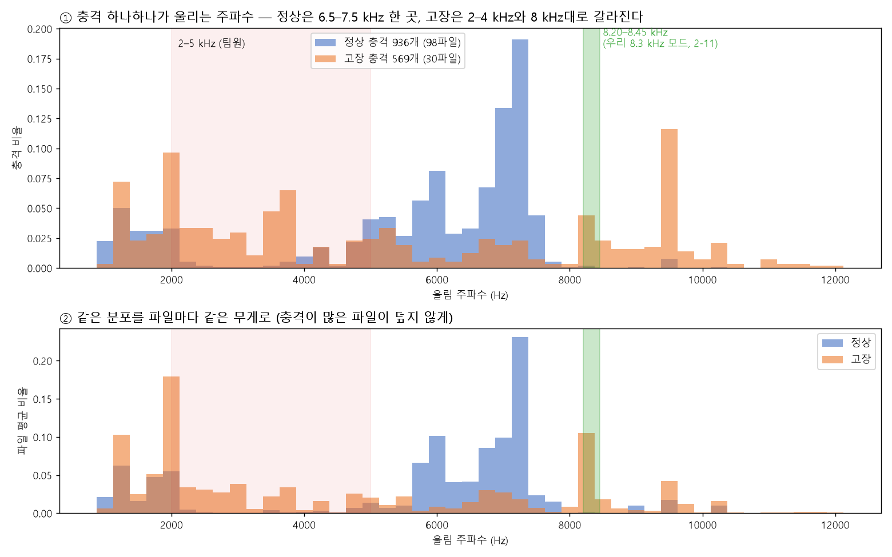
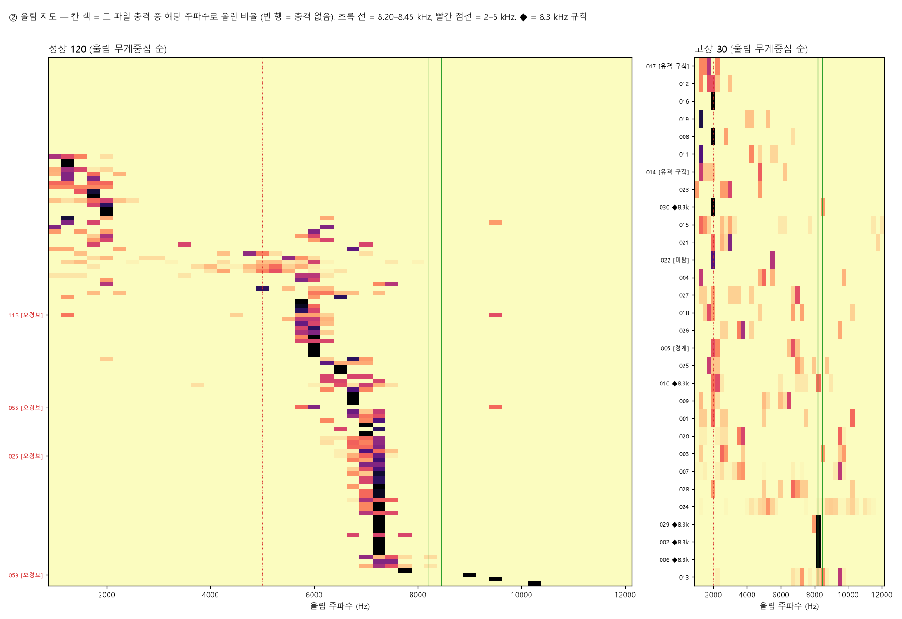
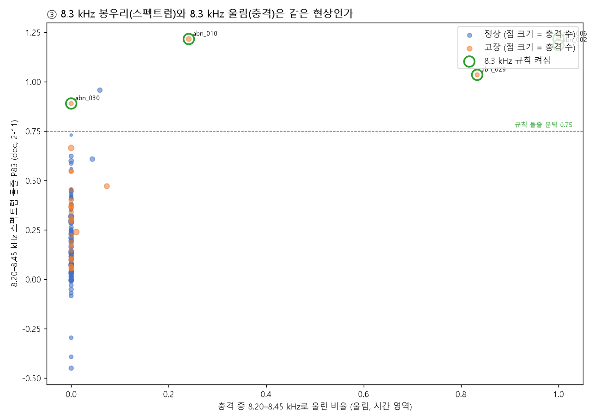
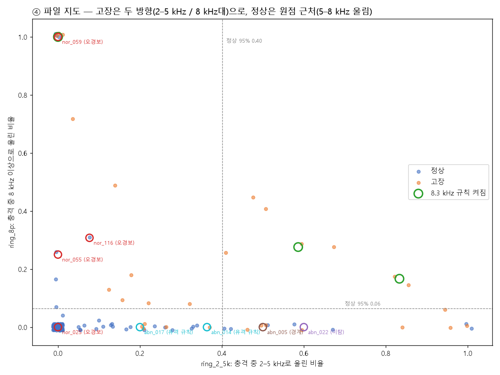
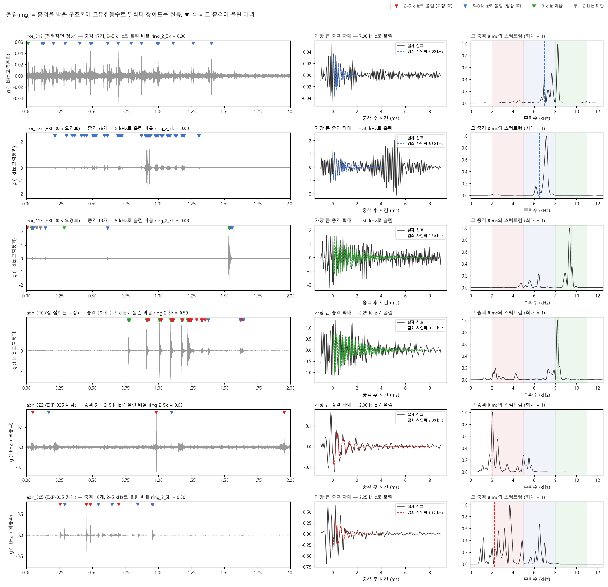
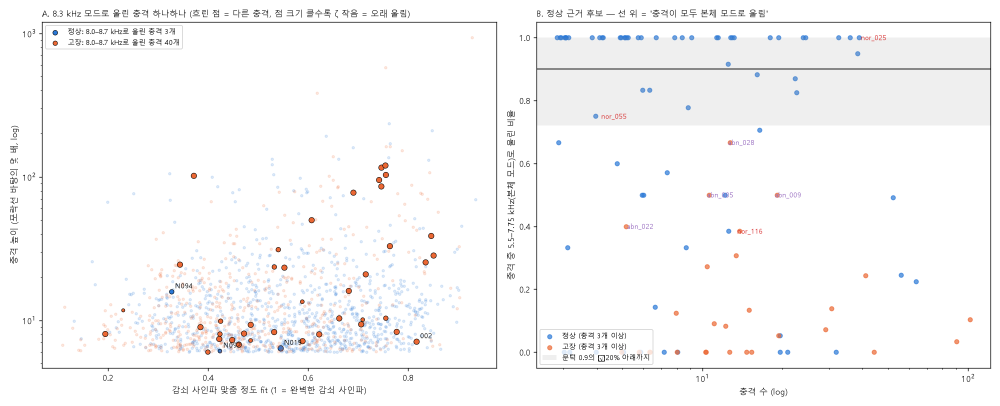

# 2-16 충격 울림 주파수 — 무엇이 어디를 쳤나

상태: 1차 (2026-11-16), 사용자 확인 대기. 실험(EXP) 아님
코드 [2-16_run.py](2-16_run.py) (분포·지도·8.3 kHz 연결) · [2-16_실제파형.py](2-16_실제파형.py) (4-3에서 옮김)
수치 [figs/2-16_summary.txt](figs/2-16_summary.txt) · 충격별 표 [figs/impacts.csv](figs/impacts.csv) (1,505개) · 파일별 표 [figs/files.csv](figs/files.csv)
출발점: 팀원 1차 공유(신효섭 11-13 보고서 그림 3, 권소린 울림 피처) → [팀원모델_검토_1116](../../5_모델비교/검토문서/아카이브/팀원모델_검토_1116.md) A1 → [4-3](../../4_피처/아카이브/4-3_1116_팀원피처·중복지도/4-3_팀원피처·중복지도.md)

## 물리 해석 — 무엇이 어디를 쳤나 (가설)
**울림(ring)** = 한 번 맞은 구조물이 자기 고유진동수로 "웅—" 떨리다 잦아드는 진동이다. 종을 치면 종 모양에 따라 정해진 음높이가 나는 것과 같다. 텐션암은 맞은 위치·부품에 따라 다른 모드가 울리므로, **충격이 울린 주파수를 보면 무엇이 어디를 쳤는지 추정할 수 있다.**

| 울림 주파수 | 누가 | 무엇이 어디를 쳤나 (해석) | 근거 |
|---|---|---|---|
| **6.5–7.5 kHz** | 정상 (98파일 대부분) | 노면 충격 등 **외부 입력이 암 전체를 친다** → 암 본체의 모드가 울린다 | 정상 충격 936개가 한 봉우리(7.0–7.25 kHz)에 모임 |
| **2–4 kHz** | 고장 | 부싱·볼조인트 **틈(유격)에서 금속끼리 부딪친다** → 연결부 쪽의 더 낮은 모드가 울린다 (H1) | 4-1의 가장 유의한 정보(1.25–3.75 kHz 충격 P02)와 같은 대역. 미탐 022의 큰 충격이 2.0 kHz의 깨끗한 감쇠 사인파 |
| **8.20–8.45 kHz** | 고장 (8.3 kHz 규칙 파일) | 타격이 **8.3 kHz 모드를 들뜨게 한다** (H2′) → 2-11에서 본 스펙트럼의 넓은 8.3 kHz 봉우리의 원인 | 이렇게 울린 충격: 정상 2/936 · 고장 25/569. 10% 넘는 파일 = 002 · 006 · 010 · 029뿐, 모두 8.3 kHz 규칙 파일 |
| 9.5–10 kHz | 고장 일부 + 정상 055 · 059 · 116 | 정상에도 있어 고장 근거가 아니다 | 오경보 정상 3개가 이 대역으로 울림 |

- 한 문장 요약: **정상은 "암 전체가 맞아" 7 kHz로 울리고, 고장은 "연결부가 맞아" 2–4 kHz로 울리거나 "8.3 kHz 모드를 울린다".** 충격의 크기가 아니라 **무엇이 울렸나**가 다르다
- 교체한 부품 기록이 없으므로 "어느 부품의 모드인가"는 신호에서 거꾸로 추정한 가정이다. 모드 해석(해석 모델이나 타격 시험) 자료가 있으면 확인할 수 있다

## 결론
1. **충격이 울리는 주파수가 정상과 고장을 가른다.** 정상 충격 936개는 대부분 5.5–7.6 kHz(봉우리 7.0–7.25 kHz) 한 곳에서 울린다. 고장 충격 569개는 **2–4 kHz**와 **8 kHz대**(8.25 · 9.5 kHz) 두 곳으로 갈라진다. 울림 주파수 중앙값은 정상 6,250 Hz, 고장 4,750 Hz다 (그림 ①)
2. **고장의 8 kHz대 울림은 우리 8.3 kHz 모드(2-11)와 같은 현상이다.**
   - 8.20–8.45 kHz로 울린 충격은 정상 2/936개, 고장 25/569개다
   - 이렇게 울린 충격이 10%를 넘는 파일은 고장 4개(002 · 006 · 010 · 029)뿐이고 정상은 0개다. 넷 모두 **8.3 kHz 규칙이 켜지는 파일**이다 (그림 ③)
   - 즉 2-11에서 스펙트럼으로 본 "8.3 kHz 넓은 봉우리"는 **타격이 8.3 kHz 모드를 울린 결과**다. 물리가설 H2′(8.3 kHz 모드가 크게 들뜸)를 시간 영역에서 확인했다
   - 예외는 030이다. 스펙트럼 봉우리는 있지만(규칙 켜짐) 충격은 2 kHz로 울린다
3. **2–5 kHz 울림은 우리 모델이 놓치는 쪽을 가리킨다.**
   - `ring_2_5k`(충격 중 2–5 kHz로 울린 비율)가 정상 95% 선 0.40을 넘는 파일은 고장 15개 · 정상 6개다
   - 여기에 **022(미탐, 0.60)와 005(경계, 0.50)**가 들어간다. 022의 가장 큰 충격은 2.0 kHz의 깨끗한 감쇠 사인파다 (그림 ⑤)
4. **두 울림 축과 유격 규칙은 서로 보완한다.**
   - 2–5 kHz 축이나 8 kHz대 축 중 하나에서 정상 95% 선을 넘는 고장은 30개 중 25개다
   - 못 넘는 5개(009 011 014 017 019) 중 **014 · 017은 우리 유격 반복 규칙이 잡는 파일**이다
   - 울림(무엇이 울렸나)과 유격 규칙(얼마나 고르게 반복해서 쳤나)은 서로 다른 고장을 본다
5. **오경보 정상의 울림은 둘로 나뉜다.**
   - **025는 충격 38개가 모두 5–8 kHz로 울린다.** 전형적인 정상(노면) 충격이라, 울림으로 보면 확실한 정상이다
   - **055 · 059 · 116은 8 kHz 이상(9.5–10 kHz)으로 울리는 충격이 있다.** 그래서 "8 kHz 이상" 전체를 쓰면 이 셋이 고장처럼 보인다. 고장 쪽 근거는 넓은 8 kHz대가 아니라 **8.20–8.45 kHz라는 좁은 대역**이다(결론 2)
6. **주의할 점**
   - 정상 중 약 15개는 충격이 1–2.5 kHz로 울린다(울림 지도 위쪽). 고장의 2–4 kHz와 경계(2 kHz)가 가깝다. 2 kHz를 문턱으로 쓰면 2-15처럼 여유가 작을 수 있다
   - 충격이 1–2개뿐인 파일은 비율이 0 또는 1로 튄다(예: 059는 충격 1개 → `ring_8p` = 1.0)
   - 충격 0개인 파일은 정상 22개다
   - 대역 경계(2–5 kHz 팀원, 8.20–8.45 kHz 우리)는 모두 라벨을 본 뒤 정한 값이라 **사후**다

## 방법
- 충격 검출(신효섭 정의, 라벨 무관): 평균 제거 → 1 kHz 고역통과 → 힐베르트 포락선(500 Hz 저역통과) → 포락선 중앙값의 6배를 넘는 봉우리, 5 ms 간격
- 울림 주파수: 충격 직후 8 ms를 감쇠 사인파 사전(1–12 kHz 250 Hz 간격 × 감쇠비 0.01 · 0.02 · 0.04 · 0.08 = 180개, 위상 자유)과 대조해 가장 잘 맞는 주파수를 고른다
- 재현 확인: 신효섭 그림 3과 같은 분포가 나온다(정상 936 vs 932, 고장 569 vs 570) → [2-16_0](figs/2-16_0_신효섭그림3_재현.png)
- 8.3 kHz 규칙 값(P83 · 폭)은 `src/experts.py` `peak83_table()` (2-11 · EXP-021과 같음), 학습 150개 전체 기준(설명용)

## 그림

### ① 충격별 울림 주파수 분포

- 위 = 충격 단위, 아래 = 파일마다 같은 무게. 초록 띠 = 8.20–8.45 kHz(우리 8.3 kHz 모드), 붉은 띠 = 2–5 kHz
- 정상은 7 kHz 근처 한 봉우리. 고장은 2 kHz 부근 · 3.5–3.75 kHz · **8.25 kHz** · 9.5 kHz에 봉우리가 있다. 파일 무게로 보면 8.25 kHz 칸이 고장에서 뚜렷하다(아래)

### ② 울림 지도 — 파일 × 울림 주파수

- 행 = 파일(울림 무게중심 순), 칸 색 = 그 파일 충격 중 해당 주파수로 울린 비율, 빈 행 = 충격 없음. ◆ = 8.3 kHz 규칙
- 정상(왼쪽)은 대부분 6–7.5 kHz 세로 띠에 모인다. 위쪽 약 15개는 1–2.5 kHz로 울린다
- 고장(오른쪽)은 2 kHz 세로 줄과, 맨 아래 **002 · 006 · 029가 8.25 kHz 한 칸**에 몰린 모습이 보인다

### ③ 8.3 kHz 봉우리(스펙트럼) × 8.3 kHz 울림(충격)

- 세로 = 2-11의 스펙트럼 돌출 P83, 가로 = 충격 중 8.20–8.45 kHz로 울린 비율
- 오른쪽 위 고장 4개(002 · 006 · 029 · 010)는 두 지표가 함께 높다 → 같은 현상이다
- 정상은 모두 가로 0 근처에 있다. P83이 높은 정상(0.96)도 충격이 8.3 kHz로 울리지 않는다(좁은 순음, 2-11 README2)

### ④ 파일 지도 — 2–5 kHz 울림 × 8 kHz 이상 울림

- 회색 점선 = 정상 95% 선. 고장은 오른쪽(2–5 kHz)과 위쪽(8 kHz대) 두 방향으로 흩어지고, 정상은 원점(5–8 kHz 울림)에 모인다
- 022 · 005는 오른쪽으로 나가 있다. 오경보 055 · 059 · 116은 위로 나가 있다(8 kHz 이상이 넓기 때문, 결론 5). 025는 원점에 있다

### ⑤ 실제 파형

- 왼쪽 = 2초 파형(1 kHz 고역통과)과 충격(▼ 색 = 울린 대역), 가운데 = 가장 큰 충격 10 ms와 맞춘 감쇠 사인파, 오른쪽 = 그 충격 8 ms의 스펙트럼
- 022는 2.0 kHz 사인파가 실제 신호와 거의 겹친다. 010은 8.25 kHz로 울린다(8.3 kHz 모드). 116은 9.5 kHz로 울린다
- 울림 주파수는 사인파 하나로 맞춘 **근사**다. 봉우리가 여러 개인 충격은 한 값으로 요약된다(005: 맞춘 값 2.25 kHz, 스펙트럼 최대 3.7 kHz)

## 규칙 수치 도출 (11-16 추가, [2-16_규칙수치.py](2-16_규칙수치.py) · [수치](figs/2-16_규칙수치.txt) · [후보 표](figs/2-16_규칙후보_정상근거.csv))

**A. 8.3 kHz 모드 울림을 충격 하나로 판단하기 (002 = 충격 1개)**
- 8.0–8.7 kHz로 울린 충격은 고장 40개(9파일), 정상 3개(019 · 092 · 094)다
- 정상의 3개는 감쇠 사인파와 잘 맞지 않는다(fit 0.33 · 0.42 · 0.55). 고장의 충격과 002는 깨끗하게 오래 울린다(002: fit 0.82, 감쇠비 ζ 0.01)
- 후보 규칙 "**8.0–8.7 kHz로 울린 충격 중 ζ ≤ 0.02이고 fit ≥ 0.7인 충격이 하나라도 있으면 고장**"
  - 켜지는 파일: 고장 002 003 006 010 029, 정상 0
  - fit 문턱을 −20%(0.56)로 내려도 정상 최대 0.545(019)보다 높다 → C3 통과(여유 22%). fit ≥ 0.6이면 −20%에서 019가 걸린다
  - 물리 의미: 8.3 kHz 모드가 **깨끗한 감쇠 진동으로 공진**했다. 정상에서 8 kHz대로 울린 충격은 모양이 흐트러진 일회성 응답이다
  - 030은 이 규칙에서 빠진다(울림이 0.17뿐이고 깨끗하지 않음). 스펙트럼 규칙과 OR로 묶으면 002 003 006 010 029 030을 모두 덮는다
- 주의: 정상 쪽 사례가 3개뿐이라 "정상의 8 kHz 울림은 지저분하다"는 표본이 작은 결론이다

**B. "충격이 모두 본체 모드로 울림 = 정상" (정상으로 내리는 규칙)**
- 후보 "**충격 3개 이상이고 그중 5.5–7.75 kHz로 울린 비율 ≥ 0.9이면 정상 쪽으로 내림**"
  - 해당 파일: 정상 38, 고장 0
  - C3: 문턱 −20%(0.72)에서도 고장 0. 고장 최대는 028의 0.67이다
  - C4: 측정 구간을 1.5초 창 3개로 옮겨도 조건에 드는 고장 0
- 더 좁은 6.5–7.75 kHz ≥ 0.8도 C3 · C4를 통과한다(정상 29 · 고장 0)
- 해소되는 오경보는 **025 하나**다(충격 38개 모두 본체 모드). 055는 충격 4개 중 0.75, 116은 0.38, 059는 충격 1개라 해당하지 않는다
- 물리 의미: 노면 충격처럼 **암 전체가 맞으면 본체 모드(약 7 kHz)로만 울린다.** 연결부 타격이 섞이면 2–4 kHz나 8 kHz대 울림이 한 번이라도 끼어든다

## 다음 (제안)
- EXP-034: ET 입력에 `ring_2_5k`(또는 대역 비율 `so_ring25_over58`)를 넣는다 → 022 · 005가 올라가고 025가 내려가는지 본다. `ring_8p`(8 kHz 이상 전체)는 넣지 않는다(결론 5). 8.20–8.45 kHz 울림은 8.3 kHz 규칙과 같은 정보라 넣지 않는다
- 발표 "02 정상·고장 비교": 그림 ①과 ⑤가 "충격의 크기가 아니라 **무엇이 울렸나**가 다르다"를 한 장으로 보여 준다
