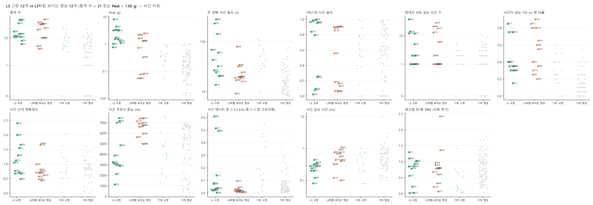
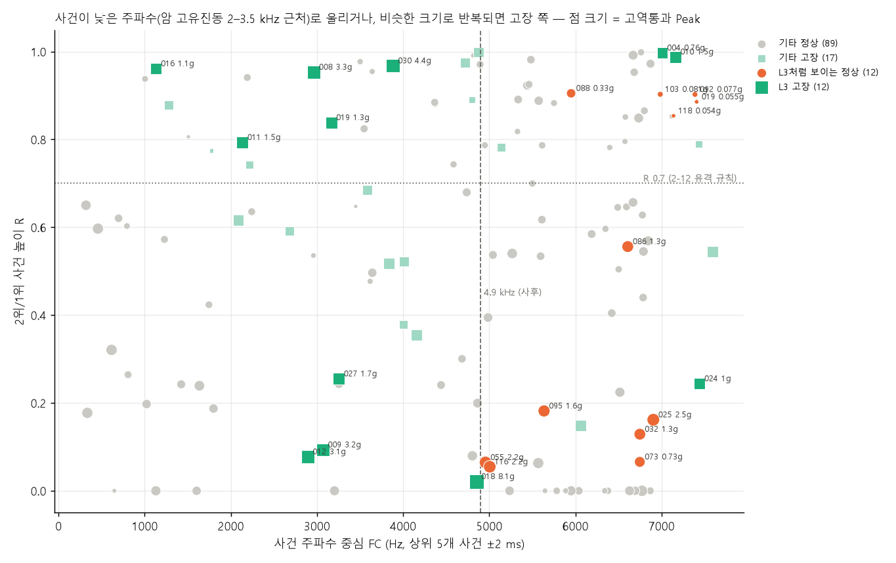
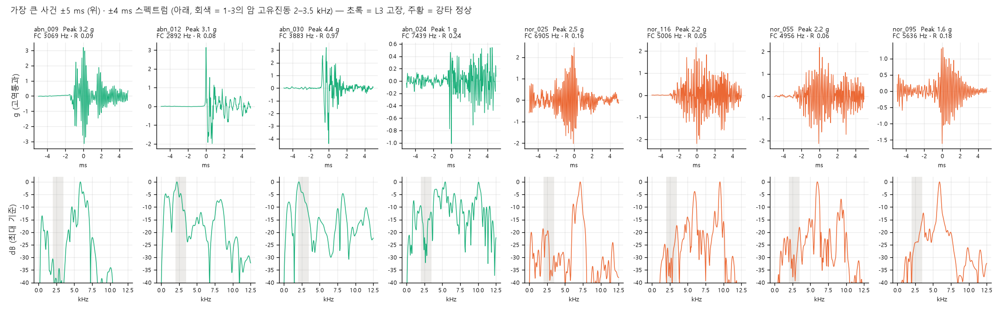

# 2-15 고역통과 충격 수 오탐 줄이기 — L3 고장처럼 보이는 정상과 L3 고장 비교

상태: 1차 (11-16), 사용자 확인 대기
코드: [2-15_run.py](2-15_run.py) → `figs/` ([events.csv](figs/events.csv) 파일별 사건 지표 · [summary.txt](figs/summary.txt))
출발점: [2-0 고장 도메인 유형](../../고장유형/2-0_고장유형분류/2-0_고장유형분류.md)의 L3(금속 타격) 칸 — 고장 12 vs 닮은 정상, EXP-025 오경보 025·116·055가 모두 여기

## 결론
- **모델 반영 (11-16, [EXP-029](../../../5_모델비교/base/EXP-029_1116_큰타격수·사건울림·주기잠금/README.md))**: 제안 (가)대로 FC·감쇠와 "0.5 g 이상 사건 수"를 연속 입력으로 넣었다. ET 입력(0.945)이든 결합 축(0.939)이든 기준(0.942 ± 0.012)과 sd 안이다. 116·055는 FC가 문턱 바로 위(4.96·5.01 kHz)라 연속 축에서는 다른 정상의 변동에 묻혔다. 두 파일은 2-14의 단일 타격 감점(큰 타격 1개)으로 내려갔다
1. **"L3처럼 보이는 정상" 12개는 원인이 다른 두 무리다.** 하나로 다루면 안 된다
   - **A. 조용한 파일의 잦은 작은 사건** (019 088 092 103 118): 충격 수 23–37번인데 Peak 0.05–0.33 g. 사건 문턱 8σ가 파일 자신의 바탕(σ) 기준이라, 아주 조용한 파일은 작은 떨림도 "충격"으로 센다. 고장 연발(004 011 019)은 Peak 0.76–1.53 g → **충격 수는 절대 크기(g)와 함께 볼 때만 의미가 있다**
   - **B. 큰 사건 한 번** (025 032 055 086 095 116, 073): Peak 0.7–2.5 g, 2위/1위 R 0.05–0.18(086만 0.56). 2-11의 N-A와 같은 무리이고 **EXP-025 오경보가 전부 여기**
2. **B를 가르는 것은 횟수나 크기가 아니라 "사건이 어떤 주파수로 울리나"다.**
   - 사건 주파수 중심(FC, 상위 5개 사건 ±2 ms): **L3 고장 중앙 3.2 kHz(12개 중 9개가 4.9 kHz 미만) vs 닮은 정상 5.0–7.4 kHz(12개 모두 4.9 kHz 이상)**. 설명용 AUC 0.78
   - R이 낮아 "큰 사건 한 번"처럼 보이는 고장(018 012 009 027)도 FC는 2.9–4.85 kHz → R로는 정상과 섞이지만 FC로는 갈린다
   - 그림 3: 정상의 큰 사건은 6–9.5 kHz **좁은 봉우리 하나**로 울리고, 고장(012·030)은 2–3 kHz 근처를 포함해 넓게 울린다. 1-3 L3 "강한 타격이 암 고유진동수(2–3.5 kHz)를 울림"과 같은 방향
3. **사후 후보 규칙** "충격 수·Peak가 정상 95% 위인 파일 중, FC < 4.9 kHz **또는** (R ≥ 0.7 **이고** Peak ≥ 0.7 g)이면 고장 쪽" → **L3 고장 11/12, 닮은 정상 0/12**. 남는 고장 024(FC 7.4 kHz, R 0.24 = 정상 B와 같은 모양)
4. **단, 4.9 kHz는 라벨을 보고 틈에 그은 값이고 여유가 거의 없다** — 정상 055 4.96 kHz · 116 5.01 kHz, 고장 018 4.85 kHz. 미리 정해진 대역(1-3의 2–3.5 kHz 몫, ARM)으로 바꾸면 AUC 0.80으로 비슷하지만 가운데가 겹친다(아래 표). 그리고 FC가 낮은 것 자체는 고장 신호가 아니다(기타 정상의 44%도 FC < 4.9 kHz) → **"사건이 클 때만" 보는 조건부 확인**으로만 의미가 있다

## 비교 대상 파일 한눈에 (L3 고장 12 · 닮은 정상 12)
무리 안에서 FC(사건 주파수 중심) 오름차순. 값은 [events.csv](figs/events.csv)에서 그대로 옮김

| 파일 | 무리 | 충격 수 | Peak (g) | 2위 사건 (σ) | R 2위/1위 | FC (kHz) | ARM 2–3.5k | DECAY (ms) | 2-0 유형 | 사후 규칙 | EXP-025 |
|---|---|---|---|---|---|---|---|---|---|---|---|
| abn_016 | L3 고장 · 강타 | 14 | 1.10 | 14 | 0.96 | 1.13 | 0.038 | 0.32 | L3 | 고장 쪽 | 잡음 |
| abn_011 | L3 고장 · 연발 | 44 | 1.53 | 25 | 0.79 | 2.13 | 0.034 | 0.32 | L3 | 고장 쪽 | 잡음 |
| abn_012 | L3 고장 · 강타 | 6 | 3.14 | 60 | 0.08 | 2.89 | 0.139 | 0.20 | L3 | 고장 쪽 | 잡음 |
| abn_008 | L3 고장 · 강타 | 11 | 3.33 | 279 | 0.95 | 2.97 | 0.608 | 0.28 | L3 | 고장 쪽 | 잡음 |
| abn_009 | L3 고장 · 강타 | 12 | 3.20 | 69 | 0.09 | 3.07 | 0.002 | 0.24 | L3 | 고장 쪽 | 잡음 |
| abn_019 | L3 고장 · 연발 | 34 | 1.28 | 21 | 0.84 | 3.17 | 0.027 | 0.28 | L3 | 고장 쪽 | 잡음 |
| abn_027 | L3 고장 · 강타 | 11 | 1.73 | 43 | 0.26 | 3.25 | 0.514 | 0.44 | L3 | 고장 쪽 | 잡음 |
| abn_030 | L3 고장 · 강타 | 17 | 4.39 | 233 | 0.97 | 3.88 | 0.493 | 0.36 | L3 | 고장 쪽 | 잡음 |
| abn_018 | L3 고장 · 강타 | 14 | 8.12 | 32 | 0.02 | 4.85 | 0.078 | 0.28 | L3 | 고장 쪽 | 잡음 |
| abn_004 | L3 고장 · 연발 | 46 | 0.76 | 20 | 1.00 | 7.01 | 0.022 | 0.12 | L3 | 고장 쪽 | 잡음 |
| abn_010 | L3 고장 · 강타 | 11 | 1.46 | 142 | 0.99 | 7.16 | 0.072 | 0.20 | L3 | 고장 쪽 | 잡음 |
| abn_024 | L3 고장 · 광대역 | 8 | 1.01 | 27 | 0.24 | 7.44 | 0.020 | 0.08 | L3 | — | 잡음 |
| nor_088 | 정상 A 작은 사건 다수 | 32 | 0.33 | 17 | 0.91 | 5.95 | 0.006 | 0.32 | L1 | — | 정상 판정 |
| nor_103 | 정상 A 작은 사건 다수 | 37 | 0.08 | 20 | 0.90 | 6.99 | 0.006 | 1.08 | 미분류 | — | 정상 판정 |
| nor_118 | 정상 A 작은 사건 다수 | 33 | 0.05 | 19 | 0.85 | 7.14 | 0.016 | 0.76 | 미분류 | — | 정상 판정 |
| nor_092 | 정상 A 작은 사건 다수 | 31 | 0.08 | 24 | 0.90 | 7.39 | 0.013 | 0.92 | L1 | — | 정상 판정 |
| nor_019 | 정상 A 작은 사건 다수 | 23 | 0.05 | 20 | 0.89 | 7.41 | 0.008 | 0.44 | L1 | — | 정상 판정 |
| nor_055 | 정상 B 큰 사건 한 번 | 4 | 2.18 | 9 | 0.06 | 4.96 | 0.044 | 0.10 | L3 | — | **오경보 3/5** |
| nor_116 | 정상 B 큰 사건 한 번 | 10 | 2.20 | 16 | 0.05 | 5.01 | 0.009 | 0.12 | L3 | — | **오경보 4/5** |
| nor_095 | 정상 B 큰 사건 한 번 | 5 | 1.61 | 34 | 0.18 | 5.64 | 0.031 | 0.56 | L3 | — | 정상 판정 |
| nor_086 | 정상 B 큰 사건 한 번 | 10 | 1.32 | 79 | 0.56 | 6.61 | 0.023 | 0.68 | L3 | — | 정상 판정 |
| nor_073 | 정상 B 큰 사건 한 번 | 47 | 0.73 | 19 | 0.07 | 6.75 | 0.094 | 0.40 | L1 | — | 정상 판정 |
| nor_032 | 정상 B 큰 사건 한 번 | 10 | 1.29 | 20 | 0.13 | 6.75 | 0.019 | 0.44 | L3 | — | 정상 판정 |
| nor_025 | 정상 B 큰 사건 한 번 | 20 | 2.45 | 32 | 0.16 | 6.90 | 0.019 | 0.76 | L3 | — | **오경보 5/5** |

읽는 법
- **열 뜻**: 충격 수·Peak = 200 Hz 고역통과 기준 · 2위 사건 = 두 번째로 큰 사건 높이(바탕 σ의 몇 배) · R = 2위/1위(1에 가까울수록 비슷한 크기로 반복) · FC = 상위 5개 사건의 주파수 중심 · ARM = 같은 창의 2–3.5 kHz 몫 · DECAY = 사건 감쇠 시간 · 사후 규칙 = "FC < 4.9 kHz 또는 (R ≥ 0.7 & Peak ≥ 0.7 g)" · EXP-025 = 최종 모델 seed 5번 결과
- **정상 A**는 충격 수(23–37)·R(0.85–0.91)이 고장 연발(004 011 019)과 같지만 Peak가 한 자리 작다(0.05–0.33 g vs 0.76–1.53 g)
- **정상 B**는 Peak(0.7–2.5 g)·R(0.05–0.18)이 고장 강타 012·009·018·027과 같지만 FC가 4.96 kHz 이상. 오경보 셋 중 055·116은 FC 4.96·5.01 kHz로 문턱 바로 위
- nor_073은 충격 47번(A처럼 많음)이면서 R 0.07(B처럼 큰 사건 하나)인 섞인 파일. Peak 0.73 g라 B에 넣었다
- 고장 004·010은 FC가 높아 정상과 같은 쪽이지만 R ≈ 1이고 Peak ≥ 0.7 g라 규칙의 두 번째 조건으로 잡힌다. 024만 어느 조건에도 안 걸린다
- EXP-025는 L3 고장 12개를 이미 모두 잡는다 → 이 비교의 목적은 **고장을 잃지 않고 정상 B의 오경보(025 116 055)를 내릴 정보**를 찾는 것

## 질문
고역통과 충격 수·Peak가 커서 L3 고장처럼 보이는 정상과 진짜 L3 고장은 무엇이 다른가? 오탐을 어떻게 줄일 수 있나?

## 정의
- 대상: **L3 고장 12개**(2-0 분류) vs **L3처럼 보이는 정상 12개** = 고역통과 충격 수 > 정상 95%(21.1) 또는 고역통과 Peak > 정상 95%(1.016 g). 평균 −1 g 파일 097·101·120은 2-0에서 L3 광대역으로 갔지만 사건이 0개라 여기 대상이 아니다
- 사건: 200 Hz 고역통과 h, σ = 1.4826·MAD, |h| > 8σ, 10 ms 안은 한 사건 (뷰어·2-12와 같음, 라벨 무관)
- 사건 지표 *(D1–DECAY는 물리 가설로 미리 정함, PRE는 그림을 본 뒤 추가)*

| 지표 | 정의 | 왜 (가설) |
|---|---|---|
| D1 · R | 두 번째 사건 높이(σ) · 2위/1위 | H1: 간극 타격은 비슷한 크기로 반복 (2-12의 K1·K3) |
| N50 | 최대의 50% 넘는 사건 수 | 큰 타격이 몇 번인가 |
| SPREAD | 사건이 있는 100 ms 창 비율 (20칸) | 2초 전체에 퍼졌나, 한 곳에 몰렸나 |
| GAPCV | 사건 간격 변동계수 | 주기적 반복인가 |
| **FC** | 상위 5개 사건 ±2 ms(한닝)의 스펙트럼 무게중심, 중앙값 | 금속 타격 = 구조(암) 공진을 울림 / 정상 = 다른 울림 |
| ARM | 같은 창에서 2–3.5 kHz 몫 | 1-3에 미리 적힌 암 고유진동 대역 |
| DECAY | 사건 최고점 뒤 포락선이 1/e로 떨어지는 시간 | 2-6: 정상 큰 충격은 길게 울림 |
| PRE | 최고점 전 0.5–3 ms RMS / 후 0.5–3 ms RMS | 그림 3에서 정상 사건이 방추형으로 보여서 (사후) |

## 결과

### 그림 1 — 지표별 네 무리

읽는 법: 각 칸 = 지표 하나. 왼쪽부터 L3 고장(초록 □) · L3처럼 보이는 정상(주황 ○, 이름 표시) · 기타 고장 · 기타 정상(회색).

| 지표 | L3 고장 중앙 | 닮은 정상 중앙 | AUC (고장=1, 설명용) | 읽기 |
|---|---|---|---|---|
| 충격 수 | 13 | 21.5 | 0.49 | 못 가름 — 정상 A 무리가 더 많다 |
| Peak (g) | 1.63 | 1.01 | 0.76 | 정상 A는 작고, 정상 B는 고장과 같은 높이 |
| D1 두 번째 사건 (σ) | 37.7 | 19.8 | 0.79 | 고장 008 030 010이 매우 높음, 아래는 겹침 |
| R 2위/1위 | 0.82 | 0.37 | 0.64 | 고장도 R 낮은 것 5개(018 012 009 024 027) |
| N50 · SPREAD · GAPCV | — | — | 0.50 · 0.37 · 0.69 | 못 가름 |
| **FC** | **3.2 kHz** | **6.7 kHz** | **0.22 (반대로 0.78)** | 고장 9개가 정상 전부보다 낮다 |
| ARM 2–3.5 kHz 몫 | 0.055 | 0.018 | 0.80 | 고장 008 027 030 012(0.14–0.61)는 확실, 가운데는 겹침 |
| DECAY | 0.28 ms | 0.50 ms | 0.18 (반대로 0.82) | 2-6과 같은 방향. 단 정상 116·055(0.10–0.12 ms)는 고장보다 짧다 |
| PRE (사후) | 0.85 | 0.79 | 0.53 | **기각** — 그림에서 본 방추형 인상은 숫자로 확인되지 않았다(009 0.85, 025 2.4) |

### 그림 2 — 사건 주파수 중심 × 2위/1위 (전체 150개, 점 크기 = Peak)

- 왼쪽(FC < 4.9 kHz): L3 고장 9개. 위쪽 오른편(R ≥ 0.7, FC 높음): 고장 004·010(Peak 0.76·1.46 g)과 정상 A 무리(019 088 092 103 118, 점이 아주 작음 = Peak 0.05–0.33 g)가 같은 높이 → 둘은 **Peak 크기로 갈린다**
- 오른쪽 아래(FC 높고 R 낮음) = 정상 B 무리 전부 + 고장 024 하나. 이 칸이 EXP-025의 오경보 자리
- 회색(기타 정상)도 왼쪽에 많다 → FC만으로 고장을 찾을 수는 없다. 사건이 크다는 조건이 먼저

### 그림 3 — 가장 큰 사건 파형 ±5 ms · 스펙트럼

- 정상 025·116·055·095: 스펙트럼이 7 · 9.5 · 6 · 6 kHz **좁은 봉우리 하나**, 그 밖은 −20 dB 아래. 한 주파수로 길게 울리는 공진
- 고장 012·030: 2–3 kHz 근처(회색 띠)가 가장 크거나 그 근처가 넓게 올라온다. 009는 6 kHz 봉우리와 함께 2 kHz 아래 성분이 커서 FC가 낮다(ARM은 0.002로 낮음 → FC와 ARM이 다른 정보)
- 024(고장)는 넓게 퍼진 잡음형이라 정상과도 고장 무리와도 다르다

## 정상과 고장을 어떻게 구분할 수 있나 (제안)
1. **충격 수는 절대 크기와 함께 쓴다.** "충격 수 > 정상 95% 이고 Peak < 0.5 g"은 조용한 파일의 착시(정상 A 5개 전부, 고장 0). 피처로는 "Peak ≥ 0.5 g인 사건 수"처럼 절대 문턱을 함께 거는 방식
2. **큰 사건이 있는 파일에서만 사건의 울림 주파수를 본다.** FC가 낮거나(구조 공진을 울림) 같은 크기로 반복되면(R ≥ 0.7) 고장, 높은 좁은 봉우리 한 번이면 정상 쪽. 사후 규칙으로 L3 고장 11/12 · 닮은 정상 0/12
3. 문턱 4.9 kHz는 사후라 그대로 쓰면 과적합이다. 대안 순서:
   - (가) 문턱 대신 **FC·DECAY를 연속 축으로** 결합 모델(EXP-025)에 넣고 quick_cv → 통과 시 중첩 CV. 문턱은 fold 안에서 정해지게 한다
   - (나) 미리 정해진 대역(ARM 2–3.5 kHz) 쪽을 주 축으로, FC는 보조로
   - (다) 사건 스펙트럼의 "봉우리 폭"(좁은 봉우리 하나 vs 넓게 퍼짐) — 2-11 8.3 kHz에서 쓴 폭 개념과 같은 정의로 미리 정해 두고 계산

## 해석
- 2-11·00_NOW의 "가장 큰 사건을 가린 Peak·파고율"은 결국 D1·R과 같은 정보다. 여기서 보면 R은 고장 018 012 009 027(큰 사건 한 번인 고장)을 정상과 함께 내려 버린다 → **크기 비교만으로는 B 무리 오경보를 줄이면 그 고장들도 같이 놓칠 위험**. 주파수 정보가 필요하다
- 물리 해석(가설): 볼조인트 간극 충돌은 짧고 날카로운 힘이라 암 구조의 낮은 모드(2–3.5 kHz)까지 넓게 울린다. 정상의 큰 사건은 노면 입력이 센서 근처 부품의 높은 공진(5–9.5 kHz) 하나를 울리는 것으로 보인다. 진짜 원인은 확인할 수 없다 → 물리가설에 H1″ 후보로 올릴지 사용자 확인 필요
- 정상 A 무리(조용한 파일의 작은 사건)는 EXP-025에서 이미 오경보가 아니다. 모델 문제라기보다 **충격 수 지표·태그를 해석할 때의 함정**이다(뷰어 "잦은 충격" 태그 정상 23개 중 일부)

## 한계
- 비교 무리가 12 vs 12로 작다. AUC·문턱 모두 설명용
- FC 문턱 4.9 kHz, R ≥ 0.7 & Peak ≥ 0.7 g 조합은 라벨을 보고 고른 것. R 0.7은 2-12 유격 규칙과 같은 값이지만 Peak 0.7 g는 이번에 고름
- 사건 창 ±2 ms(256점 FFT)는 주파수 해상도가 약 100 Hz라 봉우리 폭을 재기엔 거칠다
- 고장 024는 어느 축으로도 정상 B와 갈리지 않는다
