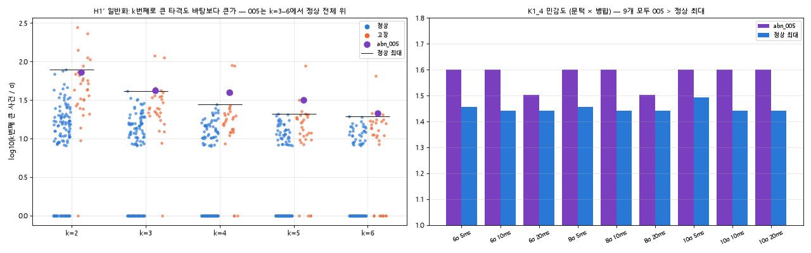
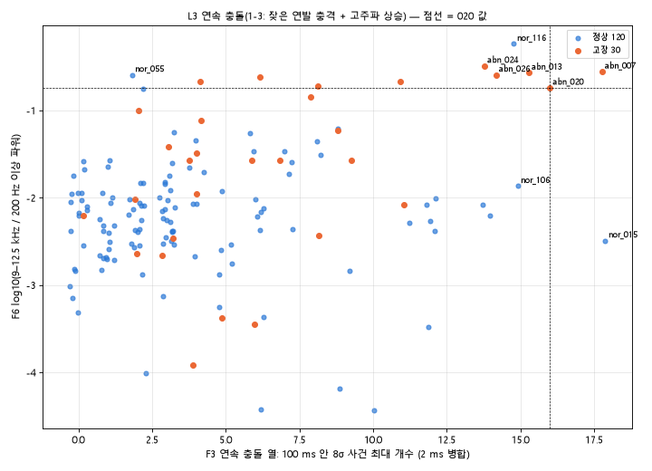
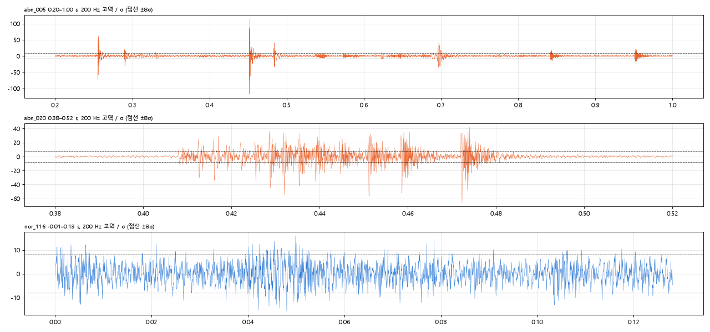

# 2-14 불안정 고장 005·020 — "바탕보다 훨씬 큰 타격이 여러 번"

상태: 2차 (2026-11-16, 1차 11-14). 실험(EXP) 아님
코드: [run.py](run.py) (005·020 피처) · [run2_정상타격.py](run2_정상타격.py) (정상의 타격, 11-16 추가)
수치: [figs/numbers.txt](figs/numbers.txt) · [figs/normal_hits.txt](figs/normal_hits.txt) · 파일별 값 [figs/features.csv](figs/features.csv) · [figs/hits.csv](figs/hits.csv)
출발점: EXP-025 이후에도 판정이 흔들린 고장 005(seed 4에서 1번 놓침)·020(임계값 근처)

## 결론
0. **최종 처리 (11-16 오후, [EXP-030](../../../5_모델비교/base/EXP-030_1116_최종후보고정_규칙감사/README.md))**: "큰 타격이 정확히 1개면 감점"은 최종 구성에 넣지 않는다. 측정 구간을 1.5초로 줄여 옮기면 고장 5개(017 019 020 022 026)가 "정확히 1개"가 되고, 문턱 22σ에서는 019가 든다. 정상으로 내리는 장치라 틀리면 미탐이다. 큰 타격 수는 판정표의 관찰 열(`n20` · `single_hit_obs`)로 남긴다
1. **쓸 만한 지표 = "바탕보다 훨씬 큰 타격이 몇 번 나오나".** 고장은 큰 타격이 **반복**된다. 바탕의 20배 이상 타격이 **딱 한 번뿐인 고장은 0개**이고 30개 중 27개는 2번 이상이다. 정상은 120개 중 92개가 0–1번이다
2. **정상도 큰 타격이 생긴다**(120개 중 66개가 한 번 이상). 노면 같은 외부 입력이 크게 들어올 때 생기는 것으로 보이며, 대개 한 번으로 끝난다 → [§2](#2-정상은-왜-큰-타격이-생기나)
3. **abn_005는 이 지표로 확실히 갈린다.** 4번째로 큰 타격도 바탕의 40배다. 정상 중 가장 높은 파일(nor_001)은 28배다. 문턱·병합 폭을 9가지로 바꿔도 005보다 높은 정상은 없다
4. **abn_020은 보류한다.** "100 ms 안에 몰린 연속 충돌 + 고주파 상승"이라는 근거는 있지만 정상 nor_116이 같은 자리에 있다
5. **한계: 이 지표가 확실히 가르는 것은 "강하게 반복 치는 고장" 무리(005·008·010·014)뿐이다.** 4번째 타격 기준으로 정상 최대를 넘는 고장은 4개이고, 정상 95%를 넘는 고장은 10개다. 모든 고장을 잡는 축이 아니라 기존 모델에 더할 축이다

## 용어
| 말 | 뜻 |
|---|---|
| 바탕 σ | 200 Hz 고역통과 신호가 평소에 흔들리는 크기. 큰 타격에 끌려가지 않도록 중앙값 기반(1.4826·MAD)으로 잰다 |
| 타격(사건) | 고역통과 신호가 바탕의 8배를 넘은 순간. 10 ms 안에 있으면 하나로 센다 |
| 타격 높이 | 타격의 최대값 ÷ 바탕 σ = "바탕의 몇 배인가" |
| 큰 타격 | 높이 20배 이상(15·30·50배도 함께 확인) |
| K1_k | k번째로 큰 타격의 높이(log10). K1_4 = 1.60이면 4번째 타격이 바탕의 40배 |

## 1. 고장은 큰 타격이 반복된다

큰 타격(바탕 20배 이상)의 개수 — 파일 수:

| | 0개 | 1개 | 2–3개 | 4개 이상 |
|---|---|---|---|---|
| 정상 120 | 54 | **38** | 21 | 7 |
| 고장 30 | 3 | **0** | 16 | 11 |

- 문턱을 15·30·50배로 바꿔도 같은 방향이다. 15배 기준 "딱 한 번" = 정상 33 · 고장 0. 30배 기준 4개 이상 = 정상 0 · 고장 4
- 큰 타격이 0개인 고장 3개(002·015·016)는 아래 표와 같다

**큰 타격이 0개인 고장 3개** — 이 지표로는 볼 수 없는 고장

| 파일 | 바탕 σ (정상 중앙 0.007 g) | 가장 큰 타격 | 정체 | 2-0 유형 | 지금 모델(EXP-025) |
|---|---|---|---|---|---|
| abn_002 | 0.009 g (정상 수준) | 바탕의 11배 | 조용한 파일. 8.20–8.45 kHz 모드가 넓게 솟은 것만 다르다(2-11 "8.25 kHz 조용한형") | L1 | 잡음 (8.3 kHz 규칙) |
| abn_015 | 0.047 g (**정상의 7배**) | 8배를 넘는 순간 없음 | 20–200 Hz 저주파 공진. 암 전체가 크게 떨린다 | L4 | 잡음 (AE·ET) |
| abn_016 | 0.078 g (**정상의 11배**) | 바탕의 14배 (절대값 1.1 g) | 바탕 자체가 커서 타격이 상대적으로 묻힌다 | L3 강타 | 잡음 (AE·ET) |

- 002는 타격형 고장이 아니다
- 015·016은 **절대 크기로는 세게 흔들리는데, 바탕 σ로 나누니 0개로 나온 것**이다. 바탕이 크면 웬만한 타격도 20배를 넘지 못한다. 바탕 대비 지표는 "바탕이 커진 고장"을 못 본다
- 그래서 이 지표는 기존 모델(AE: 바탕이 커졌나 · 8.3 kHz 규칙)을 대체하지 않고 **더하는 축**으로 쓴다. 특히 "큰 타격 0개"는 감점하면 안 된다(015·016을 잃는다). 감점은 "정확히 1개"에만 건다 → [EXP-029](../../../5_모델비교/base/EXP-029_1116_큰타격수·사건울림·주기잠금/README.md)

k번째로 큰 타격의 높이(바탕의 몇 배):

| k | 정상 중앙 | 정상 95% | 정상 최대 | 고장 중앙 | 정상 95% 넘는 고장 | 정상 최대 넘는 고장 |
|---|---|---|---|---|---|---|
| 1 | 23 | 161 | 371 | 98 | 8 | 3 |
| 2 | 13 | 43 | 79 | 43 | **16** | 6 |
| 3 | 9 | 28 | 42 | 25 | 13 | 5 |
| 4 | 0 | 21 | 28 | 17 | 10 | 4 |

- **1위 타격(= 기존 Peak)보다 2–4위 타격이 고장을 더 잘 가른다.** 정상의 1위는 가끔 매우 크지만(최대 371배) 2위부터 급히 작아진다
- 넓게 걸러내는 데는 2위가 낫고(정상 95% 넘는 고장 16개), 정상과 겹치지 않게 확실히 잡는 데는 4위가 낫다

## 2. 정상은 왜 큰 타격이 생기나

**데이터로 확인한 것**
- 정상 120개 중 66개에 큰 타격이 한 번 이상 있다. 큰 타격은 정상 운전에서도 흔하다
- 큰 타격은 **암이 크게 출렁일 때** 난다. 타격 순간의 저주파 변위는 그 파일 안에서 백분위 중앙 64%다(고장 61%). 기계적 입력과 함께 생기므로 전기적 잡음은 아니다
- 다만 **많이 출렁이는 파일이라고 큰 타격이 많지는 않다**(저주파 RMS와 큰 타격 수의 순위상관: 정상 0.14, 고장 0.12). 거칠게 달린 측정이라서 타격이 많아지는 것이 아니다
- 타격이 시간상 몰리는 정도는 정상과 고장이 비슷하다. 1위 타격 ±0.3 s 안에 든 큰 타격 비율의 중앙이 정상 0.67, 고장 0.60이다. 2-11에서 몇 파일을 보고 쓴 "정상은 큰 사건 하나 뒤에 이어서 들뜬다"는 전체로 보면 확인되지 않는다

**물리 해석 (가정, 노면·속도 정보가 없어 확인 불가)**
- 건강한 연결부도 완전히 붙어 있지는 않다. 부품 사이에는 작은 간극과 접촉면이 있다. **노면 요철 같은 큰 외부 입력**이 들어오는 순간에만 간극이 닫히며 한 번 친다. 큰 입력은 2초 안에 자주 오지 않으므로 대개 0–1번으로 끝난다
- 고장 연결부는 간극이 커서 **평소 하중으로도** 부품이 간극을 건너 부딪친다. 그래서 하중이 걸릴 때마다 비슷한 크기로 계속 친다(2-12 H1′). 큰 입력이 필요 없으니 개수가 늘고 크기도 고르다
- 즉 둘을 가르는 기준은 "타격이 있나"가 아니라 **"타격이 얼마나 자주, 비슷한 크기로 반복되나"**다

**이 해석으로 설명되지 않는 정상 7개** — 큰 타격이 4번 이상이다:

| 파일 | 큰 타격 수 | 1위 · 2위 · 4위 (바탕의 배) | 큰 타격 시각 (s) |
|---|---|---|---|
| nor_001 | 5 | 60 · 51 · 28 | 0.74 1.10 1.29 1.45 1.89 |
| nor_086 | 4 | 142 · 79 · 25 | 0.69 0.77 0.89 1.36 |
| nor_009 | 5 | 127 · 76 · 24 | 0.09 0.50 0.99 1.15 1.41 |
| nor_069 | 4 | 26 · 23 · 22 | 1.06 1.32 1.36 1.44 |
| nor_095 | 4 | 188 · 34 · 22 | 1.15 1.50 1.62 1.99 |
| nor_119 | 4 | 33 · 28 · 22 | 1.61 1.69 1.76 1.96 |
| nor_025 | 4 | 198 · 32 · 21 | 0.71 0.92 0.99 1.19 |

- 요철이 이어진 노면을 달렸거나, 정상 판정 범위 안에서 유격이 조금 있는 파일일 수 있다. 데이터만으로는 둘을 구분할 수 없다
- 이 지표의 문턱은 이 파일들이 정한다. 4번째 타격의 정상 최대가 28배(nor_001)다. nor_025는 최종 모델의 단골 오경보(EXP-025에서 5/5)이기도 하다

## 3. abn_005 — 4번째 타격도 바탕의 40배

그림 읽는 법: 왼쪽은 k번째 큰 타격 높이(세로, log10)다. 파랑 = 정상, 주황 = 고장, 보라 = 005, 검은 가로선 = 정상 최대. 오른쪽은 문턱·병합 폭을 바꾼 9가지 설정에서 005와 정상 최대의 K1_4를 비교한다.

- 005의 타격 높이는 118, 73, 42, 40, 32, 22, 21배다. 큰 타격 7개가 0.26–0.95 s에 흩어져 있다
- 정상 중 가장 가까운 파일들은 1–2위만 크고 3위부터 급히 작아진다(009: 127, 76, 28, 24 / 086: 142, 79, 32, 25)
- **같은 무리의 고장이 함께 올라온다.** K1_4 상위는 010(1.95)·008(1.94)·005(1.60)·014(1.59)다. EXP-025 유격 반복 규칙이 잡던 파일들이다 → 005 하나에 맞춘 축이 아니다
- 기존 규칙의 R(2위/1위)로 005를 못 잡은 이유: 005는 1위(118배)가 유난히 커서 R이 0.62로 눌렸다. K1_k는 1위가 아니라 바탕 σ로 나누므로 1위 크기에 영향받지 않는다
- 결정.md의 "유격 규칙 문턱 낮추기 기각"(R을 내리면 정상 009·086이 같이 걸림)과 달리, K1_4에서는 009·086(1.37·1.39)이 005(1.60)보다 확실히 아래다

## 4. abn_020 — 100 ms 안에 몰린 연속 충돌 (보류)

그림 읽는 법: 지도의 가로는 100 ms 안에 몰린 8σ 사건의 최대 개수(F3), 세로는 9–12.5 kHz 고주파 비율(F6)이다. 점선은 020의 값이다. 아래 그림은 005·020·nor_116의 파형을 확대한 것이다.

- 020은 0.41–0.48 s에 5–15 ms 간격으로 비슷한 크기의 타격이 연달아 난다(덜컥거림)
- 지도 오른쪽 위에 고장 007·013·024·026·020이 모인다. 2-8의 9.3–9.6 kHz 군집과 거의 같은 파일들이다
- F3만 보면 020보다 높은 정상은 nor_015 하나, F6만 보면 nor_116·055 둘이다. 둘 다 요구하면 12개 설정 중 8개에서 정상 0개, 나머지 4개에서는 **nor_116 하나**가 남는다
- nor_116은 몰린 타격 열이 15개이고 고주파 비율이 정상 최대다. 열 안 타격 크기가 고른 정도도 020과 같다. 정상인데 왜 이런 신호를 내는지 먼저 봐야 한다

## 5. 2-0 고장 유형 분류와 이름이 다른 이유
[2-0](../../고장유형/2-0_고장유형분류/2-0_고장유형분류.md)과 이 문서는 **같은 파일을 다른 눈금으로 본다.**
- **2-0**은 파일 전체를 요약한 값 8개(에너지·Peak·첨도 등)로 L1–L4 이름을 붙인다. 설명용이다
- **이 문서**는 타격을 하나하나 세고 크기를 잰다. 그래서 2-0에서 다른 유형인 파일이 여기서는 같은 무리로 묶이기도 한다. 이 문서의 "무리"는 L 유형이 아니라 **같은 지표에서 함께 높게 나오는 파일들**이다

| 파일 | 2-0 유형 | 이 문서 | 왜 다른가 |
|---|---|---|---|
| 005 · 014 | L2 출렁임+충격 | 큰 타격 반복 무리 | 2-0은 Peak > 1.02 g여야 L3다. 005는 0.79 g, 014는 0.37 g라 L2로 갔다. 이 문서는 1위 크기가 아니라 반복 횟수를 본다 |
| 008 · 010 | L3 강타 | 큰 타격 반복 무리 | 2-0은 Peak가 커서 L3로 분류했다. 이 문서에서는 2–4위 타격도 커서 005와 같은 무리다 |
| 020 | L2 | 100 ms 안 연속 충돌 무리 | 2-0의 충격 수(2초 전체)는 5회뿐이다. 하지만 짧은 구간에 몰려 있어 F3 = 16이다 |
| 004 · 011 · 019 | **L3 연발** | (어느 무리에도 없음) | 2-0의 "연발"은 **2초 전체에 고르게 퍼진** 작은 충격 34–46회다. 이 문서의 "연속 충돌"은 **100 ms 안에 몰린** 타격이다. 이름은 비슷하지만 다른 현상이다 |

## 6. 다음 할 일 (제안)
- **11-16 → EXP-029로 진행**: 큰 타격 수·K1_4(이 문서) + 사건 울림(2-15) + 주기 잠금(2-13)을 EXP-025에 하나씩 더해 ET·최종 결과 변화를 본다
- (원래 제안) **"큰 타격 반복" 축.** K1_4(4번째 타격 / σ)를 EXP-025 유격 반복 규칙의 R 대신 쓰거나 R과 함께 쓴다. k = 4는 지금 미리 고정한다. 문턱은 학습 정상 기준(최대 + 여유 또는 μ + kσ)으로 폴드 안에서 정한다
- 결합 모델 입력으로 넣는다면 2위(넓게 거름)와 4위(확실히 잡음)를 함께 넣는 안도 있다. quick_cv로 비교한다
- 020·nor_116은 보류한다. nor_116의 파형과 시점을 따로 본다

## 방법 — 과적합 방지 절차
1. **분리 결과를 보기 전에** 1-3 열화 단계 가설에서 피처 6개(F1–F6)를 정의해 고정했다
2. 각 피처에서 본 것: (a) 005·020보다 높은 정상 수, (b) 같은 무리의 다른 고장도 함께 올라오는지(한 파일에 맞춘 축이 아닌지), (c) 문턱·창·병합 폭을 바꿔도 유지되는지
3. K1_k는 사전 고정 목록에 없었다. 기존 가설 H1′(2-12·EXP-025: "간극 타격은 고른 크기로 반복, 바탕 σ로 잰다")에서 사건 2개를 k개로 늘린 것이다
4. §1·§2(11-16)의 큰 타격 문턱 15·20·30·50배는 라벨과 무관하게 미리 정한 격자다

| 가설 (1-3) | 피처 (사전 고정) | 005 백분위 (위 정상) | 020 백분위 (위 정상) | 정상 95%를 넘는 고장 |
|---|---|---|---|---|
| L2 부싱 유격 확대 | F1 저주파 비율 × log 고역 첨도 | 95% (6) | 77% (28) | 001 005 006 014 028 |
| L2 | F2 저주파 변위–고역 RMS 상관 | 92% (9) | 82% (21) | 028 |
| L3 연속 충돌 | **F3 100 ms 안 사건 최대 수** | 75% (30) | **99% (1)** | 007 013 020 024 026 |
| L3 | F4 되튐 비율 (3–30 ms 뒤 재타격) | 49% (61) | 92% (9) | 007 013 026 030 |
| L1 초기 미세 열화 | F5 0.1 s 창 RMS 최대/중앙 | 82% (22) | 91% (11) | 009 010 012 018 023 |
| L1 · L3 | F6 9–12.5 kHz 비율 | 4% (115) | **98% (2)** | 13개 |
| H1′ 일반화 | **K1_4 네 번째 타격 / σ** | **100% (0)** | 78% (27) | 001 005 008 010 011 014 022 025 027 028 |

## 한계
- K1_k는 005를 본 뒤 H1′에서 꺼낸 정의라서 k 선택이 편향될 수 있다. k = 3은 정상 최대와의 차이가 +0.01 dec뿐이다. 쓴다면 k = 4로 고정하고 폴드 안에서 문턱을 정한다
- 005와 정상 최대의 차이는 +0.06 ~ +0.16 dec(1.15–1.45배)다. 8.3 kHz 규칙이나 2-13 S만큼 넉넉하지 않다
- §2의 "정상 = 큰 외부 입력 때 한 번, 고장 = 평소 하중에도 반복"은 신호 모양에서 나온 해석이다. 노면·속도·부품 정보가 없어 원인은 확인할 수 없다
- 020의 L3 해석(볼조인트 연속 충돌)도 신호 모양에서 나온 해석이다
