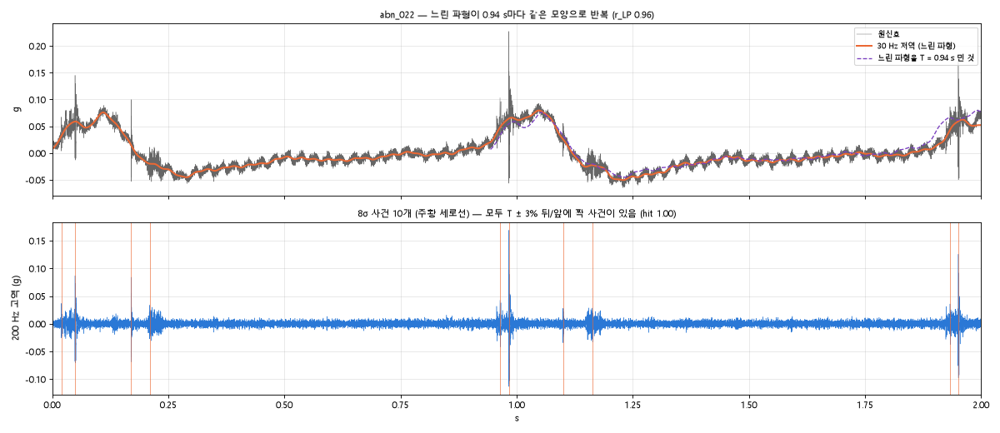
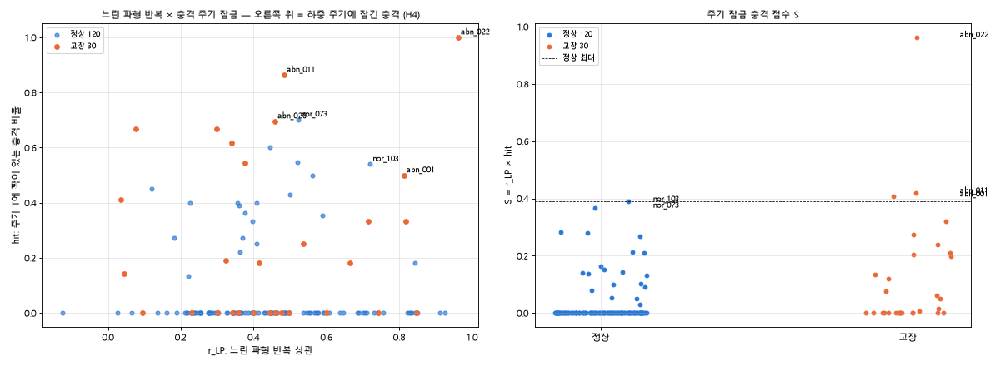
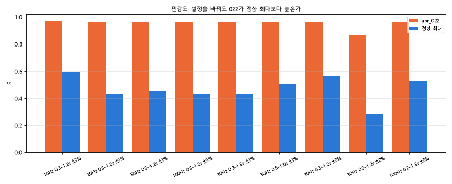
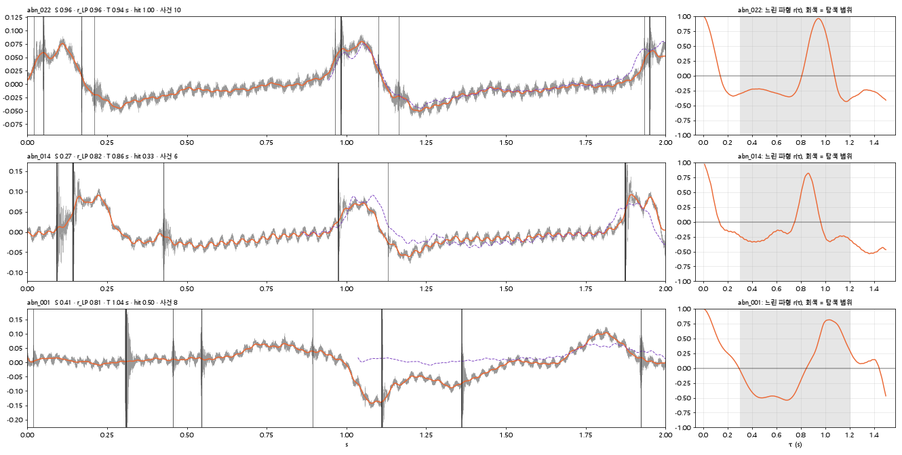
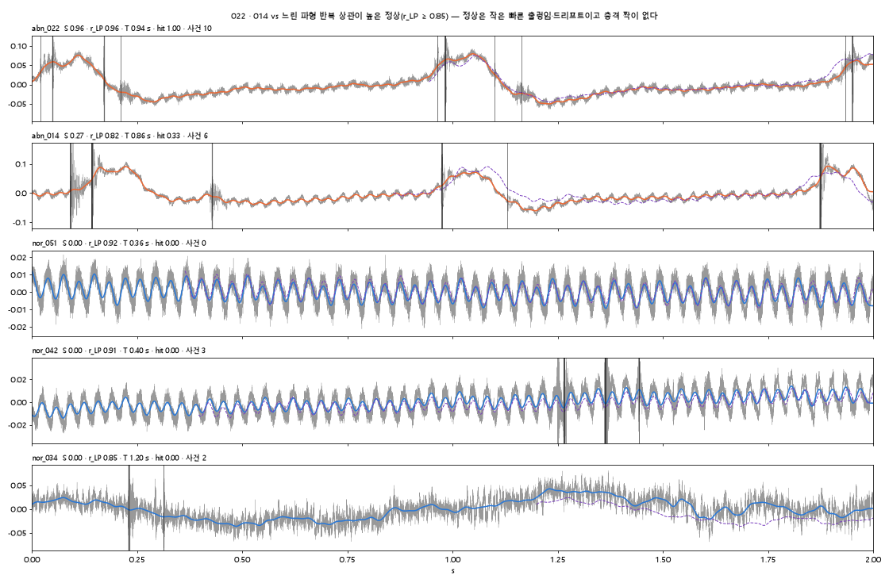
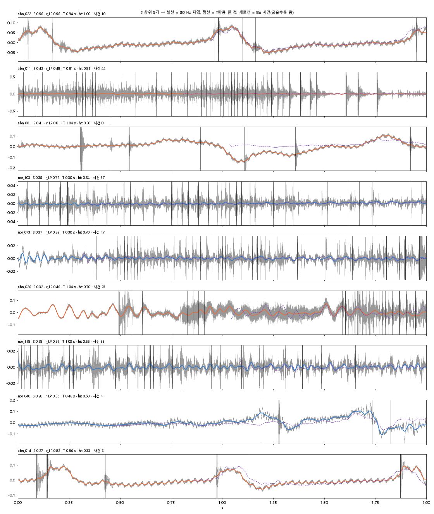

# 2-13 주기 잠금 충격 — abn_022를 가르는 축

상태: 2차 (2026-11-14, 유사 파일 추가). 코드 [run.py](run.py) · [run_similar.py](run_similar.py), 수치 [figs/numbers.txt](figs/numbers.txt), 파일별 값 [figs/lock_score.csv](figs/lock_score.csv)
출발점: EXP-025(중첩 F2 0.942)가 유일하게 놓치는 고장 022 (사용자 "22를 가를 방법을 고안해봐"). 실험(EXP) 아님

## 결론
- **최종 처리 (11-16 오후, [EXP-030](../../../5_모델비교/유의미/EXP-030_1116_최종후보고정_규칙감사/README.md))**: 이 규칙은 겨냥한 고장이 022 하나뿐이라 최종 구성에 넣지 않는다. S는 판정표의 관찰 열(`lock_obs`)로 남겨 val·test에서 문턱 이상 파일을 기록한다
- **모델 반영 (11-16, [EXP-029](../../../5_모델비교/유의미/EXP-029_1116_큰타격수·사건울림·주기잠금/README.md))**: 규칙 "S ≥ 학습 정상 최대 + 0.1이면 고장"을 EXP-025에 더하자 바깥 폴드 25번 모두 022가 켜졌다(놓침 5/5 → 0/5, 중첩 F2 0.942 → 0.966). 대가로 정상 103(S 0.389)이 2/5 켜진다(103과 정상 2위 0.367이 함께 시험 폴드에 들어갈 때)
- **"느린 파형이 같은 모양으로 반복되고, 충격이 그 주기에 잠겨 있다"를 점수로 만들면 022만 정상 전체 위로 올라간다.** S = 0.96, 정상 최대 0.39(nor_103), 정상 95% 0.21
- 설정 9가지(저역 차단 10–100 Hz, 지연 범위, 허용 오차 2–5%)에서 모두 022보다 높은 정상이 0개이고, 2위 정상과의 차이는 +0.38 ~ +0.59다
- 물리적으로는 H4(하중 반전 시 유격 충격)의 직접 증거다. EXP-016의 "저주파 극값 동기"(B4) 정의로는 안 잡혔고, **주기를 신호 자신에서 찾고 그 주기만큼 떨어진 충격 짝을 세는 정의**로 바꾸자 잡혔다

## 관찰 (022 파형)

- 느린 파형(30 Hz 저역)이 0.94 s(약 1.06 Hz)마다 거의 같은 모양으로 반복된다. 천천히 올라가 약 0.08 g에 이르고, 충격이 난 뒤 −0.05 g로 급하게 떨어진다(톱니). 0.94 s 민 파형과의 상관 r = 0.96
- 8σ 충격 10개가 모두 0.94 s 앞이나 뒤에 짝이 있다(0.02·0.05·0.17·0.21 s ↔ 0.97·0.98·1.10·1.16 s ↔ 1.94·1.95 s). 즉 **충격의 시간 배치 자체가 하중 주기를 따른다**
- PSD에서는 36 Hz와 그 2배인 72 Hz 선이 보이지만, 이 선은 정상에도 흔해서(정상 6개가 더 높음) 축으로 쓰지 않았다

## 축 정의 (라벨 무관)
| 기호 | 뜻 | 정의 |
|---|---|---|
| T | 하중(느린 흔들림) 주기 | 30 Hz 저역 신호를 τ만큼 민 자기 자신과의 피어슨 r이 최대인 τ (0.3–1.2 s) |
| r_LP | 느린 파형이 얼마나 똑같이 반복되나 | 그 최대 r |
| hit | 충격이 그 주기에 잠겼나 | 8σ 사건(200 Hz 고역, σ = 1.4826·MAD, 10 ms 안은 한 사건, 2-12와 같음) 중 T ± 3% 떨어진 곳에 다른 사건이 있는 비율 |
| **S** | **주기 잠금 충격 점수** | **r_LP × hit** (둘 다 있어야 높음) |

## 결과

| 축 | 022 | 정상 중앙 · 95% · 최대 | 022 이상 정상 | 정상 최대를 넘는 고장 |
|---|---|---|---|---|
| r_LP | 0.963 | 0.41 · 0.83 · 0.925 (nor_051) | 0 | 022 |
| hit | 1.00 | 0.00 · 0.43 · 0.70 (nor_073) | 0 | 011 022 |
| **S** | **0.963** | **0.00 · 0.21 · 0.389 (nor_103)** | **0** | **001 011 022** |

- r_LP 하나만 써도 022가 1위지만 2위와 차이가 0.04로 작다. 정상에도 느린 출렁임이 반복되는 파일(051·097·054)이 있기 때문이다. 그런 정상은 충격이 주기에 잠겨 있지 않아(hit ≈ 0) S에서 내려간다
- hit만 쓰면 충격이 많은 정상(073·103)에서 우연한 짝이 생긴다. 이 경우는 r_LP가 낮아서 S에서 걸러진다
- 정상 120개 중 100개는 S = 0이다(주기에 잠긴 충격 짝이 하나도 없음)
- 함께 올라오는 고장: 011(0.42, L3 연속 금속 타격)·001(0.41)·026(0.32). 014는 0.27로 정상 꼬리 안에 있다

## 유사 파일 — 022처럼 주기에 잠긴 충격이 또 있나
코드 [run_similar.py](run_similar.py), 사건 목록 [figs/similar.txt](figs/similar.txt)

**결론: 같은 유형은 014 하나, 부분적으로 닮은 것이 001이다. 정상에는 이 유형이 없다**

| 파일 | 판정 | 근거 |
|---|---|---|
| **abn_014** | **같은 유형, 약함** | 0.1–0.25 · 1.0–1.1 · 1.9 s에 022와 거의 같은 약 0.1 g 혹이 반복된다(r 0.82 @ 0.86 s). 큰 충격이 매번 혹이 올라가는 구간에서 난다(0.09·0.14 · 0.98 · 1.88 s). 혹 간격이 0.85 s와 0.90 s로 흔들리고 사건이 6개뿐이라 ±3%에서는 hit 0.33, S 0.27. ±5% 설정에서는 정상 최대를 넘는다(민감도 표). EXP-025 유격 반복 규칙(H1′)이 이미 잡는다 |
| **abn_001** | **부분적으로 닮음** | 느린 파형에 약 1 s 주기가 있다(r 0.81 @ 1.03 s). 가장 큰 충격(1.112 s, 185σ)이 느린 파형의 바닥 = 하중 반전점에서 난다(H4). 하지만 모양이 반복되지 않고(0.8 s 언덕 → 1.1 s 깊은 골 → 1.8 s 언덕, 골은 한 번뿐), 충격 위상이 바닥·평탄부·오르막으로 제각각이다. 짝은 8개 중 4개(0.31↔1.36 s, 0.89↔1.92 s). 기존 모델이 큰 충격만으로 잡는다 |
| abn_011 · abn_026 | 다른 유형 | 연속 금속 타격(L3). 사건이 23–44개로 많아 짝이 맞는다. 혹 반복은 없다 |
| nor_103 · nor_073 · nor_118 | 우연한 짝 | 사건 33–47개, T 0.30 s의 짧은 출렁임. 촘촘한 충격끼리 짝이 맞는다 → r_LP가 낮아 S 0.28–0.39 |
| nor_051 · nor_042 · nor_034 | 느린 파형만 반복 | r_LP 0.85–0.92지만 051·042는 약 19 Hz의 작은(0.01 g) 사인 출렁임, 034는 드리프트. 충격 짝 0 (hit 0) |

- **"약 1 Hz의 큰 혹이 반복되고 혹마다 충격이 나는" 정상은 하나도 없다.** 하중이 출렁여도 건강한 암은 치지 않는다 → H4 지지
- 치는 위상은 파일마다 다르다: 022 = 혹 꼭대기 근처, 014 = 혹 오르막, 001 = 골 바닥. 그래서 위상을 정해 두는 정의("오르막 구간에 충격")보다 **위상을 정하지 않는 지금의 "주기 짝" 정의가 더 일반적이다.** 014를 함께 올리려면 허용 오차를 넓히는 쪽이 낫다(단, 사후 조정)
- 022와 014는 지금까지 따로 다룬 회색지대 고장이었지만 같은 기전일 가능성이 높다

## 해석과 제안
- 022는 **조용한 고장**이다. 에너지·스펙트럼 모양이 모두 정상 안에 있어서 피처 178개, AE, 8 kHz 축이 모두 놓쳤다. 다른 점은 **언제 치느냐**(하중 주기와 같은 위상)뿐이다. 그래서 순간 통계나 PSD가 아니라 시간 구조를 보는 원신호 모델(MiniRocket·1D-CNN, EXP-019)만 022를 올렸다. 이 축은 그 정보를 설명할 수 있는 한 숫자로 옮긴 것이다
- 다음 실험 후보 **EXP-026 (스크리닝)**: EXP-025 위에 S를 다음 둘 중 하나로 넣고 quick_cv → 중첩 CV로 비교한다
  1. **규칙**: 학습 정상 S의 μ + kσ(또는 최대 + 여유)를 넘으면 고장. 022가 들어가면 학습 30개가 모두 잡히므로, 핵심은 오경보가 늘지 않는지다
  2. **결합 입력**: S를 정상 기준 z로 바꿔 L2 로지스틱의 한 열로 넣는다
- 기대: 022 회수, 오경보 증가 없음(정상 최대 0.39 < 022 0.96). 위험: 한 파일 유형에 맞춘 축이다

## 한계
- 022를 본 뒤 만든 축이라 사후다(8.3 kHz 규칙과 같은 처지). 민감도로 운이 아님은 확인했지만, 같은 유형의 고장이 학습 데이터에 022와 약한 014뿐이다 → val·test에서 S가 높은 파일을 따로 확인한다
- 2초에 주기가 약 2번만 들어가므로, 주기가 1.2 s보다 길면 이 정의로는 잡을 수 없다
- 원인 부품(볼조인트인지 부싱인지)은 신호만으로 알 수 없다
