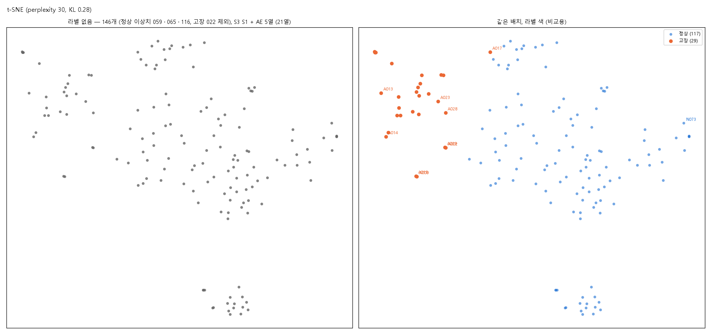
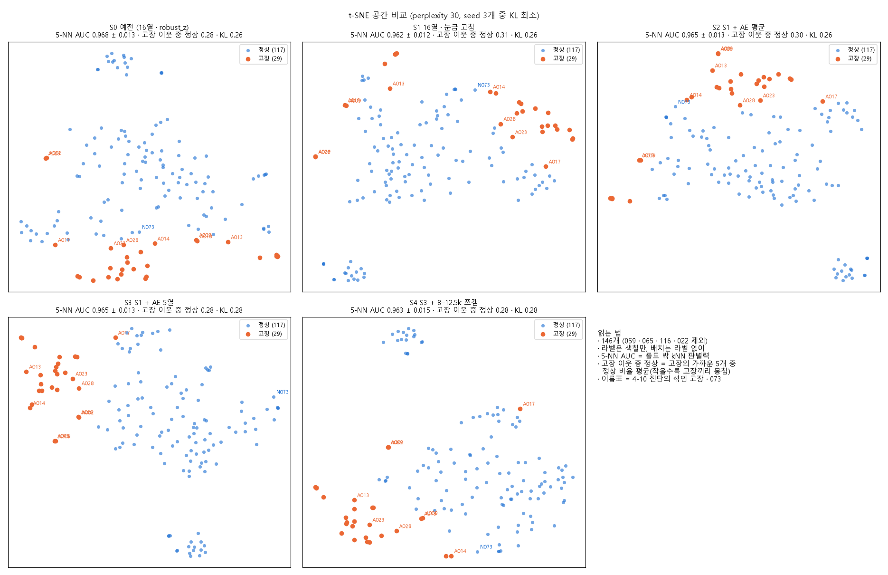
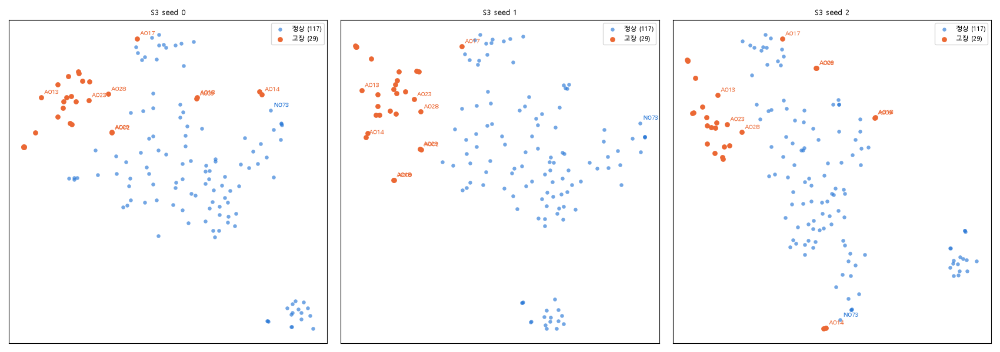

# 4-10 t-SNE 공간 다듬기: 눈금 고침 + AE 열 추가 (11-22) ★ 핵심 자료

> **기본 t-SNE로 채택 (사용자 11-22).** 모든 실험의 `tsne_라벨`은 이 방식(`src.exp2util.tsne_default`)으로 그리고 핵심 그림으로 둔다.

**결론: H 16열에 AE 5열(정상만 학습한 오토인코더의 복원 오차, 전체 평균 + 옥타브 4칸)을 더한 S3에서 고장이 한쪽으로 모인다. 라벨 없는 회색 지도에서도 고장 무리가 따로 보이고, seed 3개 모두 같은 모양이다. 다만 숫자 개선은 작다. 폴드 밖 5-NN AUC는 146개 기준 0.962 → 0.965, 150개 기준 0.964 → 0.975이다. 정상 쪽은 깨끗해졌고(섞인 정상 095 → 없음), 섞인 고장은 023 하나만 풀렸다.**

탐색 단계(중첩 CV 아님). 코드 [run.py](run.py), 수치 [log.txt](log.txt). 지도 = 146개(정상 이상치 059 · 065 · 116, 고장 022 제외, 사용자 11-22). 라벨은 색칠과 숫자 계산에만 쓴다.

왼쪽 = 라벨 없는 배치, 오른쪽 = 같은 배치에 라벨 색. 고장(주황)이 왼쪽 위에 모인다. 017(약한 신호, E2가 잡음)은 정상 무리 위쪽에, 002 · 029(8.3k 규칙이 잡음)와 009 · 018은 고장 무리와 정상 무리 사이에 둘씩 붙어 있다.

## 공간 비교

| 공간 | 열 | 고장 이웃 중 정상 (146) | 정상 이웃 중 고장 (146) | 폴드 밖 5-NN AUC (146) | 폴드 밖 5-NN AUC (150) | KL |
|---|---|---|---|---|---|---|
| S0 예전 (16열 · robust_z, EXP-046 그림) | 16 | 0.283 | 0.015 | 0.968 ± 0.013 | 0.970 ± 0.003 | 0.26 |
| S1 16열 · 눈금 고침 | 16 | 0.310 | 0.007 | 0.962 ± 0.012 | 0.964 ± 0.015 | 0.26 |
| S2 S1 + AE 평균 | 17 | 0.297 | 0.005 | 0.965 ± 0.013 | 0.970 ± 0.008 | 0.26 |
| **S3 S1 + AE 5열** | 21 | **0.276** | 0.005 | 0.965 ± 0.013 | **0.975 ± 0.001** | 0.28 |
| S4 S3 + 8–12.5k 쪼갬 ([EXP-047](../../5_모델비교/EXP-047_1122_8-12k쪼개기/README.md)) | 23 | 0.283 | 0.002 | 0.963 ± 0.015 | 0.978 ± 0.001 | 0.28 |

- **고장 이웃 중 정상**: 고장 파일의 가까운 5개 중 정상의 비율 평균. 작을수록 고장끼리 뭉친다. **정상 이웃 중 고장**은 그 반대.
- **폴드 밖 5-NN AUC**: 5겹으로 나눠, 남긴 파일을 학습 폴드의 가까운 5개로 판정했을 때의 판별력(ROC-AUC).
- 섞인 고장(정상 이웃 3개 이상)은 S1에서 002 009 014 017 018 023 028 029, S3에서 023이 빠진다. 섞인 정상은 S1에서 095, S3에서 없음.

## 눈금 고침 (S0 → S1)
- 예전 `robust_z`는 (값 − 정상 중앙) ÷ (1.4826 × MAD)이다.
- H9(울림 4–8 kHz 비율)는 정상 120개 중 60개가 정확히 1.0이라 MAD가 0 근처가 된다. 그래서 정상 전체를 기준으로 하면 z가 최대 126까지 커진다. EXP-044 t-SNE가 한 줄로 늘어선 원인이 이것이다.
- 이상치 2개(H9 = 0)를 빼면 MAD가 0이 되어 표준편차로 대신 나누므로 정상 범위로 돌아온다. **EXP-046 그림이 예쁘게 나온 것은 이 우연 때문이다.**
- 고친 눈금 `src.exp2util.map_scale`: 척도 = max(1.4826 × MAD, 0.5 × 정상 sd). 기준 정상 집합이 조금 바뀌어도 지도가 흔들리지 않는다.
- 모델에는 영향이 없다. ET는 나무 모델이라 눈금과 무관하다.

## AE 열이 섞인 고장을 가르는가 (S3 눈금의 z)

| 열 | 009 | 018 | 013 | 014 | 023 | 028 | 017 | 정상 중앙 · 95위 | 고장 중앙 |
|---|---|---|---|---|---|---|---|---|---|
| AE 평균 | 2.5 | 2.5 | 2.4 | 1.3 | 3.0 | 1.5 | −0.3 | 0.0 · 1.6 | 2.3 |
| AE 8–12.5k | 3.0 | 3.1 | 3.2 | 0.9 | 3.3 | 2.4 | −0.8 | 0.1 · 2.3 | 2.9 |
| AE 4–8k | 2.5 | 2.4 | 1.8 | 1.5 | 2.3 | 0.4 | −0.6 | 0.0 · 1.4 | 1.6 |

- 섞인 고장 대부분이 AE 열에서 정상 95위를 넘는다. 017만 예외다(신호 전체가 약함).
- 그런데 5-NN 숫자 개선이 작은 이유: 거리는 21열을 똑같은 비중으로 합친다. AE 5열이 있어도 나머지 16열에서는 이 고장들이 정상과 비슷해서 이웃이 크게 바뀌지 않는다.
- J는 로지스틱이 AE에 따로 가중치를 주므로 같은 정보를 더 잘 쓴다.

seed 0 · 1 · 2. 고장 무리(왼쪽 위)와 정상 섬(아래)은 셋 다 같다. 014는 seed마다 위치가 흔들린다.

## 결정
- 이후 실험의 `tsne_라벨` 그림은 **S3 방식**으로 그린다. 공간 = 모델 입력 H 열 + 박자 S + AE 5열, `map_scale` 눈금. 함수는 `src.exp2util.ae_map_cols` · `map_scale` · `tsne_best` · `knn_report`.
- AE 블록에 가중치를 더 주는 방법은 결과를 본 뒤의 선택이라 이번에는 하지 않았다.
