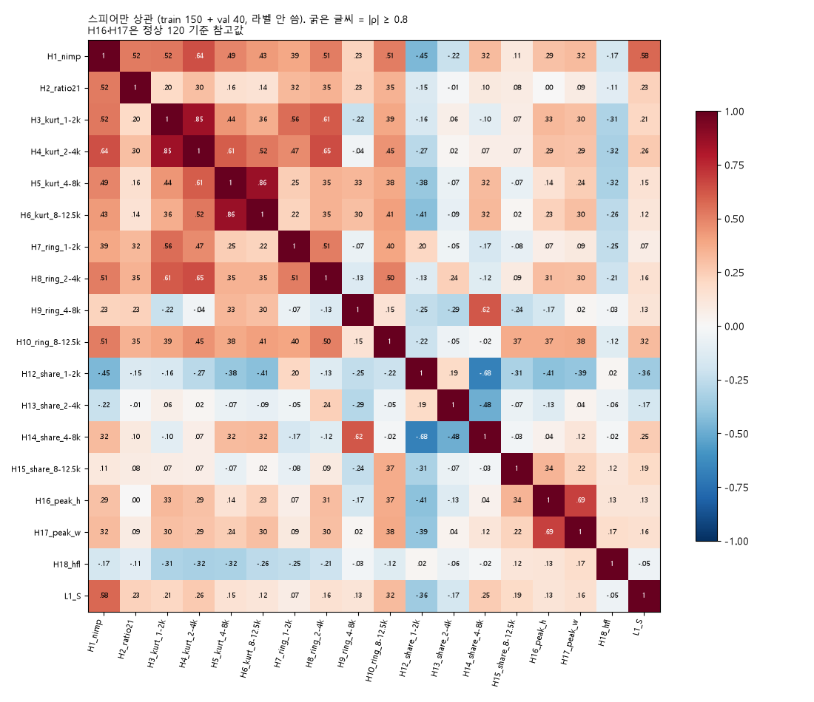
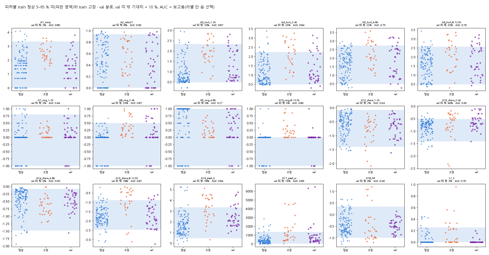
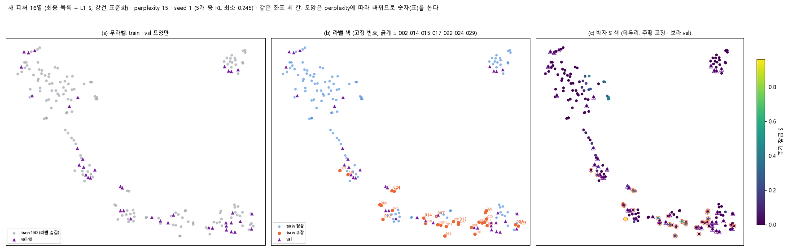
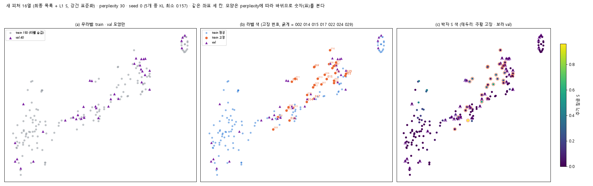
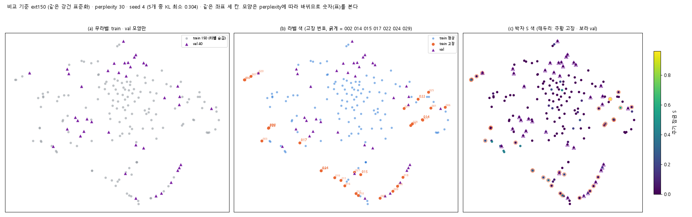

# 4-7 2차 설계 피처 라벨 없는 점검 (11-21)

## 목적
2차 설계 H 블록(1 kHz 고역·새 충격 정의) + 박자 S의 18개 후보에서, **라벨 없이** 상관 묶음을 정리해 EXP-040이 쓸 최종 목록을 고정한다. 분포 이동(val)과 t-SNE·5-NN 숫자도 라벨 없이 본다.

## 답할 질문
1. 새 충격 정의로 `src/impacts.py`·`src/features2.py`가 사령탑 4-6의 기록을 재현하는가
2. |ρ| ≥ 0.8로 묶이는 피처는 무엇이고 대표는 누구인가
3. val은 train 정상의 5–95% 띠 밖으로 얼마나 나가는가 (피처별)
4. 새 피처 공간은 ext150보다 고장끼리 가깝고, val이 train에서 덜 떨어져 있는가

## 방법
- 코드 [run.py](run.py) · 구현 `src/impacts.py` · `src/features2.py` · 캐시 `outputs/cache/feat2_*`
- 후보 18개 = H1–H10, H12–H15, H16–H17(정상 120 전체 기준 참고값), H18, L1 S (H11은 제외 결정)
- 묶음 규칙(실행 전 고정): train 150 + val 40의 스피어만 |ρ| ≥ 0.8 그래프의 연결 성분 = 묶음, 묶음 안 평균 |ρ|가 가장 큰 하나만 남김
- t-SNE 입력: 최종 목록 + L1 S, train 정상의 중앙값·MAD×1.4826 강건 표준화(MAD = 0이면 `robust_z` 대체 규모), 유클리드, train 150 + val 40 함께. perplexity 15·30, 각 seed 5개 중 KL 최소(초기값 random)

## 결과
**재현 확인(assert 통과).** 끝단 제외 전 충격 1516개·시점·높이가 `충격표_전체.csv`와 일치. 끝단 제외 후 충격 정상 854 · val 247 · 고장 402. 끝단 제외 전 시점으로 S: 022 0.963 · 014 0.546 · 정상 최대 0.449(nor_092) · val 최대 0.196 (사령탑 값과 같음). 새 정의 기준(끝단 제외 후): 022 0.963 · 014 0.546 · 정상 최대 0.445 · abn_024 충격 22 · abn_015 충격 35.

**묶음 (|ρ| ≥ 0.8) — 2개.**
| 묶음 | 평균 \|ρ\| | 남김 | 뺌 |
|---|---|---|---|
| H3 첨도 1–2k · H4 첨도 2–4k | 0.848 | H3 | H4 |
| H5 첨도 4–8k · H6 첨도 8–12.5k | 0.862 | H5 | H6 |

(묶음이 2개 구성원뿐이라 평균 |ρ|가 같다 → 동률 규칙 = 앞쪽 열.) 최종 피처 = **H 15열 + L1 S = 16열**: H1 H2 H3 H5 H7 H8 H9 H10 H12 H13 H14 H15 H16 H17 H18 + L1_S ([최종피처.json](최종피처.json), 바꾸지 않음). 옥타브 PSD 몫 4개는 서로 0.8 미만으로 남았다.

**val 이동 (피처별 val이 train 정상 5–95% 띠 밖, 기대 10%).** 큰 곳: H13 PSD 몫 2–4k 40% · H4 · H6 · H8 25% · H5 22.5% · H15 17.5% · H16 17.5%. 거의 안 나가는 곳: H1 · H7 · H9 · H12 · H18 · L1 S (0–5%). 표 [피처_분포이동_AUC.csv](피처_분포이동_AUC.csv), 그림 `figs/band_val.png`. 보고용 고장 AUC: H8 0.87 · H3 0.87 · H16–H17 0.84–0.85 · H10 0.83 · H15 0.81 · H1 0.80 (H9 0.27 · H14 0.30 · H12 0.34는 반대 방향 = 고장이 낮음). 선택에는 쓰지 않았다.

**5-NN 숫자 (표준화한 원래 공간, 임베딩 아님).** t-SNE 모양은 perplexity에 따라 바뀌므로 이쪽이 주 근거다.
| | 새 피처 16열 | ext150 150열 |
|---|---|---|
| 고장 5-NN 이웃 중 고장 비율 (무작위 29/149 = 0.195) | **0.667** | 0.453 |
| train 자기 제외 5-NN 평균 거리 중앙 · 95% | 4.12 · 8.95 | 47.9 · 2630 |
| val → train 5-NN 평균 거리 중앙 | 5.00 | 52.6 |
| val 중 train 95% 초과 · 90% 초과 | **2** · 6 | 7 · 7 |
| val 최대 거리 (파일) | 19.4 (031) | 9.1e6 (004) |
| 보조: z를 ±10으로 자른 뒤 고장 이웃 비율 | 0.787 | 0.553 |
| 보조: 자른 뒤 val 95% 초과 · 90% 초과 | 2 · 3 | 7 · 10 |

val이 train에서 가장 먼 파일: 새 피처 031 · 035 · 004 · 002 · 012, ext150 004 · 031 · 035 · 016 · 027. (예전 기록: ext150 고장 이웃 순도 0.47 · D+ 0.61 = 임베딩 기준이라 직접 비교하지 말 것.)

## 해석과 결정
- 상관 묶음이 적다(2개): 옥타브 첨도 인접 칸만 묶였다. 옥타브 PSD 몫·울림 몫·봉우리는 서로 독립이라 그대로 간다.
- 새 16열은 고장끼리의 5-NN 순도가 ext150보다 높고(0.67 vs 0.45), val이 train에서 떨어진 정도도 작다(95% 초과 2 vs 7). ext150의 거리 수치가 큰 것은 MAD 가까운 0인 열이 많아 val에서 z가 폭발하는 영향이 크다(자른 뒤에도 7개 유지). 새 피처가 val 이동에 더 강하다는 라벨 없는 근거.
- 이동이 큰 H13(2–4k PSD 몫, 40%)·H8(2–4k 울림 몫, 25%)은 EXP-040 B·C에 그대로 들어간다(라벨 없이 고르는 규칙). val에서 2–4 kHz 쪽 분포가 train 정상과 다르다는 것은 test 때도 점검 대상.
- t-SNE: `figs/tsne_새피처_perp15.png` · `perp30.png` · `tsne_ext150_perp30.png`, 세 칸(무라벨·라벨 색·박자 S 색)이 같은 좌표. 정상과 고장은 한 줄기의 양 끝에 분포하고 val은 그 줄기 안에 있다. 우측 위 작은 덩어리는 한 무리의 파일(정상·val 섞임). **t-SNE 모양은 perplexity에 따라 바뀌므로 숫자(위 표)를 본다.**
- 한계: L1 S는 정상의 79%가 0이라 대체 규모로 표준화돼 022(z ≈ 12)가 한 칸에서 멀리 튄다. H16–H17은 여기선 정상 전체 기준 참고값이고 EXP-040에서는 폴드 안에서 다시 계산한다.

## 그림

