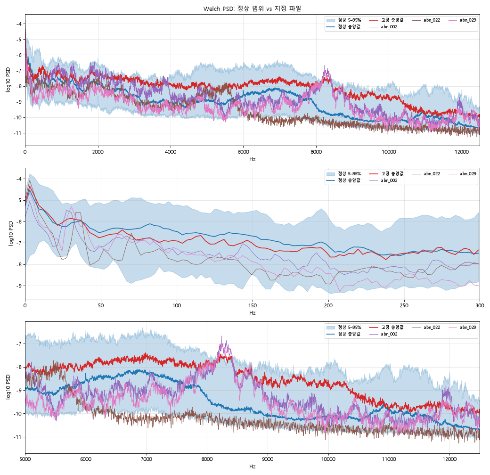
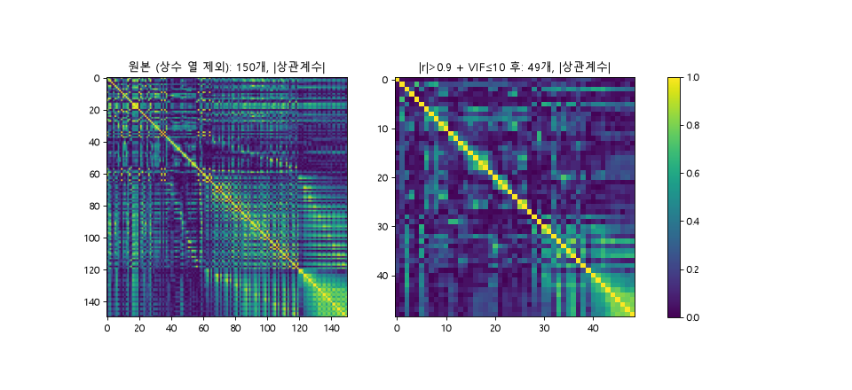

# EXP-007 확장 150 피처 다중공선성 제거

노션 카드 (실험 DB에 그대로 옮긴다)

| 팀원 | 모델 | F2 점수 | 변경 사항 | 메모 |
|---|---|---|---|---|
| 이동훈 | ExtraTrees | 0.784 ± 0.016 | ext150 앞에 폴드 안 공선성 필터(상관 0.9 초과 제거 + VIF≤10) | VIF≤10은 RMS·첨도·포락선 같은 중심 피처까지 지워 하락. 상관 0.9 초과 제거만 하면 100개로 기준과 같음(0.827) |

- 가설: — ([물리가설](../../../notes/물리가설.md))
- 실행: 2026-11-13 · git `ec033c6+수정중` · 코드 [run.py](run.py)
- 평가: 중첩 CV (바깥 5 × 안쪽 4, seed 5개). 자주 놓침 = seed 5번 중 3번 이상

## 결과

| 구성 | F2 | 재현율 | 오경보율 | 정밀도 | F2 (고장 10%·40%) | 자주 놓침 | 오경보 3회+ |
|---|---|---|---|---|---|---|---|
| 기준 ext150 | 0.827 ± 0.031 | 0.867 | 0.093 | 0.700 | 0.759 · 0.866 | 002 022 029 | 10 |
| \|r\|>0.95 | 0.819 ± 0.025 | 0.860 | 0.098 | 0.687 | 0.748 · 0.859 | 002 015 021 022 029 | 11 |
| \|r\|>0.9 | 0.827 ± 0.013 | 0.860 | 0.085 | 0.718 | 0.764 · 0.862 | 002 021 022 029 | 10 |
| \|r\|>0.9 + VIF≤10 | 0.784 ± 0.016 | 0.820 | 0.102 | 0.675 | 0.715 · 0.825 | 002 015 021 022 029 | 10 |

## 그림

### psd_focus
놓친 고장의 PSD가 정상 범위(파란 띠) 밖으로 나가는 주파수가 있는가



### corr_before_after
피처 간 |상관계수|. 밝은 덩어리 = 같은 정보를 반복하는 피처 묶음



## 전체 데이터 기준 필터 결과

```
원본 150 (상수 열 0개): rank 140, VIF 중앙값 5572, |r|>0.9 쌍 93
|r|>0.95: 113개 남음, VIF 중앙값 419.4, 최대 76979987.5
|r|>0.9: 100개 남음, VIF 중앙값 173.3, 최대 73830829.9
|r|>0.9 + VIF≤10: 49개 남음, VIF 중앙값 6.1, 최대 9.9
VIF≤10 후 남은 피처: T08_skewness T15_hjorth_complexity W01_win_rms_max_to_mean F07_peak1_freq F08_peak1_amp T18_tkeo_kurtosis W04_win_zcr_std F02_spectral_bandwidth F04_rolloff95 F09_peak2_freq F09_peak3_freq B04_ratio_00625 B04_ratio_01250 B04_ratio_01875 B04_ratio_02500 B04_ratio_03125 B04_ratio_03750 B04_ratio_04375 B04_ratio_05000 B04_ratio_05625 B04_ratio_06250 B04_ratio_06875 B04_ratio_07500 B04_ratio_08125 B04_ratio_09375 B04_ratio_10000 B04_ratio_10625 B04_ratio_11875 P02_kurtosis_000 P02_rms_012 P02_kurtosis_012 P02_kurtosis_025 P02_peak_037 P02_crest_050 P02_rms_062 P02_kurtosis_062 P02_crest_075 P02_peak_112 P02_kurtosis_112 S01_kurtosis_000 S01_kurtosis_012 S01_kurtosis_025 S01_max_to_mean_037 S01_kurtosis_037 S01_kurtosis_050 S01_kurtosis_062 S01_kurtosis_087 S01_kurtosis_100 S01_kurtosis_112
```

## 메모
- **상관 0.9 초과 쌍만 거르면 피처 150 → 100개로 줄어도 F2가 같다** (0.827 ± 0.013, 기준 0.827 ± 0.031). sd가 작아지고 오경보율도 0.093 → 0.085로 조금 낮다. 빠진 50개는 새 정보가 없었다
- **VIF≤10까지 하면 49개, F2 0.784로 떨어진다** (차이 0.043 > sd). 재현율 0.867 → 0.820, 015·021을 더 놓친다
  - VIF는 "다른 피처들로 얼마나 설명되나"만 보고 고장 구분 정보는 보지 않는다. 그래서 다른 피처와 많이 엮인 **중심 피처가 먼저 빠진다**: T01 RMS·T02 Peak·T07 첨도·E01 포락선 20개가 모두 사라졌고, 합이 1인 B04 대역 비율 17개는 남았다
  - 상관 필터 뒤에도 VIF 최대가 약 7천만 = 공선성의 원인은 쌍끼리가 아니라 여러 피처의 선형 조합(대역 비율의 합 = 1, 대역 RMS와 전체 RMS의 관계)이다
- 해석: ExtraTrees는 공선성이 있어도 예측이 크게 흔들리지 않는다(나눌 때마다 일부 피처만 봄). 공선성은 **선형 모델(로지스틱·선형 SVM)의 계수 해석과 안정성** 문제 → 5단계에서 선형 모델을 비교할 때 다시 본다
- 주 구성(VIF≤10)은 결과를 보기 전에 정했다. 상관 0.9 필터를 새 기준으로 삼는다면 4개 구성 중 고른 것이라 약간 낙관적일 수 있다
