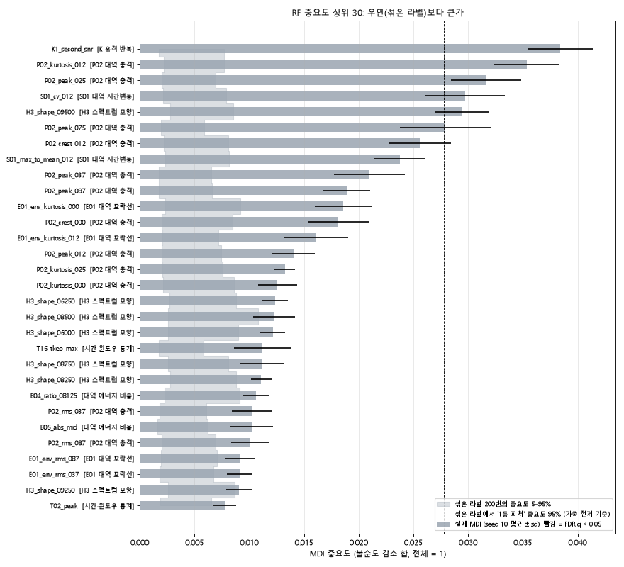
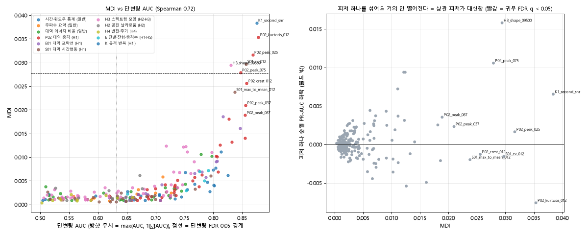
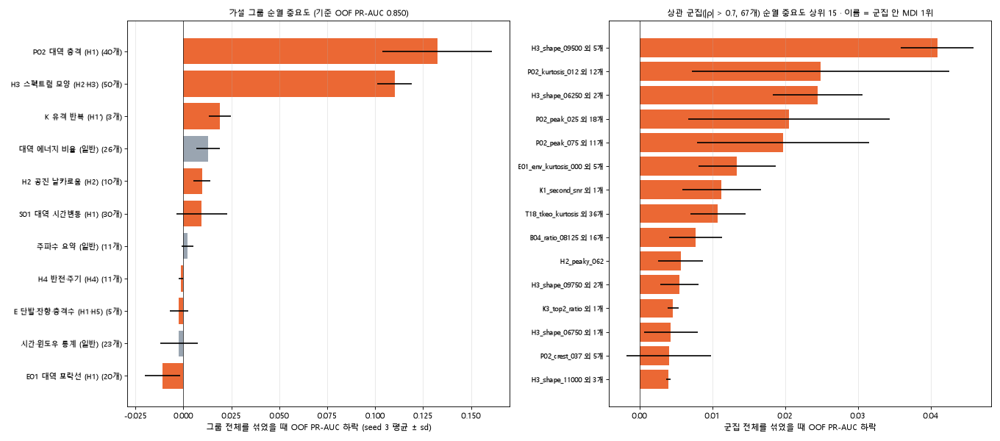
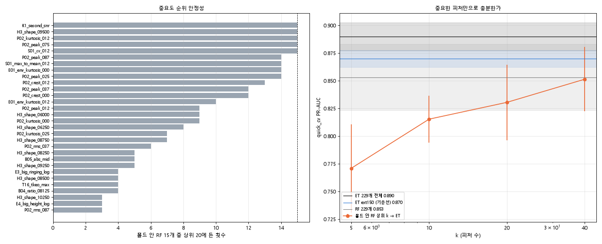
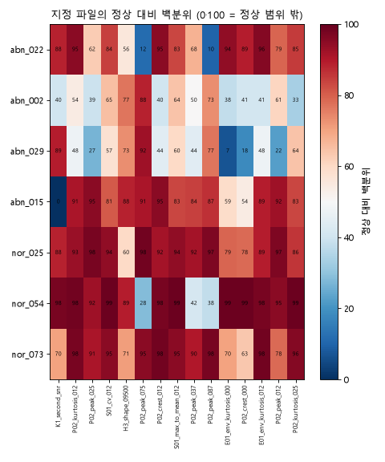
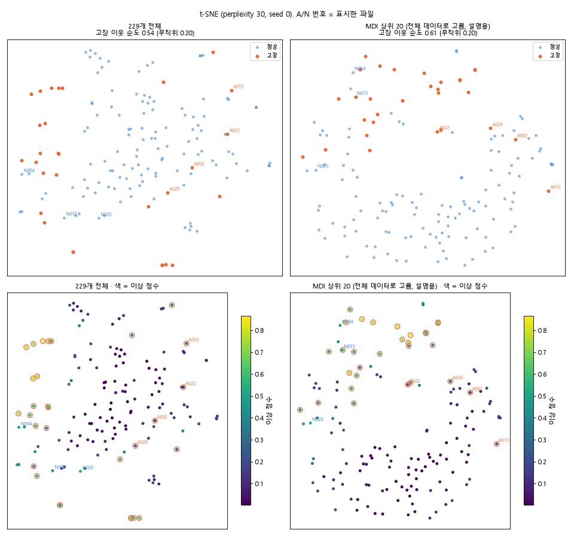

# 4-1 피처 중요도 — 뽑은 피처는 정말 유의미한가

- 날짜: 2026-11-16 · 실험: [EXP-027](../../../5_모델비교/기각/EXP-027_1116_RF피처중요도/README.md) (코드 `run.py`, 수치 `result.json`·`summary_utf8.json`)
- 자료(전체 수치 표, Excel에서 열림)
  - [importance_table.csv](../../../5_모델비교/기각/EXP-027_1116_RF피처중요도/importance_table.csv): 피처 229개 × (MDI·귀무 p·FWER p·AUC·Mann-Whitney q·순열 하락·안정성)
  - [cluster_table.csv](../../../5_모델비교/기각/EXP-027_1116_RF피처중요도/cluster_table.csv): 상관 군집 67개 × (대표 피처·구성원·군집 순열 하락)
  - [group_table.csv](../../../5_모델비교/기각/EXP-027_1116_RF피처중요도/group_table.csv): 가설 그룹 11개 × (MDI 합·유의 피처 수·그룹 순열 하락)
- 위 링크는 EXP-027 폴더가 `스크리닝/`에 있을 때 기준이다. 폴더를 옮기면 경로도 고친다

## 결론 먼저

1. **유의미하다. 다만 "많은 피처"가 아니라 "두 가지 정보"가 유의미하다.** 하나는 1.25–3.75 kHz 대역의 충격 크기·뾰족함(P02·S01, 가설 H1)이고, 다른 하나는 8.25–9.5 kHz 근처 스펙트럼 모양(H3_shape, 가설 H2·H3)이다. 둘 중 하나를 통째로 망가뜨리면 PR-AUC가 0.11–0.13 떨어진다. 나머지 그룹을 망가뜨리면 0.02 이하로 떨어진다.
2. **가장 엄격한 검정을 통과한 피처는 5개다**: K1_second_snr, P02_kurtosis_012, P02_peak_025, P02_peak_075, S01_cv_012. 라벨을 200번 섞었을 때 "1등 피처"가 얻는 중요도보다 크다. H3_shape_09500은 경계(p 0.065)지만 학습 폴드 15개 모두에서 상위 20에 들었고, 군집 순열 중요도는 1위다.
3. **229개 중 대부분(156개)은 정상·고장 분포가 다르지만 서로 같은 정보를 반복한다.** 상관으로 묶으면 67묶음이 된다. 그래서 상위 몇 개만 남기면 성능이 떨어진다(상위 5개 0.771, 상위 40개 0.851, 전체 0.890).
4. **근거가 없는 그룹**: H4(하중 반전·충격 주기, 11개), H2 공진 날카로움 대부분, 충격 주기성 B1–B5, 주파수 요약. 이 그룹들은 단변량 AUC가 0.5 근처이고, 섞어도 성능이 그대로다.
5. **중요 피처로도 못 잡는 고장이 남는다**: 002·029·022·015는 중요 피처 공간에서 정상 범위 안에 있다. 반대로 정상 025·054·073은 충격 피처에서 정상 90–99 백분위에 있다. 중요 피처가 충격의 **크기**를 재고 있어서, 정상의 단발 큰 충격과 고장의 반복 충격을 가르지 못한다.

## 왜 이 분석을 했나

지금까지 피처는 물리가설(H1–H6)을 바탕으로 만들었고, 성능은 모델 전체 점수로만 봤다. 그래서 다음 질문에 답한 적이 없다.
- 어떤 피처가 실제로 고장을 가르는가
- 그 중요도는 우연이 아닌가. 피처 229개를 표본 150개로 학습하면, 라벨과 무관한 피처도 나무 분할에 쓰이면서 중요도를 얻는다
- 중요한 피처만으로 충분한가
- 가설별로 보면 어떤 가설이 데이터로 지지되는가

## 방법

대상 피처: ext150 + 물리 67(H2_peaky·H3_shape·H4) + 충격 9(B1–B5·E1–E4) + 유격 3(K1–K3) = **229개** (상수 열 없음). `band200`은 H3_shape와 같은 정보를 더 촘촘한 격자로 담은 것이라 넣지 않았다.

RF 설정은 하나로 고정했다: 1000그루, `class_weight=balanced_subsample`, `min_samples_leaf=2`, `max_features=sqrt`. 하이퍼파라미터는 고르지 않았다.

| # | 분석 | 무엇을 답하나 | 데이터 |
|---|---|---|---|
| 0 | RF quick_cv | 중요도를 읽을 만큼 RF가 잘 맞히는가 | 폴드 밖 |
| 1 | **MDI** (불순도 감소 중요도) | RF가 어떤 피처로 나무를 나눴는가 | 150개 전체 (설명용) |
| 2 | **귀무 중요도 검정** (Altmann 2010) | 그 중요도가 우연보다 큰가 | 150개 전체, 라벨 섞기 200번 |
| 3 | 단변량 Mann-Whitney U + BH-FDR | 모델 없이도 정상·고장 분포가 다른가 | 150개 전체 |
| 4 | **순열 중요도** (피처·상관 군집) | 시험 데이터에서 그 정보를 지우면 성능이 떨어지는가 | 폴드 밖 (5-fold × seed 3) |
| 5 | 가설 그룹 순열 + 그룹 단독 학습 | 가설 그룹마다 성능 기여는 | 폴드 밖 |
| 6 | 순위 안정성 | 학습 데이터가 바뀌어도 같은 피처가 상위에 오는가 | 폴드 안 RF 15개 |
| 7 | 상위 k 선택 → ET | 중요한 피처만으로 충분한가 | 선택을 폴드 안에서 |

### 개념 정리

**MDI (Mean Decrease in Impurity)**: 나무가 어떤 피처로 노드를 나눌 때 지니 불순도가 줄어든 양을 피처별로 모두 더하고, 전체 합이 1이 되게 맞춘 값이다. 계산이 빠르지만 두 가지 함정이 있다. (1) 학습 데이터에서 잰 값이라 과적합한 분할도 중요도로 센다. (2) 상관이 큰 피처끼리는 중요도를 나눠 가진다. 피처 229개가 모두 같으면 각각 1/229 = 0.0044다.

**귀무 중요도 검정 (null importance, permutation test)**: 라벨을 무작위로 섞으면 피처와 라벨의 관계가 끊긴다. 이 상태로 같은 RF를 200번 학습해 각 피처가 "우연히" 얻는 MDI 분포를 만들고, 실제 MDI가 그 분포의 어디에 있는지로 p값을 낸다.
- 피처별 p = (1 + 실제보다 큰 귀무 횟수) / (1 + 200)
- **가족 단위(FWER, max-null) p**: 매번 섞을 때 229개 중 **가장 큰** 귀무 MDI를 모아 분포를 만들고, 그 분포와 비교한다. "229개를 한꺼번에 봐도 우연이 아니다"를 보장하는 가장 엄격한 기준이다. 섞은 라벨에서 1등 피처 MDI의 95%선은 **0.0277**이다.
- **BH-FDR**: 여러 피처를 동시에 검정할 때 "유의하다고 한 것 중 거짓의 비율"을 5%로 묶는 보정이다. FWER보다 느슨하다.

**순열 중요도 (permutation importance, 폴드 밖)**: 학습 폴드로 RF를 학습한 다음, 시험 폴드에서 한 피처의 값만 파일 사이에 섞고 OOF PR-AUC가 얼마나 떨어지는지 잰다. 학습에 쓰지 않은 데이터에서 재므로 "성능에 실제로 기여하는가"를 직접 답한다. 대신 상관이 큰 피처가 있으면, 하나를 섞어도 다른 피처가 대신해서 0에 가깝게 나온다. 그래서 상관 군집이나 가설 그룹을 **통째로** 섞는 결과를 주 결과로 본다.

**상관 군집**: Spearman |ρ| > 0.7이면 같은 군집으로 묶었다(평균 연결 계층 군집, 거리 1−|ρ| ≤ 0.3). 라벨을 쓰지 않는다.

## 결과

### 0. RF는 중요도를 읽을 만한 모델인가

| 모델 (quick_cv, seed 3) | PR-AUC | ROC-AUC |
|---|---|---|
| RF 229개 | 0.853 ± 0.030 | 0.944 |
| ET 229개 | 0.890 ± 0.013 | 0.956 |
| ET ext150 (기준선) | 0.870 ± 0.008 | 0.942 |

RF는 ET보다 조금 낮지만 같은 수준이다. 무작위 PR-AUC가 0.20이므로 RF가 가리키는 피처는 실제 구분 정보를 담고 있다고 볼 수 있다.

### 1–2. 중요도는 우연보다 큰가

막대는 실제 MDI, 회색 띠는 같은 피처의 귀무 5–95%, 점선은 섞은 라벨에서 1등 피처 MDI의 95%선이다. 상위 30개 모두 자기 회색 띠보다 높고, 점선을 넘은 것이 5개다.

MDI 상위 30 (전체 표는 `importance_table.csv`)

| 순위 | 피처 | 그룹 | MDI | 귀무 p | 가족 단위 p | 단변량 AUC (방향) | 순열 하락 (피처 하나) | 폴드 상위 20 |
|---|---|---|---|---|---|---|---|---|
| 1 | K1_second_snr | K 유격 반복 | 0.0384 | 0.005 | **0.005** | 0.875 (+) | 0.007 | 15/15 |
| 2 | P02_kurtosis_012 | P02 대역 충격 | 0.0354 | 0.005 | **0.025** | 0.878 (+) | -0.008 | 15/15 |
| 3 | P02_peak_025 | P02 대역 충격 | 0.0316 | 0.005 | **0.020** | 0.868 (+) | 0.002 | 14/15 |
| 4 | S01_cv_012 | S01 대역 시간변동 | 0.0297 | 0.005 | **0.030** | 0.856 (+) | -0.002 | 15/15 |
| 5 | H3_shape_09500 | H3 스펙트럼 모양 | 0.0294 | 0.005 | 0.065 | 0.831 (+) | 0.016 | 15/15 |
| 6 | P02_peak_075 | P02 대역 충격 | 0.0279 | 0.005 | **0.015** | 0.847 (+) | 0.011 | 15/15 |
| 7 | P02_crest_012 | P02 대역 충격 | 0.0256 | 0.005 | 0.174 | 0.858 (+) | -0.001 | 13/15 |
| 8 | S01_max_to_mean_012 | S01 대역 시간변동 | 0.0238 | 0.005 | 0.294 | 0.837 (+) | -0.002 | 14/15 |
| 9 | P02_peak_037 | P02 대역 충격 | 0.0210 | 0.005 | 0.343 | 0.856 (+) | 0.002 | 12/15 |
| 10 | P02_peak_087 | P02 대역 충격 | 0.0189 | 0.005 | 0.393 | 0.855 (+) | 0.004 | 14/15 |
| 11 | E01_env_kurtosis_000 | E01 대역 포락선 | 0.0186 | 0.015 | 0.567 | 0.817 (+) | -0.002 | 14/15 |
| 12 | P02_crest_000 | P02 대역 충격 | 0.0181 | 0.005 | 0.537 | 0.827 (+) | 0.003 | 12/15 |
| 13 | E01_env_kurtosis_012 | E01 대역 포락선 | 0.0161 | 0.005 | 0.229 | 0.847 (+) | -0.005 | 10/15 |
| 14 | P02_peak_012 | P02 대역 충격 | 0.0140 | 0.010 | 0.811 | 0.854 (+) | 0.000 | 9/15 |
| 15 | P02_kurtosis_025 | P02 대역 충격 | 0.0133 | 0.005 | 0.950 | 0.832 (+) | -0.001 | 7/15 |
| 16 | P02_kurtosis_000 | P02 대역 충격 | 0.0126 | 0.020 | 0.871 | 0.812 (+) | -0.005 | 9/15 |
| 17 | H3_shape_06250 | H3 스펙트럼 모양 | 0.0124 | 0.020 | 0.980 | 0.718 (-) | 0.009 | 8/15 |
| 18 | H3_shape_08500 | H3 스펙트럼 모양 | 0.0122 | 0.015 | 0.602 | 0.752 (+) | 0.003 | 4/15 |
| 19 | H3_shape_06000 | H3 스펙트럼 모양 | 0.0121 | 0.015 | 0.871 | 0.748 (-) | 0.009 | 9/15 |
| 20 | T16_tkeo_max | 시간·윈도우 통계 | 0.0112 | 0.050 | 1.000 | 0.813 (+) | -0.002 | 4/15 |
| 21 | H3_shape_08750 | H3 스펙트럼 모양 | 0.0111 | 0.015 | 0.985 | 0.755 (+) | 0.004 | 7/15 |
| 22 | H3_shape_08250 | H3 스펙트럼 모양 | 0.0111 | 0.015 | 0.985 | 0.797 (+) | 0.007 | 5/15 |
| 23 | B04_ratio_08125 | 대역 에너지 비율 | 0.0106 | 0.020 | 0.980 | 0.778 (+) | 0.002 | 4/15 |
| 24 | P02_rms_037 | P02 대역 충격 | 0.0102 | 0.030 | 1.000 | 0.805 (+) | -0.004 | 6/15 |
| 25 | B05_abs_mid | 대역 에너지 비율 | 0.0102 | 0.025 | 1.000 | 0.797 (+) | -0.002 | 5/15 |
| 26 | P02_rms_087 | P02 대역 충격 | 0.0101 | 0.035 | 1.000 | 0.807 (+) | 0.001 | 3/15 |
| 27 | E01_env_rms_087 | E01 대역 포락선 | 0.0092 | 0.040 | 1.000 | 0.807 (+) | 0.002 | 3/15 |
| 28 | E01_env_rms_037 | E01 대역 포락선 | 0.0091 | 0.020 | 1.000 | 0.805 (+) | -0.002 | 3/15 |
| 29 | H3_shape_09250 | H3 스펙트럼 모양 | 0.0091 | 0.045 | 0.995 | 0.767 (+) | 0.004 | 5/15 |
| 30 | T02_peak | 시간·윈도우 통계 | 0.0077 | 0.035 | 1.000 | 0.804 (+) | -0.002 | 2/15 |

- 피처 이름 끝 숫자는 대역 시작(100 Hz 단위)이다. `_012` = 1.25–2.5 kHz, `_025` = 2.5–3.75 kHz, `_075` = 7.5–8.75 kHz, `_000` = 20 Hz–1.25 kHz
- 단변량 AUC 방향: (+)는 고장에서 큼, (−)는 고장에서 작음 (6–6.25 kHz 모양은 고장에서 상대적으로 낮다)

| 검정 | 유의 피처 수 (229개 중) |
|---|---|
| 귀무 검정, 피처별 p < 0.05 (보정 없음) | 37 (우연이면 약 11.5) |
| 귀무 검정, 가족 단위 p < 0.05 | **5** |
| 귀무 검정, BH-FDR q < 0.05 | 0 (해상도 한계, 아래 "한계" 1) |
| 단변량 Mann-Whitney, BH-FDR q < 0.05 | 156 |

### 3. 세 가지 중요도가 같은 말을 하는가

- 왼쪽: MDI와 단변량 |AUC|의 순위 상관은 0.72다. RF가 중요하다고 한 피처는 대체로 "혼자서도 갈리는 피처"다. 다만 단변량 AUC가 0.75–0.85인 피처가 아주 많은데(H3·P02·E01) MDI는 그중 몇 개에 몰린다. 같은 정보를 담은 피처들이 중요도를 나눠 가지기 때문이다.
- 오른쪽: 피처 하나만 섞은 순열 중요도는 거의 0이다. MDI 2위인 P02_kurtosis_012조차 −0.008이다. 피처 하나를 지워도 상관 피처가 대신한다. 이 그림만 보고 "쓸모없다"고 판단하면 안 된다.

### 4–5. 묶음 단위로 지우면 (폴드 밖)

가설 그룹 (기준 OOF PR-AUC 0.850)

| 그룹 (피처 수) | 그룹 순열 하락 | 그룹 단독 ET PR-AUC | MDI 합 | 판정 |
|---|---|---|---|---|
| P02 대역 충격 · H1 (40) | **0.132 ± 0.029** | 0.827 | 0.318 | 핵심 |
| H3 스펙트럼 모양 · H2·H3 (50) | **0.110 ± 0.009** | 0.805 | 0.209 | 핵심, P02와 다른 정보 |
| K 유격 반복 · H1′ (3) | 0.019 ± 0.006 | 0.632 | 0.043 | 피처당 기여 최대 (사후 피처) |
| 대역 에너지 비율 · 일반 (26) | 0.013 ± 0.006 | 0.791 | 0.069 | H3와 중복 |
| H2 공진 날카로움 (10) | 0.010 ± 0.004 | 0.439 | 0.023 | 약한 보조 |
| S01 대역 시간변동 · H1 (30) | 0.010 ± 0.013 | 0.544 | 0.103 | P02와 중복 |
| 주파수 요약 · 일반 (11) | 0.002 ± 0.003 | 0.563 | 0.023 | 기여 없음 |
| H4 반전·주기 (11) | −0.001 ± 0.001 | 0.484 | 0.013 | 기여 없음 |
| E 단발·잔향·충격수 · H1·H5 (5) | −0.002 ± 0.005 | 0.664 | 0.024 | 중복 |
| 시간·윈도우 통계 · 일반 (23) | −0.002 ± 0.010 | 0.654 | 0.080 | 중복 |
| E01 대역 포락선 · H1 (20) | −0.011 ± 0.009 | 0.761 | 0.094 | P02와 완전 중복 |

상관 군집 상위 (67개 중, 전체는 `cluster_table.csv`)

| 군집 대표 (구성 수) | 구성 | 군집 순열 하락 |
|---|---|---|
| H3_shape_09500 (6) | H3_shape 8.25–9.5 kHz | **0.041 ± 0.005** |
| P02_kurtosis_012 (13) | 1.25–3.75 kHz의 P02 첨도·파고율, E01 포락선 첨도, S01 시간변동 | 0.025 ± 0.018 |
| H3_shape_06250 (3) | H3_shape 5.75–6.25 kHz (고장에서 낮음) | 0.025 ± 0.006 |
| P02_peak_025 (19) | 원신호 Peak·TKEO, 0–3.75 kHz P02 Peak·RMS, B05 절대 에너지 | 0.021 ± 0.014 |
| P02_peak_075 (12) | 7.5–12.5 kHz P02 Peak·RMS·포락선 RMS | 0.020 ± 0.012 |
| E01_env_kurtosis_000 (6) | 0–1.25 kHz 첨도·파고율·시간변동 | 0.013 ± 0.005 |
| K1_second_snr (2) | K1 + H1_impact_rate | 0.011 ± 0.005 |

읽는 법: 상위 군집은 두 계열이다. **충격 계열**(P02·E01·S01·K, 1.25–3.75 kHz 충격의 뾰족함 + 전 대역 Peak)과 **모양 계열**(H3_shape 8.25–9.5 kHz는 고장에서 높고, 5.75–6.25 kHz는 고장에서 낮음)이다. 그룹 순열에서 P02와 H3 둘 다 크게 떨어지므로 두 계열은 서로를 대신하지 못한다. 이것은 EXP-014에서 ET(충격)와 스펙트럼 AE(모양)를 결합했을 때 좋아진 이유와 같다.

### 6–7. 안정한가, 상위 피처만으로 충분한가

- 학습 폴드 15개 **모두**에서 상위 20에 든 피처: K1_second_snr, H3_shape_09500, P02_kurtosis_012, P02_peak_075, S01_cv_012. 14번: P02_peak_087, S01_max_to_mean_012, E01_env_kurtosis_000, P02_peak_025.
- 폴드 안에서 RF 상위 k개만 고른 뒤 ET로 학습: 5개 0.771, 10개 0.815, 20개 0.830, 40개 0.851. 229개 전체(0.890)에 못 미친다. EXP-011(단변량 AUC 상위 k, 0.746–0.786)과 같은 결론이다. **중요도 순위로 피처를 줄이는 것은 이득이 없다.**

### 놓친 파일

- RF가 가장 못 잡는 고장(정상 중 순위): 022 0.44 · 002 0.39 · 029 0.16 · 015 0.12. 이전 실험들과 같은 파일이다.
- 002는 상위 15 피처 모두에서 정상 33–77 백분위로, 정상 한가운데에 있다. 029도 대부분 정상 범위 안이다. 두 파일의 단서(8.3 kHz 모드가 넓게 들뜸, EXP-021)는 중요도 상위 피처에 들어 있지 않다.
- 015는 K1이 정상 0 백분위(가장 낮음)인데 P02는 81–95 백분위다. 두 축이 반대 방향을 가리킨다.
- 점수가 가장 높은 정상 025·054·073은 충격 피처에서 90–99 백분위다. 2-11의 N-A형("큰 사건 한 번")이다. 중요 피처가 충격의 크기·뾰족함을 재고 있어서, 정상의 단발 큰 충격과 고장의 반복 충격이 같은 값으로 보인다.

t-SNE에서 고장 이웃 순도는 229개 0.54, MDI 상위 20개 0.61이다(무작위 0.20). 상위 20개 공간에서 고장 본진은 위쪽에 모이지만 002·022·029·015는 정상 쪽에 있다. 상위 20개는 전체 데이터로 고른 것이라 이 그림은 설명용이다.

## 가설별 판정 ([물리가설](../../../1_기준·기록/물리가설.md) 검증 열에 반영)

| 가설 | 피처 | 이번 결과 | 판정 |
|---|---|---|---|
| H1 유격 → 금속 타격 | P02·E01·S01 (1.25–3.75 kHz 첨도·Peak) | 가족 단위 유의 4개, 그룹 순열 하락 1위(0.132). E01·S01은 P02와 같은 정보 | **강하게 지지** |
| H1′ 반복 타격 | K1·K3 | K1이 MDI 1위·가족 단위 p 0.005·15/15 안정. 단, 라벨을 보고 만든 피처라 낙관적. K2(p 1.0)·K3(p 0.63)는 단독으로 유의하지 않음 | 지지 (사후) |
| H2·H3 공진·모양 | H3_shape 8.25–9.5 kHz, 5.75–6.25 kHz | 군집 순열 1·3위, 그룹 순열 2위(0.110). 고정 250 Hz 격자에서 나온 것이라 라벨 보고 고른 대역이 아님 | **지지** |
| H2 공진 날카로움 | H2_peaky (1.25 kHz 대역 최대−중앙) | 6.25 kHz 하나만 약하게 남음, 그룹 단독 0.439 | 약함 (1.25 kHz 폭이 너무 넓어 8.3 kHz 모드가 희석된 것으로 추정) |
| H4 하중 반전 충격·주기 | H4_*, B1–B5 | 11개 모두 귀무 p ≥ 0.96, AUC 0.41–0.66, 그룹 순열 −0.001 | **지지 안 됨** (EXP-016과 같음, 022 한정 2-13은 별도) |
| H5 감쇠 (잔향) | E3 | AUC 0.22(고장이 짧음)지만 귀무 p 0.16, 결합 기여 없음 | 약함 (중복) |

## 한계

1. **귀무 순열 200회로는 FDR을 판정할 수 없었다.** 피처별 p의 최솟값이 1/201 = 0.005라서, 13개가 이 값에 묶여 BH 보정 후 q가 0.088 아래로 내려가지 못했다. "FDR 유의 0개"는 "유의하지 않다"는 뜻이 아니라 해상도가 부족했다는 뜻이다. 대신 쓴 가족 단위 검정은 FDR보다 엄격하다. FDR이 꼭 필요하면 순열을 2,000회 이상으로 늘려야 한다(약 50분).
2. MDI와 귀무 검정은 150개 전체로 학습한 **설명용** 수치다. 성능 기여에 대한 주장(순열 하락, 상위 k, 그룹 단독)은 모두 폴드 밖에서 쟀다.
3. K1은 2-12에서 abn_014를 분석하다가 라벨을 보고 만든 피처라, 1위라는 결과에는 선택 편향이 들어 있다. val로 확인해야 한다.
4. 여기서 본 것은 RF 한 모델의 관점이다. 최종 후보(EXP-025)는 ET + 스펙트럼 AE + 규칙이라, AE가 보는 모양 정보는 이 표에 직접 나오지 않는다.
5. 이 결과를 보고 그룹을 지우면, 그 선택은 전체 라벨을 본 것이 된다. 피처를 줄이려면 폴드 안 선택으로 다시 비교해야 한다.

## 발표용 요약 (3줄)

- RF 중요도와 라벨 섞기 검정으로 확인한 결과, 고장을 가르는 정보는 **"1.25–3.75 kHz 충격의 뾰족함"(H1)**과 **"8.25–9.5 kHz 스펙트럼 모양"(H2·H3)** 두 계열이고, 둘은 서로를 대신하지 못한다.
- 피처 229개 중 156개는 통계적으로 차이가 있지만 같은 정보의 반복(상관 군집 67개)이라, 상위 피처만 남기면 오히려 성능이 떨어진다.
- 하중 반전·충격 주기(H4) 피처는 데이터로 지지되지 않았고, 남은 오류(002·029·022, 정상 단발 충격)는 중요 피처 공간 밖의 정보가 필요하다.

## 다음에 해 볼 수 있는 것 (실행 안 함, 결정 필요)

1. 정상 N-A(큰 사건 한 번)를 가르는 피처: 중요 피처가 충격 "크기"라서 생기는 오경보 → 00_NOW 다음 할 일 1번("가장 큰 사건을 가린 신호로 P02 재계산")과 같은 방향이고, 이번 결과가 그 근거가 된다.
2. 기여 없는 그룹(H4·B1–B5 11개 + 주파수 요약 11개 = 22개)을 빼는 비교: 지우는 기준이 라벨을 본 이번 결과이므로, 폴드 안 선택 또는 "가설 기준 제거"로 quick_cv 비교.
3. FDR이 꼭 필요하면 귀무 순열을 2,000회로 다시 실행.
