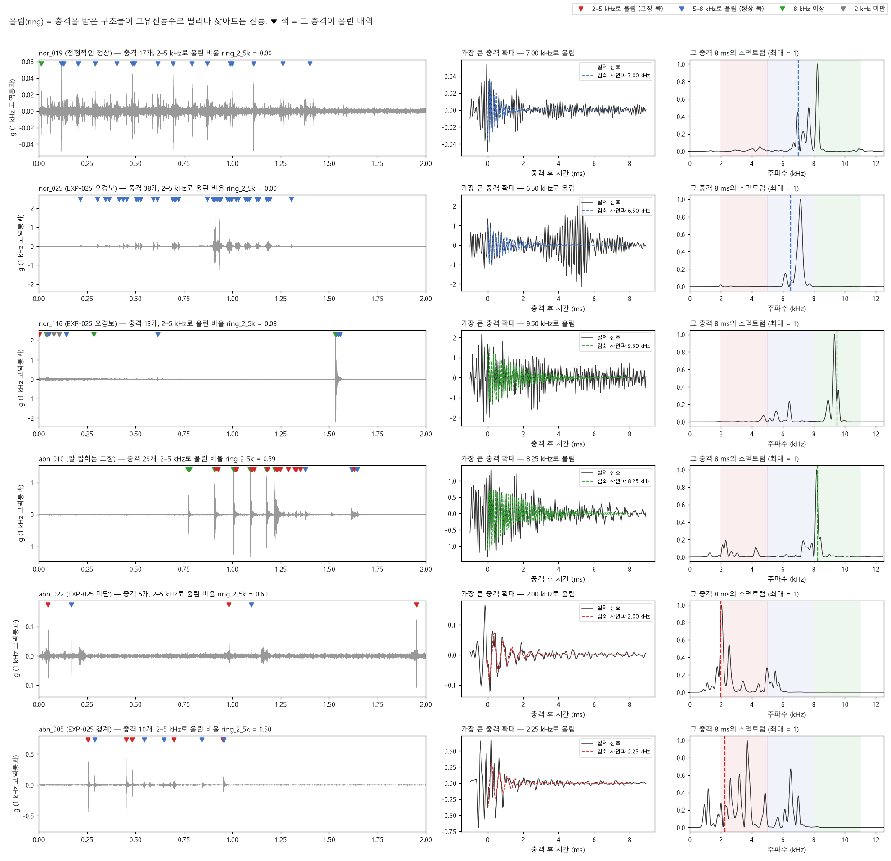
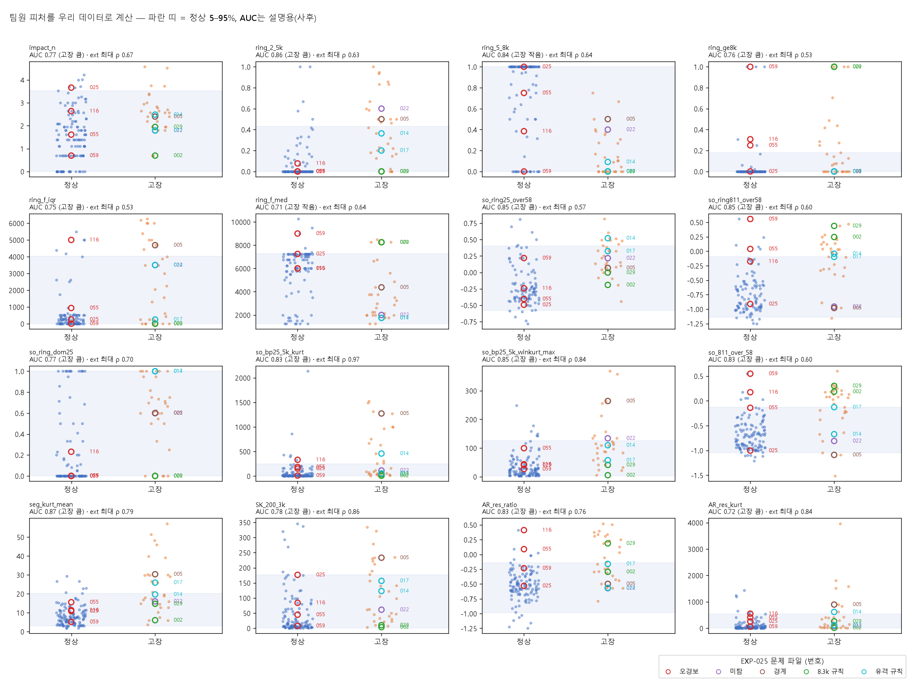

# 4-3 팀원 피처 · ext150 중복 지도

상태: 1차 (2026-11-16), 사용자 확인 대기. 실험(EXP) 아님. 모델 학습 없이 그림·표만
코드 [run.py](run.py) · 수치 [figs/summary.txt](figs/summary.txt) · 파일별 값 [figs/teammate_features.csv](figs/teammate_features.csv) · 문제 파일 백분위 [figs/problem_file_percentile.csv](figs/problem_file_percentile.csv)
출발점: [팀원모델_검토_1116](../../../5_모델비교/검토문서/팀원모델_검토_1116.md) A1–A4, 사용자 요청 "피처가 너무 많다. 팀원 모델에서 유의미한 피처를 뽑자"

## 결론
1. **ext150은 150개지만 실제로는 26–49덩어리다.** 순위상관 |ρ| ≥ 0.8로 묶으면 49개, 0.7로 묶으면 26개다. VIF는 150열 모두 10을 넘는다(중앙값 5,572). 가장 큰 중복은 같은 1.25 kHz 대역의 P02(대역 충격) · E01(포락선) · S01(시간축 에너지)이다. 같은 대역을 세 방식으로 재고 있다
2. **팀원 피처 중 새 정보는 "충격이 울리는 주파수" 묶음이다.** `ring_2_5k`(AUC 0.86), `so_ring25_over58`(0.85), `ring_5_8k`(0.84)는 ext150의 어떤 열과도 |ρ|가 0.64 이하다. 반대로 2.5–5 kHz 첨도(ρ 0.97), 스펙트럼 첨도(0.86), AR 잔차 첨도(0.84), 구간 첨도 최대(0.84)는 이미 ext150에 있는 정보다
3. **울림 묶음은 우리 문제 파일을 맞는 쪽으로 옮긴다.**
   - 오경보 **025**: 충격이 모두 5–8 kHz로 울린다(`ring_5_8k` = 1.0, `ring_2_5k` = 0). 전형적인 정상(노면) 충격이다. 2.5–5 kHz ÷ 5–8 kHz 비율도 정상 하위 9%다
   - 미탐 **022**와 경계 **005**: `ring_2_5k`가 0.6 · 0.5다. 정상 95% 선(0.43)보다 위에 있어 고장 쪽이다
4. **8–11 kHz 비율(`so_811_over_58` · `so_ring811_over58`)은 쓰면 안 된다.** 이 두 피처는 오경보 055 · 059 · 116을 정상 상위 5% 안으로 올린다(95–100%). 고장 쪽으로 올리는 것은 8.3 kHz 규칙이 이미 잡는 002 · 029다. 우리 8.3 kHz 규칙과 같은 정보이면서 오경보를 늘린다
5. 다음은 실험이다(EXP-034, 아래). 단변량 그림이라 ET에 넣었을 때도 같은지는 아직 모른다

## 울림(ring)이란 — 실제 파형으로 보기
**울림** = 한 번 맞은 구조물이 자기 고유진동수로 떨리다 잦아드는 진동(종을 치면 종 모양에 따라 정해진 음높이로 울리는 것과 같다). 어디를 맞았는지에 따라 울리는 주파수가 다르다.
**→ 울림 분석 전체는 EDA [2-16 충격 울림 주파수](../../../2_EDA/2-7_충격울림주파수/README.md)로 옮겼다(11-16).** 아래 그림과 코드도 그쪽에 있다

- 그림 읽는 법: 왼쪽 = 2초 파형(1 kHz 고역통과)과 충격 위치(▼ 색 = 울린 대역: 빨강 2–5 · 파랑 5–8 · 초록 8 kHz 이상), 가운데 = 가장 큰 충격 10 ms와 맞춘 감쇠 사인파, 오른쪽 = 그 충격 8 ms의 스펙트럼
- **022 · 005(우리 미탐·경계)**: 가장 큰 충격이 2.0 · 2.25 kHz의 깨끗한 감쇠 사인파로 울린다. 특히 022는 사인파가 실제 신호와 거의 겹친다. 정상 파일에서는 이런 낮은 울림이 보이지 않는다
- **019 · 025(정상)**: 충격이 모두 파랑(5–8 kHz). 025는 충격이 38개로 많지만 전부 정상 쪽 대역으로 울린다 → 우리 ET는 "충격 수·크기"로 025를 올렸지만, 울림 대역으로 보면 정상이다
- **116(정상, 오경보)**: 1.53초에 큰 타격 한 번, 9.5 kHz(초록)로 울린다 → 2–5 kHz 축으로는 정상이지만 8 kHz 이상 축으로는 고장처럼 보인다(결론 4의 이유)
- **010(고장)**: 큰 타격이 반복되고(H1′), 가장 큰 충격은 8.25 kHz(우리 8.3 kHz 모드)로 울리며 2–2.5 kHz 성분도 함께 있다
- **주의 — 울림 주파수는 근사다.** 감쇠 사인파 하나로 맞추므로, 스펙트럼 봉우리가 여러 개인 충격은 한 값으로 요약된다(019: 맞춘 값 7.0 kHz, 스펙트럼 최대 8.2 kHz / 005: 맞춘 값 2.25 kHz, 최대 3.7 kHz). 대역 RMS 비율(`so_ring25_over58`)이 이 근사에 덜 민감하다

## 방법
- 팀원 피처 16개를 보고서 정의 그대로 다시 계산했다 ([팀원모델_검토_1116](../../../5_모델비교/검토문서/팀원모델_검토_1116.md) 출처 표)
  - 신효섭: 1 kHz 고역통과 → 힐베르트 포락선(500 Hz 저역통과) → 중앙값의 6배 넘는 봉우리(5 ms 간격)를 충격으로 본다. 충격 직후 8 ms를 감쇠정현파 사전(1–12 kHz 250 Hz × 감쇠비 4개 = 180개)과 맞춰 울림 주파수를 고른다 → `ring_*`, `impact_n`. 그 밖에 `seg_kurt_mean`, `SK_200_3k`, AR(40) 백색화 잔차(`AR_res_*`)
  - 권소린: 큰 충격 20개 직후 12 ms의 대역 RMS 비(2–5k ÷ 5–8k, 8–11k ÷ 5–8k), 2–5 kHz가 가장 큰 충격 비율 → `so_ring*`. 그 밖에 2.5–5 kHz 대역통과 첨도·구간 첨도 최대, 전체 신호 8–11k ÷ 5–8k(`so_811_over_58`)
- **재현 확인**: 충격별 울림 주파수 분포가 신효섭 그림 3과 같다(정상 충격 936개 vs 보고서 932개, 고장 569개 vs 570개, 정상 7–7.5 kHz 봉우리, 고장 2–4 · 8–10 kHz) → [2-16 그림 0](../../../2_EDA/2-7_충격울림주파수/figs/2-16_0_신효섭그림3_재현.png)
- 라벨은 색·설명용 AUC에만 썼다. 대역 경계(2/5/8/11 kHz)는 팀원이 데이터를 보고 정한 값이므로 우리 기준으로는 **사후**다. AR 계수는 정상 120개 전체로 맞췄다(폴드 밖, 설명용)
- 충격이 0개인 파일 = 정상 22 · 고장 0. 이 파일들은 울림 피처가 빈칸이다(모델에 넣을 때 처리 방식을 정해야 함)

## 그림
- [1_ext150_중복지도.png](figs/1_ext150_중복지도.png): ext150 |순위상관| 군집 지도와 VIF 곡선
- 울림 주파수 그림(신효섭 그림 3 재현 · 실제 파형 · 울림 지도)은 [2-7](../../../2_EDA/2-7_충격울림주파수/README.md)으로 옮김

- 위 그림 읽는 법: 파란 점 = 정상, 주황 점 = 고장, 파란 띠 = 정상 5–95%. 동그라미 = EXP-025 문제 파일(빨강 오경보 · 보라 미탐 · 갈색 경계 · 초록/청록 = 규칙으로만 잡히는 고장). 제목의 "ext 최대 ρ"가 낮을수록 ext150에 없는 정보다
- [4_새정보_여부.png](figs/4_새정보_여부.png): 피처별 AUC와 ext150 최대 상관

## 다음 (제안, 사용자 확인 후)
**EXP-034 피처 정리 + 울림 묶음** (`스크리닝/`, `quick_cv` → 통과 시 중첩 CV)

| 구성 | ET 입력 | 확인할 것 |
|---|---|---|
| 기준 | ext150 (EXP-025 그대로) | — |
| A | ext150 + 울림 3개 (`ring_2_5k`, `ring_5_8k`, `so_ring25_over58`) | 025가 내려가고 022·005가 올라가는가 |
| B | ext 압축(|ρ| ≥ 0.8 군집마다 대표 1개 = 49개, 라벨 없이 정한 규칙) | 150 → 49로 줄여도 같은 수준인가 |
| C | B + 울림 3개 | 최종 후보 |

- 군집 대표는 라벨을 쓰지 않고 정한다(예: 군집 안 피처 id가 가장 앞선 것, 또는 군집 중심에 가장 가까운 것). 군집은 폴드 안 학습 파일로 다시 만든다
- 충격 0개 파일의 울림 피처는 "정상 쪽" 값(`ring_2_5k` = 0, 비율 = 학습 정상 중앙값)으로 채운다
- 8–11 kHz 비율 두 개는 넣지 않는다(결론 4). AR 잔차·스펙트럼 첨도·2.5–5 kHz 첨도는 이미 있는 정보라 넣지 않는다(결론 2)
- AE는 바꾸지 않는다. AE 입력은 스펙트럼 1,025칸이고 점수 하나만 내므로 VIF 문제가 없다. 신효섭 AE도 같은 구조다
