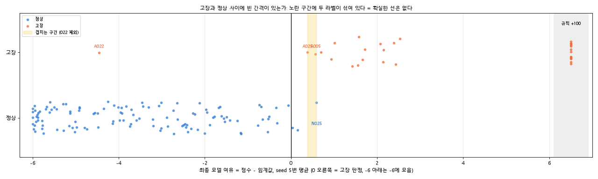
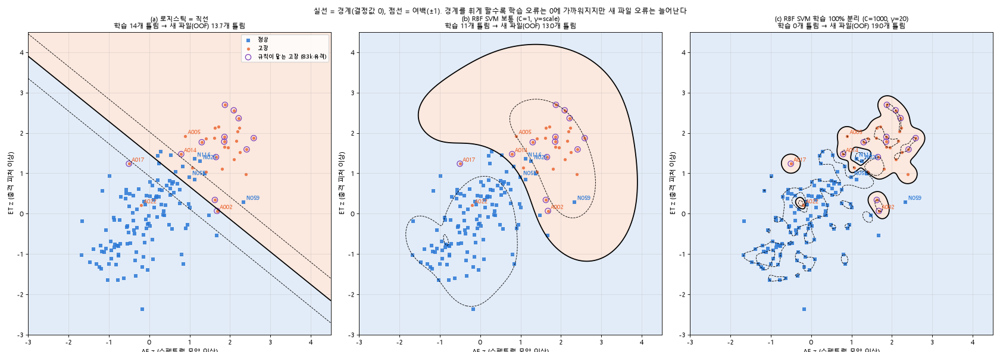

# EXP-025 README2 — 고장과 정상을 확실히 가르는 선이 있는가, 그리고 다음 할 일

상태: 논의 (2026-11-14). 그림 코드 [fig_svm.py](fig_svm.py) · 수치 [figs/svm.txt](figs/svm.txt) · 앞 문서 [README](README.md)
질문 (사용자 11-14)
1. 경계에 있는 파일은 아직 잘 모른다. 5번 돌려서 경계를 잡는 것은 과적합 아닌가
2. 다음 할 일: ① 022 잡기 ② 오경보 정상을 정상 쪽으로 끌어내리기
3. 고장과 정상을 **확실하게 가르는 선**은 없나. SVM처럼 비선형 공간으로 보내면 갈리지 않나. 그 사이 간격을 시각화하고 싶다

## 결론
- **확실한 선은 없다.** 최종 모델에서 고장과 정상이 섞이는 구간은 폭 약 0.2(여유 +0.38 ~ +0.59)로 좁고, 그 안에 파일 3개(고장 005·025, 정상 025)가 있다. 그리고 **022 하나가 정상 무리 한가운데**(−4.46)에 있다
- **비선형 경계(SVM RBF)는 이 문제를 풀지 못한다.** 경계를 휘게 할수록 학습 데이터 오류는 줄지만(14 → 11 → 0개), 새 파일 오류는 그대로이거나 늘어난다(13.7 → 13.0 → 19.0개). 022·017 같은 파일을 둘러싸는 "섬"을 그릴 뿐이다
- 병목은 **경계의 모양이 아니라 정보**다(EXP-015에서도 같은 결론). 다음 할 일은 경계 모델을 바꾸는 것이 아니라, 022와 오경보 정상을 가를 **새 정보(도메인 축)** 를 찾는 것이다

## 그림 1 — 고장과 정상 사이에 빈 간격이 있는가

**그림 읽는 법** — 가로 = 최종 모델의 여유(점수 − 그 fold 임계값)를 seed 5번 평균한 값. 0 오른쪽 = 고장 판정. 오른쪽 회색 띠 = 규칙(+100)이 잡는 고장 14개. 노란 띠 = 고장과 정상이 겹치는 구간(022 제외)

- 고장 대부분은 +1 위 또는 규칙 띠에 있고, 정상 대부분은 −1 아래에 있다. **두 무리 사이는 거의 비어 있다**
- 겹치는 곳은 두 군데뿐이다
  - **노란 띠(+0.38 ~ +0.59)**: 고장 005·025와 정상 025가 섞인다. 이 셋은 어디에 선을 그어도 하나는 틀린다
  - **022(−4.46)**: 정상 무리 깊숙이 있다. 선을 022까지 내리면 정상 수십 개가 먼저 고장이 된다
- 0선 바로 위의 정상 116·055·059(평균 +0.0 ~ +0.2)는 seed에 따라 넘었다 안 넘었다 한다 → README 해석 7의 "가끔 오경보"
- 주의: seed 5번을 평균하면 모델 5개를 평균한 것과 같아서, 한 번 돌린 결과보다 경계가 깨끗해 보인다. 실제 한 번의 판정은 README의 errors 그림처럼 더 흔들린다

## 그림 2 — 비선형 경계(SVM)로 보내면 갈리는가

**그림 읽는 법** — 기준 결합의 두 전문가 점수 평면(가로 AE z = 스펙트럼 모양 이상, 세로 ET z = 충격 피처 이상, 모든 점은 그 파일을 학습에 쓰지 않은 모델의 점수). 주황 영역 = 고장 판정, 실선 = 경계, 점선 = 여백(±1). 보라 원 = 최종 모델에서 규칙이 맡는 고장

| 경계 | 학습 데이터에서 틀림 (자기 채점) | 새 파일(5-fold OOF)에서 틀림 | 새 파일에서 자주 틀리는 고장 |
|---|---|---|---|
| (a) 로지스틱 = 직선 | 14 | **13.7** (고장 3.0 · 정상 10.7) | 002 017 022 |
| (b) RBF SVM 보통 (C=1) | 11 | 13.0 (고장 4.3 · 정상 8.7) | 002 014 017 022 025 |
| (c) RBF SVM 학습 100% 분리 (C=1000, γ=20) | **0** | **19.0** (고장 15.0 · 정상 4.0) | 002 003 004 005 009 010 011 014 017 019 020 021 022 025 029 |

(결정값 0 기준, OOF는 seed 3번 평균. 임계값을 따로 고르지 않은 단순 비교)

- **(a) 직선**: 고장 무리와 정상 무리를 대각선으로 가른다. 017(왼쪽 위)·022·002(가운데 아래)는 정상 쪽, 116·025·055는 고장 쪽에 남는다
- **(b) 보통 RBF**: 경계가 고장 무리를 감싸도록 휜다. 정상 오류는 조금 줄지만 고장 오류가 늘어 전체로는 비슷하다
- **(c) 100% 분리 RBF**: 017·022·002를 각각 감싸는 **작은 섬**을 그리고, 정상 사이사이를 파고든다. 학습 데이터는 하나도 안 틀리지만 새 파일에서는 19개를 틀린다. "모든 점을 가르는 선"은 그릴 수 있지만 **외운 선**이라 쓸 수 없다 — 이것이 과적합의 모양이다
- **비선형 매핑이 하는 일**: RBF SVM은 점들을 "다른 점과의 거리"로 이루어진 높은 차원 공간으로 보내 그곳에서 평면으로 가른다. 원래 공간에서 섞여 있는 점(022는 정상들 사이)은 거리 기반 공간에서도 정상들과 가깝다. 매핑은 **이미 있는 정보의 배치를 바꿀 뿐 새 정보를 만들지 않는다**

**참고: 규칙 축까지 한 공간에 넣으면** (quick_cv 5-fold × seed 3, 규칙 없이 모델 하나로. z는 바깥 seed 0 분할의 OOF를 고정 입력으로 써 약한 누수가 있음 → 비교용)

| 입력 공간 | 로지스틱 PR-AUC | RBF SVM PR-AUC | 022 위험 (로지·SVM) |
|---|---|---|---|
| z 2축 | 0.921 | 0.891 | 0.53 · 0.97 |
| z 2축 + 규칙 축 4개 (r, 2위/1위, 8.3k 돌출·폭) | **0.945** | **0.945** | 0.53 · 0.72 |
| (최종 EXP-025: 결합 + 규칙 두 개) | 0.973 | | 022 놓침 5/5 |

- 같은 정보를 넣으면 **선형과 비선형이 같은 점수**(0.945)다. 점수를 올린 것은 경계 모양이 아니라 규칙 축이라는 **정보**였다
- 022는 어느 공간·어느 경계에서도 정상 절반 이상보다 아래다(위험 0.53–0.97)

## 질문 1 — "5번 돌려서 경계를 잡는 것은 과적합인가"
- **아니다.** 5번(seed 0–4)은 **평가를 반복**한 것이다. 각 회차에서 임계값은 그 회차의 학습 파일만으로 고르고, 시험 파일은 보지 않는다. 5번 돌린 결과로 경계를 정하지 않는다
- 최종 제출 모델은 150개 전체로 **한 번** 학습하고, 임계값도 같은 방식(학습 데이터 안쪽 CV로 F2 최대)으로 **하나** 정한다. val·test를 보고 바꾸지 않는다
- 과적합 위험이 실제로 있는 곳은 따로 있다: **사람이 라벨을 보고 정한 것들**이다
  - 8.3 kHz 대역·돌출 0.75·폭 150 Hz (EXP-021)
  - r = 2 · 2위/1위 = 0.7 · 축 K1·K2 자체 (EXP-025)
  - 이 값들은 CV 바깥에서 정했으므로 F2 0.942에 그 낙관이 들어 있다. 그림 2 (c)처럼 "몇 개 파일을 위해 선을 휘게" 하는 일을 사람이 손으로 한 셈이라, 같은 일을 더 하는 것(022만을 위한 축·문턱)은 피해야 한다

## 다음 할 일 (제안, 우선순위)

| 순서 | 할 일 | 대상 | 방법 | 과적합 위험 |
|---|---|---|---|---|
| 1 | **오경보 정상 끌어내리기** | 025 · 116 · 055 (큰 사건 한 번, N-A형) | 2-11 1순위 "가장 큰 사건(±10 ms)을 가린 Peak·파고율"을 **연속 입력**으로 결합에 추가. 이 셋은 2위/1위가 0.05–0.16이라 "단발"이 분명하다 | 낮음: 정의가 라벨 무관(8σ, ±10 ms 고정), 문턱 없이 모델이 가중을 배운다 |
| 2 | **022 확인 (시간 제한)** | 022 | EDA 한 번. 1-3에서 022는 L2 "저주파 출렁임 + 고주파 충격 복합형"으로 분류됐다. 이미 실패한 것: H4 저주파 동기(EXP-016), 유격 반복(r 1.31). 볼 것: 출렁임 정점 근처에서만 나는 작은 충격의 고역통과 첨도 등 **라벨 없이 정의되는 축**이 있는가 | 높음: 파일 하나. 축이 안 나오면 "현재 정보로 구분 불가"로 기록하고 넘어간다 |
| 3 | 규칙 문턱 견고성 (EXP) | 8.3k 규칙, 유격 규칙 | 문턱을 ±10–20% 흔들어 중첩 F2가 유지되는지 | 없음 (확인용). 0.7 근처에서만 좋으면 사후 문턱 과적합의 신호 |
| 4 | 최종 고정 → 전체 학습 → val 예측 | — | 7단계 파이프라인. 11/19 val 공개 전 | — |

- 059(조용한 6–8 kHz형, N-B)는 1번 축의 대상이 아니다. 2-10·2-11에서 AE 오차가 6–8 kHz에 몰리는 파일로 확인했지만, 대역을 고르면 사후 대역이 된다 → 지금은 둔다
- 경계 모델 교체(SVM, 비선형 매핑)는 **하지 않는다.** 위 그림 2와 EXP-015가 근거

## 한계
- 그림 1의 여유는 seed 평균이라 실제 한 번의 판정보다 깨끗해 보인다
- 그림 2의 오류 수는 결정값 0 기준이라 실제 평가(임계값을 안쪽 CV로 고름)와 다르다. 경계 모양 비교용이다
- 참고 quick_cv는 z를 고정 입력으로 써 약한 누수가 있다. 정식 비교는 EXP-015(중첩 경로)를 따른다
